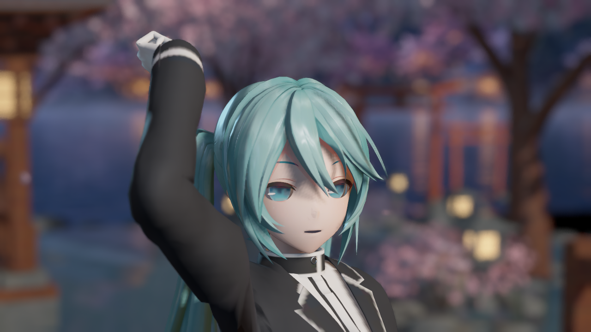

# 修改记录

每批功能、修复和资源调整在这里追加日期、具体变化、验证结果及必要限制。渲染改动同时链接实际引擎截图；截图捕获日期和文档归档日期分别记录。

## 2026-10-15 — v9：双层暗部、二维RS与主辅光分工

- 修正“接入原生光照但体积仍弱”的具体简化：Cloth/Hair恢复RD(NoF)、双层暗部和背光坐标；Skin增加参考视角染色，Cloth/Skin主光高光恢复日间观察方向偏置。AO无材质载荷时明确取1，皮肤LUT仍未接入。
- 原固定V高光切片改成真实Cloth04/Hair09的32×8二维重采样，使用现有Profile RGB槽，不新增RT；四点Load避免跨行串色，RD.A仍独立连续保存。缓存算法3覆盖尺寸与数据，atlas低于256整份副本恢复原曲线/Mode0并提示。低分辨率不冒充完整二维数据，增量内存/采样成本未测。
- 使用当前View已绑定的ForwardLightStruct识别主平行光，完整NPR暗底只由主光提供，附加灯使用无暗底Lambert与原生阴影。Generic的连续ramp修复NoL约.1即封顶；Hair高光独立柱面化。传统聚簇局部灯接口同步，矩形灯高光保留UE GGX/LTC兜底。同向平行光可能同时匹配，未增加跨帧缓存；原生GI/反射合成位置不变。
- 二维RGB布局变更同步升级后端/Cooked协议至9，Skin payload仍v4。Editor build3、Game game-build2和generate9b的12包/四材质编译通过；volume9b实拍34图/156槽，低分辨率Mode2/Mode0各8图/78槽，合计50图/312槽/0失败。四类灯原生遮挡及GI/高光开关已出图；新旧Unlit对照逐像素一致。原图、来源、失败重试与限制见[本批归档](Screenshots/2026-10-15-endfield-volume/README.md)。
- 保护范围2,378项中2,375保持，仅三个自有V2包有意变化；用户Face、安装引擎、Config及既有未提交工作未改。本批没有重跑v9完整Cook/BuildPlugin或fmt0聚簇GPU实拍；不沿用v8结果宣称新版本已发行验收。皮肤LUT、独立球面Hair高光法线、双波瓣、眼睛分层、Rim与完整后处理仍待完成，终末地画质尚未验收。

## 2026-10-15 — 公开复刻核对、v8 分发门控、底色描边与新角色验证

- 核查四个公开复刻仓库，固定 90 个源码／配置文件快照。MyZmdShaders `6507457` 与 Morgana `40c9229` 未发现明确源码许可证，congyu `2634c57` 为 MIT，blurfeng UE 工程 `c5be997` 为 GPL-3.0；没有将这些仓库的代码、模型或贴图直接搬入发行包。源码核对确认各方案都有范围与依赖限制，不能把展示视频或单个 shader 当作完整复刻。新增[流程与来源审计](ENDFIELD_REPRODUCTION_REFERENCE_AUDIT.md)，按材质、逐灯、单次屏幕效果、几何分层和后处理继续对应本插件架构；完整十项目标不变。
- 原生后端推进到 v8：生成副本写入协议 8，专用 GlobalShader 从实际编译参数反射记录协议，并通过 `LAYOUT_FIELD` 保存。Cooked 启动在 `OnPostEngineInit` 检查已加载 shader 的序列化协议后才允许 Profile 标记；同 v8 普通 Cook 应记录 0，启动参数不能单独授权。模块编译协议代替启动时读取私有 CustomOutput C++ 文件，支持移除该源码后的独立宿主验证。该字段只说明一份 GlobalShader 的编译来源，不代表全部材质内核或 GPU 已验证；完全缺少新增 shader 的旧 Cook 可能被 UE 提前拒绝，必须重新 Cook。引擎版本仍限定 UE 5.8.3 CL58210709，安装引擎文件不写入。
- 新增专用 `M_MMD_EndfieldV2_Outline`：从当前槽底图与 BaseColor 派生边线颜色，按部位控制亮度、饱和度；复用 PMX 边线开关、EdgeSize、顶点 EdgeScale、EdgeColor.A、骨骼 Overlay／WPO 和恢复链路。遮罩／透明槽读取表面 alpha 覆盖，避免透明区域留下实心边，Opacity 只乘一次。保留白图／白色兜底，旧预设未配置新父材质时保持原行为，不覆盖用户修改中的旧 Outline。生成白名单增至 12 个自有资产，四份父材质均参与真实 shader map 编译。
- 探针新增 `-SampleManifest` 严格指定 Saved 导入样本，失败不回退旧角色；`-PoseTime=-1` 强制参考姿势；`-FitSampleCamera` 让 full 机位按当前模型包围球取安全距离。换用仓库已有 YYB Hatsune Miku 16th 带翼款，导入 610,819 顶点、997,023 三角形、39 材质、550 骨骼、71 Morph，角色资产仅放 Saved。通用词表补 `clothes`，`clothes01..07` 七槽正确进入 Cloth；全模型 Cloth 共 14 槽。body、耳机和 wing 保留 Generic，不凭名称判定金属，本模型未覆盖 Metal 分路。
- 最终 Editor `build4`、Game `game-build2` 通过；`generate1` 完成自有资产生成与编译。旧 Librarian 样本 `outline2` 为 24 图／70 次槽检查、0 失败。新 16th 样本 `yyb16-final2` 为 24 图／78 次槽检查、0 失败，`yyb16-final0` 为 8 图／78 次槽检查、0 失败；八个共有机位的相机位置与 FOV、环境设置记录全部一致。Mode0 是同一 V2 材质中的原生 Toon 对照，不是旧 Unlit。归档五张[2026-10-15 角色原图及来源](Screenshots/2026-10-15-endfield-distribution/README.md)和两张Cooked诊断原图，PNG原字节不改；报告、输入PMX、清单与原图SHA256随归档记录。
- 独立 `BuildPlugin` 暴露此前被间接 include 掩盖的依赖，已对9个文件补最小头文件声明／包含，未改对应算法。`EF8e` 的Editor Development、Game Development、Shipping和发行文件检查通过；过滤测试角色／动作，收录Bullet头/四库、文档和脚本，声明当前仅Win64。修正空RHI格式覆写后，SM6空白宿主移出私有CustomOutput cpp仍实际编译四父材质30/54/48/40 shaders，协议8、0错误；不将AdapterOnly称为模型绘制或额外C++消费者工程验证。详见[插件分发验证](ENDFIELD_PLUGIN_DISTRIBUTION.md)。
- `package-v8b`与`package-vanilla-v8`均完成完整SM6-only Cook/Stage/Pak/Archive，实际程序SHA相同。正Cook在运行时读协议8；普通Cook即使请求Mode2仍协议0、禁止标记、0重绑并成功回退原生。正Cook正常响应与Skin packed开/关绿红实拍通过，12/12 Profile、2/2 Skin，外部像素检查仅证指定路径，CPU报告GPU字段保持false；[Cooked来源](Screenshots/2026-10-15-endfield-distribution/COOKED_VALIDATION.md)。带RenderDoc自动附加的两次首帧失败留档，其中RHIThread栈首为renderdoc.dll；仅CLI禁用捕获插件后正常/两诊断/普通Cook四次成功，用户Config不改，不宣称一般稳定性已验收。13个工具测试包与清单移回Saved，不提交测试Content。
- 最后以修正后的完整脚本重跑`EF8f`，三配置BuildPlugin、文件过滤、私有cpp缺失宿主、四父材质编译和协议严格检查全部通过；[最终报告来源](Screenshots/2026-10-15-endfield-distribution/distribution-sources.json)。源码、shader和资源未因文档整理再次变更，没有扩大为全角色或一般稳定性验收。
- 2,378 项保护基线中仅两个自有 V2 包按计划变化，其余 2,376 项不变，意外变化为 0；新 Outline 为另加的自有资产。保留既有用户工作，不提交 Saved、构建产物或测试角色。此次新角色只验证参考姿势，VMD 有 196 条不匹配轨道警告，导入数量不证明动画／Morph 已运行。白布和翅膀层次仍偏平，头发完整响应、皮肤 SSS、眼睛分层、深度 Rim、后处理与动态材质颜色同步仍待迭代。**运行检查和图片数量不代替终末地画质验收。**

## 2026-10-14 — 脸部独立方向、真实 RD／RS 与材质响应迭代

- 沿用用户认可的原生后端推进画质：图版本4、适配器v6新增专用材质CustomOutput和真实packed export/read。单Toon Skin的Mode2/adaptive fmt1把完整头空间漫反射方向及头部旋转传到逐灯BSDF；原生Normal独立用于高光/GI。复用Pattern24和预留anisotropy32，ProfileID/底色/粗糙度保持；单basis、24 bytes实际/请求预算、简化、格式、真实anisotropy及非中性UV均有门控。原生零anisotropy可跳过extra word，新通道实际会写／读此word，未测性能。
- 旧V3固定俯角阈值不是真正遮挡SDF，无法表示非连续亮区，也会污染共享高光法线。本轮V4改为完整头空间几何方向，保留UV0，按各texel分别解oct/离散镜像后插值；复杂冲突回退。新DirectionTexture/Version字段与旧阈值严格隔离，不覆盖旧SDF或用户纹理。重烘5槽共29,042有效texel，主脸15,748有效／15,555镜像／85冲突；noncontinuous统计仅作诊断，不再截断方向。方向场目前只随头骨刚性旋转，Morph/下颌修正待补。
- Skin/Hair/Cloth接完整256点客户端RD：alpha混明暗、RGB作chroma tint并保亮度；移除三档先量化，再与当前原生遮挡混合。保留无LUT影色派生、`.96` diffuse、`.04×specular` F0和GGX波瓣幅度；头发加入几何竖向切线主波瓣、水平投影edge fade，scalar代P.g。Skin代表样本禁用RS；Hair09/Cloth04真实RS暂取固定V=.5/.696相邻两行。各源字节与参数纳入缓存签名；Mode0/1恢复源曲线，Cook载体保持源RGB。Mode2明确拒绝UnifiedDiffuse=1，避免后段重复解释RD。
- Editor最终build4、Game最终game-build2通过；generate2只写11个允许包，实际3材质shader21/40/29且无fallback。fidelity2的45图/210槽、修正临时mask绑定后的fidelity3的26图/140槽均0失败；含多仰角、±35°组件旋转、三灯、平行/点/聚/矩形原生遮挡及GI。packed逐灯开/关诊断显示绿/红；V4GPU覆盖白/黑可见。关闭直射漫反射后方向开关的脸区均差.113/255、95%≤1，没有旧共享法线明显漂移，不声称逐像素无时序差。
- Mode0和后端关闭各8图/70槽通过；同新资产下脸/头发/衣料/全景均差.116/.089/.048/.005（0–255）。fmt0普通与聚簇各11图/70槽通过，仍无新脸部payload但共享RD/RS语义。新版与负对照合计109图/630槽0失败，图片数量不是画质验收。安装引擎shader、Config、用户Face及所有非本轮Content保持；2,378项保护基线中仅5个自有V2包有意变化，其余2,373不变。仅归档8张[实际原图与来源](Screenshots/2026-10-14-endfield-fidelity/README.md)及数据流SVG，不提交Saved、构建或测试角色。原用户/Claude资产与Mobile文档保留。
- 冷编译/探针失败留档：generate1主动停止补Legacy响应；fidelity1将新增C++签名路径误作shader路径，出图前终止，后续按插件物理源码路径校验修复。fidelity2临时mask材质受生产路径门控而未绑定V4，不能用该图证明采样；fidelity3已显式绑定诊断并重跑，没有修改生产门控来放宽检查。
- **限制**：这是有实际改善的开发迭代，侧光鼻/脸颊硬条块减少，仍不是最终终末地验收。没有关闭整角色普通投影；原RT后台开销仍在。本轮未重新Cook/验证发行包，不能沿用v4结果。完整二维RS/Skin LUT、头发独立高光法线与第二波瓣/体积、眼部Matcap分层、真实深度rim/底色描边、后处理及Morph继续按既定十项清单推进。

## 2026-10-14 — 原生着色入门图解与维护说明

- 新增[入门与维护指南](ENDFIELD_NATIVE_RENDERING_GUIDE.md)，用三版方案职责图、同材质直射／间接流程图和两张既有打包实拍，解释为什么接管光照方程、哪些原生数据仍由 UE 计算，以及改明暗／高光、GI、脸部数据、Profile、引擎适配和旧 RT 的具体文件入口。示意图为可维护 SVG；实拍沿用 2026-10-14 的原始归档，不生成目标效果图。
- 明确新后端不依赖旧阴影／灯光 RT，但旧系统仍在后台提交四级阴影深度 pass 与 RT 更新；尚未按材质需求停用或测得性能收益。原生 ID／GBuffer 格式保持，独立高光法线及正式 face payload 仍待补齐。
- 补充时序说明：逐灯入口直接使用当前光照 pass 的参数，不新增 RT 跨帧等待；Lumen 历史累积、VSM 有效缓存和原有线程流水线仍保留，不能声称所有结果均每帧从零重算。
- 增加管线位置图，标注 A 材质 BasePass、B RenderLights 内逐灯响应、C DiffuseIndirectComposite、D 可选 ReflectionEnvironment 的具体函数和计算边界；核对本机 UE 的早／晚 GI 调度，说明异步计算及现有 pass 内嵌入口，不把所有 GI 合成误画成固定串行顺序。
- 本批只新增图文与交付记录，没有重新运行 UE 或修改着色逻辑；沿用同日已完成的编译／Editor／Cook／打包验证。检查本地文档与源码链接、SVG 渲染和截图来源，提交范围包含终末地实现及必要承接依赖；既有旧舞台资产和 Mobile 文档保留在工作区，不上传 Saved／构建产物／测试角色。

## 2026-10-14 — 插件原生 BSDF 后端、阴影／GI 与实际发行验证

- 按用户授权实现类似自定义 ShadingModel 的插件入口：限定 UE5.8.3 / CL58210709，完整镜像 Private shader 到工程 Intermediate，通过目录映射适配五个入口；安装引擎源文件不写入。精确源 hash、锚点与版本保护，缓存签名覆盖原树、插件 ush 和最终适配源码，按签名原子发布。没有新增 ShadingModel ID 或修改原生材质缓冲布局，后端默认关闭。
- 自有 struct `.ush` 接逐灯光 BSDFContext、完整原生 ShadowTerms、AreaLight，以及50项灯光／阴影输入；补传统聚簇路径与 adaptive／传统 GI、独立反射最终合成入口。只对双签名 Endfield Profile 生效；模式及 GI 倍率写瞬态 Profile alpha，源 RGB 和资产保持，支持同一 Cook 运行时切换。模式0透传、1阴影诊断、2三档原型；正式独立高光法线尚未接通。
- Editor build8、Game game-build3 实际构建通过。r3–r8 各11图／70次槽检查，v4 r11 传统 GBuffer=0／聚簇开启另11图／70槽，全计77图／490槽通过；三种绘制材质 shader 为21／40／29，无默认／代理 fallback。VSM 下平行、点、聚光、矩形灯的 clear／blocked 遮挡均已实际出图。模式0对关闭后端间接脸视图平均RGB差0.0429（0–255），不称逐像素完全一致。
- r9 与关闭后端的 r10 在相同 VS／PS hash 处失败，核对为 Substrate tile VS 与传统聚簇 PS 语义不匹配；v4 仅改工程副本接口，r11 实跑通过。最初内存不足、移动宏条件／实验白名单和r2中断均保留原记录。首次 Cook 因编辑器资源过滤失败，第二次 Cook 成功后 Zen staging 记录404，最终命令行 SkipZenStore 的 package3 完整 Cook／Stage／Pak／Archive exit0；package4 将最新 Game 二进制重新 Stage，SHA256 与本地构建相同。
- 最终相同 Cook 的 final0/1/2/6/7 五次后台 D3D12 SM6 打包游戏均 exit0：12／12专属槽重绑并匹配控制，第120帧1280×720实拍、第160帧报告。阴影诊断、间接漫反射归零、间接镜面归零对模式2全图平均RGB差8.1818／7.5538／5.1399；同模式重复差0.4027。Cook来源加实际变化证明本批内核已消费运行时控制，CPU报告单独不宣称内核验证。首次game0第1帧0xc0000374无调用栈，原因未定位；同命令game0r与final0成功，保留失败，不宣称修复。
- 代表实际截图与来源见[本日归档](Screenshots/2026-10-14-endfield-native-backend/README.md)，机制见[后端说明](ENDFIELD_NATIVE_BACKEND.md)。全部安装引擎shader、原工程／插件Content、Config与用户Face共2,378项SHA256保持；13个专用测试包和manifest移到Saved备份，无前台窗口、无默认配置更改、未提交／推送。既有用户／Claude工作区修改保留。
- **限制**：这是原生后端完成，不是终末地画质验收；仍需正式逐像素face／SDF／独立高光法线payload，修SDF Version3侧向错误及自阴影策略，继续真实ramp、头发、眼睛、rim、描边与后处理。原生灯光剔除／早退仍生效，未接BRDF加权前的天空／capture辐射、非零独立SSR；固定私有接口不保证跨版本兼容。未验证CSM、移动端、Cook后的骨骼/Morph、SDF或透明发片，未测性能。

## 2026-10-13 — 自动 SDF 接通、ush 收敛与接触阴影修复

- 公共计算移入 `Core/TMMDEndfieldNative.ush` 的 struct 成员函数，一个 Custom 输出法线、PatternUV、脸部 mask 和可选投影覆盖率；材质图保留必要输入与原生 Toon。共享线性 offset gradient 随插件保存，避免每模型创建 Profile 和堆叠连线。图指纹纳入 ush 源码、额外输出与纹理配置。
- SDF 改成三角形 UV 栅格化；头部基与运行时对齐，R/G 独立左右角阈值。Version3 仅对几何镜像、阈值互换和侧向一致的共 UV 标记 B，运行时按实际几何侧解码而不翻 UV；复杂冲突 A=0 回退。修正 RGBA/BGRA 交换、角度范围及完整纹理包路径，纹理线性无损、无 mip。
- 同步/异步 PMX 导入完成后自动烘焙并将按槽数据保存在网格 AssetUserData；应用预设时自动绑定，分类切换与恢复支持 native/旧回退。新增 `MMDEndfieldBindSdf` 供已有网格生成或只读校验。派生纹理具有版本标记，同名非工具资产采用新名称保留；重烘无覆盖会清掉旧缓存。
- 按用户要求排查自阴影：同姿态对照确认鼻灰点来自接触阴影。V2 默认关闭角色接触阴影，保留普通投影与外部遮挡，恢复材质时恢复原开关。保留 masked ShadowPassSwitch 的脸面投影抑制选项，默认 0；启用会同时影响脸面对身体/场景的投影，不是仅关闭自身接收。
- UE5.8.3 后台构建最终 `build13` 通过；`generate4` 白名单写入 11 个包。p17 重新保存 Version3 夹具：29 图、140 次槽检查、0 失败；5 槽共 29,472 个有效 texel。主脸槽 15,777 有效、15,510 镜像、56 冲突；GPU mask 已自行看图。p18 在 Substrate=0 独立回读保存夹具，12 图、105 次槽检查、0 失败，包含 SDF 绑定/解绑、角色切换与接触开关恢复。
- 最终 `verify3` 原生资产只读回读通过、写包列表为空；p19 在 Substrate=1 独立回读 Version3，14 图、140 次槽检查、0 失败，接触阴影恢复通过。实际 Cook/打包与更多模型尚未验证。
- 早期 p13/p14 的 Version2 镜像冲突遮罩过窄，已由 p17 修正；p16 保存已有夹具包时报部分加载错误，已改为先加载完整包再重烘，并由 p17 成功重跑。失败日志保留 Saved。渲染日志有 Non-Nanite VSM marking queue 溢出警告，尚需性能审查。
- 代表实拍和来源见[本批归档](Screenshots/2026-10-13-endfield-sdf-contact/README.md)。原有 598 项保护范围仅两个 Endfield shader 为本批有意修改，其余 596 项保持接手哈希；用户 Face、引擎和项目默认配置未改。未提交/推送，不归档 Saved、构建或测试角色资产。完整终末地目标仍未完成，真实 ramp/头发/眼睛/rim/描边/后处理继续保留在既定清单。

## 2026-10-13 — 重新核对 Claude 原会话，恢复完整终末地复刻范围

- 按用户要求读取本机 Claude Code 原会话，核对已定十项考虑清单；目标持续为本机真实终末地，自动 SDF 已获用户再次确认。修正交接与渲染文档，把原生 Toon 接入定位为基础设施，把球面法线 + 自动 SDF、真实 ramp、头发高光环、材质/眼部分路、深度 rim、底色驱动描边、打光与后处理恢复为完整实施范围。
- 只读核查当前源码：新 V2 没有消费 SDF/真实 ramp 或接深度 rim/眼部分层，旧烘焙工具也未完成自动绑定；不能宣称 SDF 已在当前 V2 出图中生效。不再因旧通用性约定排除用户批准的自动派生 SDF；仍保留单 base_color 兜底。
- 本批仅修正文档与任务范围，未修改 shader/材质/引擎/配置、未运行 UE、无新截图、未提交/推送；原会话提取和只读审查材料保留 Saved，不归档原始私人会话。

## 2026-10-13 — 终末地 V2 原生 Toon 接入与灰模修复（画质未验收）

- 定位灰模为 UE5.8 `PostEditChange(None)` 没有主动编译绘制 shader；新增显式预编译并恢复 success/finalized/shader_count 严格检查。修复探针多实验逗号解析，新增保存预设、渲染代理和角色切换/恢复验证。
- 新增 `MMDEndfieldToonPresets` 生成器，白名单保存三种原生 Toon 父材质、六个共享 Profile 与独立 `DA_Render_EndfieldV2`，全部 Profile 禁用 offset/hatching 贴图；球面法线默认关闭并仅影响有效头部范围。半透明接 Coverage Weight 与每像素前向光照。没有改引擎、用户 Face、旧 shader 或项目默认 Substrate 开关。
- 运行时按 Substrate 能力与新父材质选择原生/旧回退；MID 在复制源输入之前刷新 Profile。部位分类更改只重建仍由预设持有的那个槽，保留源快照和其他用户覆盖。新增字段缺省时，旧预设沿用原行为。
- UE5.8.3 / CL58210709 后台真实构建、十资产保存与最终 `verify2` 回读通过，三材质绘制 shader 为 21/40/29；回读没有写包。`p12` 原生 53 图 / 0 失败、`p11` 关闭 Substrate 回退 9 图 / 0 失败，三组各35槽无默认材质/代理回退；角色 Profile/粗糙度切换、贴图保留、其他槽保留和恢复全部通过。两个旧静态检查器及 diff 空白检查通过。
- 归档[四张本日实际引擎图与来源](Screenshots/2026-10-13-endfield-native-v2/README.md)：原生全景/脸/发与未采用的 UnifiedDiffuse=1 过暗对照。默认采用 UnifiedDiffuse=0；原有598个 Content/shader/Config 文件与接手时哈希相同，未还原既有工作区改动，未提交/推送。
- **限制**：鼻部灰点、天使环、布料层次和后处理尚未达标；本机 Toon 节点不消费自定义 Tangent，移除无效控制。天空/自阴影/场景遮挡响应明确，GI 变化接近时序噪声，不能宣称完整 Lumen GI 验证；主视图、Cook、打包及移动端未验证。首次 `verify` 的曲线临时句柄误报与 `p9` 的代理输出未初始化误报均保留原失败报告，修复后已重新验证；不把检查通过写成视觉验收。

## 2026-10-13 — 终末地预设接入真实引擎截图（旧 Unlit，已被用户否决）

- `MMDStagePresetsCommandlet.cpp` 新增只读开关 `-EndfieldCapture`：在既有七套预设与四套对比流程**之外**单开一条分支，加载 `/Ue5MMDTools/Stages/Presets/Endfield/DA_Render_Endfield` 与三套 `M_MMD_Endfield_*` 父材质，把它们并入原有 `CapturePreset(...)` 截图流程。**不改动** `Definitions[]`、`SourcePresetIndices`、`ReferenceFamilyFor` 与预设绑定校验，旧七套行为逐字不变（选独立分支而非追加条目，正是为了避开这些耦合）。
- 新增内容仅三处：`EndfieldCaptureDefinition` + 路径常量（匿名命名空间）、`EndfieldCaptureLoadBundle()`（只读加载并校验预设确实绑定新父材质）、`Main()` 内 4 段小改动（解析开关、编译等待队列并入新父材质、跳过旧循环与对比、单跑终末地捕获）。helper 一律带 `EndfieldCapture` 前缀以规避本模块 unity build 撞名史。
- 编译：`Result: Succeeded`（`Saved/EndfieldValidation/endfield_capture_build.log`，37.4s）。截图：12 张 PNG 全部产出且非空非黑，整组 `passed: true`。真实绑定已核对（`Hair01 → M_MMD_Endfield_Masked`、`Hair02 → M_MMD_Endfield_Opaque`），环境光响应 22.99 vs 全关 0.05，178 刚体 / 337 骨骼变化。归档[实拍截图与说明](Screenshots/2026-10-13-endfield-preset/README.md)。
- 回归：旧七套 + 四套对比 `-Screenshots` 实跑 **57/57 通过、11 组全过**（`Saved/EndfieldValidation/regress-seven-screenshots.json`）；`-Generate` 实跑 50/50。
- **限制**：本次 `-Generate` 会重写旧七套预设，其中 `SakuraTheater` 因共享 `References.Families[2]` 被终末地生成器改绑 `M_MMD_Endfield_*` 而一度失败，重跑 `-Generate` 后恢复（`DA_Render_Endfield.uasset` 前后逐字节一致，未被回归运行改动）。未修改 `Shaders/` 下任何 `.usf/.ush`，未改引擎文件，未提交/推送。

## 2026-10-12 — 终末地渲染重写与正式预设入库（未编译、未验收）

- 按用户要求复刻终末地人物渲染，**依据改用本机真实逆向数据**而非网上逐步复刻教程：`Saved/Phase2Reference/StaticProbe/CharacterShaderMetadata/` 的真实属性表（`HGRP/CharacterNPR` 256 项、`_Skin` 131、`_Hair` 115、`_Eye` 78）、`StaticProbe/EndfieldBytecodeSamples/` 反编译 HLSL，以及 `Tooling/EndfieldCharacterRendering-public-code/`（完整 URP 光照库 980 行）与 `Tooling/Endfield-MME-public-code/`。反编译 HLSL 的 DXC 重编译未通过，仅作结构参考，不称原版等价复刻。
- 新增 `Shaders/Core/TMMDEndfieldLighting.ush`（21 个成员函数）与 `Shaders/TMMDShader/TMMDEndfieldCharacter.usf`（64 个输出形参 / 57 个材质输入）。按真实做法实现：`sigmoidSharp` 硬阈值三段阴影取 min、脸部 SDF 方位角阈值（按光照侧镜像 U）、`GetEquirectTangent` 等距柱面切线各向异性、屏幕空间深度壳轮廓光、脸部球面法线高光、JGT 透散（默认关，与原版一致）。
- 两处有意不照抄参考工程：其 `DepthRim` 写作 `clamp(0.0, 5.0, x)`，HLSL 语义为 `clamp(x,min,max)`，该写法结果恒为 0，已按正确语义修正；场景深度改为材质侧显式 Texture 输入——引擎 `SceneTexturesStruct` 只在 translucent 基 pass 被 `#define` 重定向，opaque/masked 下直接调 `CalcSceneDepth` 无法编译。
- 新增脸部 SDF 自动烘焙（`Public/Editor/MMDEndfieldFaceSdfBaker.h`、对应 cpp、`-run=MMDEndfieldBakeSdf`）。从 LOD0 顶点法线/UV + 头部基烘出逐 texel 角度阈值，头部基优先取 `Head` 骨参考姿势、无骨骼退包围盒并在报告标注 `head_frame_source`，识别不到脸部 texel 时拒绝写空白图。用户确认"能自动化生成就没问题"，因此 SDF 成为可再生派生资产而非手绘配套贴图。
- 新增 `-run=MMDEndfieldPresets` 生成器（`MMDEndfieldPresetsCommandlet.cpp/.h`），从零构建 57 输入材质图，把三套父材质与预设**正式写入插件 Content**：`/Ue5MMDTools/Stages/Materials/Endfield/M_MMD_Endfield_{Opaque|Masked|Translucent}` 与 `/Ue5MMDTools/Stages/Presets/Endfield/DA_Render_Endfield`。与旧 `MMDEndfieldPhase2` 的区别是资产随插件分发、打开即可用，而非只留在 Saved 私有目录。写入范围严格限定四个白名单包。
- 通用性铁律保持：SDF/Ramp/场景深度均为可选输入并有开关（`UseSdfMap`/`UseRampMap`/`UseSceneDepthRim` 默认 0），未连接时分别回退半兰伯特硬化阴影、解析式两段 toon 曲线、几何菲涅耳轮廓，只连一张 base_color 仍可完整着色。`MMDToonLighting.ush`、`TMMDAnimeFace.usf`、`TMMDReferenceBRDF.ush` 等文件 SHA256 与冻结值一致，未修改；旧 Phase2 文件保留未删。
- 新增两个静态检查器（`Scripts/validate_endfield_shaders.py`、`Scripts/validate_endfield_sources.py`）与端到端脚本（`Scripts/Invoke-EndfieldPresets.ps1`）。检查器已捕获两个真实编译级错误：UE 自动采样器名为「输入名 + `Sampler`」（`light_data_texSampler`，写成 `_sampler` 会失败）；`UMaterialExpressionTextureObjectParameter::Texture` 是 `UTexture*` 而非 `UTexture2D*`。另做输入名/顺序逐一对照、白名单一致性、签名覆盖完整性检查。
- **限制（重要）**：沙箱为 Linux，UE 二进制为 Windows `.exe`（`Exec format error`，无 wine），**本批未编译、未运行、无截图**，全部结论仅来自静态检查——静态检查不证明可编译，更不证明画面达标。眼球分层（真实 `_EyeHighLight`/`_EyeScatteringColor`/视差）与 `EyeThrough`/`BrowOverlay`/`HairShadow`/描边未实现；参数取真实默认值，未针对插件 Miku 夹具调优。详细实现依据、取舍与未完成项见[终末地渲染记录](ENDFIELD_RENDERING.md)。
- 本批未修改引擎文件、未发布主 Content 资产、未运行旧全量 `MMDStagePresets -Generate`。仅提交源码、脚本与文档；不提交 Saved、构建产物与测试角色资产。另一个任务的 `MOBILE_MMD_EDITOR_ARCHITECTURE_TASKS.md` 不纳入本批提交。

## 2026-10-12 — 二期收尾与用户接手

- 更正规则修改范围：用户指的是本机 Codex 全局 `C:/Users/admin/.codex/AGENTS.md`，已撤销此前误改的 `MMD/AGENTS.md`，恢复项目原模型路由及截图归档约定。全局规则改为授权范围内自主完成普通远端操作，无额外 push 确认或强制个人分支；全局文件已本地备份，不纳入项目仓库。本次仅修改规则与记录，未改 shader 或运行 UE。
- 新增[交接说明](PHASE_TWO_HANDOFF.md)及[逐 shader 审计](PHASE_TWO_SHADER_AUDIT.json)。相对一期基线核对全部已跟踪 shader，既有改动仅 Reference BRDF/Character、GardenSurface、StageBackdrop 四个；新增两个 EndfieldPhase2 shader。明确 `TMMDReferenceBRDF.ush` 有修改，不能笼统声称所有 `.ush` 未动。
- `MMDToonLighting.ush`、Archived、MMDStandardCore、实验版 lighting 和用户 Face 均未修改；原文件 SHA256 与 10 月 11 日冻结值核对。旧主 691 文件及新四源码仍与最后真实验证的冻结值一致，未继续调 shader。
- 交接源码、研究/失败记录和代表截图；独立四资产仍留在私有验证工程，主 Content/DLL 未发布。文档说明编译与定向生成入口、共享变更影响及后续未完成项，当前画质仍未达标。另一个任务的 Mobile 文档不纳入提交。
- 10 月 12 日仅做收尾文件/文档/Git核对，没有新 UE 运行；所有实拍保持真实 10 月 11 日日期。按用户授权准备独立 Git 交接分支与 dry-run，实际推送须按本聊天 AGENTS.md 第 3 条确认后执行；不删除分支、不 force、不动 stash。

## 2026-10-11 — 独立 Hair/Cloth/Skin 实现与真实输入归因（画质未通过）

- 22:49–22:50:19 SGT 发带候选只在专属 `EvaluateHairBand` 加 shifted-normal 方位门控，保持灯光/输入/其他 shader 不变；Build/Generate/两组三视图成功，精确重写三parent，旧691/496/preset保持。归档[两张实际原图](Screenshots/2026-10-11-phase-two-endfield-hair-azimuth/README.md)；只略减部分亮区，长亮轨、灰脸基本不变，视觉目标未达，不称发带已修复。该门控仅减能，仍是艺术近似。
- 在两个专属 shader 中分离 Hair 宏观/镜面细法线、发流与双带偏移；Cloth 将 cavity 限于漫反射、明确 F0 上下界、独立三段受光与 GGX/纤维混合；Skin 使用归一包裹光而非仅改 toon 阈值。新直射响应继续乘真实灯辐射与 CSM，未改用户 Face 或共享 shader。详见[实现与实测记录](PHASE_TWO_ENDFIELD_DEDICATED.md)。
- 21:50 首次诊断宿主构建失败，保留失败证据后另开批次。21:54 私有 Build/Generate 成功，只重写三个专属 parent，preset 与旧 496 包不变；三实拍仅有小幅变化，实际游戏资源完整 map 九项检查失败，不记为通过。
- 查明 UE 游戏模式 shader job DDC 与完整 material-map 状态差异，Saved 宿主改为启动阶段完整编译；无引擎修改。22:32:39–22:34:04 后台 Build、Normal3、FlatHair3 均 exit 0，两组三视图检查通过，三个 parent/35 MID 完整 SM6 资源、四级阴影、156 物理步/178 刚体及最终 PP 读回通过。本批复用真实 Roles3 Generate，未写资产。
- [归档三张实际原图](Screenshots/2026-10-11-phase-two-endfield-input-attribution/README.md)：正常底图、平色 RGB 加原 Mip0 alpha 的发丝对照、正常衣料。底图手绘细亮纹确有贡献，但平色后程序性宽长亮轨仍在，不能将问题全归于底图；脸部灰带与衣料层次仍不合格。临时平色纹理只有单 mip，不能证明原压缩/mip链与逐LOD透明边缘等价。
- 旧主 691 文件、旧 Content 496、独立四资产按阶段哈希保护；本机少量截图和摘要，不归档测试角色、游戏资产、Saved 或二进制。没有前台、主Content/DLL发布、云上传、提交、推送或 Git ref/stash 操作。运行检查通过不等于目标画质通过。

## 2026-10-11 — 确认终末地人物方向与独立二期入口（画质未通过）

- 用户已明确回答「终末地人物方向」，更新[目标范围](PHASE_TWO_PRESET_SCOPE.md)与[独立预设记录](PHASE_TWO_ENDFIELD_DEDICATED.md)。新建独立 Character/BRDF shader 和 `MMDEndfieldPhase2` commandlet，严格只写三种新父材质与一个 EndfieldPhase2 预设。旧全量生成路线继续撤回，旧七预设、十二父材质及既有源码改动保留当前内容。
- 完成所有三处 Custom 的依赖隔离与同步签名、44/17 输入和环境接线校验、显式预设参数与全属性检查。新 shader 首轮只是机械隔离 Revision4，不能记作外观改善；用户 Face 和公共 Lighting 未动。
- 20:59:30 SGT Saved 脚本静态解析及路径核对通过；root 静态预检修正保留变量名冲突后，于 21:02:50 SGT 重新冻结输入。691 旧主文件、496 旧私有 Content、原宿主/九二进制与历史中断证据受保护；新四源码独立列出。
- 21:04:40–21:07:05 SGT 经共享门完成后台有限执行：Build/Generate 真退出成功，三 SM6 父类与四包保存通过；Capture3 实际三图，但父资源状态合并检查九项、cloth第四级中心深度检查一项失败，整个 batch exit 1。旧主保护文件、496旧私有Content哈希保持；本批未通过运行/画质验收，原失败回执保留。
- 归档[两张21:06:58实际诊断图](Screenshots/2026-10-11-phase-two-endfield-dedicated-baseline/README.md)，来源/时间/状态/大小/SHA256全部记录。鼻部灰块、宽纵向发条和衣物平板感仍在；用户明确指出结果不合格，后续转向真实 Hair/Cloth shader与材质数据流实现，不再把验证链当画质提升。没有主Content发布、主DLL更新、云上传、提交或推送。

## 2026-10-11 — 唯一专属预设范围核对与撤回后续生成

- 按用户最新要求，仅推进准确的独立参考预设；钟离/终末地转写歧义未解决，依赖目标的源码修改、生成和 UE 验证停止。新增[预设范围与已有改动](PHASE_TWO_PRESET_SCOPE.md)，列出七套真实资产、family/父类、参考角色证据、关键假设、最小验证及换路线条件。
- 主七预设和十二 Reference 父材质共十九文件哈希与 Revision4 主保护清单全部一致；主 Sakura 仍 Genshin，私有同名 Sakura 为 Endfield，不能自动覆盖。未找到钟离专属命名或角色绑定证据。
- 报告已有六处生产源码改动的实际影响，包括跨风格共享 shader 和全量 Generate 会把旧樱庭分配 family 2 的风险；保留所有现状和用户内容，不擅自回滚。
- WorkflowProbe1 私有宿主编译日志成功后等待编译器辅助进程；保存原批准文件并撤回 RootApproved。原会话随后 Ctrl+C 中断、exit 1，18:49:40 SGT 确认包装父子已退出、三个 VCTIP 保留，无 UE/编译子进程。Generate/Native2/Map1 未执行；Hair4/PointSpec 等 Saved 草案保持未批准。
- 本轮没有 MMD released 事件、完整 Build 回执或 batch summary，不记为有限批次通过。Component 于 18:48:44 取得同一锁、18:48:58 释放，证明互斥锁已可用，不声称另一任务验收成功。不为补齐日志重启批次；本机中断证据保存在 Saved，十九受保护主资产保持原状。
- 后续完整截图/录像仅本机保存，逐文件登记真实时间、项目/源码/UE 版本、范围、通过/失败/未执行、大小与 SHA256；历史实拍与生成式目标不充作新验证。本批没有新实拍或云文件上传。
- 没有前台操作、主 Content 发布、提交、推送或 Git 分支/stash 操作。旧 Genshin/旧 Sakura 绑定作为诊断事实，不自动作为应修复项。

## 2026-10-11 — 二期完整参考与实际消费链核对

- 新增[完整工作流核对](PHASE_TWO_WORKFLOW_AUDIT.md)，固定三个社区参考提交，审查输入、预处理、材质/pass、环境和最终后处理；区分实际启用能力与仅存在的属性。不移植专属 SDF、角色资产或缺明确许可的管线。
- 核实主 Sakura 预设仍指向历史 Genshin 父类，主 DLL 是历史构建；隔离预设与 shader 成功不能说明主工程已更新。旧主视图宿主加载地图后另建 native 舞台，也不能替代真实保存地图的消费验证。
- 核实两条编辑器预览都未自动应用舞台 Reference 预设；缩略 SceneCapture 被当前灯光 view extension 跳过，全局 preview light override 未绑定 world。记录为独立交付缺口，不以简单替换材质宣称预览已接通。
- 背景恢复候选保留人物/灯光不变，恢复建筑/水岸映射并单独合成月亮；新增私有 Native2 / Map1 协议，准备读取实际保存的舞台、镜头、35 MID、source signature 与最终 PP。18:03 SGT 私有宿主 C++ 构建日志成功；随后发生辅助进程等待。本批已在范围纠正后中断（详见上条），生成及新截图未执行，不记为视觉通过。
- 本批未打开前台、未提交或推送；主 Content 未覆盖。新实际渲染结果完成后再归档截图和结论。

## 2026-10-11 — 樱庭主视图材质、舞台候选与真实差异诊断

- 更新[樱庭目标与诊断](PHASE_TWO_SAKURA_RENDERING.md)，区分 B 樱庭水镜生成式目标、终末地人物方向和实际插件截图。当前 Revision4 **视觉未通过**，不以技术检查数量作为目标达成证据。
- family 2 Hair 新增独立双偏移正弦幂带、切向正交/退化兜底和灯循环前屏幕足迹；Skin 按几何夹角保留鼻部受光，并在 V2 黑鼻回退后提高有限平滑。Cloth 降低宽镜面占比，湿地修正显式粗糙度被默认值覆盖的问题；用户维护的 Face、引擎文件和 BaseColor 最小输入约束保持不变。
- 樱庭生成默认改 family 2，主光 −32°/48°、Key/Fill/Rim 3.8/0.28/0.9、Ambient 0.12，收窄描边并统一 FilmSlope 0.86。新预设只在私有工程生成，主插件原有 496 个 Content 文件未覆盖；未将未通过的资产推广到主工程。
- 舞台前庭候选换成 51 块错缝湿石；花簇总数 1260→884，保留下游随机布局；中部两扇纸墙改格栅；背景映射调整使月亮入画。实际出现远岸建筑/水岸丢失和灰石偏平，明确记录为构图/材质回退。
- UE 5.8.3 有效主视图批次完成于 14:57:30（修改前）、15:30:35（V2）和16:05:23（Revision4）SGT，每组17 PNG；Revision4 构建通过、生成50/50及23个SM6材质编译通过。实际 shader/资产队列归零、GPU灯光/四级联读回、178刚体顺序推进2.6秒；后台未打包，无前台。基线与V2同时改shader/灯光，不能称单变量A/B。
- 保留 V2 原生成批次因 AndroidFileServer 自动改写私有配置而失败的原报告；精确恢复后独立 Recover3 捕获通过，Revision4 禁用该自动写配置模块后守卫通过。早先 DDC、动画压缩、就绪等待等修复属于验证链工作，不能当成画质提升。
- [归档五张代表性实际主视图与一张原生成式目标](Screenshots/2026-10-11-phase-two-sakura-v2/README.md)，逐文件 SHA256 及真实来源存入清单。实拍显示发片白亮减少、鼻部黑块有所减轻；宽亮带、脸部层次和暖湿地反射仍不足，关闭自阴影后鼻侧灰块仍存在。
- 未执行的主/副发带偏移交换候选先保存到 Saved，再仅恢复其两常量及一行注释到已实测 Revision4 BRDF；背景替代和 Aux6/Revision5 也只保留草案。下一步改用固定镜头、灯位与镜面开关的有限对照，再决定算法或资产方向。源码、草案、构建产物和测试角色不归档入Git。本批未提交、推送或发布。
- 16:51 SGT 收尾只读复核：691个主保护文件、115个私有源输入、9个编译产物、88个私有shader均与Revision4冻结清单一致；47个本地文档链接及13张二期归档图哈希通过，Git diff空白检查通过。诊断归档期间没有新增UE运行。

## 2026-10-11 — GitHub 终末地解包方案复核

- 更新[公开参考与离线方法](PHASE_TWO_PUBLIC_REFERENCES.md)，固定 EndfieldStudio、Research Kit/AnimeStudio、Ruri 工具链的审查提交，区分容器读取、材质与编译程序恢复、独立材质重建及私服后端。
- 核对正式版 Shader 尾部解析差异：Variante 具有 LOD/Blob、HG type33/DXBC、参数及 descriptor 恢复路径，与本机既有 TypeTree 结果更匹配。仅源码审查，未重新运行导出，不宣称资源版本24577065完整兼容或原始 HLSL 恢复。
- 新确认 RuriRipperImporter 公开的终末地 Blender 材质库、Substance GLSL 与输入映射清单，补充此前只查到生成器描述的记录；同时记录作者列出的屏幕阴影、雾与管线功能缺失，不将生成物称作完整原作渲染。
- EndfieldUnpacker 当前 GitHub 访问返回 HTTP451，只取得搜索缓存的作者说明，保留为未核验线索。没有下载或运行新解包器、挂接游戏、启动 UE、修改 shader 或新增截图。本批验证为主仓库页面/代码/提交核对和文档链接检查；没有提交或推送。

## 2026-10-11 — 二期视觉验收纠正

- 用户指出当前画面明显不像终末地，接受此判断：上一批只做了小幅通用材质修正与运行验证，**未达到终末地外观目标**。47项通过、23个材质编译成功不能当成视觉验收。
- 当前四套 Reference 方向共用 `TMMDReferenceCharacter` 与 `TMMDReferenceBRDF`，由风格参数和材质角色调整；不是四款游戏人物 shader 的完整实现。Endfield 命名只标识目标方向，不作为复刻完成的证据。
- 复核实际 `stages.json` 和 `ReferenceFamilyFor`：已展示的 SakuraTheater 截图绑定 `reference_family=0`，即 Genshin 方向父材质；Endfield 为 `reference_family=2`，对应 IndustrialAnime。上一批虽然编译了四个方向的材质，但只捕获 SakuraTheater，没有独立验收 Endfield 画面。更正截图标签，保留真实历史图和来源。
- 实际看图记录：头发有大块浅色、沿发片延伸的高光；脸颊/额头明暗接近，鼻部体积不易读；布料响应宽而平，分材质层次不足。景深使近景手部、肩胸和部分衣物变软，现有图不能证明微法线或织纹改善。可能根因需在固定曝光、关闭景深的对照中验证，不能仅按截图推定。
- 后台浏览器已查看[官方庄方宜战斗演示](https://www.bilibili.com/video/BV1woQ3BvEq6/)的少量人物近景及展示/战斗片段，确认页面标题与发布账号；未下载或归档原视频，菜单显示自动 360P，压缩和特效干扰不适合微法线或定量像素对比。
- 2026-10-11 10:54:55–10:55:54 SGT 经共享门禁完成一次正确目标的后台捕获：实际 Reference_Endfield / family=2 与三种父材质核对通过，57 项运行检查、23 个 SM6 材质、11 组/52 张 PNG成功；景深与运动模糊以启动阶段真实 GetString 读回 0 确认。没有修改 shader 或主 Content，496 个主资产、88 个 shader 和184个输入源文件哈希前后未变。归档[两张实际 Endfield 方向问题基线](Screenshots/2026-10-11-phase-two-endfield-baseline/README.md)，来源为插件测试角色，非原作实拍。
- 对这组三张实际 Endfield 近景看图后，**仍判为未达到目标**：头发仍主要沿发片形成纵向亮条，衣物黑灰渐变宽而平，脸部层次不足。本批纠正验证对象与消除景深干扰，没有新增外观提升。SceneCapture 仍缺主视图自定义 CSM；使用兼容历史 DLL，未重编或打包。后续需要主视图自阴影、镜面/填光分离和局部衣料粗糙度对照，不用检查通过数量代替视觉结果。

## 2026-10-11 — 二期公开参考核对与首批通用材质修正

- 用户反馈工具检测后停止 RenderDoc 抓帧，转向[公开资料与离线方法](PHASE_TWO_PUBLIC_REFERENCES.md)。查到社区人物材质配方、描边分析、MME 独立复现及公开反编译后改写样本；区分作者旧报告、重建源码与原始数据，尚未取得本机人物 shader 与画面的可靠绑定。
- EndfieldStudio 源码构建及 VFS 列表实测成功，识别资源版本 `24577065`；随后定向读取 manifest、四类 CharacterNPR shader bundle，以及庄方宜 root 与七个材质 bundle。347,942 个 asset hash、254,722 个 bundle hash 和字典关联重放一致；索引 CRC 已检查，另记录副本 SHA256，不宣称逐 payload CRC 或当前 GameAssembly 认证。
- 按文件内实际 TypeTree 解析四类 Shader 元数据，并以 external CAB/pathID 精确核对七个 Material→Shader 引用。Prefab 52 个 renderer/55 个槽中仅 10 个槽解析到这七个材质，不称完整角色导出或当前帧绘制认证。审查发现第三方 RDEF reader 的 slot/count 字段错位，记录限制，不照搬未经复核的槽位输出。
- Hair 的 D3D11 目录与首代码段解压长度匹配，从中定向保留两个真实 Pixel DXBC，均成功离线反汇编与 HLSL 重建。各用独立 DXC 编译一次：242 通过，184 因 TEXCOORD1 语义重叠失败，保留实际结果。完整 HG 程序分组直接把 Blob184/242 与 LOD600 ForwardLit 及参数70/25关联，关键词和 Pixel stage 独立吻合；没有 RDEF，不能从反射恢复名称，也不声称原始 HLSL、当前帧变体或画面等价。
- 后续补查常态 Hair126、透明 Hair131 与 Cloth572/577：六份参数表覆盖全部 34/32/32/33/34/36 项 ASM 资源声明，无遗漏或冲突。确认 SplitNormalMap 的 RG/BA 分别重建表面/镜面法线，LineMap 只采 R 调整条带；常态与 dither 的遮罩方向不同。Hair 为偏移方向的正弦幂高光带，区别于现有双瓣 GGX。Cloth 从 MRO 贴图 G/A 驱动镜面与粗糙度，并乘 SpecRamp；存档 `_Specular=0` 不门控所选贴图变体。记录雨雪、环境反射、纹理像素与当前帧仍未证明的范围。追加样本只反汇编，本批未新增重建编译。
- 修正 Reference Hair 的双瓣各向异性高光对可选贴图强度的依赖，零细节强度仍保留几何发流；环境镜面系数统一按 Hair 角色处理。Reference Cloth 使用现有 `SoftSpecularStrength` 控制最多 30% 的中性宽 GGX 混合，宏观法线驱动，0 保留原 Cloth 路径。未修改用户维护的 Face、材质节点输入、已有粗糙度配置或主插件 Content。
- 2026-10-11 09:37:10 SGT 隔离工程实测：47 项通过/0 项失败、23 个 `PCD3D_SM6` 材质编译通过、12 张实际 PNG；日志 0 error/4 warning。178 个物理刚体有效，主 Content 496 个 SHA256 全部未变。归档[三张代表性实拍及来源](Screenshots/2026-10-11-phase-two-material-v1/README.md)。
- 默认画面变化很轻微，不宣称整体塑造感大幅改善。未实测所有可选贴图同时关闭；离屏自定义 CSM 走既有回退，未覆盖运行时 CSM 或打包。验证后核对引擎更新会话的哈希证据，确认 5.8.2/5.8.3 文件混合；该轮报告只作历史基线，本任务引擎进程已自然退出，当时后续发布复验等待修复，静态研究继续。没有提交或推送本批改动。
- 后续安装修复完成，按官方 manifest 独立复查16个关键文件 SHA1 全部一致，无 Pending/bps；范围为抽样关键文件，不是全引擎逐文件校验。2026-10-11 10:21–10:30 SGT 经共享门禁完成一次 UE **5.8.3/CL58210709** 离屏复测：47 项通过/0 失败，23 个 PCD3D_SM6 材质及12张实际 PNG通过，0 error/4 warning；引擎和子进程自然结束。主 Content 496 个文件、shader 88 个文件前后 SHA256 一致，含 Face。归档[两张新实拍及来源](Screenshots/2026-10-11-phase-two-material-v1-ue583/README.md)。
- 新引擎批次复测同一 MaterialV1 shader 实现，未额外更改外观。使用兼容的历史插件 DLL，未重新构建 C++、验证构建 SDK 或打包；离屏 CSM、全部可选贴图关闭等覆盖限制保留。跨版本像素差异不当成材质提升。只读审查记录后续 N/T 正交兜底、独立正弦幂带、几何镜面平滑的优先顺序，均未在本批实施。

## 2026-10-11 — 二期无账号离线 shader 可行性验证

- 新增[二期参考离线检查记录](PHASE_TWO_REFERENCE_PROBE.md)。用户没有游戏账号，暂停前台抓帧，改为只读检查本地终末地、鸣潮与无限暖暖客户端。
- 暖暖未加密 IoStore shader 容器成功列目录并过滤提取两个库头；解析内容库 7,245 个 shader 条目和 Global 库 6,733 个条目。六组压缩代码的 BLAKE3-160 哈希匹配；三个内容库样本组解压长度吻合，五个 DXBC 成功反汇编，一份重建 HLSL 经 DXC 重新编译成功（未验证与原程序画面等价）。
- 终末地裸 Unity 资源可列对象，但标准解析器未完整解析 Shader/Material；鸣潮抽检 Pak 未能列目录。尚未取得人物材质绑定或原始 HLSL，不把泛用样本声称为人物 shader。
- 本批仅新增研究摘要与记录；原始客户端数据、反汇编和临时工具保留在被 Git 忽略的 `Saved/Phase2Reference/`。未修改插件渲染、运行游戏、抓帧或新增引擎截图；不复用一期旧实拍作为本次验证。

## 2026-10-10 — 手机端完整编辑器架构任务

- 新增[手机端 MMD 完整编辑器架构与执行任务书](MOBILE_MMD_EDITOR_ARCHITECTURE_TASKS.md)，按用户确认的 Android 首发、iOS 第二阶段定义模型/材质深度编辑、物理、工程保存、PMX/VMD 写出与本机带音频视频导出。
- 基于当前源码记录 Editor 导入链、Windows Bullet 库、SM5 灯光与桌面阴影路径、SDEF/QDEF 近似等阻塞；给出 `TG/mobile-editor` 本地分支建议、模块与接口边界、Agent 工作包、阶段门禁及功能/性能/发布验收标准。
- 根据用户单人开发的实际情况，将默认流程简化为同目录开发、各工作包串行接手和小批次提交；独立worktree、并行写代码与PR/MR按需要采用，逻辑边界不要求一开始拆成全部物理模块。
- 验证范围：源码与官方移动文档核对、任务依赖审查、Markdown 本地链接与 Git diff 检查。性能数值为设计目标，尚无手机实测；本次仅修改文档，没有新建/切换/推送分支，没有执行构建、Cook、手机打包或真机渲染，不新增实拍截图。

## 2026-10-10 — 恢复一期提交与文档归档

- 将 `feature/ue5.8-mainline` 恢复到一期提交 `add91e1d`。逐一核对的 224 个一期文件均与原提交一致；恢复后工作区干净，原 GitHub Desktop 配置 stash 保留。
- 新增本修改记录、[一期截图归档](Screenshots/2026-10-09-phase-one/README.md)，并在项目约定中要求以后每批修改同步更新记录。
- 归档七张已有的引擎实拍：舞台全景、人物全景、脸部与衣物前后对照、关闭描边对照。保留原始 PNG，不对截图进行重绘或调色。
- 本次只整理 Git 状态、文档和截图，没有修改渲染代码或重新执行渲染。下方验证结果及归档截图来自 2026-10-09 的一期验证。

## 2026-10-09 — 一期舞台与通用角色渲染

提交：[`add91e1d`](https://github.com/treasureGrove/MMDUETools/commit/add91e1d49097d2b03b394a4d04971a78a84e6ef)。详细使用方式见 [STAGE_RENDER_PRESETS.md](STAGE_RENDER_PRESETS.md)。

### 舞台与预设

- 新增霓虹演唱会、月光水镜、樱庭水镜三套动态舞台蓝图和地图，以及七套灯光与渲染预设。
- 樱庭水镜加入亭阁、水岸、花簇、石灯、落花与涟漪动效；支持编辑器预览、手动时间和运行时播放。
- 提供原神、鸣潮、终末地和白银之城四个 Reference 风格参数方向，共 12 个角色父材质；作为后续依据实际参考继续调整的基础。

### 材质、法线和阴影

- 按皮肤、头发、布料、金属与眼球分别响应实际场景灯光、SkyLight SH 和天空镜面。原模型最少只需 BaseColor，不依赖特定 UV 布局或配套脸部 SDF 阴影图。
- 可选 V2 发丝法线、褶皱法线和布料数据图采用物体空间三向投影。布料宽褶皱塑造漫反射，细织纹进入镜面；主着色与天空反射共用细节结果。
- `HairDetailStrength` / `ClothDetailStrength` 默认 0.20 / 0.40。强度为 0 时跳过对应细节采样；头发还需将独立的 `HairShiftStrength` 设为 0 才完全回退基础响应。
- V2 使用独立资产名，仅迁移父材质中旧默认纹理的精确链接，保留 V1、自选纹理及实例覆盖。
- 加入双瓣各向异性发丝高光、角色主光自阴影与接收平面 PCF 修正，减少倾斜表面的自遮挡条纹。
- 加入可恢复的细描边，按材质角色选择颜色和宽度，保留 PMX 边线开关、透明度、EdgeSize 与顶点 EdgeScale；恢复时还原原始 overlay 和 bounds。

### 播放、导入与模块

- 默认播放启用 MMD Bullet 物理；一期测试角色成功初始化 178 个刚体。
- 分离 Runtime 与 Editor 依赖，补齐后台导入、材质、舞台和打包验证流程。
- 修复 PMX 法线保留，以及按实际三角形区域判定贴图透明度；已有模型需要重新导入才能获得这些导入修复。

### 验证结果

| 验证 | 一期结果 |
|---|---|
| UE 5.8 后台舞台检查 | 51 项通过，0 失败；PCD3D_SM6 |
| 舞台/角色材质编译 | 23 个材质检查全部通过 |
| 打包主视图 | 35 次 1280×720 捕获全部通过 |
| 运行时资源 | 七套预设、三套舞台蓝图和三张 Cook 地图通过 |
| 状态恢复 | 原材质、自阴影标签及描边 overlay/bounds 恢复通过 |

打包画面覆盖四个材质方向、细节开关、灯光分离、自阴影及描边开关。报告源为本地 `Saved/BackgroundValidation/SakuraDetailV5/stages.json` 和 `Saved/BackgroundValidation/RuntimePackageSakura/runtime-{smoke,visual}.json`；仓库仅归档必要截图和来源摘要。

### 当前限制

- 材质仍在插件 Custom 节点内自算光照，未新增引擎 GBuffer ShadingModel；角色不自动获得局部反射捕获、Lumen/SSR、引擎 AO 或点光阴影。
- 预设细描边仅在透视视图生效；正交视图关闭，以免描边外壳进入自阴影深度采集。原 PMX 世界空间描边仍可使用。
- 通用法线不会改变模型轮廓或产生真实衣物形变；较大骨骼变形可能使细节游移。实时物理任意跳帧和倒放不保证确定性，稳定成片需烘焙或顺序预滚。

### 实际画面

下图为打包版主视图实拍，捕获于 2026-10-09。完整前后对照见[一期截图归档](Screenshots/2026-10-09-phase-one/README.md)。

