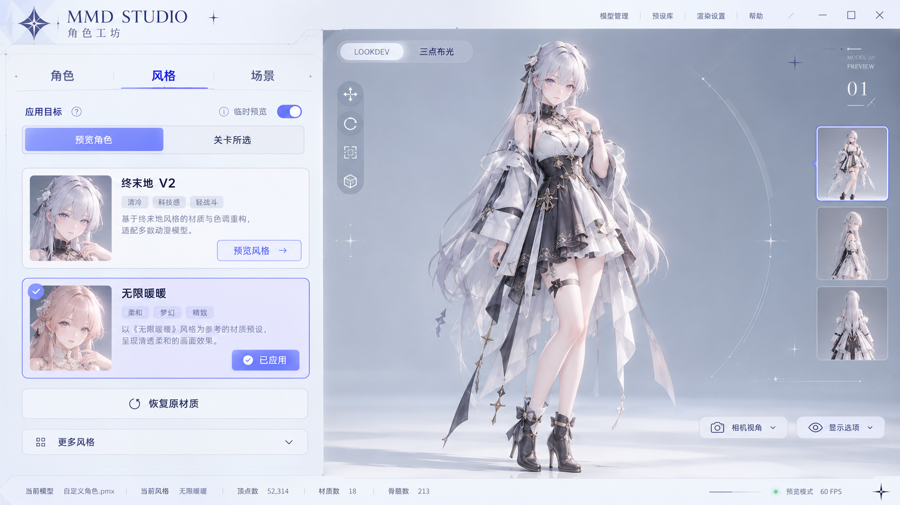

# 二次元菜单设计参考

生成日期：2026-10-23（Asia/Singapore）。使用内置 image_gen 工具生成。用户明确选择本图的浅色通透方向，替换前一轮森林主题。



本图是生成式界面概念，角色、缩略图、工具栏和文字不代表引擎实拍或已实现功能。实际实现采用原生 Slate 控件与项目里的真实角色、风格资产和 LookDev 环境；不把此图铺成可点击的假界面，不使用概念角色替换用户模型。页眉星标、细线装饰与按钮状态由矢量和 Slate 样式实现，随 DPI 缩放。被否决的森林插画未加入项目。

## 完整生成提示词

```text
Use case: ui-mockup
Asset type: high-fidelity desktop anime character editing tool UI concept, 16:9 landscape, approximately 1920x1080.
Primary request: design the actual interface style of a premium contemporary anime game character menu, adapted into an MMD preset editor. Original clean sophisticated anime game UI, pale frosted ivory, very light ice blue, hints of lavender, midnight blue text and a vivid periwinkle selected accent. Strong hierarchy, precise thin strokes, small chamfered details, airy spacing, beautiful readable typography. NOT an illustration wallpaper.
Layout: a compact top header reading "MMD STUDIO", subtitle "角色工坊". On the left about one third width a functional control panel. Its top has three navigation tabs exactly "角色" "风格" "场景"; "风格" is visibly selected with a periwinkle underline. Then a clear target segmented selector "预览角色" / "关卡所选". Two refined preset cards, "终末地 V2" with button "预览风格" and "无限暖暖" with a small "已应用" state badge; second card subtly lavender and outlined blue. Below a secondary "恢复原材质" control and collapsed row "更多风格". A quiet note "临时预览" near the target.
Right about two thirds: a large actual-looking 3D character viewport with a simple cool gray studio background and a single original anime young adult female character wearing understated white and charcoal stage clothing, full body, standing, softly lit. No environmental scenery, just clean studio light. The character is contextual placeholder content; interface chrome and hierarchy are the main subject. Viewport top has slim readable labels "LOOKDEV" and "三点布光" and small transform controls. Bottom has a discreet status strip.
Decoration: very restrained geometric star-cross marks, thin circular HUD arcs at the outskirts of the character, abstract diamond-shaped original app emblem. Flat frosted panels with very subtle translucent shading. Use deliberate compact buttons and clear state hierarchy. Entire UI should feel like an anime game's polished character outfit/preset selection screen.
Constraints: this is only a UI concept mockup, not an engine screenshot. No forest, no tree, no leaf, no treasure chest, no wood, no rustic scrapbook, no moss, no green palette. No busy background illustration, no big golden ornament, no glossy skeuomorphic buttons, no neon cyberpunk, no logos or watermarks. Render interface texts as specified.
```
