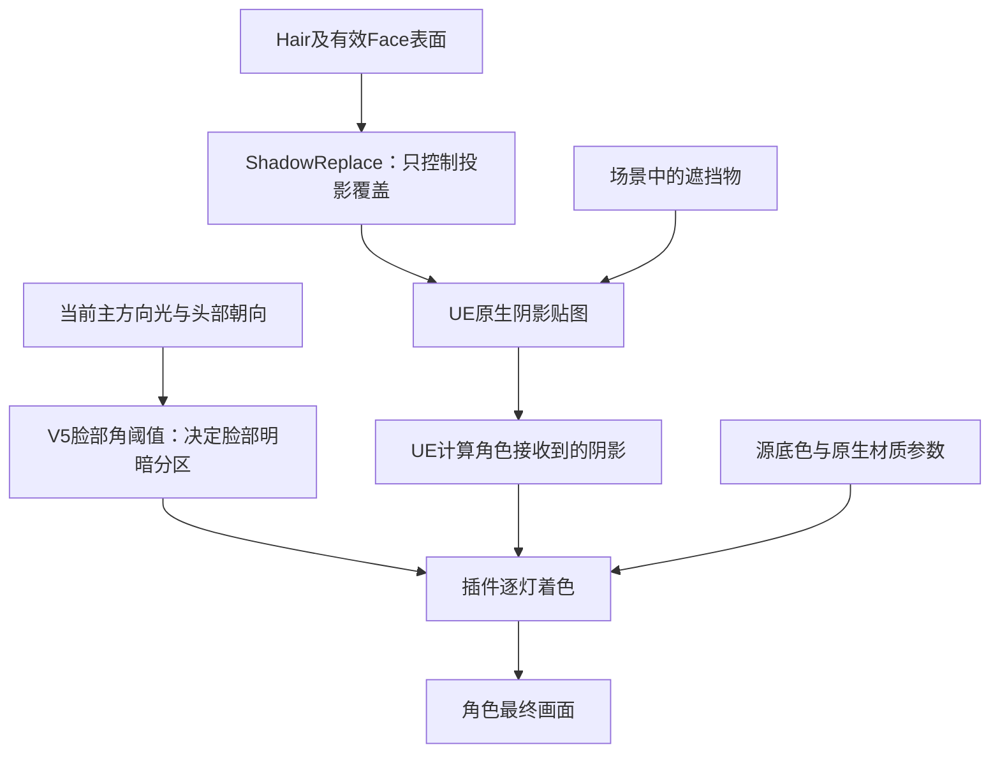

# 脸部与头发阴影：为什么分开控制

更新：2026-10-16。当前为 **Backend `endfield-native-bsdf-v14-cast-clean`／Cooked协议14／Graph7**，Skin Profile布局42、payload5、FaceData5、Frame1保持。最终生产材质实拍 `cast4` 完成27图／156次槽检查／0失败，Editor全局shader协议14验证通过；本次目检鼻部椭圆硬斑消失。mode0_final2与atlas64_final各8图／78次检查／0失败，均验证协议14；`EFCastClean16c` BuildOnly三配置通过；以前v13皮肤泛红的验证不能算作本批阴影验证。

这次处理的是头发碎片、鼻部和附脸几何投出来的碎硬阴影。**让这些表面少投影，不等于让角色不接收场景阴影。** 插件使用材质的原生 `ShadowReplace` 分支，将投影覆盖与主画面覆盖分开；Backend14另修正这类Masked材质在早深度优化下漏掉的主画面裁剪，原生阴影接收继续保留。

## 三件事，分别负责什么

1. **脸部SDF分区**：根据头部朝向和当前主光方向，决定脸上哪一片属于受光区、哪一片属于暗部。当前V5是自动生成的角阈值图，使用头部投影坐标，不依赖模型原底图UV；它不是实时遮挡查询。
2. **投射阴影（cast）**：头发、鼻子、衣领等几何挡住光，在其他表面留下影子。细碎发片进入原生阴影贴图后，可能形成不适合二次元脸部的细碎边界。
3. **接收阴影（receive）**：场景中的墙、遮挡块或其他物体挡住光，角色应随之变暗。当前逐灯着色继续使用UE提供的原生遮挡结果。



因此，调SDF截止角不能消除真实头发投影；降低总阴影强度也不能证明只处理了头发。这里保留原生接收，分别控制哪些表面继续投影。

## 当前选择：改阴影分支，不增加代理层

Graph7的Masked父材质计算两份覆盖率：主画面沿用源表面的覆盖语义，阴影绘制再乘部位投影控制与有效脸部抑制。

```text
主画面覆盖 = 原Opaque转换时为1；否则为原Texture.A × Opacity
阴影覆盖   = 主画面覆盖 × ShadowCastStrength
                          × (1 - 有效脸部coverage × FaceShadowSuppress)
ShadowReplace：正常绘制用主画面覆盖，阴影绘制用阴影覆盖
```

原Opaque本来忽略贴图alpha。为了启用投影分支把它换成Masked时，必须继续令主覆盖为1，否则底图中原本无关的透明通道会突然把头发或脸裁出孔洞。原Masked仍保留裁剪孔洞；透明附脸层继续保留连续alpha，本次不会为了关投影把它改成Masked。

第一版Graph7／Backend13实拍还暴露了另一条路径：`r.EarlyZPassOnlyMaterialMasking=1`让BasePass依赖早深度阶段的裁剪结果；Opaque头发转换为Masked后，近共面的AO层中alpha为0的黑色片元仍被画出，出现黑洞。这不是通过继续降低脸部阴影强度能修好的问题。

Backend14在**插件生成的BasePass虚拟副本**中，只对 `MATERIALBLENDING_MASKED && NUM_MATERIAL_OUTPUTS_GETMMDENDFIELDNATIVEPAYLOAD == 3` 的变体恢复BasePass clip。也就是带插件三项payload输出的Masked材质仍执行自身裁剪；其他材质保留原来的早深度优化。没有关闭全局早深度设置，也没有修改引擎安装目录。

鼻部椭圆还涉及透明材质的强制硬遮罩投影。只关闭Face专用Translucent父的标志不足，进一步拆分caster与普通深度覆盖的 `cast3` 也仍有椭圆。最终生成器把**全部插件自有Toon Translucent父材质**的 `bCastDynamicShadowAsMasked` 设为false，共享与Face专用父一致；主画面仍使用原连续软alpha。`cast4`生产实拍目检椭圆消失，这支持本例中强制masked透明投影的归因，不代表所有透明投影路径或任意模型都已逐项验证。

本批**没有新增简化hair-cap、独立刘海阴影mask、全身影子副本或拍RT流程**。动画、Morph、LOD和变形仍由原来的角色网格绘制，不额外复制一套姿态。它也没有修改引擎安装文件、新增GBuffer字段或更换皮肤光照协议。

投影分支最终仍由Masked裁剪阈值决定可见性。`ShadowCastStrength`不是物理透光率，也不是阴影边缘柔化半径；首轮主要使用0／1。几何和绘制提交仍可能存在，不能据此承诺节省了整个阴影pass或固定性能提升。

## 怎么设置，作用会到哪里

打开 `DA_Render_EndfieldV2` 的 `CharacterToonRoles`，修改后重新应用预设：

- **Hair → `ShadowCastStrength`**：新版生成预设设为0，关闭受支持Hair表面的阴影贴图投射；设1恢复投射。结构和旧资产默认1，非法数值回退1，正常值限制在0至1。
- **Skin → `FaceShadowSuppress`**：新版生成预设设为1，但只有有效V5脸部coverage内才抑制投影，身体Skin不会仅因分类相同就被关掉。结构和材质参数默认0。无有效绑定时Stage写0；Mode0保留原先的脸部投影回退。
- **`ToonShadowOpaqueCoverage`**：Stage内部参数，默认0。只有源材质真实为Opaque、最终使用受控Masked父材质时才写1；不要把它当作普通透明度滑块。
- **`bCharacterContactShadow`**：当前EndfieldV2预设继续关闭角色接触阴影。它与本次阴影贴图覆盖控制是不同开关。

转换要求目标父材质位于插件自有EndfieldV2目录、混合模式为Masked，并实际存在 `ToonShadowCastStrength` 与 `ToonShadowOpaqueCoverage` 两个参数。缺少支持时保留原生投影；不会把任意用户材质强行改造成这条路径。原透明Hair仍遵守已有 `bUseMaskedHair` 的显式选择，本轮控制不额外改变透明转换条件。

**Hair抑制作用于所有接收面**：脸、衣服、地面以及其他角色都会失去这些Hair表面的阴影。有效Face抑制同样影响它对身体和地面的投影。当前不是“只关Hair→Face”，也没有按遮挡来源拆分UE的总阴影值。身体和场景遮挡物的原生阴影接收路径保留，本批另有场景遮挡块对照；CPU放置成功不能单独算接收阴影的GPU证明。

代价也很直观：真实刘海遮挡会一起减少，额头可能显得更干净、更平。当前没有补上一层可控的刘海投影，不能把“碎影减少”直接称作完整终末地复刻通过。

## 公开做法给了哪些依据

- [Arc System Works的GDC2015演讲](https://gdcvault.com/play/1022031/GuiltyGearXrd-s-Art-Style-The)讨论如何通过美术与技术决策，在3D中维持2D观感；[官方发布说明](https://www.arcsystemworks.com/guilty-gear-xrds-art-style-the-x-factor-between-2d-and-3d-talk-from-gdc-2015-is-now-available-online/)确认演讲来源。这里借鉴的是按画面目标控制表现的思路，未据此宣称某一种具体刘海算法就是其实现。
- [ChillyHub的StarRail复刻示例](https://github.com/ChillyHub/Unity_StarRail_CRP_Sample/blob/main/README_CN.md)明确展示了角色不收自阴影、仍收场景阴影的分层目标。它是作者的Unity复刻工程，**不是游戏官方源码**；其自定义管线和逐角色投影也不等于本插件的ShadowReplace方案。这里只参考目标分工，没有搬入代码。
- [Unity官方Toon Shader](https://github.com/Unity-Technologies/com.unity.toonshader)提供受光色、暗部色等艺术控制，说明卡通材质需要独立的表现参数；没有据此推导终末地的内部实现。其[许可证](https://github.com/Unity-Technologies/com.unity.toonshader/blob/master/LICENSE.md)明确面向Unity依赖项目，本插件没有把其代码移植进UE。

NetEase GDC2022《Finding Harmony》PDF本轮访问受限，未核对正文，不引用它证明具体阴影算法，也不把它标作原神官方资料。上述公开参考都不能证明终末地原作使用了本批实现。

## 后续维护从哪里改

- [MMDStageRenderPreset.h](../Source/Ue5MMDTools/Public/Stage/MMDStageRenderPreset.h)：部位参数、默认值和用途提示。
- [MMDStageLibrary.cpp](../Source/Ue5MMDTools/Private/Stage/MMDStageLibrary.cpp)：有限值净化、父材质能力检查、Opaque覆盖标记、有效Face绑定、重新应用及角色分类覆盖。恢复仍使用原 `SourceOverrides`；不修改组件整体CastShadow或共享网格section标志。
- [TMMDEndfieldNative.ush](../Shaders/Core/TMMDEndfieldNative.ush)：`PrepareShadow`集中计算两份覆盖；`PrepareSurface`提供现有有效脸部coverage与抑制值。计算保持struct成员函数形式。
- [MMDEndfieldNativeBackend.cpp](../Source/Ue5MMDTools/Private/Rendering/MMDEndfieldNativeBackend.cpp)：Backend14的BasePass虚拟副本裁剪门控；修改门控需同步后端签名、协议与重新编译／Cook验证，不能改成影响所有材质的全局设置。
- [MMDEndfieldToonPresetsCommandlet.cpp](../Source/Ue5MMDToolsEditor/Private/Editor/MMDEndfieldToonPresetsCommandlet.cpp)：Graph7生成、两个新增参数、ShadowReplace连接、新版Hair／Skin预设值，以及所有自有Toon透明父的masked投影标志。修改图后须重新生成并验证父材质，不能只改文档版本。
- [MMDEndfieldToonProbeCommandlet.cpp](../Source/Ue5MMDToolsEditor/Private/Editor/MMDEndfieldToonProbeCommandlet.cpp)与[NativeBackendProbe](../Source/Ue5MMDToolsEditor/Private/Editor/MMDEndfieldNativeBackendProbeCommandlet.cpp)：实拍、CPU绑定检查及后端协议校验。既有Facefix影子副本只是诊断工具，不能写成当前生产架构。

脸部坐标和绑定生命周期见[V5说明](ENDFIELD_FACE_V5_GUIDE.md)，皮肤逐灯响应见[皮肤说明](ENDFIELD_SKIN_MATERIAL_GUIDE.md)，后端和发行边界见[原生渲染说明](ENDFIELD_NATIVE_RENDERING_GUIDE.md)与[分发说明](ENDFIELD_PLUGIN_DISTRIBUTION.md)。

## 本批验证（2026-10-16）

最终依据为本机 `Saved/Phase2Reference/Endfield2/cast-clean-2026-10-16/cast4/report.json` 与 `cast4_report.json`：共27图，其中19项castclean与8项AB，156次槽检查／0失败；Editor编译反射协议14验证通过。六个表面父材质Graph7、Hair0／Face1预设、重新应用和控制参数回读通过；材质参数／父材质／Profile、灯光与场景控制均恢复，Profile字节保持。

本次目检生产结果的鼻椭圆消失；场景遮挡、关原生阴影、顶光与原Opaque alpha0均有独立对照。报告的 `all_gpu_verified` 仍为false：CPU控制检查、全局shader协议和少量截图不能证明全部材质内核通过。mode0_final2与atlas64_final各8图／78次检查／0失败，均验证协议14；`EFCastClean16c` BuildOnly三配置通过，15份冻结源码与15个自有V2资产逐字节匹配；未重跑干净宿主渲染或Cook。

外部像素分析52项通过：本批鼻部核心与同角度关阴影对照逐像素一致；外部遮挡块使固定右颊画面编码亮度从201.892降至.0689，支持场景遮挡接收仍在。四张Unlit对照与cast3相同。这些是具体采样范围的控制检查，不是整张shadow mask或全模型画质证明。保护2,381项中仅8个自有V2包有意变化。

本批只归档7张实际引擎原PNG，不调色、不做AI修图。左侧旧结果保留历史来源，不能冒充本次重拍。


其余原图：[顶光](Screenshots/2026-10-16-endfield-cast-clean/top-clean.png)、[侧光关闭原生阴影](Screenshots/2026-10-16-endfield-cast-clean/left-shadow-off.png)、[场景遮挡块](Screenshots/2026-10-16-endfield-cast-clean/external-block.png)、[原Opaque的alpha0对照](Screenshots/2026-10-16-endfield-cast-clean/opaque-alpha0.png)。

历史失败保留：第一版Graph7／Backend13的alpha0黑洞、Face-only透明投影修正不足、`cast3`仍有椭圆。全局临时关闭早深度mask优化的 `clipcheck` 在冷编译中止后没有出图，不记为验证通过。

还需单列多模型、多LOD／材质映射、动画／Morph及发行包验证范围。源网格仍负责这些变形，不等于它们已经逐项实测；阴影贴图路径的结果也不能自动推广为所有光追、胶囊或接触阴影路径通过。
