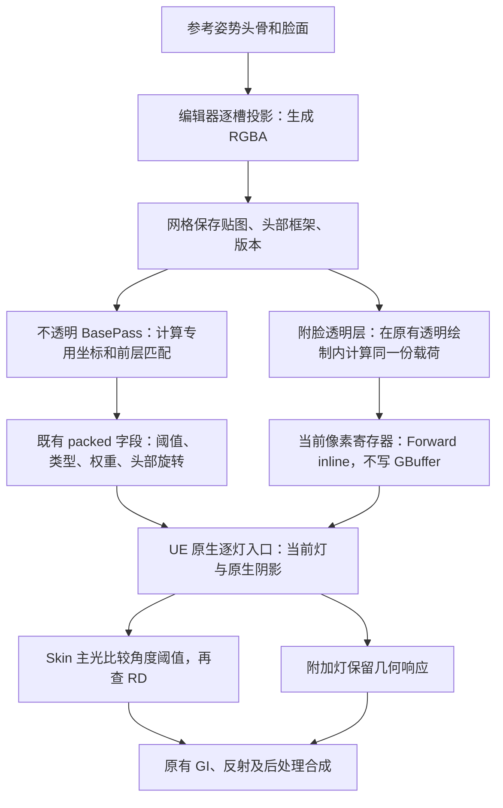

# 脸部 V5：把明暗分区和头发投影分开

Face V5 初稿日期：2026-10-16，当时为 Backend11／Graph5。2026-10-19 源码核对：现行共享后端为 Backend15／Graph7，终末地响应保持v14，payload5／FaceData5保持，本文说明其继续使用的几何数据机制；当前投影控制以[脸部阴影说明](ENDFIELD_FACE_SHADOW_GUIDE.md)为准，全局路径见[当前架构](RENDERING_ARCHITECTURE.md)。历史实验保留各自日期，不代表本日重测。

一张脸上的暗色可能来自脸部明暗分区、鼻子或刘海的原生投影、材质的视角染色，也可能是模型另叠了一层“假鼻影”。改 SDF 只能直接改变第一种。本轮分别关闭方向场、全部动态阴影、Hair 槽投影及鼻影层，逐项确认来源。

## 这次换了什么

V4 实际存的是一条几何方向，并不是脸部 SDF。V5 改存“灯从左边或右边转到哪个角度时，这个位置变暗”的阈值。烘焙器自动生成可用底图，也可以继续绘制 R/G 调整形状。

头部中心、半径从头骨、眼骨及头附近 Skin 几何拟合，随网格保存；运行时使用同一份标定跟随头骨。全身包围盒、翅膀和描边扩张不再参与估算。缺少可靠头骨或有效派生数据时，回到通用 Toon。



这里没有每帧另拍脸部光照 RT，也没有增加角色绘制。透明层本来就有自己的绘制；现在在那次绘制里补载荷和逐灯响应。阈值图是静态形状数据，当前头部变换、灯光和阴影沿原生管线使用；不透明脸保留原有 Lumen 历史与 VSM 缓存机制。

## 专用坐标怎么处理

本轮使用**过程化头部投影坐标**，没有实际往网格塞 UV2／3／4。原模型 UV0 和附加 UV 原样保留，重叠的底图 UV 不会再决定脸部阈值的位置。

`uv = (0.5 + RightOffset / (3R), 0.5 - UpOffset / (3R))`

`UVChannel=-1` 是上述计算方式的标识，不能拿它当 TextureCoordinate 索引。坐标越界就回退，不做循环采样。每个 opaque／masked Skin 槽独立投影，重叠位置取最前层脸面；通过几何验证的附脸透明层直接复用宿主图，不重新生成一张壳层图。

- R：右侧光的截止角／PI。
- G：左侧光的截止角／PI。
- B：前层深度，`0.5 + ForwardOffset / (3R)`。
- A：有效脸面覆盖。

运行时四个采样点**分别**检查覆盖和深度，再插值阈值；不能先平均两个不同层的 B，制造不存在的中间层。深度差在 `0.08R` 内保留，至 `0.12R` 渐退为普通几何响应。

自动 R/G 用 `0.5 ± atan2(RightOffset, max(ForwardOffset, 0.6R)) / PI`，限制在 `[0.05,0.95]`。这是通用几何角阈值底图，**不是原作手绘 SDF，也不是逐角度追踪真实遮挡得到的距离场**。前层深度只选投影层，不负责烘焙刘海或场景阴影。

## 着色时发生什么

24bit 字段前两个 byte 保存阈值或旧 oct 方向，第三个 byte 是 1bit 类型和 7bit 覆盖率；另一个 32bit 字段继续保存头部 Quaternion。透明层只做相同的 ALU 量化、解码，数据留在像素寄存器里。没有新增 GBuffer 布局或 RT。旧 cooked 协议不能混用，新 Cook 必须使用 protocol11。

仅有效 Skin 主方向光进入 V5：将当前 L 反旋到头空间，计算 `atan2(abs(L.x), L.y)/PI`，按左右选择 R/G 并比较，结果进入现有 RD。近垂直光渐退回几何响应，附加灯沿用几何光照。独立高光法线和 GI 所用原生 Normal 保持。

有效外脸没有 SSS 修饰遮罩时，不再套用身体的 view tint，避免鼻侧三角法线额外压灰。身体保留原响应；这项兜底不代表已还原原作的 Skin LUT／SSS。

**默认保留原生投影和阴影接收。** Hair-off 对照通过临时阴影代理只关 Hair 槽投射，保留可见头发和身体投影。合并后的 ShadowTerms 没有遮挡者身份，不能把整体减弱阴影说成“只去掉头发自投影”。已有 masked `ToonFaceShadowSuppress` 显式开关仍可用，默认 0；它改变脸向外投射的覆盖，opaque 不使用这个开关。

## 鼻子上的黑块为什么不是全靠 SDF 修

测试角色有两层很薄的半透明鼻壳，作者法线朝向与表面几何相反，用于传统 MMD 假鼻影。它们原先被当成 Generic 独立受光；主脸已经变亮，鼻壳仍可能压黑。只关动态阴影无效，只关这两层的 opacity 就消失，因此不能把它归因于刘海投影。

现在由插件自动识别贴脸层：头部骨权重至少 90%，顶点和投影面积至少 98% 贴合主脸，真实几何距离不超过 `0.03R`，且验证所有现有渲染 LOD。未分类层还必须与宿主共用底图。没有角色名、鼻壳槽号或特定 UV 特判；腮红等不满足条件的层保留原路径。

通过验证后保留原 RGB 和连续 alpha，复用宿主 R/G/B/A，在原生 Surface Forward 逐灯入口比较相同阈值；高光／环境所用法线改为头部球面兜底，避免继续使用假鼻影的反向法线。失配或宿主失效会自动禁用该层绑定，不能链式借用另一个透明层。

**透明层的灯光范围仍按 UE 原生 Forward。** 当前入口提供选定方向光和局部灯，不等同于不透明延迟路径的全部方向光；透明 GI 也不等同于不透明 Lumen 合成。多方向光、独立 Morph 与动态 LOD 仍需继续验证，不能承诺两条路径逐像素相同。

## 重烘与继续画图

已有 V4 缓存会关闭，需重烘 V5。导入／自动绑定使用 `MMDEndfieldFaceBinding::BakeAndBind`；显式保存已有模型可运行：

```text
UnrealEditor-Cmd.exe YourProject.uproject -run=MMDEndfieldBindSdf -Generate
  -Mesh=/Game/YourModel/SK_Model.SK_Model
  -OutputFolder=/Game/YourModel/Derived -Size=512 -Report=<report.json>
```

参数放在同一命令行；路径替换为自己的资产。此命令保存指定网格及派生纹理。单张调试图使用 `MMDEndfieldBakeSdf -Slots=<单槽索引> -Tga=<路径>`；多槽绑定使用 BindSdf。

手工调整时编辑已经绑定的 V5 纹理 **R/G**：数值小代表较早变暗，数值大代表更晚变暗。保留 B/A 的几何数据，保持线性、无 mip、无有损压缩及 clamp 设置。不要把现成角色 UV 空间的 SDF 直接塞进这张投影图。再次自动重烘会重新生成工具派生图，先另存人工版本。

## 维护入口和边界

- 头部标定：[MMDEndfieldHeadFrame.cpp](../Source/Ue5MMDTools/Private/Rendering/MMDEndfieldHeadFrame.cpp)；当前姿态更新：[UMMDHeadBoneSubsystem.cpp](../Source/Ue5MMDTools/Private/Rendering/UMMDHeadBoneSubsystem.cpp)。
- 投影、筛选和阈值：[MMDEndfieldFaceSdfBaker.cpp](../Source/Ue5MMDToolsEditor/Private/Editor/MMDEndfieldFaceSdfBaker.cpp)；持久化绑定：[MMDEndfieldFaceBinding.cpp](../Source/Ue5MMDToolsEditor/Private/Editor/MMDEndfieldFaceBinding.cpp)。
- 采样：[TMMDEndfieldNative.ush](../Shaders/Core/TMMDEndfieldNative.ush)；编码：[TMMDEndfieldNativePayload.ush](../Shaders/Core/TMMDEndfieldNativePayload.ush)；逐灯响应：[TMMDEndfieldNativeBSDF.ush](../Shaders/Core/TMMDEndfieldNativeBSDF.ush)。
- 透明载荷和原生灯光：[TMMDEndfieldNativeForwardPayload.ush](../Shaders/Core/TMMDEndfieldNativeForwardPayload.ush)、[TMMDEndfieldNativeForwardLight.ush](../Shaders/Core/TMMDEndfieldNativeForwardLight.ush)；副本接入点：[MMDEndfieldNativeForwardPatch.inl](../Source/Ue5MMDTools/Private/Rendering/MMDEndfieldNativeForwardPatch.inl)。
- 诊断：[MMDEndfieldToonProbeCommandlet.cpp](../Source/Ue5MMDToolsEditor/Private/Editor/MMDEndfieldToonProbeCommandlet.cpp)。专用 Profile 的 diagnostic18 以绿／红表示 `valid && has_face_sdf`；不透明是 packed 读回，透明是 inline，两者不能混称。软透明混合后的颜色不一定为纯绿／红，也不单独证明阈值数值、旋转或画质都正确。

头部刚性旋转、统一缩放可沿相同投影跟随。大幅嘴部 Morph、独立下颌、不同 LOD 的几何变化仍可能触发深度回退；非均匀缩放目前只保守扩半径，不能保证投影形状不变。一般透明皮肤、跨 UE 版本以及新版 Cook／发行包须分别验证。引擎安装目录不改，适配仍限定现有版本与源指纹。

实拍中，无投影时的额外鼻壳暗斑已明显减轻，仍有轻微色差；原生鼻／发投影保留，极端侧光的鼻梁硬边和半脸分界还需继续美术调整。数据响应恢复不等同于完整画质验收。

本批实际截图与验证记录见 [2026-10-16 脸部修复归档](Screenshots/2026-10-16-endfield-face/README.md)。
