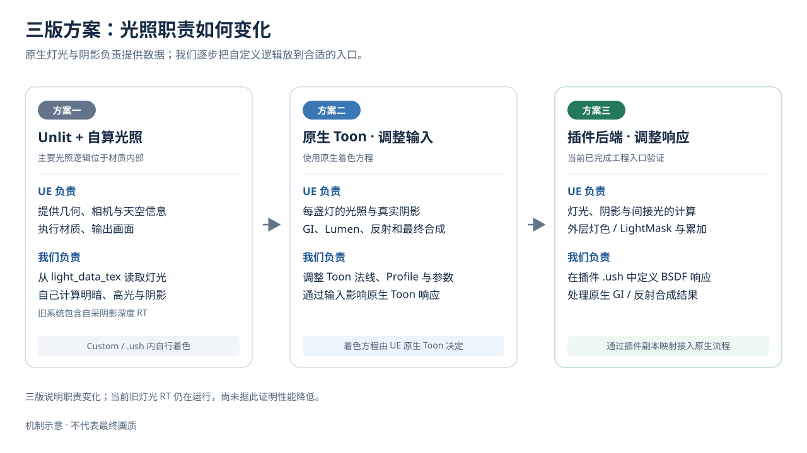
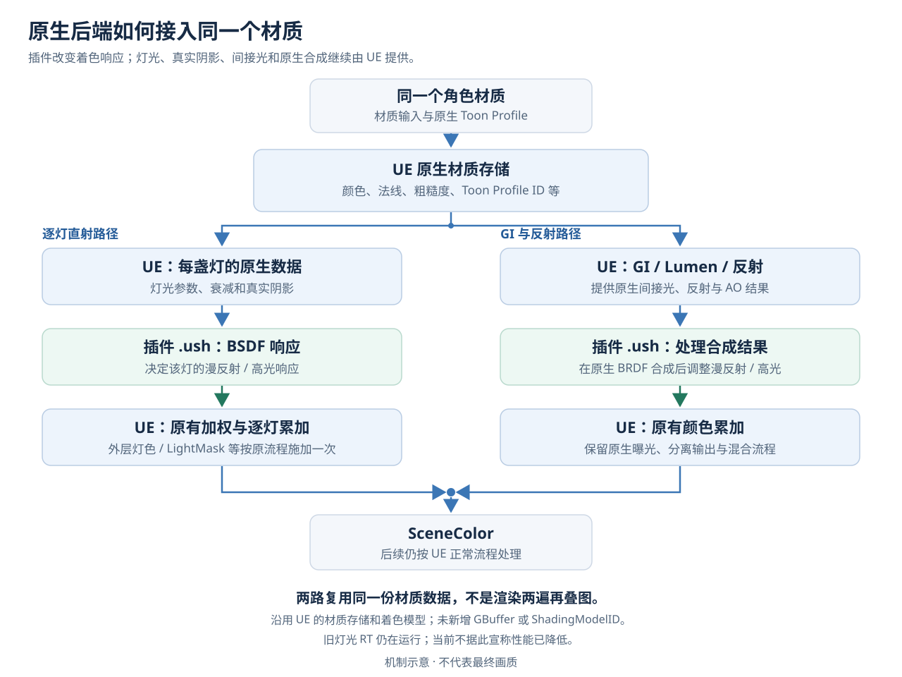
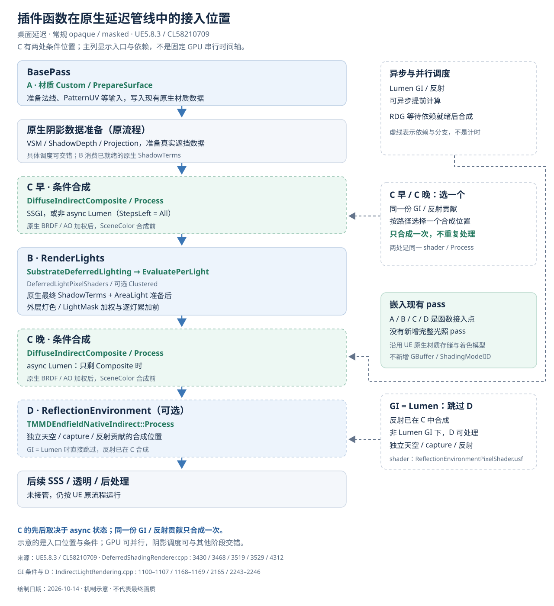
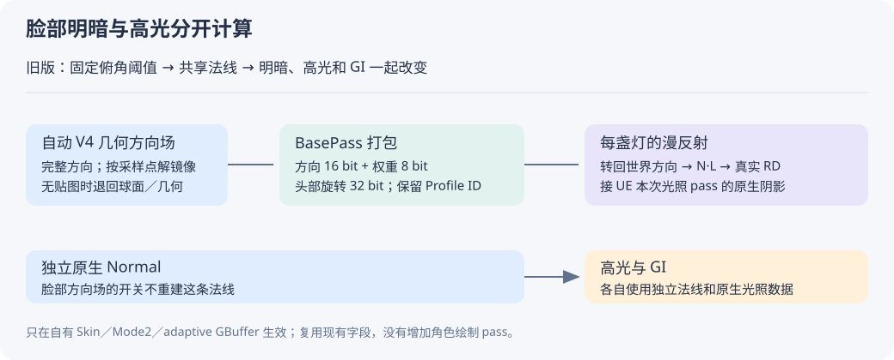
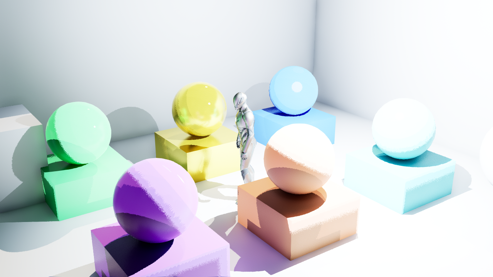
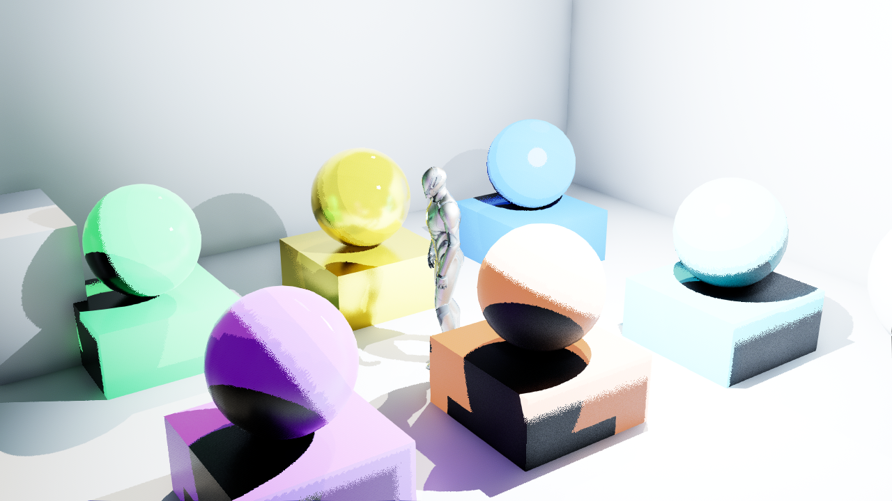

# 终末地插件着色入门与维护

更新日期：2026-10-16。适用版本：UE 5.8.3 / CL58210709。

当前为 **Backend `endfield-native-bsdf-v14-cast-clean`／Cooked协议14／Graph7／Profile布局42**；payload5／FaceData5／Frame1保持。`cast4`生产实拍27图／156次槽检查／0失败，Editor全局shader协议14验证，本次目检鼻椭圆消失。mode0_final2与atlas64_final各8图／78次检查／0失败，均验证协议14；`EFCastClean16c` BuildOnly三配置通过。

新版预设Hair投影覆盖0影响所有接收面，Face抑制只限有效coverage；原Opaque转Masked后主覆盖仍为1，带自有payload的Masked在BasePass恢复clip。全部自有Toon透明父保留连续alpha，取消强制masked投影；只处理Face透明父曾不足，cast3仍有椭圆，最终cast4才消失。脸部SDF分区与caster覆盖分开，身体／场景原生阴影接收保留。没有新增RT、代理角色或修改安装引擎，具体机制、研究边界和[本批原图](ENDFIELD_FACE_SHADOW_GUIDE.md#本批验证2026-10-16)见[脸部阴影说明](ENDFIELD_FACE_SHADOW_GUIDE.md)。

本批外部像素检查52项通过：鼻核心与同角度关阴影对照逐像素一致；场景遮挡块使右颊编码亮度201.892→.0689，四张Unlit与cast3相同。保护2,381项仅8个自有V2包有意变化。这不等于原厂算法或完整终末地画质验收；多模型／动画／LOD、发行包绘制、Cook与性能不能从本批参考姿势推导。下方v13及更早结果保留原版本日期。

**UE 负责准备真实灯光、阴影和环境光，插件负责决定角色被照亮后是什么样子。** 这就是目前的方案。材质仍使用原生 Substrate Toon 的数据格式，光照计算入口已经接到插件自己的 `.ush`。

shader 是计算像素颜色的程序，`.ush` 是保存这类代码的文件；材质负责提供底色、法线等输入。

历史皮肤版本（2026-10-16，v13）为 **`endfield-native-bsdf-v13-skin-redness`／Cooked协议13／Profile布局42**，payload5／Graph6／FaceData5／Frame1不变。v12的颜色LUT与视角响应继续保留，v13在Skin当前灯的漫反射明暗交界增加弱暖红窄带。它是插件原创风格化泛红，不是提取到的原作红边；没有空间扩散、厚度透射或新的RT／GBuffer／渲染pass。

新版预设仍关闭两组静态肤色，`CharacterSkinLighting`新增强度 `.18`、NoL宽度 `.22`、按π归一化的角半宽 `.035`、RGB `(1,.4,.30)`。几何NoL与SDF连续角距离分别计算窄带，并受覆盖、弱NoV及原生阴影约束；`SurfaceShadow≤.1`关闭新项。灯色与衰减只在原生外层乘一次，独立高光和GI不变。强度0保留同参数v12响应，详见[皮肤说明](ENDFIELD_SKIN_MATERIAL_GUIDE.md#v13明暗交界的弱暖红)。

v13最终 `Editor3`／`Game1`构建通过，`generate13`保存15包、七父材质真实编译21／40／29／21／40／29／40；17项静态边界检查通过。最终 `redness3` NativeBackendProbe为34图／156次槽检查／0失败，Mode0与启动atlas64各8图／78次检查／0失败，Editor协议13均验证。外部像素检查72／72通过，本批ROI与最终报告、图像SHA绑定并目检，见[v13原图与来源](Screenshots/2026-10-16-endfield-skin-redness/README.md)。以下v12结果保留原版本与日期。

侧光右颊只出现小幅局部暖红：MAE1.30296，高于自身复拍噪声.20222，RGB平均变化约 `(+1.0911,-1.0911,-1.5356)`；背光未超噪声，不算新增效果。固定右颊的放块／关原生阴影对照支持该位置的遮挡与泛红门控；关闭原生阴影后，两档强度各自的放块／不放块整图RGB相同，零直射灯开／关也相同。它没有提供整张原生shadow mask，具体编码亮度和范围见[皮肤验证](ENDFIELD_SKIN_MATERIAL_GUIDE.md#维护与验证)。

`EFSkinRedness16` BuildOnly三配置、包内容及源码检查通过，12份冻结Source／HLSL与发行包哈希匹配；保护2,381项中2,379保持，仅自有Preset和OffsetLinear变化。干净宿主、发行包角色绘制、Cook及性能未重跑；身体Skin、附加灯和Legacy未独立GPU实测，不把这些结果称为全部内核或真实SSS验收。

**历史验证（2026-10-16，v12）**：最终 `Editor3`与`Game1`运行时模块构建成功，`generate12b`完成15包／七父材质，shader数21／40／29／21／40／29／40。`response3` Mode2为47图／195次检查／0失败，Mode0及启动时atlas64各为8图／78次检查／0失败；Editor全局shader编译反射的协议12验证通过。原PNG和14文件冻结来源见[v12归档](Screenshots/2026-10-16-endfield-skin-response/README.md)。`Game1`之后只有验证CPP／Legacy USH修正，未声称新Cooked运行。

背光暖肤变化明显，侧光和视角变化较细微；主光0的开／关对照全部RGB逐字节一致。外部55项严格检查通过，背光白衣ROI的开关差异未超过自身复拍噪声，右颊／鼻部核心差异则明显高于该噪声；这不是画质评分，鼻梁硬边仍在。`.025`角柔化只作对照，默认仍为 `2/255`。失败修复与具体数据见[皮肤验证记录](ENDFIELD_SKIN_MATERIAL_GUIDE.md#维护与验证)。

同日v12的 `EFSkinResponse16c` BuildOnly通过Editor Development／Game Development／Shipping及必需文件、皮肤源文件检查，14份冻结Source／Shader与当时发行包逐字节一致。`response3`与该版代码对应；[v12来源摘要](Screenshots/2026-10-16-endfield-skin-response/sources.json)保留依据。它没有重跑空白宿主、发行包角色绘制与Cook；v13的BuildOnly结果已在上方单列。

2026-10-16较早的v11新增独立身体／脸部表面参数和Face三父材质，[当时的同机位实拍](Screenshots/2026-10-16-endfield-skin/README.md)只验证静态肤色准备。新皮肤响应没有真实空间SSS、邻域扩散或厚度透射；脸部RefineMask尚未接入，视角处理属于通用近似。

v11建立的独立头部投影角阈值图与透明附脸层继续保留，[脸部V5说明](ENDFIELD_FACE_V5_GUIDE.md)解释坐标、贴图、刘海投影及维护入口。v9双暗层、Hair／Cloth二维高光及主辅光分工也保留，[2026-10-15实拍](Screenshots/2026-10-15-endfield-volume/README.md)属于历史验证。Mode2需在应用预设前设置 `r.Substrate.ToonProfile.Resolution=256`；绑定时不足256会退回原曲线／Mode0，已分配Profile后不支持运行中直接降低分辨率。v12空白宿主与完整Cook仍待独立重测。

本批也核对了别人公开复刻的完整分工：[参考源码对照](ENDFIELD_REPRODUCTION_REFERENCE_AUDIT.md)。材质和逐灯入口保持，另补底色描边与[插件分发检查](ENDFIELD_PLUGIN_DISTRIBUTION.md)；完整眼睛、头发与屏幕效果仍逐项推进。

2026-10-15已改用更复杂的YYB16th带翼款，按同一机位对比原生Toon与当前响应：[脸、头发、衣料实拍](Screenshots/2026-10-15-endfield-distribution/README.md)。独立插件构建、空白宿主四材质编译、正/普通Cook及指定Skin载荷绿红对照均已有实证；这些是基础验证，白布、翅膀与完整材质响应仍未达到终末地画质目标。

先看下面两张示意图，再看实拍。需要改代码时，直接跳到[维护入口](#维护入口)。

## 为什么从旧方案换过来



最早的 **Unlit** 是“自己画出受光的样子”：插件把灯光写进 RT，再在材质里手算明暗。RT 就是一张由程序实时写入的纹理。Unlit 不自动接收原生阴影，因此还要额外渲染一张阴影深度 RT，自己比较谁挡住了光。

后来改成 **原生 Toon**，角色开始使用 UE 的灯光、阴影和环境光，但我们主要只能调整底色、法线和 ramp。ramp 可以理解成“输入一个明暗程度，查出一个颜色”的色带；它不能表达所有想要的光照方程。

现在的 **插件后端** 保留原生数据和渲染流程，将光照计算接到自己的函数。过去主要是调方程的输入，现在可以改方程本身。这样做是为了同时拥有 UE 的场景一致性和终末地着色所需的控制权。

## 同一个材质分阶段处理光照



**这里不是两个材质，也不是把角色渲染两遍再叠加。** UE 本来就分阶段处理直射光与间接光，我们在对应阶段各接一个入口。

直射光是灯直接照到角色。每处理一盏灯，UE 提供方向、衰减、面积光和原生阴影；插件计算这一盏灯产生的漫反射与高光，UE 再按原流程加权、累加。

```text
最终直射颜色 = 各盏灯的［UE 灯光权重 × 插件着色响应］之和
```

引擎外层仍负责乘灯色、强度和灯光 mask；在当前入口里再乘一次会把能量重复计算。灯光 mask 是引擎算出的该灯作用范围等权重。

间接光是墙面反弹过来的光、环境照明和反射。**GI** 就是全局光照。Lumen 继续计算这些结果，插件在合成入口处理当前阶段的贡献。现在只实现了间接漫反射／镜面贡献的倍率控制，没有重写 Lumen 的多次反弹算法。

### 数据会不会慢一帧

直射入口接的是**本次光照 pass 正在使用的参数和阴影结果**。这里的“复制”是 shader 函数内整理参数，没有新增一张 RT 再等下一帧采样，也没有额外的整帧延迟。

Lumen 的 GI／反射会使用历史累积，VSM 会复用仍然有效的阴影缓存。插件读取的是 UE 给本次合成准备的结果，保留这些原生机制；“本帧使用”不等于“所有结果都是本帧从零重算”。游戏线程与渲染线程原有的流水线延迟也仍然存在。

## 我们的入口在渲染管线哪里

下面标的是 UE 5.8.3 桌面延迟渲染中不透明／遮罩材质的入口位置。**B、C、D 都嵌在 UE 已有 pass 里，不是额外新建三套完整光照 pass。** pass 可以理解成渲染管线中的一项工作。



- **投影覆盖，在UE原生阴影深度绘制中。** Graph7用ShadowReplace选择caster覆盖，不新建阴影pass；正常深度／主画面保留对应表面覆盖，Backend14仅为自有Masked恢复必要的BasePass裁剪。透明主画面继续在原生Translucency绘制。
- **A 材质准备，在 BasePass 内。** 材质 Custom 调用 `TMMDEndfieldNative::PrepareSurface()`，计算独立原生法线、脸部角阈值／方向和头部旋转。专用 CustomOutput 将后两项交给 BasePass 的打包入口，再供逐灯读取。这一步还没有当前逐灯光的最终阴影。
- **B 直射，在 RenderLights 内。** `DeferredLightPixelShaders.usf` 调用 `SubstrateDeferredLighting()`；该调用链准备原生阴影、接触阴影与 AreaLight，再在 `SubstrateEvaluation.ush` 的 Toon 分支调用我们的 `EvaluatePerLight()`。返回后，UE 外层乘灯色／LightMask 等并累加。额外灯光参数的复制在同一调用链中完成。
- **C 间接，在 DiffuseIndirectComposite 内。** UE 已取得 GI／反射输入，算好原生材质权重和 AO，插件再调用 `Process()`；adaptive 路径处理 `OutBSDF.Diffuse/Specular`，传统路径处理 `IndirectLighting.Diffuse/Specular`，随后才累加到 SceneColor。位置在原生分离输出及后续合成之前，不在 Lumen 射线追踪或历史更新内部。
- **D 独立环境／反射，在 ReflectionEnvironment 内。** `SubstrateEnvLightingCommon()` 及适用的独立 Lumen 反射合成先计算贡献，再调用插件 `Process()`，之后进入原生反射量化、分离输出和颜色合成。如果 Lumen 的组合路径已经在 C 合成了对应贡献，这个独立 pass 会按配置跳过，不能重复处理同一份结果。

**C 的位置按调度选择，不能固定画成直射之后。** 本机引擎在 `RenderLights()` 前后各调用一次 `RenderDiffuseIndirectAndAmbientOcclusion()`：SSGI 和未走异步的 Lumen 在前一次生成并合成；异步 Lumen 只剩合成步骤时，在直射后的第二次合成。对同一份贡献，不会两次都调用 C 去重复乘倍率。RDG（UE 的渲染任务图）维护资源依赖，Lumen 计算能与其他 GPU 工作重叠。

当 GI 使用 Lumen 时，对应反射已由 C 合成，独立 D 会跳过；GI 不使用 Lumen 的独立反射／天空路径才可能执行 D。这里也没有接管 D 循环外的非零独立 SSR 合成。

**E 透明附脸层，在原有 Translucency 绘制里。** v11 于 `BasePassPixelShader.usf` 的 `SubstrateUpdateTree` 之后、建立 Forward context 之前填入 inline 载荷；它留在当前像素寄存器，不写 GBuffer。在 `SubstrateForwardLighting.ush` 的每灯 `GetShadowTerms()` 之后捕获原生灯光，再进入同一 Toon 响应。不是在不透明 BasePass 后额外补画一次脸，透明层本来就按原生调度绘制。

E 当前针对自有单层 Toon、Surface Forward 及可靠附脸绑定；灯光范围是原生 Forward 选定方向光与局部灯，透明 GI 也不等同于 C 的不透明 Lumen。一般透明、多方向光一致性、移动端、MegaLights 或路径追踪不能由当前验证推导。TAA／TSR、tonemap仍沿用UE流程；本Toon分支没有自动获得原生皮肤空间SSS。

维护时可对照安装引擎 `Source/Runtime/Renderer/Private/DeferredShadingRenderer.cpp`：BasePass 调用约在 3060 行，前一次 GI 在 3430 行，`RenderLights()` 在 3468 行，后一次 GI 在 3519 行，独立反射在 3529 行，后处理入口约在 4312 行。行号针对上述固定版本；只读对照，实际修改仍在插件适配器和 ush。

## GBuffer 和 ShadingModel 到底变了什么

可以把 **GBuffer／Substrate 材质容器**理解为每个像素的“材质记录”：保存颜色、法线、粗糙度等，供后面的光照读取。没有新增独立的 GBuffer render target；新版在自己的 Skin 材质里复用已有字段传递脸部参数。

**ShadingModel／BSDF** 是使用这些记录计算受光效果的规则。当前仍使用原生 Toon 类型，没有新增一个 ShadingModel ID；替换的是指定 Toon 材质分支中的光照计算函数。

插件通过Profile标记识别自己的材质。Diffuse.A保存角色、模式、GI倍率及Skin布局标记／控制，Diffuse.RGB仍是RD。Skin从v12起借用Specular.RGB保存原创6³颜色立方体；v13布局42复用尾槽216／217传泛红六参数，Specular.A仍保留RD.A，Hair／Cloth的32×8 RS不变。布局41继续保留cube响应并关闭泛红；布局42尾槽无效只关闭泛红，不误读成RS。普通Toon和Default Lit继续走原生响应。

GBuffer 里保存的是 Profile ID，用它查找对应色带；这些标记和倍率不占用 GBuffer 的 alpha 通道。

shader 中的 `mmd_light_data` 只是“这一次光照计算的参数包”，不写入 GBuffer。正式打包的 `mmd_payload` 使用 24 bit 保存方向或 V5 左右阈值、类型及权重，32 bit 保存头部旋转。它复用自有 Toon 的 PatternUV 字段和材质编译器已预留的 anisotropy word；Profile ID、底色和粗糙度保持。原生 Normal 独立供高光与 GI 使用。

这条 **packed 通道**只用于 Mode2、adaptive GBuffer=1、不透明／遮罩、单 Toon Skin，并检查实际预算。真实各向异性、fmt0、多层和简化变体会回退；不能把这套字段分配当成所有材质都可使用的空闲存储。透明附脸层使用独立 **inline 通道**：同一份阈值与旋转、相同量化，留在当前像素寄存器，既不占 anisotropy word，也不经 packed 读回。普通材质不使用这些标记，没有新增角色绘制或离屏光照 pass。

这也不是“完全没有额外写入”：原生零 anisotropy 的像素可能跳过该32 bit word，新通道会写它，只是没有超出编译器预留预算。打包、读回和解码都有成本，目前未测净性能收益。

## 本轮脸部与 ramp 改了什么



旧版把固定俯角下的脸部阈值转换成一条共享法线，同时影响明暗、高光和 GI。改变灯光俯角时，这条法线无法重建烘焙时的方向；原型还会先做三档分类、再叠加偏移。

2026-10-16 改为 **V5 独立头部投影角阈值图**：左右光分别存截止角，逐灯以当前头空间光方向比较。专用坐标从位置与持久化头部框架计算，不占用网格 UV2／3／4，底图 UV 及附加 UV 保留。RGBA 的 B/A 负责前层深度和覆盖，四 tap 分别过滤后插值；不再受原 UV 重叠或全身翅膀包围盒影响。自动阈值是几何兜底，不是原作手绘 SDF 或真实遮挡距离场；真实阴影仍来自 UE。旧 V4 缓存需要重烘。

V5跟随头骨旋转及正均匀缩放。大幅Morph／下颌、其他LOD及非均匀缩放仍有边界，深度不匹配处回到实时几何。payload权重对V5表示有效阈值覆盖，对方向类型表示准备后方向有效，不能混用语义。头发投影与脸部阈值独立；v11让外脸退出身体view tint，v12启用皮肤响应时改用受头部朝向和几何限制的脸部视角近似，避免直接把身体公式套满鼻侧。传统半透明假鼻影通过头权重、几何朝向、宿主深度与覆盖验证后，保留软alpha并复用主脸图；不按角色名字、槽号或特定UV特判。详见[脸部V5说明](ENDFIELD_FACE_V5_GUIDE.md)。

```text
BasePass：头部投影阈值／通用方向 → 类型 + 权重 + 头部旋转 → 打包
主光 Skin：角度比较阈值；其他情况：几何 N·L → RD 明暗混合 + 颜色 tint
高光／GI：独立原生 Normal → 原生数据 + 对应着色响应
```

Skin、Hair、Cloth的RD使用已有客户端完整256点数据。A决定明暗混合量，RGB负责tint及亮度补偿；RD.A保存在Profile的Specular.A，Diffuse.A用于控制。Hair／Cloth影色继续从底色派生；v12 Skin开启新响应后可混入原创颜色LUT的暗色。**真实RD不能直接当作普通RGB乘数。**

衣料高光保留GGX波瓣幅度与 `.04 × specular` 的F0。代表Skin未启用RS，因此新布局的Skin高光使用白色乘数，不能误采已存颜色LUT的RGB；旧布局保留既有读取。Hair／Cloth自2026-10-15使用32×8二维RS，缺P／flow图仍为几何近似。Skin LUT采用插件原创6³配方，不复制客户端颜色表；脸部RefineMask、头发第二波瓣／独立法线、眼睛、深度rim及最终调色仍待继续。

Mode2要求 `r.Substrate.Experimental.ToonUnifiedDiffuse=0`，由每盏灯处理RD语义；统一漫反射后段尚未适配，会拒绝启用此模式。Profile atlas须在应用前设为至少256，插件没有改工程默认值；不得在已有tile／cube Profile运行中直接降为64来期待安全自动回退。

本轮同镜头侧光、头发／衣料及packed读回原图见[2026-10-14画质迭代归档](Screenshots/2026-10-14-endfield-fidelity/README.md)。旧版鼻部、脸颊硬条块已明显减少；其余复刻项继续按清单推进，不以编译或图片数量判定终末地画质达标。

## 看实拍理解 GI 接口

以下两张均为 **2026-10-14 捕获的 UE 打包游戏原图**。这是基础几何诊断场景，中央人形来自工程默认 GameMode，颜色和曝光用于测试，不是终末地成品效果。

第一张：自定义响应原型，间接漫反射／镜面倍率均为 1。



第二张：保持直接灯光，将插件入口的间接漫反射倍率设为 0。注意肤色球体下方及盒子背光面明显变暗；这说明插件确实能处理原生间接光贡献。



更多原生阴影、高光对照以及原始来源见[实机归档](Screenshots/2026-10-14-endfield-native-backend/README.md)。本次编写文档没有重新运行 UE，沿用上述日期的实拍和验证结果。

## 阴影 RT 和性能

新后端直接取得 UE 原生阴影，自己的着色函数不需要旧 `MMDShadowMapRT` 或 `LightDataRT`。原生阴影结果告诉我们“这个像素被挡了多少”，插件可以把它并入明暗分段或高光门控。

**当前旧 RT 子系统仍在后台运行。** 旧阴影启用且有有效主光时，仍提交四级阴影深度 pass；灯光 RT 也仍在更新。因此不能把“新 shader 不再采它”写成“已经省掉这些开销”。

后续应按场景里实际使用的材质启停：全部使用新后端时停掉重复工作；仍有旧 Unlit 材质需要它时保留。停掉重复渲染有望节省这部分耗时，净收益需要实测，原生阴影和自定义 shader 本身也有成本。

此外，原生阴影值不保存遮挡物身份，不能直接区分鼻子、刘海和墙。因此接通原生阴影不等于已经解决所有脸部自阴影问题。

## 安装引擎文件为什么可以保持不变

```text
安装引擎的 Private shader
        ↓ 只读复制
工程 Intermediate 中的副本
        ↓ 适配光照、合成及材质打包入口并 include 插件 ush
Editor／Cook 编译 shader
        ↓
打包程序使用编译好的 shader 库
```

这叫 shader overlay，可以理解成“编译器改用工程里的适配副本”。安装目录的源文件不写入，但实际编译的 shader 实现确实经过适配。

它依赖固定版本的私有接口。升级 UE 时需要重新检查入口和源文件 hash，不能直接删除版本保护强行启用。工程 `Intermediate` 是自动缓存，维护应改插件源码；直接改缓存既难复现，也会破坏 hash 校验。

## 维护入口

按“想改什么”选择入口，通常不用同时打开所有文件。

### 改明暗分段和高光

打开 [TMMDEndfieldNativeBSDF.ush](../Shaders/Core/TMMDEndfieldNativeBSDF.ush)，看 `EvaluateToonResponse()`。

这里接收材质、当前灯光、阴影和面积光。Mode2的Skin／Hair／Cloth用 `ReadDiffuseRamp()`、`ApplyDiffuseRamp()` 和 `EvaluateSpecular()` 处理RD与高光。Skin脸部阈值来自 `BSDF.mmd_payload`，高光法线独立；矩形灯使用原生GGX／LTC兜底，不把展平RS或颜色立方体交给一维高光查表。

皮肤专门看 [TMMDEndfieldSkinResponse.ush](../Shaders/Core/TMMDEndfieldSkinResponse.ush)；原创配方在 [MMDEndfieldSkinLutData.inl](../Source/Ue5MMDTools/Private/Rendering/MMDEndfieldSkinLutData.inl)，控制与使用方式见[皮肤材质说明](ENDFIELD_SKIN_MATERIAL_GUIDE.md)。它在同一逐灯入口调整暗部和受光区，不改GBuffer、GI算法或新增SSS pass。

### 改 GI 或反射的表现

打开 [TMMDEndfieldNativeIndirect.ush](../Shaders/Core/TMMDEndfieldNativeIndirect.ush)，看 `Process()`。

当前只有最终贡献倍率。扩展时按 `path` 区分合成阶段，并检查 `available_flags`：没有标为可用的字段只是零占位。逐灯光阴影与完整 Lumen 结果不在同一个入口里。

### 改材质输入或脸部数据

打开 [TMMDEndfieldNative.ush](../Shaders/Core/TMMDEndfieldNative.ush) 的 `PrepareSurface()`；材质图由 [MMDEndfieldToonPresetsCommandlet.cpp](../Source/Ue5MMDToolsEditor/Private/Editor/MMDEndfieldToonPresetsCommandlet.cpp) 构建。

这层负责底色、几何和脸部数据。V5 `ReadFaceSdf()` 在独立头部坐标按覆盖／前层深度过滤；`ReadDirection()` 保留手动 V4 兼容，`FrameQuaternion()` 负责头部旋转。旧 V3 阈值桥保留在 `PrepareLegacySurface()`，各编码分开读取。派生数据由 [MMDEndfieldFaceSdfBaker.cpp](../Source/Ue5MMDToolsEditor/Private/Editor/MMDEndfieldFaceSdfBaker.cpp) 自动生成。

跨阶段打包维护 [TMMDEndfieldNativePayload.ush](../Shaders/Core/TMMDEndfieldNativePayload.ush)；正式材质输出是 [MaterialExpressionMMDEndfieldNativePayload.h](../Source/Ue5MMDTools/Public/Materials/MaterialExpressionMMDEndfieldNativePayload.h)。新增数据时必须一起检查 CustomOutput、BasePass 注入、packed export/read、预算与简化回退，不能只给局部 struct 加成员。

### 改材质识别和引擎接入

- [MMDEndfieldNativeProfile.cpp](../Source/Ue5MMDTools/Private/Rendering/MMDEndfieldNativeProfile.cpp)：标记、RD／RS／Skin cube与瞬态副本，按源、角色及皮肤设置隔离缓存；同目录 `MMDEndfieldNativeRampData.inl` 为已有RD／RS，`MMDEndfieldSkinLutData.inl` 为新原创配方，修改时分别维护版本。
- [MMDStageLibrary.cpp](../Source/Ue5MMDTools/Private/Stage/MMDStageLibrary.cpp)：把对应 Profile 应用到角色材质。
- [MMDEndfieldNativeBackend.cpp](../Source/Ue5MMDTools/Private/Rendering/MMDEndfieldNativeBackend.cpp)：版本保护、源码校验、缓存、光照入口及新增的 BasePass／Substrate packed export/read 适配。
- [MMDEndfieldNativeBackendProtocol.cpp](../Source/Ue5MMDTools/Private/Rendering/MMDEndfieldNativeBackendProtocol.cpp)：从 Cooked 全局 shader 的序列化编译反射检查协议。只读记录，不 dispatch，不新增光照 pass；不能代替实际画面验证。
- [MMDOutlineLibrary.cpp](../Source/Ue5MMDTools/Private/Rendering/MMDOutlineLibrary.cpp)及[TMMDEndfieldOutline.ush](../Shaders/Core/TMMDEndfieldOutline.ush)：终末地专属底色描边、源 alpha 裁剪、绑定与恢复。
- [MMDEndfieldNativeIndirectPatch.inl](../Source/Ue5MMDTools/Private/Rendering/MMDEndfieldNativeIndirectPatch.inl)：GI／反射合成位置。
- [TMMDEndfieldNativeLightCapture.ush](../Shaders/Core/TMMDEndfieldNativeLightCapture.ush)：复制原生灯光输入；只有 `mmd_light_data.valid=true` 时这些额外字段才有效。
- [TMMDEndfieldNativeLegacy.ush](../Shaders/Core/TMMDEndfieldNativeLegacy.ush)：传统 GBuffer 的聚簇灯光兼容路径。

### 处理旧 RT 的重复开销

看 [FMMDAnimeLightViewExtension.cpp](../Source/Ue5MMDTools/Private/Rendering/FMMDAnimeLightViewExtension.cpp) 的 `SetupView()` 和 `PreRenderViewFamily_RenderThread()`：这里仍调用旧阴影更新、灯光收集与 RT 写入。

对应实现是 [UMMDShadowMapSubsystem.cpp](../Source/Ue5MMDTools/Private/Rendering/UMMDShadowMapSubsystem.cpp) 和 [UMMDAnimeLightDataSubsystem.cpp](../Source/Ue5MMDTools/Private/Rendering/UMMDAnimeLightDataSubsystem.cpp)。未来停用应依据旧材质是否需要它们；仅看“新后端已启用”就全局关闭，会影响混用旧材质的场景。

## 改完怎样确认没有弄坏

先开启 Substrate，并显式启用后端；项目默认配置仍未更改。

```text
-MMDEndfieldNativeBackend
-MMDEndfieldNativeBackendMode=2
```

- 模式 0：原生透传，用作基线。
- 模式 1：把阴影通道显示成 RGB，用于确认收到的是原生阴影。
- 模式 2：当前 RD／RS 与脸部方向响应迭代，不代表最终终末地画质。

先用 [MMDEndfieldNativeBackendProbe](../Source/Ue5MMDToolsEditor/Private/Editor/MMDEndfieldNativeBackendProbeCommandlet.cpp) 比较原生／自定义、无遮挡／有遮挡、间接光开／关，并确认普通材质保持原生。改材质图时同步更新生成器中的图版本／签名。

之后用 [MMDEndfieldNativeBackendFixture](../Source/Ue5MMDToolsEditor/Private/Editor/MMDEndfieldNativeBackendFixtureCommandlet.cpp) 生成专用夹具，再做 Cook 和打包游戏对照。**Cook 时必须启用后端；仅在打包程序启动时加开关，不能补上没有编译进去的内核。** 改 ush 后需重新编译，发行时重新 Cook；只切换 Profile 模式／倍率不需要重编同一份内核。

2026-10-14 的既有验证已覆盖 Editor 原生阴影／GI 对照和五组打包游戏运行。移动端、CSM、Cook 后的 SDF／骨骼／透明发片，以及最终终末地画质仍未完成验收。详细配置、验证记录和剩余边界见[技术记录](ENDFIELD_NATIVE_BACKEND.md)，完整复刻范围见[交接清单](ENDFIELD_V2_FOR_GPT.md)。
