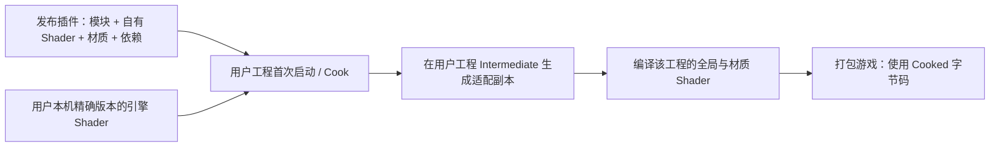

# 终末地后端怎样随插件分发

适配范围：**UE 5.8.3 / CL58210709，Win64 桌面延迟渲染**。实际运行验证为D3D12 SM6。最近核查日期：2026-10-16。这是一份固定引擎版本的插件适配，不是跨版本自定义 ShadingModel API。

**当前源码版本**：Backend `endfield-native-bsdf-v13-skin-redness`／Cooked协议13／Profile布局42；payload5／Graph6／FaceData5／Frame1不变。v13的原创风格化泛红在Skin本灯漫反射明暗交界局部生效，不新增RT、GBuffer或空间pass，不改独立高光／GI。它不代表提取到的原作红边、真实扩散或厚度透射。新预设仍关闭两组静态肤色，发布仍七父材质／15包。

新预设的泛红参数为强度 `.18`、NoL半宽 `.22`、归一π的角半宽 `.035`、Tint `(1,.4,.30)`；结构默认强度0，保留旧资产行为。几何NoL和SDF连续margin使用不同宽度，结合覆盖与弱NoV，原生 `SurfaceShadow≤.1`关闭新项；灯色和衰减只走原生外层一次。

**v13本轮开发对照与BuildOnly通过。** `Editor3`／`Game1`构建、17项静态边界检查通过；`generate13`保存15包／七父材质，shader数21／40／29／21／40／29／40。最终 `redness3` NativeBackendProbe为34图／156次槽检查／0失败，Mode0与启动atlas64各8图／78次检查／0失败，Editor GlobalShader反射协议13均验证。外部像素分析72／72通过，独立ROI清单已绑定最终报告与PNG SHA并目检，见[v13原图](Screenshots/2026-10-16-endfield-skin-redness/README.md)与[来源摘要](Screenshots/2026-10-16-endfield-skin-redness/sources.json)。

最终 `Saved/EFSkinRedness16/Ue5MMDTools/` 的BuildOnly完成Editor Development／Game Development／Shipping三配置，`build_plugin_verified`、`payload_files_verified`、`skin_response_sources_verified`均为true；12份final-freeze Source／HLSL与工作区及发行包哈希匹配。**clean-host、发行包绘制、Cooked和性能未重测**，对应报告的cleanhost／render／Cooked标记仍为false；协议13的发行库仍须重新Cook，不以Editor实拍代替。

侧光右颊仅有小幅局部暖红，效应MAE1.30296／复拍噪声.20222，RGB变化约 `(+1.0911,-1.0911,-1.5356)`；背光未超过自身噪声，不计新增效果。固定右颊深遮挡下新项归零，关闭原生阴影后恢复；在关闭原生阴影的对照中，两档强度各自的放块／不放块整图RGB相同，零直射灯的泛红开关图也整图相同。它不提供整图shadow mask，没有真实SSS或厚度透射；身体Skin、附加灯与Legacy未独立GPU实测。保护2,381项中2,379不变，仅自有Preset和OffsetLinear两项变化。

## 历史验证：v12（2026-10-16）

**v12本轮开发对照通过，发行链路尚未完成。** 最终 `Editor3`与`Game1`运行时模块构建成功；`generate12b`为15包／七父材质，shader数21／40／29／21／40／29／40。`response3` Mode2为47图／195次槽检查／0失败，Mode0及启动时atlas64各8图／78次检查／0失败，Editor全局shader编译反射验证协议12。14文件冻结与原PNG见[本轮来源](Screenshots/2026-10-16-endfield-skin-response/README.md)。`Game1`之后仅验证CPP／Legacy USH变动；不能把模块构建或Editor协议读回写成打包运行。

最终 `EFSkinResponse16c` **BuildOnly通过**：Editor Development／Game Development／Shipping三配置构建、必需文件检查及 `skin_response_sources_verified`均成功。14份冻结Source／Shader在当时工作区和发行包逐字节一致，v12输出为本机 `Saved/EFSkinResponse16c/Ue5MMDTools/`，见[来源摘要](Screenshots/2026-10-16-endfield-skin-response/sources.json)。v12收尾归档阶段仅补文档，v13结果已在上方独立列出。

**v12空白宿主、发行包角色绘制和完整Cook／打包游戏尚未重跑**；报告的 `clean_host_adapter_verified`、`rendering_verified`、`cooked_runtime_verified`仍为false，不称为最终二进制角色GPU验证。[2026-10-16较早皮肤批次](Screenshots/2026-10-16-endfield-skin/README.md)是v11的静态表面准备与分发验证；下文正反Cook属于2026-10-15的v8，均不能证明v12发行完成。旧库需重新Cook。Mode2须在应用预设前设置 `r.Substrate.ToonProfile.Resolution=256`；绑定时不足256会使用原曲线／Mode0，已分配tile或cube Profile后不支持运行中直接降低分辨率，默认配置不自动改写。

本轮保护清单2,381项中2,379保持，仅自有Preset和OffsetLinear包变化；用户27个资产、10张旧PNG、Mobile文档、Face shader与安装引擎保持。新增文档与配置另列为有意变更。

本次背光暖肤明显，侧光与视角更细微，主光0开／关对照全部RGB逐字节一致；外部55项严格检查全通过，白衣ROI差异未超过自身复拍噪声。鼻梁硬边未解决，不是真实空间SSS或完整肤质验收；角柔化 `.025`仅为对照，预设仍 `2/255`。具体数据与失败修复见[皮肤说明](ENDFIELD_SKIN_MATERIAL_GUIDE.md#维护与验证)。

## 用户拿到什么

插件包包含运行时与编辑器模块、自己的 USH、材质与预设、Bullet 依赖、维护文档及验证脚本。**不包含生成的引擎 shader 目录镜像、参考游戏角色、Saved、DDC 或本机编译缓存。**

当前版本必须同时分发 `Shaders/Core/TMMDEndfieldSkinResponse.ush` 与 `Source/Ue5MMDTools/Private/Rendering/MMDEndfieldSkinLutData.inl`。前者由后端纳入shader源签名，后者为重新编译插件所需的原创CPU配方；不能只带二进制后漏掉下游源码依赖。本轮BuildOnly已核对源SHA256，空白宿主仍须独立实际检查协议13与材质编译，不能把文件一致当作该步骤通过。

Skin的原创6³ LUT仍为recipe1的216点，存于既有Profile Specular.RGB固定256槽，Specular.A仍为RD.A。Diffuse.A空隙标记布局42，九个平台的位置及其余八个控制值合同保留；216槽存泛红强度／NoL宽度／角宽度，217槽存Tint RGB。shader兼容41且泛红为0；42尾槽无效仅关泛红，仍保护cube不被误当RS。这里没有新增GBuffer／RT或真实空间SSS pass，也不分发客户端SkinLUT原图／重采样数据。RefineMask缺失的脸部视角响应仍是近似。

仓库 `Resources` 中的 PMX 模型和 VMD 动作仅用于本机验证，过滤器不会把这些目录及配套模型纹理打进插件包；仅保留 UI 图标和自有 Garden 舞台图片。换测试模型不会给用户增加一套角色资源依赖。



安装引擎保持原样。生成的副本位于用户工程的 Intermediate；版本或源 hash 不符、映射冲突时拒绝启用后端。完整副本是目录映射的要求，不能只复制改动的几个文件并假定其他路径会自动回退。

## 本批修复的两个实际问题

1. BuildPlugin 默认不收集插件根目录的 `ThirdParty`。原包会漏掉 Bullet，而下游 C++ 工程的 Build.cs 仍引用这些头文件和库。现在由 `Config/FilterPlugin.ini` 显式收集；当前依赖只有 Windows `.lib`，descriptor 明确声明 Win64。
2. 后端原先启动时必须读取 CustomOutput 的私有 `.cpp/.h` 来生成签名。二进制插件可以没有这些源文件。现在材质输出名称、次序、默认值与打包约定由模块内的协议版本参与签名，自己的 USH 和引擎源 hash 继续逐项校验。修改这些约定必须同步升级协议并重新 Cook。

自v8起保留 **Cooked全局shader协议门控**，当前适配副本在 `ToonProfileCommon.ush` 声明协议13；指纹shader只有编译看到该版本时才保留相应命名参数。C++从编译反射记录它，并随shader内存镜像序列化。游戏初始化后检查已加载记录，匹配当前协议13才允许Profile路由；普通未开启后端的Cook记录为0，启动参数不能把0或旧协议变成13。下面v8实测仍保留当时的协议8结果，不是新版本结果。

该 shader **只用于读取编译记录，没有 dispatch，也没有新增一帧或逐像素光照 pass**。它证明这一份全局 shader 见过正确适配头，不能证明所有材质内核都正确；仍须全新 Cook 和实际绘制。完全缺少该新 shader 的旧包可能先被 UE 全局 shader 完整性检查拒绝，必须重新 Cook，不能承诺旧包都能自动回退。

公开复刻代码也有缺失管线依赖、未处理附加灯等边界，不能仅凭它们的效果图证明我们的插件能发布。具体对照见[源码审计](ENDFIELD_REPRODUCTION_REFERENCE_AUDIT.md)。

## 用新工程检查发行包

在 PowerShell 运行，替换本机引擎和输出路径。输出目录必须尚不存在；脚本拒绝覆盖旧目录，输入插件、引擎及输出祖先也不能经过目录联接或符号链接，避免路径别名绕过 UAT 清理隔离。

```powershell
& .\Scripts\Test-EndfieldPluginDistribution.ps1 `
  -EngineDir 'D:\software\EpicEngine\UE_5.8' `
  -OutputRoot 'D:\PluginReleases\Endfield-test-001'
```

脚本运行 UE 的 BuildPlugin（Editor Development、Game Development、Shipping），核查包内所需文件，然后把发行包复制到一个空白项目。测试副本移出 CustomOutput 的私有 `.cpp`，发行原包不变；该项目没有本仓库角色和工程配置，使用 `-AdapterOnly` 实际检查目录映射、源码完整性、全局协议及七个已发布父材质编译（含Face三模式与专用描边）。结果写入 `distribution.json`；日志和宿主留在输出目录便于定位。

`distribution.json` 的 `expected_*` 是待核对版本要求；`skin_response_sources_verified`只代表两个源文件完整，`clean_host_adapter_verified`须在当前协议13及材质编译检查后才能置为真。两者都不代表皮肤画质或Cooked游戏已验证；历史v12报告仍按当时协议12解释。

`-BuildOnly` 仅做打包与文件检查。**AdapterOnly 不绘制模型，也不代表画质验收或 Cooked 游戏通过。** 渲染和打包运行须另附实拍与 Cook 来源。

可选 `-SharedDataCachePath` 指定本机 DDC 以节省重复编译时间；DDC 不进入发行包，也不替代 shader 源 hash 和实际编译状态检查。干净宿主指没有源工程配置、角色和源码依赖，并不声称该次测试删除了全机编译缓存。

## 项目怎样启用

将 `Scripts/EndfieldNative.example.ini` 中的节合并到使用插件的项目 `Config/DefaultEngine.ini`，保留原配置，然后重启。首次使用会编译 shader。也可用已有命令行开关做临时测试；发行项目应使 Editor、Cook 和游戏使用一致设置，不能只给游戏加开关。

Mode2 使用逐灯 RD 语义，要求 `ToonUnifiedDiffuse=0`。脸部独立数据通道还要求 adaptive GBuffer=1、单 Toon Skin 与足够预算；透明、简化和其他未适配路径保留相应回退。生成器与绑定工具在 Editor 模块，游戏仅消费已生成的数据与编译结果。

## 发布前分别确认什么

- **插件结构**：BuildPlugin 与干净宿主加载通过，必需文件齐全。
- **Cook 来源**：全新 Cook 期间后端实际激活，版本、协议、渲染设置和编译成功均有记录；不能拿旧 Cook 或 `skipcook` 当作新协议验证。
- **运行行为**：同一份 Cooked 游戏测试正常响应、阴影诊断、GI 控制与 packed 数据正负对照，查看实际截图；CPU 启动状态不能单独证明材质内核执行。
- **画质**：固定机位比较脸、发、衣服、眼睛，多灯、自影/外影、头部旋转、动画/Morph、缺配套贴图分别检查。

2026-10-15实测：`EF8e`的BuildPlugin三配置与包内检查通过，Bullet头/四库齐全，Resources无测试PMX/VMD及模型目录；修正SM6启动参数后，空白宿主移出私有CustomOutput cpp仍通过目录/协议/四父材质编译，实际shader数30/54/48/40、0错误，未绘制模型。材质数随工程编译设置变化，脚本不将其写死。该宿主无源工程配置、角色和源码依赖，复用本机DDC；没有另编独立下游C++消费模块，不能把它写成额外消费者工程验证。

`package-v8b`与`package-vanilla-v8`另做完整Cook/Stage/Pak/Archive；同程序的正Cook协议8、普通Cook协议0并保持原生回退。正Cook正常响应和Skin packed绿红对照通过，来源见[Cooked实拍](Screenshots/2026-10-15-endfield-distribution/COOKED_VALIDATION.md)。夹具为通用几何，新增带翼角色仍只完成Editor参考姿势；全角色Cook、动画/Morph和最终画质不能据此记为通过。带RenderDoc自动附加的两次首帧异常保留，CLI禁用捕获插件后四次成功，未改用户Config。

首次冷启动须等待全局与材质shader编译。空白宿主最初的无效空RHI覆写导致启动断言，修正后以明确D3D12 SM6参数重测；不要向Editor的目标shader格式数组写空字符串。后续引擎升级需重新核对私有接口、更新适配与保护hash，再重新执行这些检查。

最终再次完整运行修正后的脚本，`EF8f` 的BuildPlugin、文件过滤、缺私有cpp的空白SM6宿主及四材质严格回读全部通过，报告未将AdapterOnly记成绘制。最终脚本、报告与日志SHA见[分发证据](Screenshots/2026-10-15-endfield-distribution/distribution-sources.json)。本机可检查发行目录 `Saved/EF8f/Ue5MMDTools/`；包体和编译缓存不入库。
