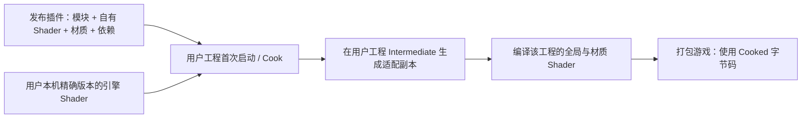

# 终末地后端怎样随插件分发

适配范围：**UE 5.8.3 / CL58210709，Win64 桌面延迟渲染**。本批实际运行验证为D3D12 SM6。核查日期：2026-10-15。这是一份固定引擎版本的插件适配，不是跨版本自定义 ShadingModel API。

**版本更新**：当前源码为 v9／Cooked 协议9，增加双暗层、二维 RS 和主辅光分工。下文 BuildPlugin、空白宿主、正反 Cook 的具体记录属于同日较早的 v8，不能当作 v9 已重新发行验证。v8 的库需用 v9 模块重新 Cook；Profile 的二维数据布局已变化。Mode2 还需在应用预设前设置 `r.Substrate.ToonProfile.Resolution=256`；低于256整体退回原生曲线并提示，默认配置不自动改写。

## 用户拿到什么

插件包包含运行时与编辑器模块、自己的 USH、材质与预设、Bullet 依赖、维护文档及验证脚本。**不包含生成的引擎 shader 目录镜像、参考游戏角色、Saved、DDC 或本机编译缓存。**

仓库 `Resources` 中的 PMX 模型和 VMD 动作仅用于本机验证，过滤器不会把这些目录及配套模型纹理打进插件包；仅保留 UI 图标和自有 Garden 舞台图片。换测试模型不会给用户增加一套角色资源依赖。



安装引擎保持原样。生成的副本位于用户工程的 Intermediate；版本或源 hash 不符、映射冲突时拒绝启用后端。完整副本是目录映射的要求，不能只复制改动的几个文件并假定其他路径会自动回退。

## 本批修复的两个实际问题

1. BuildPlugin 默认不收集插件根目录的 `ThirdParty`。原包会漏掉 Bullet，而下游 C++ 工程的 Build.cs 仍引用这些头文件和库。现在由 `Config/FilterPlugin.ini` 显式收集；当前依赖只有 Windows `.lib`，descriptor 明确声明 Win64。
2. 后端原先启动时必须读取 CustomOutput 的私有 `.cpp/.h` 来生成签名。二进制插件可以没有这些源文件。现在材质输出名称、次序、默认值与打包约定由模块内的协议版本参与签名，自己的 USH 和引擎源 hash 继续逐项校验。修改这些约定必须同步升级协议并重新 Cook。

另外，v8 增加 **Cooked 全局 shader 协议门控**。适配副本在 `ToonProfileCommon.ush` 声明协议8；独立指纹 shader 只有在编译看到该协议时才保留一个版本命名的参数。C++ 从编译反射记录它，并随 shader 内存镜像序列化。游戏初始化后检查已加载的这份记录，符合协议8才允许 Profile 路由；普通未开启后端的 Cook 记录为0，游戏启动参数不能把0变成8。

该 shader **只用于读取编译记录，没有 dispatch，也没有新增一帧或逐像素光照 pass**。它证明这一份全局 shader 见过正确适配头，不能证明所有材质内核都正确；仍须全新 Cook 和实际绘制。完全缺少该新 shader 的旧包可能先被 UE 全局 shader 完整性检查拒绝，必须重新 Cook，不能承诺旧包都能自动回退。

公开复刻代码也有缺失管线依赖、未处理附加灯等边界，不能仅凭它们的效果图证明我们的插件能发布。具体对照见[源码审计](ENDFIELD_REPRODUCTION_REFERENCE_AUDIT.md)。

## 用新工程检查发行包

在 PowerShell 运行，替换本机引擎和输出路径。输出目录必须尚不存在；脚本拒绝覆盖旧目录，输入插件、引擎及输出祖先也不能经过目录联接或符号链接，避免路径别名绕过 UAT 清理隔离。

```powershell
& .\Scripts\Test-EndfieldPluginDistribution.ps1 `
  -EngineDir 'D:\software\EpicEngine\UE_5.8' `
  -OutputRoot 'D:\PluginReleases\Endfield-test-001'
```

脚本运行 UE 的 BuildPlugin（Editor Development、Game Development、Shipping），核查包内所需文件，然后把发行包复制到一个空白项目。测试副本移出 CustomOutput 的私有 `.cpp`，发行原包不变；该项目没有本仓库角色和工程配置，使用 `-AdapterOnly` 实际检查目录映射、源码完整性、全局协议及四个已发布父材质编译（含专用描边）。结果写入 `distribution.json`；日志和宿主留在输出目录便于定位。

`-BuildOnly` 仅做打包与文件检查。**AdapterOnly 不绘制模型，也不代表画质验收或 Cooked 游戏通过。** 渲染和打包运行须另附实拍与 Cook 来源。

可选 `-SharedDataCachePath` 指定本机 DDC 以节省重复编译时间；DDC 不进入发行包，也不替代 shader 源 hash 和实际编译状态检查。干净宿主指没有源工程配置、角色和源码依赖，并不声称该次测试删除了全机编译缓存。

## 项目怎样启用

将 `Scripts/EndfieldNative.example.ini` 中的节合并到使用插件的项目 `Config/DefaultEngine.ini`，保留原配置，然后重启。首次使用会编译 shader。也可用已有命令行开关做临时测试；发行项目应使 Editor、Cook 和游戏使用一致设置，不能只给游戏加开关。

Mode2 使用逐灯 RD 语义，要求 `ToonUnifiedDiffuse=0`。脸部独立数据通道还要求 adaptive GBuffer=1、单 Toon Skin 与足够预算；透明、简化和其他未适配路径保留相应回退。生成器与绑定工具在 Editor 模块，游戏仅消费已生成的数据与编译结果。

## 发布前分别确认什么

- **插件结构**：BuildPlugin 与干净宿主加载通过，必需文件齐全。
- **Cook 来源**：全新 Cook 期间后端实际激活，版本、协议、渲染设置和编译成功均有记录；不能拿旧 Cook 或 `skipcook` 当作新协议验证。
- **运行行为**：同一份 Cooked 游戏测试正常响应、阴影诊断、GI 控制与 packed 数据正负对照，查看实际截图；CPU 启动状态不能单独证明材质内核执行。
- **画质**：固定机位比较脸、发、衣服、眼睛，多灯、自影/外影、头部旋转、动画/Morph、缺配套贴图分别检查。

2026-10-15实测：`EF8e`的BuildPlugin三配置与包内检查通过，Bullet头/四库齐全，Resources无测试PMX/VMD及模型目录；修正SM6启动参数后，空白宿主移出私有CustomOutput cpp仍通过目录/协议/四父材质编译，实际shader数30/54/48/40、0错误，未绘制模型。材质数随工程编译设置变化，脚本不将其写死。该宿主无源工程配置、角色和源码依赖，复用本机DDC；没有另编独立下游C++消费模块，不能把它写成额外消费者工程验证。

`package-v8b`与`package-vanilla-v8`另做完整Cook/Stage/Pak/Archive；同程序的正Cook协议8、普通Cook协议0并保持原生回退。正Cook正常响应和Skin packed绿红对照通过，来源见[Cooked实拍](Screenshots/2026-10-15-endfield-distribution/COOKED_VALIDATION.md)。夹具为通用几何，新增带翼角色仍只完成Editor参考姿势；全角色Cook、动画/Morph和最终画质不能据此记为通过。带RenderDoc自动附加的两次首帧异常保留，CLI禁用捕获插件后四次成功，未改用户Config。

首次冷启动须等待全局与材质shader编译。空白宿主最初的无效空RHI覆写导致启动断言，修正后以明确D3D12 SM6参数重测；不要向Editor的目标shader格式数组写空字符串。后续引擎升级需重新核对私有接口、更新适配与保护hash，再重新执行这些检查。

最终再次完整运行修正后的脚本，`EF8f` 的BuildPlugin、文件过滤、缺私有cpp的空白SM6宿主及四材质严格回读全部通过，报告未将AdapterOnly记成绘制。最终脚本、报告与日志SHA见[分发证据](Screenshots/2026-10-15-endfield-distribution/distribution-sources.json)。本机可检查发行目录 `Saved/EF8f/Ue5MMDTools/`；包体和编译缓存不入库。
