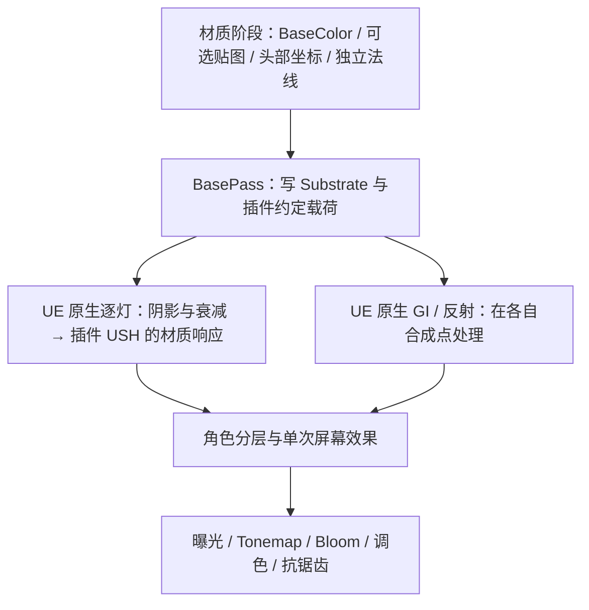

# 终末地公开复刻流程与本插件的对应关系

核查日期：2026-10-15。读了下列仓库的实际 HLSL / Shader / Renderer Feature；没有运行这些 Unity / UE 示例，也没有把展示图当成本插件的验证图。

结论：**完整效果需要材质、逐灯光照、屏幕效果、几何分层、后处理共同完成。** 当前原生后端能承担前两层及 GI 接入，是继续开发的基座；本批 v8 补充发行协议检查与专用底色描边。它还不是完整终末地复刻，也不是跨 UE 版本稳定的公开 ShadingModel API。

## 参考了谁，哪些内容能确认

### 秋大叔：MyZmdShaders

[固定版本 6507457](https://github.com/qiudashu233/MyZmdShaders/tree/650745732f8251db150744eab60eb01613d1ecc8)。[原作者文章](https://zhuanlan.zhihu.com/p/2028819446546932894)当前抓取受限；[译文](https://techartnomad.tistory.com/735)只用于导航，以源码核对结论。

覆盖 cloth、skin、face、eye、hair、fur、outline、刘海影、眼影、LUT，是本次最成体系的算法参考。关键证据：

- [头发](https://github.com/qiudashu233/MyZmdShaders/blob/650745732f8251db150744eab60eb01613d1ecc8/Assets/MyZmd/ZmdHairToonMain.hlsl#L74)：漫反射法线与高光法线分开，高光法线可球化、柱面压平；RS 查表同时使用各向异性波瓣与观察方向。
- [眼睛](https://github.com/qiudashu233/MyZmdShaders/blob/650745732f8251db150744eab60eb01613d1ecc8/Assets/MyZmd/ZmdEyeToonMain.hlsl#L205)：Matcap 的 RGB 与 A 分别控制高光和染色，再受光照、暗部影响，不能仅加一块固定自发光。
- [脸部](https://github.com/qiudashu233/MyZmdShaders/blob/650745732f8251db150744eab60eb01613d1ecc8/Assets/MyZmd/ZmdFaceToonMain.hlsl#L152)：SDF 阈值、左右 UV 镜像及配套区域图均有模型约定；不能直接套到任意 MMD。

边界：其 shader [依赖定制 danbaidong 管线](https://github.com/qiudashu233/MyZmdShaders/blob/650745732f8251db150744eab60eb01613d1ecc8/Assets/MyZmd/MyZmdToonShader.shader#L209)，但仓库 manifest 未声明该包。表面 shader 读取该管线提供的逐角色阴影；管线本身不在此仓库。作者亦承认多灯未研究、描边和毛绒仍有差距。本次版本未发现许可证文件，作为研究参考，不直接搬运源码或资源。

### congyuxiaoyoudao：Endfield Character Rendering

[固定版本 2634c57](https://github.com/congyuxiaoyoudao/Endfield_Character_Rendering/tree/2634c570011f0dd2c9199dc0e719136c69ca933e)，Unity 2022.3.57f1c1；[MIT](https://github.com/congyuxiaoyoudao/Endfield_Character_Rendering/blob/2634c570011f0dd2c9199dc0e719136c69ca933e/LICENSE.txt)。

[光照源码](https://github.com/congyuxiaoyoudao/Endfield_Character_Rendering/blob/2634c570011f0dd2c9199dc0e719136c69ca933e/Assets/Shaders/Library/EndfieldLighting.hlsl#L563)把引擎主灯、阴影、GI 与专用皮肤响应连接起来；但附加灯走普通 PBR，SSS 结果有注释禁用，不能视作多灯完整复刻。[Renderer Feature](https://github.com/congyuxiaoyoudao/Endfield_Character_Rendering/blob/2634c570011f0dd2c9199dc0e719136c69ca933e/Assets/Scripts/Features/EndfieldRenderFeature.cs)另建轮廓遮罩，[虹膜 shader](https://github.com/congyuxiaoyoudao/Endfield_Character_Rendering/blob/2634c570011f0dd2c9199dc0e719136c69ca933e/Assets/Shaders/EndfieldIris.shader#L95)另算视差。这说明分层与视差不能只靠改一个 BRDF 完成。

### Morgana：Perlica Character Shader

[固定版本 40c9229](https://github.com/Morgana-lgtm/Arknights-Endfield-Inspired-Perlica-Character-Shader/tree/40c92292eb49ecadb3a2ad4159176f0ec47e436a)，Unity 6000.3.11f1 / URP 17.3。

其 [Core / Lighting / Specular](https://github.com/Morgana-lgtm/Arknights-Endfield-Inspired-Perlica-Character-Shader/tree/40c92292eb49ecadb3a2ad4159176f0ec47e436a/Assets/Shader)拆分适合对照维护入口；实际角色着色主要处理主灯，未见附加灯循环。[后处理](https://github.com/Morgana-lgtm/Arknights-Endfield-Inspired-Perlica-Character-Shader/blob/40c92292eb49ecadb3a2ad4159176f0ec47e436a/Assets/Post/ZmdPostProcessPass.cs#L43)以 RenderGraph 串起 LUT、Bloom、FXAA，挂在原生后处理之后；这是该作者的近似选择，不能据此断言原作时序。本次版本未发现许可证文件，不直接搬运代码。

另查了 [blurfeng 的 UE 5.8 工程](https://github.com/blurfeng/arknights-endfield-npr/tree/c5be997dab13b6b404d2476fcec97ec7c7872a31)（GPL-3.0）：按部位材质、反壳描边、Custom Depth 屏幕边缘光组织，主要实现是二进制材质资产；可核对功能分工，未导入工程验证其节点和运行结果。

## 在我们架构里分别放哪里

脸部方向与高光法线属于材质数据；阴影来自当前帧原生逐灯入口。描边颜色读取当前模型 BaseColor，复用已有反壳与骨骼链路。深度 Rim 每像素合成一次，不能每盏灯重复叠加。眉眼透发、刘海投影是额外的深度/遮罩/几何关系，不能拿 SDF 阴影形状替代遮挡。后处理统一校准，不用它掩盖错误法线和错误阴影。

任意模型仍须只有 BaseColor 就能显示；配套法线、材质图、Matcap、脸部区域图只能增强。公开实现中的固定 UV、手绘阈值图和专用网格，不变成本插件的强制输入。

## 按此顺序实施和验收

1. 先补分发门槛：干净宿主构建、Cook、打包运行；校验精确引擎适配版本、载荷格式与失败回退。当前工程编译成功不能代替这些证据。
2. 完成由 BaseColor 派生的描边；独立验证隐藏槽、透明槽、角色切换和骨骼动画。
3. 补齐头发独立法线/切线与二维 RS、皮肤暗部 LUT/SSS、眼睛 Matcap/视差，各自提供几何兜底。
4. 加单次深度 Rim、眉眼层与刘海遮挡，再校准曝光及调色。
5. 固定参考机位，分别测多灯、自影/外影、暗环境、头部转动、Morph、无配套贴图，并归档实际引擎对照。完成这些以后再讨论“完整复刻”。

维护入口见 [原生后端说明](ENDFIELD_NATIVE_BACKEND.md)与[易读流程图解](ENDFIELD_NATIVE_RENDERING_GUIDE.md)。本次参考源码固定快照保存在本地 `Saved/Phase2Reference/Endfield2/public-reproductions-2026-10-15/`，不随插件提交、打包或分发。
