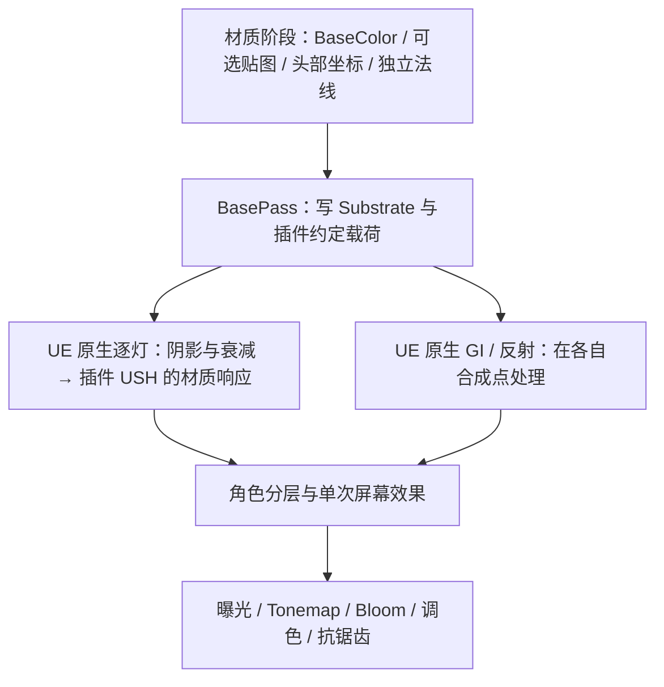

# 终末地公开复刻流程与本插件的对应关系

**历史快照（2026-10-19 标记）**：本文保留原批次的研究、状态与验证，内部“当前／下一步”和历史聊天指令不作为今日架构或执行约束。现状先读[当前架构](RENDERING_ARCHITECTURE.md)和[接手状态](ENDFIELD_V2_FOR_GPT.md)，原日期与证据保持。

核查日期：2026-10-15。读了下列仓库的实际 HLSL / Shader / Renderer Feature；没有运行这些 Unity / UE 示例，也没有把展示图当成本插件的验证图。

结论：**完整效果需要材质、逐灯光照、屏幕效果、几何分层、后处理共同完成。** 当前 v9 原生后端在既有逐灯与 GI 入口上补充暗部体积、视角响应和二维 RS；此前 v8 的发行协议检查与专用底色描边仍保留。v9 已完成本轮编译和常规延迟截图对照，见[实际前后图](Screenshots/2026-10-15-endfield-volume/README.md)；本文记录方程和代码对应关系，不代表完整复刻画质或新版发行包已验收。它也不是跨 UE 版本稳定的公开 ShadingModel API。

## 参考了谁，哪些内容能确认

### 秋大叔：MyZmdShaders

[固定版本 6507457](https://github.com/qiudashu233/MyZmdShaders/tree/650745732f8251db150744eab60eb01613d1ecc8)。[原作者文章](https://zhuanlan.zhihu.com/p/2028819446546932894)当前抓取受限；[译文](https://techartnomad.tistory.com/735)只用于导航，以源码核对结论。

覆盖 cloth、skin、face、eye、hair、fur、outline、刘海影、眼影、LUT，是本次最成体系的算法参考。关键证据：

- [头发](https://github.com/qiudashu233/MyZmdShaders/blob/650745732f8251db150744eab60eb01613d1ecc8/Assets/MyZmd/ZmdHairToonMain.hlsl#L74)：漫反射法线与高光法线分开，高光法线可球化、柱面压平；RS 查表同时使用各向异性波瓣与观察方向。
- [眼睛](https://github.com/qiudashu233/MyZmdShaders/blob/650745732f8251db150744eab60eb01613d1ecc8/Assets/MyZmd/ZmdEyeToonMain.hlsl#L205)：Matcap 的 RGB 与 A 分别控制高光和染色，再受光照、暗部影响，不能仅加一块固定自发光。
- [脸部](https://github.com/qiudashu233/MyZmdShaders/blob/650745732f8251db150744eab60eb01613d1ecc8/Assets/MyZmd/ZmdFaceToonMain.hlsl#L152)：SDF 阈值、左右 UV 镜像及配套区域图均有模型约定；不能直接套到任意 MMD。

边界：其 shader [依赖定制 danbaidong 管线](https://github.com/qiudashu233/MyZmdShaders/blob/650745732f8251db150744eab60eb01613d1ecc8/Assets/MyZmd/MyZmdToonShader.shader#L209)，但仓库 manifest 未声明该包。表面 shader 读取该管线提供的逐角色阴影；管线本身不在此仓库。作者亦承认多灯未研究、描边和毛绒仍有差距。本次版本未发现许可证文件，作为研究参考，不直接搬运源码或资源。

### congyuxiaoyoudao：Endfield Character Rendering

[固定版本 2634c57](https://github.com/congyuxiaoyoudao/Endfield_Character_Rendering/tree/2634c570011f0dd2c9199dc0e719136c69ca933e)，Unity 2022.3.57f1c1；[MIT](https://github.com/congyuxiaoyoudao/Endfield_Character_Rendering/blob/2634c570011f0dd2c9199dc0e719136c69ca933e/LICENSE.txt)。

[光照源码](https://github.com/congyuxiaoyoudao/Endfield_Character_Rendering/blob/2634c570011f0dd2c9199dc0e719136c69ca933e/Assets/Shaders/Library/EndfieldLighting.hlsl#L563)把引擎主灯、阴影、GI 与专用皮肤响应连接起来；但附加灯走普通 PBR，SSS 结果有注释禁用，不能视作多灯完整复刻。[Renderer Feature](https://github.com/congyuxiaoyoudao/Endfield_Character_Rendering/blob/2634c570011f0dd2c9199dc0e719136c69ca933e/Assets/Scripts/Features/EndfieldRenderFeature.cs)另建轮廓遮罩，[虹膜 shader](https://github.com/congyuxiaoyoudao/Endfield_Character_Rendering/blob/2634c570011f0dd2c9199dc0e719136c69ca933e/Assets/Shaders/EndfieldIris.shader#L95)另算视差。这说明分层与视差不能只靠改一个 BRDF 完成。

### Morgana：Perlica Character Shader

[固定版本 40c9229](https://github.com/Morgana-lgtm/Arknights-Endfield-Inspired-Perlica-Character-Shader/tree/40c92292eb49ecadb3a2ad4159176f0ec47e436a)，Unity 6000.3.11f1 / URP 17.3。

其 [Core / Lighting / Specular](https://github.com/Morgana-lgtm/Arknights-Endfield-Inspired-Perlica-Character-Shader/tree/40c92292eb49ecadb3a2ad4159176f0ec47e436a/Assets/Shader)拆分适合对照维护入口；实际角色着色主要处理主灯，未见附加灯循环。[后处理](https://github.com/Morgana-lgtm/Arknights-Endfield-Inspired-Perlica-Character-Shader/blob/40c92292eb49ecadb3a2ad4159176f0ec47e436a/Assets/Post/ZmdPostProcessPass.cs#L43)以 RenderGraph 串起 LUT、Bloom、FXAA，挂在原生后处理之后；这是该作者的近似选择，不能据此断言原作时序。本次版本未发现许可证文件，不直接搬运代码。

另查了 [blurfeng 的 UE 5.8 工程](https://github.com/blurfeng/arknights-endfield-npr/tree/c5be997dab13b6b404d2476fcec97ec7c7872a31)（GPL-3.0）：按部位材质、反壳描边、Custom Depth 屏幕边缘光组织，主要实现是二进制材质资产；可核对功能分工，未导入工程验证其节点和运行结果。

## v9：从参考方程到当前代码

### v8 留下的简化

此前客户端 RD 已按真实 RGB/A 数据进入自有 Profile，但暗部只做一次 `lerp(影色, 亮色, RD.A * shadow)`；Hair/Cloth 没有另读 `RD(NoF).A`，RS 也仅采用 Cloth 的 V=0.696、Hair 的 V=0.5 固定行。每盏灯都使用这份带暗底的响应，背光和补光也会累加约一半底色，容易填平发束和衣褶。这解释了需要修正的数学风险，不能单凭它断定某张旧截图的全部成因。

`Diffuse_Lambert(color)` 只含 `color / π`。UE 5.8.3 的 `SubstrateToonEvaluateCommon` 本来就让 ramp 决定明暗，没有另外乘 `AreaLight.NoL`；Deferred 外层也没有补乘这个余弦。因此本轮保留主光的 signed NoL 查表约定，不能把统一加 `max(N·L,0)` 描述为“补回引擎漏算项”。

### 双暗层与 RD(NoF)

当前实现见 [TMMDEndfieldNativeBSDF.ush](../Shaders/Core/TMMDEndfieldNativeBSDF.ush) 的 `ApplyDiffuseRamp`、`EvaluateToonResponse`。Hair/Cloth 的 NoF 使用法线与朝向相机的基轴点积；UE 的基轴取 `-View.ViewForward`。它与每个像素到相机的 V 分开，不把头发高光法线替代成全部用途的法线。

以 `a=RD(u).A`、`s=原生 Toon 阴影透光率`、`o=材质 AO`、`v=RD(NoF*0.5+0.5).A` 表示当前主光分支，核心混合为：

```text
dark  = 从底色派生的角色影色
deep  = saturation(0.65 * dark, 1.2)
inner = lerp(deep, dark, saturate(o * s * v + a))
color = lerp(inner, lit, min(a, o, s))
```

Skin 的 `v` 取 1；Hair/Cloth 另读视角 RD，并补入与水平背光、相机俯仰有关的 ramp 坐标修正。随后保留 `1-chroma + RD.RGB*chroma` 染色及上限 1.5 的亮度补偿。RD 的灰色 RGB 不能当作普通漫反射乘数；A 与 RGB 有不同用途。

当前背光俯仰项采用公开 MyZmd 的 `smoothstep01(saturate(.75-abs(cameraForward.z)))`，客户端汇编对应位置另有系数2，两者并不完全相同。Cloth/Skin 主光高光半程方向恢复公开实现 Day=1 的观察方向偏置；Hair 仍从自己的光/视方向构造波瓣。这里是有明确来源的局部重建，尚未覆盖完整昼夜和角色参数。

这一结构可对照固定版本 MyZmd 的[头发 NoF 与双暗层](https://github.com/qiudashu233/MyZmdShaders/blob/650745732f8251db150744eab60eb01613d1ecc8/Assets/MyZmd/ZmdHairToonMain.hlsl#L175)及[皮肤暗部混合](https://github.com/qiudashu233/MyZmdShaders/blob/650745732f8251db150744eab60eb01613d1ecc8/Assets/MyZmd/ZmdSkinToonMain.hlsl#L181)。这是按数学含义重新实现；没有复制该无许可证快照的源码。

本地客户端 DXBC/反编译摘要也支持这些操作：`shader-equation/asm` 与 `shader-equation/decomp` 下，`hair_01` 的标签 L1208、L1241–1246 分别对应视角 RD 和双暗层；`npr_cloth01` 的 L1150、L1183–1201 对应同类结构；`skin_body` 的 L1125–1138、L1167–1185 对应 signed NoL、A 混合与 RGB 染色。Lxxxx 沿用原始 `asm.txt` 的行号标签，不是 `decomp.txt` 的物理行号；完整本地根目录为 `Saved/Phase2Reference/Endfield2/`。未恢复的昼夜混合、运行时角色全局参数和专用阴影约定，不能由这段局部对照推定为相同。

### 二维 RS：32×8 近似取代固定行

[MMDEndfieldNativeProfile.cpp](../Source/Ue5MMDTools/Private/Rendering/MMDEndfieldNativeProfile.cpp) 与 [MMDEndfieldNativeRampData.inl](../Source/Ue5MMDTools/Private/Rendering/MMDEndfieldNativeRampData.inl) 从用户本地已提取的 `T_actor_common_cloth_04_RS`、`T_actor_common_hair_09_RS` 真实 256×256 线性 RGBA32 数据重采样。源采样为双线性 clamp，不翻转 V；32×8 节点位于 `(x/31,y/7)`，并按 `slot=y*32+x` 展平。

Specular RGB 用 `slot/256` 常量区间存入现有 Profile 行，shader 对四个 slot 分别 `Load` 后再做二维插值，避免跨行串色。Diffuse RGB 与 Specular A 中的 RD.A 仍连续采样，Diffuse A 的控制 metadata 不变。缓存算法版本升至 3，覆盖尺寸及数组；Mode 0/1 恢复源曲线。atlas 分辨率不足 256 时，C++ 把整个副本退回 Mode 0，而不是让 shader 将残缺 tile 当作 RS。这里没有新增 GBuffer 或 ShadingModelID。

CPU 离线估算包含 UE Profile 的 float16 量化，以原图全部 256×256 texel 中心比较 RGB：Cloth 平均绝对误差 0.002884、最大 0.031695；Hair 平均绝对误差 0.001235、最大 0.026010，数值范围均为 0–1。这是压缩查表的数值误差，不是 GPU 画质验证，也不是无损的完整二维贴图。详细报告位于本地 `native-fidelity/rs-tile-32x8/report.json`。

来源为 `material-values/ramps/T_actor_common_cloth_04_RS.json` 和 `T_actor_common_hair_09_RS.json`；重建源 RGBA 的 SHA256 分别是 `538181418de6d5f0f9529923b74966d080ffeb8f85e08a0c07ebce2cdd9cd607`、`6d6dc9dfd5bf580cd3870c609814ff14e4846dd8b1185cb0353f44bd24d29de8`。只有重采样数值进入插件，未导入公共示例的角色资源。

Cloth 用波瓣坐标和 roughness 查询二维 RS；Hair 的第二坐标与水平观察边缘、切线半程方向有关，替代旧固定 V。当前仍缺完整 P/flow、双波瓣与条纹门控，不能因查表变成二维就声称头发方程完整。

### Skin 视角染色与 UE 多灯扩展

Skin 已加入基于 `N·V` 的亮部染色，可对照 [MyZmd Skin 视角项](https://github.com/qiudashu233/MyZmdShaders/blob/650745732f8251db150744eab60eb01613d1ecc8/Assets/MyZmd/ZmdSkinToonMain.hlsl#L99)与本地 `skin_body` 的 L408–414。它仍是代表参数驱动的表面颜色响应：暗部 LUT 尚未采样，也没有实现真正的皮下散射或深度 Rim。

主光与附加灯分工是本插件面向 UE 的扩展。当前桌面入口以引擎为 View 选择的主平行光方向进行匹配；主光保留 NPR 暗层，附加灯仅累加受光面的余弦与原生表面阴影，避免每盏灯再铺暗底。灯色、强度、LightMask 和最终累加仍交给 UE，只乘一次。这不等于恢复了客户端全部附加灯类型，也不应冒充 MyZmd 已完成多灯；congyu 的[主灯/附加灯分工](https://github.com/congyuxiaoyoudao/Endfield_Character_Rendering/blob/2634c570011f0dd2c9199dc0e719136c69ca933e/Assets/Shaders/Library/EndfieldLighting.hlsl#L563)同样只能作为实现边界的参考。

当前没有公开逐灯唯一 ID：同向重叠平行光无法仅靠方向区分。Clustered 局部灯、没有绑定主光查询的入口也不能假定已识别主光；这些都是需要专门对照的限制。GI/反射继续使用原生合成入口，不能把主光暗层复制成额外一份 GI。

### 尚未闭合的差距

- **暗部与皮肤**：LUT、Face/Body 各自的角色参数、完整昼夜/环境混合尚未接齐；本轮双暗层中的材质 AO 明确取 1，不能把阴影值冒充 AO。原生场景 AO 仍由 UE 自己的路径处理。
- **头发**：独立高光法线、柱面压平和竖向切线目前只有几何兜底；专用 split normal、flow/P、线条遮罩和完整第二波瓣数据尚未接入。
- **分层与屏幕效果**：深度 Rim、眼睛 Matcap/视差、眉眼透发和相应遮罩/几何层，以及终末地后处理校准尚未完成。几何方向场与原生遮挡也不能替代这些效果。
- **验证**：本轮 v9 的各渲染路径编译、主灯/补光隔离、低分辨率回退、重新 Cook 与实际图像对照仍需完成；先前 v8 的构建或截图不能作为本轮结果。

## 在我们架构里分别放哪里



脸部方向与高光法线属于材质数据；阴影来自当前帧原生逐灯入口。描边颜色读取当前模型 BaseColor，复用已有反壳与骨骼链路。深度 Rim 每像素合成一次，不能每盏灯重复叠加。眉眼透发、刘海投影是额外的深度/遮罩/几何关系，不能拿 SDF 阴影形状替代遮挡。后处理统一校准，不用它掩盖错误法线和错误阴影。

任意模型仍须只有 BaseColor 就能显示；配套法线、材质图、Matcap、脸部区域图只能增强。公开实现中的固定 UV、手绘阈值图和专用网格，不变成本插件的强制输入。

## 按此顺序实施和验收

1. 先补分发门槛：干净宿主构建、Cook、打包运行；校验精确引擎适配版本、载荷格式与失败回退。当前工程编译成功不能代替这些证据。
2. 完成由 BaseColor 派生的描边；独立验证隐藏槽、透明槽、角色切换和骨骼动画。
3. 验证 v9 的双暗层/NoF 与二维 RS 近似，再补齐头发专用法线/切线数据、皮肤暗部 LUT/SSS、眼睛 Matcap/视差，各自保留几何兜底。
4. 加单次深度 Rim、眉眼层与刘海遮挡，再校准曝光及调色。
5. 固定参考机位，分别测多灯、自影/外影、暗环境、头部转动、Morph、无配套贴图，并归档实际引擎对照。完成这些以后再讨论“完整复刻”。

维护入口见 [原生后端说明](ENDFIELD_NATIVE_BACKEND.md)与[易读流程图解](ENDFIELD_NATIVE_RENDERING_GUIDE.md)。本次参考源码固定快照保存在本地 `Saved/Phase2Reference/Endfield2/public-reproductions-2026-10-15/`，不随插件提交、打包或分发。
