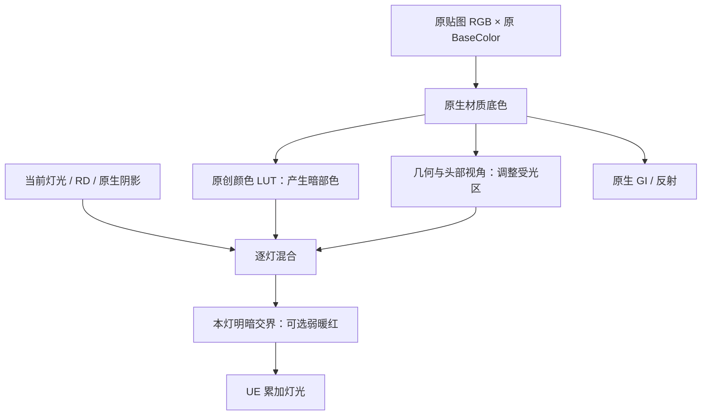

# 皮肤与脸部材质

当前（2026-10-16）：**Backend `endfield-native-bsdf-v14-cast-clean`／Cooked协议14／Graph7／Profile布局42**，payload5／FaceData5／Frame1保持。皮肤LUT、视角与原创泛红公式沿用v13；这批修正的是投影和覆盖，仍不是真实空间SSS。`cast4`生产实拍27图／156次槽检查／0失败，Editor协议14验证通过，本次目检鼻椭圆消失；mode0_final2和atlas64_final各8图／78次检查／0失败，均验证协议14；`EFCastClean16c` BuildOnly三配置通过。

新版预设Hair投影覆盖设0，影响所有接收面；Skin的投影抑制只限有效Face coverage。原Opaque转Masked时主覆盖保持1，自有Masked在BasePass恢复必要裁剪；所有自有Toon透明父保留连续alpha，取消强制masked投影。脸部SDF明暗分区、投影覆盖和原生阴影接收分别控制，身体／场景接收路径不改；没有新RT、全身影子代理或安装引擎改动。机制、研究边界及本批来源见[脸部与头发阴影说明](ENDFIELD_FACE_SHADOW_GUIDE.md)。

历史验证（2026-10-16，v13）：**Backend `endfield-native-bsdf-v13-skin-redness`／Cooked协议13／Profile布局42**；payload5／Graph6／FaceData5／Frame1。最终 `redness3` NativeBackendProbe完成34图／156次槽检查／0失败，Mode0及启动atlas64各8图／78次检查／0失败；Editor协议13验证通过。[当批原图](Screenshots/2026-10-16-endfield-skin-redness/README.md)与[来源摘要](Screenshots/2026-10-16-endfield-skin-redness/sources.json)记录小幅局部暖红和阴影控制，不代表全部GPU路径或真实空间SSS通过。下方v12结果也保留原版本与日期。

之前只把皮肤底色调暖，颜色虽变了，却不能补出随光照和视角变化的质感。现在主要由 `CharacterSkinLighting` 控制：暗部按源色查颜色LUT，受光区按视角产生色彩变化，再由现有RD、原生阴影和灯光混合。它不靠固定自发光，也没有降低整场景曝光。

**这是原作风格的皮肤响应近似，不是真正的空间SSS。** 当前没有皮肤邻域扩散、厚度透射或屏幕模糊。原作的RefineMask尚未接入，所以脸部视角响应也不能称为原版精确还原。

## v13：明暗交界的弱暖红

新增项是**插件原创风格化泛红**，不是从原作提取到的红边算法。它只在Skin当前灯的漫反射局部生效：普通几何用连续的有符号 `N·L` 距离形成窄带；主方向光的有效V5脸面用 `cutoff-theta` 的连续角度距离形成窄带，再按覆盖与水平光可靠性混合。这样不用已经压成正负1的SDF明暗结果推算过渡。

`CharacterSkinLighting`新增四个设置，修改后重新应用预设：

- `RednessStrength`：强度，范围 `0..1`。结构与旧资产默认 `0`，新生成的EndfieldV2预设设为 `.18`。
- `RednessWidth`：几何窄带的NoL半宽，默认 `.22`，范围 `0.05..0.6`，不是角度单位。
- `RednessAngularWidth`：V5窄带的角半宽，按π归一化，默认 `.035`，约每侧 `6.3°`，范围 `0.005..0.15`。它与 `FaceAngularSoftness`控制不同的效果，不更改原SDF明暗柔化默认值。
- `RednessTint`：线性RGB默认 `(1,.4,.30)`，各通道 `0..1`，alpha不参与。

新项受较弱的NoV权重影响，正面仍可有响应；原生 `SurfaceShadow≤.1`时完全关闭，随后平滑恢复。它对当前漫反射作有界暖色重分配和少量填充，再交给本灯原有路径。灯色、强度和衰减只由原生外层计算一次；独立高光、GI与反射不改，没有新增RT、GBuffer字段或空间pass。`RednessStrength=0`保留相同设置下的v12响应；总开关关闭也保留原先的关闭回退。

## 先调逐灯皮肤响应

打开 `DA_Render_EndfieldV2` 的 `CharacterSkinLighting`，修改后重新应用预设：

- `bEnabled`：总开关。新版生成的EndfieldV2预设开启；结构默认值及没有新设置的旧调用关闭，保留既有外观。
- `ShadowLutStrength`：暗部颜色查表的权重，默认 `1`，范围 `0..1`。它改变暗部的颜色关系，不是把全部底色涂成一种颜色。
- `BodyViewScale`：身体视角响应的绝对强度，默认 `.7`，范围 `0..2`。
- `FaceViewScale`：有效脸部的视角响应强度，默认 `1.1`，范围 `0..2`。
- `ViewTint`：视角响应的线性RGB乘色，默认约 `(.6745,.6116,.5333)`；透明度不使用这个颜色的alpha。
- `FaceAngularSoftness`：V5截止角两侧的柔化半宽，以半圈归一化。默认仍为 `2/255`，约为每侧 `1.41°`，范围 `1/255..0.15`。较早v12的 `.025`仅作独立对照，没有采用为预设默认值。它只影响有效主方向光的脸部阈值，不模糊原生投影。

脸部使用已有头部朝向、几何法线与V5覆盖构造稳定的视角近似，独立高光法线继续保留。没有可用的脸部载荷时，退回通用几何响应；当前没有借用原作RefineMask的R/G/B语义。附加灯仍按既有受光面、原生阴影和分类高光累加，避免每盏灯重复铺暗底。

LUT只替换暗部颜色源；原生灯色、强度、阴影和间接光仍走现有管线。关闭新总开关时，暗部、视角公式及阈值柔化回到v11响应。仅改变这里的数值不需要新增shader内核，换后端代码与发行协议仍须重编和重新Cook。

## LUT存在哪里，为什么不依赖模型UV

这里查表的坐标是**颜色本身**，不是脸部UV：线性BaseColor转成编码RGB，三个通道分别作为立方体坐标。

- 使用插件原创程序化 `6×6×6` 配方，共216个颜色点；按亮度变化的暖色吸收保留源色差异，黑色仍为黑色。
- 输出保存为线性RGB，八角插值后直接进入暗部混合，不再重复gamma解码。
- 借用Skin原本未使用的 **Profile Specular RGB**，0至215槽索引为 `r + 6*g + 36*b`；布局42的216槽保存泛红强度／NoL宽度／角宽度，217槽保存泛红RGB，218至255槽继续重复最后一个颜色。原创颜色配方仍为recipe1。
- **Specular.A仍保存RD.A**；Skin识别颜色立方体布局后，高光响应继续用原有白色乘数。Hair／Cloth的32×8 RS不变。
- Diffuse.A的空隙保存布局标记 **42**，其余八个控制平台仍是总开关、LUT权重、两个视角强度、RGB与角度柔化；原模式、GI、角色签名及诊断区保留。

shader兼容布局41：保留原cube／LUT与视角响应，泛红强度视为0，不读取新尾槽。布局42的尾槽数值无效时只关闭泛红，仍将有效cube识别为颜色数据，不误当成高光RS。新六个控制值有限化后一起参与瞬态缓存键，避免同源Profile的不同皮肤设置串值。

atlas须在应用预设前设为至少256；256／512下都按固定槽读取，而不是把216点拉伸到整条纹理。绑定时不足256会使用原曲线与Mode0；已经分配tile／cube Profile后，不支持运行中直接降低atlas分辨率。这个颜色表随既有Profile更新，没有新增逐帧RT、GBuffer字段、ShadingModel ID或角色绘制。新配方没有复制或重采样客户端SkinLUT资源；原始SkinLUT与RefineMask提取数据仅在本机对照，不随插件分发。

公开参考可看固定版本MyZmd的[皮肤视角与暗部LUT](https://github.com/qiudashu233/MyZmdShaders/blob/650745732f8251db150744eab60eb01613d1ecc8/Assets/MyZmd/ZmdSkinToonMain.hlsl#L97)与[脸部视角遮罩](https://github.com/qiudashu233/MyZmdShaders/blob/650745732f8251db150744eab60eb01613d1ecc8/Assets/MyZmd/ZmdFaceToonMain.hlsl#L109)。这些代码及其“SSS”命名不能证明空间散射；本插件也没有直接搬运该无许可证快照的实现或资源。

## 静态肤色仍是可选控制

`CharacterSkinSurface` 和 `CharacterFaceSkinSurface` 继续分别调整身体／脸部的 `Tint`、`TintStrength`、`AlbedoScale`、`Saturation`、`Roughness`、`Specular`。新版生成的EndfieldV2预设将两组 `bEnabled` **默认关闭**，让逐灯响应直接使用源底色，避免先染暖再查暖色LUT。

开启静态设置会改变真实BaseColor，因此直射与GI都会受到影响；它是美术校正，不应称为SSS。已有可选值仍为身体scale `.96`、tint `(1,.92,.88)`、strength `.35`、saturation `1.05`；脸部scale `.85`、tint `(1,.84,.76)`、strength `.70`、saturation `1.10`。两组roughness `.742`、specular `.454`。这些是插件起点，不是原作精确参数。

三个独立Face父材质为 `M_MMD_EndfieldV2_Face_Opaque`、`Masked`、`Translucent`，默认Profile为Skin。**单独预览Face父材质**仍有暖肤色兜底，Body／Face静态组同值且开启；Stage应用预设会显式覆盖这些默认值。共享三父材质的静态组默认关闭。不要把独立预览球的默认值与新预设的默认状态混为一谈。

## 混合槽和透明附脸层

Face父材质决定槽可以使用脸部设置，静态颜色、粗糙度和高光仍按像素覆盖混合。覆盖复用V5的A和前层深度B，不依赖底图UV，也不读取SDF阈值开关；因此手动关闭阈值不会顺带关闭静态脸部肤色。逐灯脸部视角近似则使用当前可用的V5载荷，无载荷时采用几何兜底。

FaceData被移除、版本失效、宿主身份或图不匹配时，子系统清掉绑定版本，防止旧图继续染脸；有效绑定下手动关阈值会保留静态覆盖。透明附层复用已验证宿主的图，并各自从源底色计算。透明度继续走原有 `Texture.A × Opacity`，保留连续软alpha与恢复快照。

## 维护与验证

- [TMMDEndfieldSkinResponse.ush](../Shaders/Core/TMMDEndfieldSkinResponse.ush)：布局41／42读回、颜色立方体插值、暗部／视角及原创泛红响应。
- [MMDEndfieldSkinLutData.inl](../Source/Ue5MMDTools/Private/Rendering/MMDEndfieldSkinLutData.inl)：原创CPU配方与版本；修改配方须升级版本。
- [MMDEndfieldNativeProfile.cpp](../Source/Ue5MMDTools/Private/Rendering/MMDEndfieldNativeProfile.cpp)：固定槽、metadata平台、参数净化与按设置隔离的瞬态缓存。
- [TMMDEndfieldNativeBSDF.ush](../Shaders/Core/TMMDEndfieldNativeBSDF.ush)：将暗部和受光区接入原有逐灯混合，保留独立高光及原生阴影。
- [TMMDEndfieldSkinMaterial.ush](../Shaders/Core/TMMDEndfieldSkinMaterial.ush)：可选静态肤色与逐像素表面准备。
- [MMDStageRenderPreset.h](../Source/Ue5MMDTools/Public/Stage/MMDStageRenderPreset.h)与[MMDStageLibrary.cpp](../Source/Ue5MMDTools/Private/Stage/MMDStageLibrary.cpp)：预设入口、绑定和恢复。
- [MMDEndfieldToonPresetsCommandlet.cpp](../Source/Ue5MMDToolsEditor/Private/Editor/MMDEndfieldToonPresetsCommandlet.cpp)：当前Graph7、15包及七父材质的生成检查；透明父材质的投影标志也在这里配置。

**历史验证（2026-10-16，v13）**：`Editor3`与`Game1`构建通过，`generate13`保存15包，七父材质真实shader数依次为21／40／29／21／40／29／40。最终 `redness3` 是NativeBackendProbe包装的26项泛红与8项AB，共34图／156次槽检查／0失败；Mode0、启动atlas64各8图／78次检查／0失败。三组均读到并验证Editor GlobalShader协议13；另有17项静态边界检查通过。

外部像素分析72／72项通过。本批独立ROI清单绑定最终报告与PNG的SHA，图像已按本次运行目检。侧光固定右颊ROI开关差异MAE为1.30296，自身关闭复拍噪声为.20222；平均RGB变化约 `(+1.0911,-1.0911,-1.5356)`，属于很小的局部暖红。**背光差异未超过复拍噪声，不计为本轮新增效果**；这些数值是控制检查，不是肤质评分。

原生阴影对照中，同一右颊ROI的画面编码亮度从无遮挡200.02576降到放块后的.068889，关闭原生阴影后为202.61194；对应泛红开关效应MAE为1.30296／0／1.27037。关闭原生阴影后，两档强度下的放块／不放块图分别整图RGB相同；零直射灯的泛红开／关图也整图RGB相同。它们支持该采样位置的遮挡与门控归因，不是对整张原生shadow mask的读取或验证。

`EFSkinRedness16` BuildOnly的Editor Development／Game Development／Shipping三配置、必需文件与皮肤源码检查通过；12份final-freeze Source／HLSL在工作区与发行包哈希一致。发行包保留本机 `Saved/EFSkinRedness16/Ue5MMDTools/`，来源见上方摘要。该包未重测干净宿主、角色绘制、Cooked或性能；身体Skin、附加灯与Legacy也未独立GPU实测，不能据此宣称全部内核、真实扩散或厚度透射已实现。

保护清单2,381项中2,379不变，仅自有Preset和OffsetLinear两包变化。最终保留默认强度 `.18`与既有SDF柔化 `2/255`，本次没有以加大参数代替控制验证。画质及完整十项目标仍未验收。

**历史验证（2026-10-16，v12）**：最终 `Editor3`成功；`Game1`运行时模块构建成功后，仅验证用CPP与Legacy USH继续修正，没有把它写成新Cooked游戏运行。`generate12b`完成15包，七父材质的shader数依次为共享三模式21／40／29、Face三模式21／40／29、描边40。原图见[v12归档](Screenshots/2026-10-16-endfield-skin-response/README.md)。

`response3`为Mode2：47张图、195次槽检查、0失败，包含18项皮肤响应对照（含背光关闭后的复拍）、21项facefix和8项AB。Mode0及启动时atlas64各为8图／78次检查／0失败。本次Editor全局shader编译反射读到协议12且验证成功，不能据此证明另行Cook的库。冻结的14个源码／验证文件及原PNG来源见[本轮摘要](Screenshots/2026-10-16-endfield-skin-response/sources.json)。

实际观察：背光下暖肤差异明显，侧光和视角变化较细微；主光设0的开／关图全部RGB逐字节一致。外部55项严格检查全通过：背光白衣ROI的开关差异MAE为5.0864，不超过关闭后复拍的自身噪声5.3136；右颊效应11.1052、复拍噪声1.3548，鼻部核心效应9.9101、噪声.09788。它们用于区分可见响应与时序波动，不是画质评分，也不表示鼻梁硬边已解决。身体皮肤、512 atlas的GPU表现、动画／Morph等边界仍需独立验证。

首轮 `generate12`因Legacy调用漏第五参而失败，修正后 `generate12b`通过。`response1`暴露测试恢复距离场阴影属性时setter裁值，Editor2修复；`response2`46图／0失败后，`response3`再补背光关闭复拍。

最终 `EFSkinResponse16c` 的 **BuildOnly通过**：Editor Development／Game Development／Shipping三配置与必需文件检查成功，`payload_files_verified`、`skin_response_sources_verified`为真。`response3`后冻结的14个Source／Shader文件在当时工作区与发行包中逐字节一致；v12收尾阶段仅补文档与截图，没有改已验证代码，v13结果已在上方独立列出。来源见[摘要](Screenshots/2026-10-16-endfield-skin-response/sources.json)，v12发行包留在本机 `Saved/EFSkinResponse16c/Ue5MMDTools/`。

保护清单2,381项中2,379不变，仅自有Preset与OffsetLinear包变化；用户27个资产、10张旧PNG、Mobile文档、用户Face shader与安装引擎保持。**v12空白宿主、发行包角色绘制与完整Cook／打包游戏均未重跑**，不能把BuildOnly当作最终二进制角色GPU验证。本轮仍非真实空间SSS或完整肤质验收。

**历史验证（2026-10-16，v11）**：[静态皮肤材质实拍与来源](Screenshots/2026-10-16-endfield-skin/README.md)记录当时44张Mode2、8张Mode0、独立BuildPlugin三配置及空白宿主七父材质编译。它验证的是上一版静态表面准备，不能证明协议12或新Cook已通过。完整终末地画质、真实空间SSS与新版Cooked游戏仍未验收。
