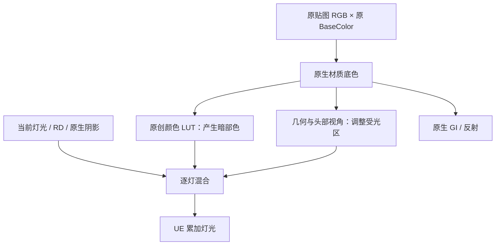

# 皮肤与脸部材质

更新：2026-10-16。当前源码为 **Backend v12／Cooked协议12／payload5／Graph6／FaceData5／Frame1**。最终 `Editor3`与`Game1`运行时模块构建通过；`generate12b`完成15包、七父材质编译。本页区分逐灯皮肤响应与静态肤色准备，[本轮实拍与来源](Screenshots/2026-10-16-endfield-skin-response/README.md)记录v12开发验证，不能代替完整肤质或Cooked验收。

之前只把皮肤底色调暖，颜色虽变了，却不能补出随光照和视角变化的质感。现在主要由 `CharacterSkinLighting` 控制：暗部按源色查颜色LUT，受光区按视角产生色彩变化，再由现有RD、原生阴影和灯光混合。它不靠固定自发光，也没有降低整场景曝光。

**这是原作风格的皮肤响应近似，不是真正的空间SSS。** 当前没有皮肤邻域扩散、厚度透射或屏幕模糊。原作的RefineMask尚未接入，所以脸部视角响应也不能称为原版精确还原。

## 先调逐灯皮肤响应

打开 `DA_Render_EndfieldV2` 的 `CharacterSkinLighting`，修改后重新应用预设：

- `bEnabled`：总开关。新版生成的EndfieldV2预设开启；结构默认值及没有新设置的旧调用关闭，保留既有外观。
- `ShadowLutStrength`：暗部颜色查表的权重，默认 `1`，范围 `0..1`。它改变暗部的颜色关系，不是把全部底色涂成一种颜色。
- `BodyViewScale`：身体视角响应的绝对强度，默认 `.7`，范围 `0..2`。
- `FaceViewScale`：有效脸部的视角响应强度，默认 `1.1`，范围 `0..2`。
- `ViewTint`：视角响应的线性RGB乘色，默认约 `(.6745,.6116,.5333)`；透明度不使用这个颜色的alpha。
- `FaceAngularSoftness`：V5截止角两侧的柔化半宽，以半圈归一化。默认仍为 `2/255`，约为每侧 `1.41°`，范围 `1/255..0.15`。本轮 `.025`仅作独立对照，没有采用为预设默认值。它只影响有效主方向光的脸部阈值，不模糊原生投影。

脸部使用已有头部朝向、几何法线与V5覆盖构造稳定的视角近似，独立高光法线继续保留。没有可用的脸部载荷时，退回通用几何响应；当前没有借用原作RefineMask的R/G/B语义。附加灯仍按既有受光面、原生阴影和分类高光累加，避免每盏灯重复铺暗底。

LUT只替换暗部颜色源；原生灯色、强度、阴影和间接光仍走现有管线。关闭新总开关时，暗部、视角公式及阈值柔化回到v11响应。仅改变这里的数值不需要新增shader内核，换后端代码与发行协议仍须重编和重新Cook。

## LUT存在哪里，为什么不依赖模型UV

这里查表的坐标是**颜色本身**，不是脸部UV：线性BaseColor转成编码RGB，三个通道分别作为立方体坐标。

- 使用插件原创程序化 `6×6×6` 配方，共216个颜色点；按亮度变化的暖色吸收保留源色差异，黑色仍为黑色。
- 输出保存为线性RGB，八角插值后直接进入暗部混合，不再重复gamma解码。
- 借用Skin原本未使用的 **Profile Specular RGB**，固定256槽中索引为 `r + 6*g + 36*b`；216至255槽重复最后一个颜色。
- **Specular.A仍保存RD.A**；Skin识别颜色立方体布局后，高光响应继续用原有白色乘数。Hair／Cloth的32×8 RS不变。
- Diffuse.A的空隙保存布局标记 **41**、总开关、LUT权重、两个视角强度、RGB与角度柔化；原模式、GI、角色签名及诊断区保留。

atlas须在应用预设前设为至少256；256／512下都按固定槽读取，而不是把216点拉伸到整条纹理。绑定时不足256会使用原曲线与Mode0；已经分配tile／cube Profile后，不支持运行中直接降低atlas分辨率。这个颜色表随既有Profile更新，没有新增逐帧RT、GBuffer字段、ShadingModel ID或角色绘制。新配方没有复制或重采样客户端SkinLUT资源；原始SkinLUT与RefineMask提取数据仅在本机对照，不随插件分发。

公开参考可看固定版本MyZmd的[皮肤视角与暗部LUT](https://github.com/qiudashu233/MyZmdShaders/blob/650745732f8251db150744eab60eb01613d1ecc8/Assets/MyZmd/ZmdSkinToonMain.hlsl#L97)与[脸部视角遮罩](https://github.com/qiudashu233/MyZmdShaders/blob/650745732f8251db150744eab60eb01613d1ecc8/Assets/MyZmd/ZmdFaceToonMain.hlsl#L109)。这些代码及其“SSS”命名不能证明空间散射；本插件也没有直接搬运该无许可证快照的实现或资源。

## 静态肤色仍是可选控制

`CharacterSkinSurface` 和 `CharacterFaceSkinSurface` 继续分别调整身体／脸部的 `Tint`、`TintStrength`、`AlbedoScale`、`Saturation`、`Roughness`、`Specular`。新版生成的EndfieldV2预设将两组 `bEnabled` **默认关闭**，让逐灯响应直接使用源底色，避免先染暖再查暖色LUT。

开启静态设置会改变真实BaseColor，因此直射与GI都会受到影响；它是美术校正，不应称为SSS。已有可选值仍为身体scale `.96`、tint `(1,.92,.88)`、strength `.35`、saturation `1.05`；脸部scale `.85`、tint `(1,.84,.76)`、strength `.70`、saturation `1.10`。两组roughness `.742`、specular `.454`。这些是插件起点，不是原作精确参数。

三个独立Face父材质为 `M_MMD_EndfieldV2_Face_Opaque`、`Masked`、`Translucent`，默认Profile为Skin。**单独预览Face父材质**仍有暖肤色兜底，Body／Face静态组同值且开启；Stage应用预设会显式覆盖这些默认值。共享三父材质的静态组默认关闭。不要把独立预览球的默认值与新预设的默认状态混为一谈。

## 混合槽和透明附脸层

Face父材质决定槽可以使用脸部设置，静态颜色、粗糙度和高光仍按像素覆盖混合。覆盖复用V5的A和前层深度B，不依赖底图UV，也不读取SDF阈值开关；因此手动关闭阈值不会顺带关闭静态脸部肤色。逐灯脸部视角近似则使用当前可用的V5载荷，无载荷时采用几何兜底。

FaceData被移除、版本失效、宿主身份或图不匹配时，子系统清掉绑定版本，防止旧图继续染脸；有效绑定下手动关阈值会保留静态覆盖。透明附层复用已验证宿主的图，并各自从源底色计算。透明度继续走原有 `Texture.A × Opacity`，保留连续软alpha与恢复快照。

## 维护与验证

- [TMMDEndfieldSkinResponse.ush](../Shaders/Core/TMMDEndfieldSkinResponse.ush)：布局41读回、颜色立方体插值、暗部与视角响应。
- [MMDEndfieldSkinLutData.inl](../Source/Ue5MMDTools/Private/Rendering/MMDEndfieldSkinLutData.inl)：原创CPU配方与版本；修改配方须升级版本。
- [MMDEndfieldNativeProfile.cpp](../Source/Ue5MMDTools/Private/Rendering/MMDEndfieldNativeProfile.cpp)：固定槽、metadata平台、参数净化与按设置隔离的瞬态缓存。
- [TMMDEndfieldNativeBSDF.ush](../Shaders/Core/TMMDEndfieldNativeBSDF.ush)：将暗部和受光区接入原有逐灯混合，保留独立高光及原生阴影。
- [TMMDEndfieldSkinMaterial.ush](../Shaders/Core/TMMDEndfieldSkinMaterial.ush)：可选静态肤色与逐像素表面准备。
- [MMDStageRenderPreset.h](../Source/Ue5MMDTools/Public/Stage/MMDStageRenderPreset.h)与[MMDStageLibrary.cpp](../Source/Ue5MMDTools/Private/Stage/MMDStageLibrary.cpp)：预设入口、绑定和恢复。
- [MMDEndfieldToonPresetsCommandlet.cpp](../Source/Ue5MMDToolsEditor/Private/Editor/MMDEndfieldToonPresetsCommandlet.cpp)：Graph6、15包及七父材质的生成检查。

**本轮验证（2026-10-16，v12）**：最终 `Editor3`成功；`Game1`运行时模块构建成功后，仅验证用CPP与Legacy USH继续修正，没有把它写成新Cooked游戏运行。`generate12b`完成15包，七父材质的shader数依次为共享三模式21／40／29、Face三模式21／40／29、描边40。

`response3`为Mode2：47张图、195次槽检查、0失败，包含18项皮肤响应对照（含背光关闭后的复拍）、21项facefix和8项AB。Mode0及启动时atlas64各为8图／78次检查／0失败。本次Editor全局shader编译反射读到协议12且验证成功，不能据此证明另行Cook的库。冻结的14个源码／验证文件及原PNG来源见[本轮摘要](Screenshots/2026-10-16-endfield-skin-response/sources.json)。

实际观察：背光下暖肤差异明显，侧光和视角变化较细微；主光设0的开／关图全部RGB逐字节一致。外部55项严格检查全通过：背光白衣ROI的开关差异MAE为5.0864，不超过关闭后复拍的自身噪声5.3136；右颊效应11.1052、复拍噪声1.3548，鼻部核心效应9.9101、噪声.09788。它们用于区分可见响应与时序波动，不是画质评分，也不表示鼻梁硬边已解决。身体皮肤、512 atlas的GPU表现、动画／Morph等边界仍需独立验证。

首轮 `generate12`因Legacy调用漏第五参而失败，修正后 `generate12b`通过。`response1`暴露测试恢复距离场阴影属性时setter裁值，Editor2修复；`response2`46图／0失败后，`response3`再补背光关闭复拍。

最终 `EFSkinResponse16c` 的 **BuildOnly通过**：Editor Development／Game Development／Shipping三配置与必需文件检查成功，`payload_files_verified`、`skin_response_sources_verified`为真。`response3`后冻结的14个Source／Shader文件在工作区与发行包中逐字节一致；此后仅更新文档与截图归档，没有改已验证代码。来源见[摘要](Screenshots/2026-10-16-endfield-skin-response/sources.json)，发行包留在本机 `Saved/EFSkinResponse16c/Ue5MMDTools/`。

保护清单2,381项中2,379不变，仅自有Preset与OffsetLinear包变化；用户27个资产、10张旧PNG、Mobile文档、用户Face shader与安装引擎保持。**v12空白宿主、发行包角色绘制与完整Cook／打包游戏均未重跑**，不能把BuildOnly当作最终二进制角色GPU验证。本轮仍非真实空间SSS或完整肤质验收。

**历史验证（2026-10-16，v11）**：[静态皮肤材质实拍与来源](Screenshots/2026-10-16-endfield-skin/README.md)记录当时44张Mode2、8张Mode0、独立BuildPlugin三配置及空白宿主七父材质编译。它验证的是上一版静态表面准备，不能证明协议12或新Cook已通过。完整终末地画质、真实空间SSS与新版Cooked游戏仍未验收。
