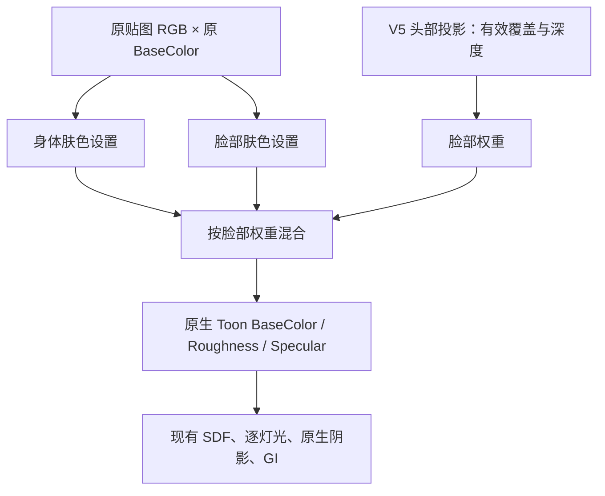

# 皮肤与脸部材质

更新：2026-10-16。材质图 Graph6，原生后端仍为 protocol11、payload5。

之前的脸图非常亮，受光区又查到 RD 的白色端点，最终容易呈现灰白肤色。这次新增脸部专用材质，用独立参数调整皮肤反射的底色，再交给现有光照。曝光、灯光、SDF 边界和原生阴影不参与这次肤色校正。

## 使用入口

EndfieldV2 材质目录新增三个父材质：

- `M_MMD_EndfieldV2_Face_Opaque`：不透明脸面。
- `M_MMD_EndfieldV2_Face_Masked`：需要裁剪的脸面。
- `M_MMD_EndfieldV2_Face_Translucent`：通过验证的透明附脸层，保留软 alpha。

独立使用 Face 父材质时，默认有暖肤色兜底；没有头部数据的预览球也能看到肤色。应用 EndfieldV2 预设时，根据有效脸部绑定选择对应父材质，鼻影附层与主脸使用同一份肤色参数。角色仍属于 Skin，没有新增 ShadingModel ID。

在 `DA_Render_EndfieldV2` 中调整：

- `CharacterSkinSurface`：身体皮肤参数，也是脸部遮罩外的兜底。
- `CharacterFaceSkinSurface`：有效脸面内的参数。

修改后重新应用预设。`bEnabled` 关闭即沿用原表面参数；旧预设的这两个开关默认关闭。身体是否属于 Skin 继续使用原分类和手工覆盖，不能把一张混合衣物的 body 贴图自动当作皮肤。

## 参数如何影响画面

- `Tint`、`TintStrength`：线性 RGB 乘色及权重。保留源贴图，不额外叠一块固定肤色；Tint 的 alpha 不参与透明度。
- `AlbedoScale`：底色反射率倍率。皮肤太白时先降低它，不必降低整场景曝光。
- `Saturation`：源底色的饱和度，保留妆容和纹理细节。
- `Roughness`、`Specular`：真正接入原生 Toon 的粗糙度和高光输入。

默认身体起点为 scale `.96`、tint `(1,.92,.88)`、strength `.35`、saturation `1.05`；脸部为 scale `.85`、tint `(1,.84,.76)`、strength `.70`、saturation `1.10`。两者 roughness `.742`、specular `.454`。这些是本插件的美术起点，不是提取到的客户端参数；Tint 是线性乘数，不要再对已解码的底图做 gamma 转换。

## 一个槽同时包含脸和身体怎么办

切换 Face 父材质只确定该槽可以使用脸部设置，真正的颜色、粗糙度和高光仍按像素混合：

覆盖解析复用 V5 的 A 和 B，不依赖底图 UV，也不依赖“启用 SDF 阈值”的开关。因此关闭 SDF 明暗分区不会顺带关闭脸部肤色。没有有效头框架／覆盖时使用身体兜底；不把整个混合槽强制涂成脸色。

FaceData 被移除、版本失效或透明层宿主不匹配时，头部子系统会清掉绑定版本，防止继续使用旧图染脸；有效绑定下手动关闭 SDF 阈值仍保留版本与肤色。肤色有效性与明暗开关分别判断。

透明度仍走原先的 `Texture.A × Opacity`。源 BaseColor、贴图、Opacity 和恢复快照保留，新的肤色参数独立存放。附脸层从源底色单独计算，避免先乘身体色再乘一次脸色。

## 光照与维护边界

肤色在材质准备阶段写入真实底色，因此直射和原生间接光会一起受到影响；暖色底色也会使现有暗部偏暖。没有新增自发光、固定环境补色或另一张逐帧 RT。RD／RS、GI 倍率和原生阴影公式保持现状。

这轮是肤色与表面材质分工，没有实现厚度驱动透射、原作 SkinLUT 或真正的屏幕 SSS。极端侧光的 SDF／鼻影硬边仍是独立美术问题。

维护入口：

- [TMMDEndfieldSkinMaterial.ush](../Shaders/Core/TMMDEndfieldSkinMaterial.ush)：肤色和逐像素表面参数混合。
- [MMDStageRenderPreset.h](../Source/Ue5MMDTools/Public/Stage/MMDStageRenderPreset.h)：可编辑的身体／脸部设置。
- [MMDStageLibrary.cpp](../Source/Ue5MMDTools/Private/Stage/MMDStageLibrary.cpp)：选父材质、绑定参数、保留源 alpha 和恢复。
- [UMMDHeadBoneSubsystem.cpp](../Source/Ue5MMDTools/Private/Rendering/UMMDHeadBoneSubsystem.cpp)：头部跟随、绑定失效与恢复。
- [MMDEndfieldToonPresetsCommandlet.cpp](../Source/Ue5MMDToolsEditor/Private/Editor/MMDEndfieldToonPresetsCommandlet.cpp)：Graph6、15 包白名单、7 个父材质生成与编译检查。

本轮独立 BuildPlugin 三配置构建、包内容和空白宿主七父材质编译已通过，见[实际截图与来源](Screenshots/2026-10-16-endfield-skin/README.md)。新增材质需重新 Cook；当前尚未重跑完整 Cook／Shipping 游戏，不能直接沿用 v8 的打包运行结果。
