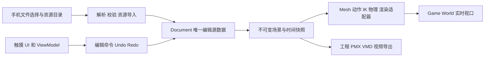

# 手机端 MMD 完整编辑器架构与执行任务书

编写日期：2026-10-10。用途：交给其他 agent 实施、审查和验收。当前状态：架构任务已定义，功能尚未实施，手机构建与真机指标尚未验证。

用户已确认：**Android 先行，iOS 第二阶段；正式首版为完整编辑器，包含模型与材质深度编辑、物理、视频导出。** 中间演示包可以缩小能力，但不能按正式首版完成验收。

## 1. 分支与项目决策

### 1.1 单人开发默认使用一个目录，建议新开手机端本地分支

审计时工作区干净；当前本地分支 `feature/ue5.8-mainline` 跟踪 `origin/feature/ue5.8-mainline`，tip 为：

```text
009d90a11f3dbe98d40fb46fac564238099111a2
docs: archive phase-one changes and engine screenshots
```

用户只有一人开发，默认直接在当前目录开发，其他 agent 按工作包依次接手。建议创建本地功能分支 `TG/mobile-editor`，从当前功能线起步，方便保留桌面基线、分批集成与回退；不要求独立 worktree，也不要求长期维护两条产品分支。后续仍共享插件代码，不另行复制维护一套插件。

分支是工作组织建议，不是手机功能的技术前提。如果桌面版暂停迭代、全部开发都转向手机，也可以继续当前分支；模块边界、验收和小批次提交仍需保留。只有需要同时打开桌面/手机版，或多个 agent 同时修改不同分支时，再引入独立 worktree。

下面是采用推荐分支方案时的准备命令，**本次文档任务没有执行创建分支、提交或推送**。开始前重新核对 tip 与工作区；若分支已存在，检查并复用，不覆盖已有工作。保留用户未提交改动，不自动 reset、清理或 stash。

```powershell
git status --short
git rev-parse feature/ue5.8-mainline
git switch -c TG/mobile-editor 009d90a11f3dbe98d40fb46fac564238099111a2
```

若基线已有新提交，先记录基线变动及原因，再使用经核对的完整字面 SHA。默认一个 agent 修改、其他 agent 只读审查；需要并行写代码时才各用独立 worktree 与 `TG/mobile-*` 分支，由用户或指定 agent 集成小批次，不能在同一目录同时切换分支。

本任务书与本批CHANGELOG记录目前在当前工作区，尚未提交。同目录从当前基线新建分支时，应保留并检查这两个文档，再作为手机分支首个文档提交，不提交其他用户改动。如果后续选择新worktree，须主动带入这两个文档的本批内容；代码基线和文档提交分别记录SHA。

Git 红线沿用用户指令：**永远禁止本地或远程分支删除；禁止 force；禁止变量拼接推送 refspec；每次仅推一个字面 ref。** 默认个人分支 + PR/MR。若用户明确要求推共享分支，必须先用真实当前 tip 建立 `refs/backup/<分支>-<时间戳>`，再 dry-run，将 `旧sha..新sha -> refs/heads/xxx` 原文交用户确认后才推。本任务不授权上架、签名凭证配置、直接推共享分支或删除任何分支。

### 1.2 新建独立移动宿主，保留桌面插件入口

- 新增 `Apps/MMDMobile/MMDMobile.uproject`、Game/Editor Target、启动地图和平台配置。通过 `AdditionalPluginDirectories` 指向仓库共享 `Plugins`，相对路径与 UBT/打包行为须在 A02 验证。
- 当前根目录 `MMD.uproject` 继续承担桌面开发和旧资产回归；手机应用采用正常 Game World、PlayerCamera、运行时 UMG 与触摸输入。
- 保留 `Ue5MMDTools` / `Ue5MMDToolsEditor` 模块名、旧 UObject 类型和 `/Script/` 序列化路径。新增模块封装能力，按接口逐步提取逻辑，不做一次性全仓库改名。
- 这是本地原生手机应用：断网时仍能导入、编辑、播放、保存与导出。服务器预转换、远程桌面或 Pixel Streaming 不计入本目标的验收。

## 2. 源码事实与已知阻塞

以下结论来自 2026-10-10 当前源码；旧 Docs 和旧架构摘要只能作历史材料。表中的可复用表示具备源码基础，**不表示已在手机验证**。

| 位置 | 当前事实 | 实施要求 |
| --- | --- | --- |
| [插件描述](../Ue5MMDTools.uplugin) | 已有 Runtime / Editor 两模块，若干依赖带 Editor 限制 | 继续隔离，不把 Editor API 搬入 Shipping |
| [运行时 Build.cs](../Source/Ue5MMDTools/Ue5MMDTools.Build.cs) | `UnrealEd/LevelEditor` 已条件隔离；Bullet 无平台判断，直接链接 Windows `.lib` | 平台化 Bullet 构建；可编译的无物理后端仅供早期门禁 |
| [TPMXParser](../Source/Ue5MMDTools/Private/Import/TPMXParser.cpp)、[TVMDParser](../Source/Ue5MMDTools/Private/Import/TVMDParser.cpp) | 位于 Runtime，读取原始文件；VMD CP932 仅 Windows 路径完整，其他平台退回 ANSI | 提取流式/内存解析入口、跨平台编码、边界检查与结构化报告 |
| [模型构建器](../Source/Ue5MMDToolsEditor/Private/Import/TMMDMeshBuilder.cpp) | PMX 建网格依赖 MeshUtilities、导入数据、PostEditChange、保存资产；VMD 写 AnimSequence 使用编辑器 DataController | 新增运行时 mesh 后端与动作采样器；不能靠去掉 `WITH_EDITOR` 实现 |
| 同上，权重转换 | SDEF 按 BDEF2 近似；QDEF 按四骨线性权重处理 | 不能宣称已有精确 SDEF/QDEF；保留原数据并另建正确求解路径 |
| 同上，Morph/相机导入 | 原生 mesh 主要构建 Vertex Morph；相机导入在 Editor 模块，不能据此推断完整 VMD 相机插值 | 补运行时多类型 Morph 与相机 Bezier，独立参考验收 |
| [AMMDActor](../Source/Ue5MMDTools/Private/Actors/AMMDActor.cpp) | `SetupComponents` 委托编辑器注册的导入服务，无服务只警告 | 新增明确的运行时导入/装配接口，保留旧入口兼容 |
| [模型数据资产](../Source/Ue5MMDTools/Public/Import/MMDModelDataAsset.h)、[播放实例](../Source/Ue5MMDTools/Private/Animation/MMDPhysicsPlaybackAnimInstance.cpp) | Bones/Rigids/Joints 可留在运行时；已有 cooked 模型与动作播放基础 | 用于早期 packaged smoke；动态模型的编辑源数据另由 Document 持有 |
| [物理节点](../Source/Ue5MMDTools/Private/Animation/AGN_MMDSkeletalControl.cpp)、[模拟器](../Source/Ue5MMDTools/Private/Physics/MMDPhysicsSimulator.cpp) | 节点主要处理物理，未覆盖完整 VMD/IK/append；模拟器使用 `RelatedBoneIndex + 1` 的旧 Root 假设，关节共用6DoF Spring路径 | 建显式骨骼映射、类型分派、输入校验；不能将它视作完整求值器 |
| [编辑器视口](../Source/Ue5MMDToolsEditor/Private/UI/MMDViewPanel.cpp) | 使用 EditorViewport、GEditor、DesktopPlatform、HitProxy | 重建 Game World 选取、变换、相机与手机文件选择 |
| [灯光 CS](../Source/Ue5MMDTools/Private/Rendering/MMDAnimeWriteLightsCS.h) | `ShouldCompilePermutation` 要求 SM5 | 移动基线不能依赖该灯光写入路径；新增参数上传后端并做能力门控 |
| [视图扩展](../Source/Ue5MMDTools/Private/Rendering/FMMDAnimeLightViewExtension.cpp) | 当前阴影采用 CustomRenderPass，并跳过 SceneCapture 视图 | 手机阴影与离屏导出分别验证，不能套用旧 SceneCapture 描述 |
| [阴影系统](../Source/Ue5MMDTools/Private/Rendering/UMMDShadowMapSubsystem.cpp) | 当前为四级CSM；默认4096² R32F atlas与2048² scratch，仅原始RT约80MiB | 先禁用桌面路径；按移动预算另建，不直接复用旧单级摘要 |
| Source 写出/编码能力 | 本次搜索未发现 PMX/VMD 原格式写出器、手机视频编码或音频混流导出 | 均为新增能力，不能只给现有函数加UI即宣称完成 |
| [根工程设置](../../../Config/DefaultEngine.ini) | 桌面硬件目标，启用 Lumen、VSM、RayTracing 等 | 独立手机 Config/DeviceProfile，不能全局降低桌面设置 |

本次没有执行 UBT、Cook、Android/iOS 打包、真机、性能或视频编码测试。已有 2026-10-09 桌面截图只能标为历史桌面验证，不能作移动端证据。

## 3. 正式首版范围与格式声明

### 3.1 Android V1 必须形成完整工作闭环

| 能力 | 正式 V1 必须交付的边界 |
| --- | --- |
| 文件导入 | 手机上选择原始 PMX、关联纹理目录/资源包、VMD、音频；进度、取消、失败原因、缺失资源重定位 |
| 场景编排 | 多角色/道具对象的添加、删除、复制、变换、显隐；相机、灯光、舞台设置；标准性能场景为单角色，多角色上限由预算控制 |
| 动作编辑 | 骨骼姿态、FK/IK、时间轴、关键帧增删改/复制、区间播放、VMD 贝塞尔曲线、Morph、相机/灯光轨道、音频同步 |
| 模型深度编辑 | 顶点/三角面选择与变换、面增删与焊接、法线与 UV 编辑、材质分区；骨骼新增/删除/重命名/父子关系/绑定姿态；权重刷与归一化；Morph 创建与编辑 |
| 材质深度编辑 | 纹理替换/重定位、颜色、透明模式、双面、toon/高光/rim/环境参数、PMX sphere/toon/edge 参数；统一模板与参数预设 |
| 物理 | 刚体与关节的创建/删除/属性和连接编辑、碰撞分组、启停/重置、预览、固定步长求解、烘焙到动画轨道 |
| 工程 | 创建、保存、另存为、自动恢复、重开、资源打包分享、版本迁移；所有编辑支持 Undo/Redo |
| 文件输出 | PMX 模型及纹理依赖、VMD 动作/相机/灯光输出；明确导出目标、损失报告和模型分轨规则 |
| 视频输出 | 本机 MP4 H.264 + AAC，720p/30fps 为最低必达；可选 1080p/60fps 根据设备能力开放；区间、进度、取消、失败恢复 |
| 产品交互 | 触摸选取/拖动/缩放、可读的轨道与属性面板、软键盘/安全区/横竖屏适配、后台恢复、明确错误提示 |

“完整”指上述 MMD 编辑闭环，不扩展为 Blender 的雕刻、完整建模节点、插件脚本平台或云协作。材质编辑以预编译模板和参数为边界；手机中不提供任意 HLSL/材质图即时编译。

### 3.2 格式支持表必须随实现维护

- 正式 V1 的强制基线为 PMX 2.0：BDEF1/2/4、**准确 SDEF**、骨骼/IK/append、Vertex/Group/Bone/UV/Material Morph、材质和刚体关节；含额外 UV 的源数据须保留并按能力表处理。显示框和中日文名称导入后可编辑并写回。
- PMX 2.1 的 QDEF、Flip/Impulse Morph、SoftBody 等先建立独立能力表、fixture 与原数据保留路径。没有逐项通过时，只能标注“部分兼容”，不能宣称完整 PMX 2.1；对影响结果的未支持项在导入前提示并提供拒绝/明确近似选项。
- 本机 `.mmdproj` 的无损保存与 PMX/VMD 导出的可表达性是两件事。已解析但不参与求解的格式项也不能在保存时静默丢掉；涉及拓扑/骨骼重排而无法安全维护引用的未知项，必须阻止该项编辑或导出并报告原因。
- VMD 骨骼/Morph、相机、灯光、显隐/IK 数据与插值须按能力表保留、编辑、采样和写出；旧版头、固定长度 CP932 名称单独测试。写出时名称不可编码或超过格式字节限制必须明确报错/展示映射，不能静默截断造成轨道冲突。
- A00冻结VMD输出规则：每模型对象独立骨骼/Morph/显隐/IK文件，场景相机/灯光按目标读器规则输出独立文件，manifest保存对象ID与文件映射。同名角色不能合并轨道；工程对象变换是否烘焙到root轨道、坐标与名称映射须明确。
- PMX 导出重建全局索引宽度、材质面数、引用索引与纹理相对路径。VMD 不承载 mesh、材质、全部工程属性或物理配置，超出格式的内容保留在工程中并生成损失报告。
- 若为了早期技术验证采用 SDEF/QDEF 近似，只能出现在技术演示标签下；不满足 V1 的准确 SDEF 门禁。

## 4. 模块边界与核心数据流

下表首先定义逻辑职责，单人开发不需要一开始就创建所有物理模块。G0/G1先保留现有Runtime/Editor两模块，在共享插件中按目录和接口隔离移动代码；出现明确复用或编译依赖需要后再提取独立模块。确需新增的模块放在共享插件 `Source/`，移动宿主只组装应用。类/目录名可按仓库命名习惯调整；职责和依赖方向不能倒置。

| 模块 | 职责与允许依赖 | 禁止依赖 |
| --- | --- | --- |
| `MMDCoreRuntime` | Core 为主；PMX/VMD 数据、编码、读写、坐标/蒙皮/轨道数学、数据校验与 ID 映射 | Engine 资产构建、UI、Renderer、Bullet、Editor |
| `MMDDocumentRuntime` | CoreRuntime、CoreUObject/Engine、Json；工程、资源索引、编辑命令、历史、快照与 schema 迁移 | 平台 Java/ObjC、Editor 事务、视口状态作为唯一源数据 |
| `Ue5MMDTools` | 保留现有 Runtime 类型；接入运行时模型、动画、物理和渲染适配器 | 无条件 Editor API；Document 反向读取渲染状态 |
| `MMDMobilePlatform` | 平台文件访问、生命周期、权限边界、音频设备、视频编码与输出接口实现 | 业务编辑逻辑、mesh 源数据所有权 |
| `MMDMobileUI` | UMG、Slate 运行时、EnhancedInput；ViewModel、工具模式、时间轴、选择与变换手柄 | UnrealEd、DesktopPlatform、Sequencer Editor、GEditor |
| `Ue5MMDToolsEditor` | 旧导入器、资产生成、桌面兼容、可选资源预处理/fixture 制作 | 成为手机必需模块 |
| `Apps/MMDMobile` | 地图、GameMode、应用服务组装、设备配置、发布元数据 | 复制一套插件源代码 |

原有 parser 头中 Engine/SkeletalMesh include、导出宏和跨模块结构要一并整理；通过旧模块转发头/包装入口维持源码兼容。若移动已有 UObject/USTRUCT 类型，必须给迁移方案、Core Redirects 与旧资产回归，不能自行改序列化路径。



### 4.1 Document、命令和实例所有权

- Document 持有模型源数据、稳定 ID、工程对象、资源引用、原始动作轨道、编辑覆盖层、材质、物理设置、版本和 dirty revision。渲染网格、组件、MID、GPU 缓存均可从 Document 重建。
- ID 不用数组下标或 UObject 指针代替。修改 topology、删除骨骼、重排材质时，以一次原子命令维护权重、Morph、刚体、关节、轨道和索引引用；存在无法保持的引用时，先显示影响清单。
- 每条命令定义 Validate/Apply/Revert、影响集、旧值和新值。触摸长拖动合并为一个历史项；取消拖动不落入工程；历史按字节预算保存增量，不能每帧复制全模型。
- Document 是主线程串行提交；解析、纹理解码、导出读不可变快照。后台结果附带 revision/request ID，工程切换或取消后过期结果不能覆盖当前对象。
- World/应用实例拥有自己的服务和资源；不新增跨所有 World 的可变单例，避免桌面预览、主视口和导出任务互相污染。
- Shader、mesh、音频、物理后端以能力接口接入，缺少能力产生显式报告。无物理后端不能让正式 V1 物理功能“显示成功”。

### 4.2 先冻结的接口契约

| 契约 | 输入与输出必须定义的内容 |
| --- | --- |
| `IMMDAssetSource` | 字节流/相对资源访问；文件 URI 不伪装成普通磁盘路径；长度、取消和访问失效结果 |
| `FMMDImportReport` | 格式版本、supported/approximate/unsupported 项、数量/内存预算、缺失资源、名称映射、警告/致命错误 |
| `FMMDSceneDocument` | schema/version/revision、对象与资源 ID、源数据和编辑层；编辑提交与只读快照 |
| `IMMDModelRuntimeBackend` | 从模型快照建立/更新/释放动态网格；报告 BDEF/SDEF/QDEF、Morph、骨骼数、平台限制 |
| `IMMDEditCommand` | 输入目标 ID、校验、原子 Apply/Revert、影响集、序列化/恢复策略 |
| `FMMDEvaluationContext` | 指定时间、帧率、模型/动作快照、物理模式与 reset/checkpoint；输出 pose/morph/camera/light |
| `IMMDPhysicsBackend` | 固定步长、刚体关节设置、重置/暂停/烘焙、平台能力；不得自行依赖 UI 时钟 |
| `IMMDExportJob` | 快照 revision、区间、输出配置、资源检查、进度、取消、结果路径与损失报告 |

统一记录单位、矩阵/四元数约定、MMD↔UE 映射、纹理色彩空间、帧率和原始骨名。沿用并验证当前坐标映射，不凭经验重写轴交换；增加三轴、法线、相机、刚体与导入导出往返 fixture。

## 5. 运行时导入、模型编辑和动画架构

### 5.1 导入与运行时模型技术门禁

导入流水线：选择源与授权 → 预算预检 → 解析/校验 → 解码资源 → 建 Document → 创建运行时资源 → 发布到场景。每步可取消；最终成功前不破坏已有工程。解析线程不能创建/修改 UObject，渲染线程资源更新经明确 fence/生命周期管理。

**A03 必须先证明手机 Shipping 内建立动态蒙皮网格。** 首选独立 adapter 使用目标 UE 版本实际允许的运行时渲染资源构建路径；完整记录 API、cook 前提、资源释放、Morph 和蒙皮限制。若原生 USkeletalMesh 后端达不到准确 SDEF、拓扑编辑或 Morph 更新要求，采用插件内自定义运行时 skinned component/backend；不可修改引擎、不可把编辑器 MeshUtilities 带进发布包。

首选路线和替代路线只在短期 spike 比较，门禁结束必须写 ADR 选定主路线与平台范围。CPU 蒙皮可作为正确性参考和小模型诊断，若不能达到性能指标，不算正式渲染后端。原始文件须在安装后从手机文件选择器导入；内置 cooked 模型只通过 A02，不通过 A03。

G1的SDEF不是纸面可行性：必须在选定手机backend上执行双骨弯折fixture，C/R0/R1实际参与求解，顶点对独立参考误差≤0.1cm。A07再完成大模型、编辑更新与性能，不允许把后端能否表达SDEF的问题留到全功能后期。

资源输入支持 PMX + 用户选定纹理目录，以及安全解包的资源包；单独选择 PMX 不自动拥有兄弟纹理的访问权限。ZIP 路径穿越、负数/溢出计数、引用越界、骨骼循环、Morph 递归、NaN/Inf、截断文本、超大图片均需在分配前或有界读取时拦截。图片采用预编译模板的运行时纹理解码路径，不使用 TextureFactory；为常用 PNG/JPEG/TGA/BMP 建 fixture，色彩/法线/alpha 规则独立测试。

初始硬上限建议：每模型 200k 顶点、300k 三角形、512 骨骼、32 材质、256 刚体/关节；每工程 1M 关键帧、1GiB 输入资源；单纹理最长边 4096、总 GPU 纹理预算 256MiB。**这些是待 G0/G1 实测调整的产品限额，不是当前性能事实。** 拒绝、缩图或明确降级均须先告知，原始数据不自动覆写。

### 5.2 深度编辑不能只改预览组件

- Mesh 命令覆盖选择、点/面变换、面创建/删除、焊接、法线重算、UV 修改和材质分区。建立 PMX 原顶点到渲染拆分顶点映射，Morph/权重和 UV seam 不能因渲染端复制顶点而错位。
- 骨骼命令覆盖父子关系、rest pose、名称、IK/append 和约束；删除/重设父级维护权重、刚体、轨道和显示框。提供权重刷、锁定骨骼、归一化、零权重/无效索引校验。
- Morph 编辑覆盖 Vertex/Group/Bone/UV/Material，保留参考 pose 和相对 delta。骨骼 rest pose 或 topology 变化后重映射 delta，无法重映射的编辑给出明确限制，不能留下悬空索引。
- 大范围编辑后台重建 mesh 派生数据，主线程分帧上传；更新时保留旧可用画面和取消入口。最终结果必须能保存、重开与写出，不能只在 RAM 中改变外观。

### 5.3 运行时动作和物理时序

- 原始 VMD 直接建立运行时轨道；采样指定时间，不依赖在手机创建/压缩 UAnimSequence 或编译 AnimBlueprint。已有 cooked 动画可以通过 adapter 使用。
- MMD 帧基准、轨道插值、四元数归一化、同帧重复键的决策均固定。保留 VMD 贝塞尔控制点，编辑覆盖层不破坏原始轨道；骨名匹配优先原始名称/稳定映射，别把显示重命名当永久丢失轨道。
- 建立显式的 deformation 顺序计划：层级、transform layer、append、固定/局部轴、IK、物理前后 deform 标志、Morph 与最终 skinning。不可机械套用单一“动画→IK→物理”顺序覆盖所有 PMX 标志。
- 正常播放、逐帧、循环、跳帧、倒退、后台恢复与导出统一调用 evaluation context。物理固定步长默认 1/60s，可配置但写入工程；Seek 通过 reset + checkpoint + 前向求解恢复。
- 实时预览可限 substep 防止卡死，并标记模拟落后；离线烘焙/视频不得丢模拟步或直接用壁钟 delta。相同输入在同一设备重复导出需满足容差，不宣称 Bullet 跨平台逐 bit 一致。

## 6. 移动材质、灯光、阴影与物理后端

### 6.1 移动渲染基线

Android 首发以 ARM64 + Vulkan 的 Mobile Forward 为主路线；是否增加 GLES 在 G0 作为显式设备范围决策。手机应用独立关闭 Lumen、VSM、RayTracing 等桌面基线设置，并用 DeviceProfile 控制分辨率、后处理、灯数、阴影和描边。Epic 的移动功能表将 Mobile Forward/Deferred 的 Lumen、Nanite、VSM、硬件光追列为不支持，而 Unlit 可用；高端桌面移动 renderer 另作扩展路线。[官方移动功能表](https://dev.epicgames.com/documentation/unreal-engine/rendering-features-reference)

- 预 Cook 通用 Unlit toon 材质模板；手机 MID 只更新纹理和参数。至少只连 `base_color` 就能正确显示；缺失纹理使用颜色/占位资源。
- 移动灯光后端从应用 SceneDocument 收集灯，以 World 所属 MPC 或明确支持的材质参数上传主方向光与最多 **2 个局部灯**；固定上限展开求值，定义方向、颜色、强度、半径、类型、disabled 默认值。不能继续依赖只编译 SM5 的 LightDataRT CS。
- 非SM5/移动平台在创建桌面ViewExtension、LightDataRT、阴影RT和取compute shader之前就做能力门控。G0/G1不分配桌面四级CSM资源、不提交其depth pass；名称带Lite的现有shader也不能直接当作已验证移动模板。
- Toon ramp 基于不含强度的方向明暗量；diffuse 再乘颜色/强度，环境项乘 base_color；高光与 rim 使用几何量。环境 SH 系数由可移动后端上传，不能假定桌面 View uniform 字段在全部 shader permutation 有效。
- 主光缺失使用固定方向低强度兜底，环境设置可退回常量SH。局部灯按对象/舞台锚点稳定选择，不能按主相机排序造成导出时换灯；材质实例参数与场景MPC分开持久化。
- 始终遵守通用 shader 约束：无特定脸部 UV/SDF 阈值贴图；Custom 节点使用 struct 成员函数，变量 snake_case、函数 PascalCase、中文必要注释；**不改引擎，不改用户维护的 `TMMDAnimeFace.usf`**。需要手机 face 兼容时新增独立适配模板。
- 编辑器选择反馈用运行时选中标记/网格 overlay；视觉描边优先可 cook 的 mesh shell，计入 draw call/透明排序/镜像缩放成本。不依赖编辑器 SelectionOutline。
- 阴影分低/中/高档：基础有稳定接地反馈，高档实现明确支持的动态遮挡后端。Unlit 材质不会自动消费引擎延迟光照阴影；使用 CSM、shadow map 或自定义 pass 时必须证明材质接收方式。桌面 CustomRenderPass、RGBA 浮点 RT 的存在不等于移动兼容。
- 视频离屏视图必须有自己的相机/灯光快照和阴影更新入口。当前跳过 SceneCapture 的灯光/阴影逻辑不能直接拿来导出；采用独立 scene instance 或隔离的 capture 上下文，防止覆盖主视口数据。

### 6.2 Bullet 平台与完整物理编辑

- 固定 Bullet 源码版本/commit、编译器、NDK/Xcode、精度和编译定义。Win64、Android ARM64、后续 iOS ARM64 各提供独立产物路径和可重复构建脚本；头文件与库的 `BT_USE_DOUBLE_PRECISION`/ABI 必须一致。
- Android 库必须满足所选 NDK、设备页大小和链接要求；本机能编译不能代替 ARM64 链接/真机验证。先提供可编译的 disabled backend 跑 A02，再交付真实后端通过 A09。
- 刚体/关节 UI、碰撞分组和连接编辑写入 Document；重建模拟器、Undo/Redo、暂停、删除对象的释放需统一生命周期。主线程与物理线程不得同时写 bone pose 或 Bullet world。
- 动态mesh、旧cooked mesh和模型源数据均用显式PMX→运行时bone映射，消除固定`+1`假设。按PMX关节类型选择求解约束，未知类型拒绝或明确兼容降级；来自用户文件的坏数据返回报告，不能进入`checkf`终止进程。
- 物理烘焙形成可编辑动画轨道，记录设置、区间、步长、模型 revision 和损失。烘焙后禁用实时物理时结果应保持在验收容差内。

## 7. 工程、平台文件、音频与导出

### 7.1 工程格式和恢复

`.mmdproj` 采用有版本的包/目录契约：`manifest.json`、`scene.json`、模型/轨道二进制数据、`assets/<content_hash>`、恢复日志、可选 thumbnail；最终容器形式由 A00/A04 冻结。工程中使用资源 ID 与相对路径；外部 URI 只作为来源提示，资源导入后复制到受控工程目录，重开不依赖原授权仍存在。

- schema/version 与数据版本独立于 App 版本；写迁移函数和旧版 fixture。未知新版本只读/拒绝，不能默认写回损坏。
- 私有存储通过临时快照、校验、原子替换和上一有效版本实现保存；平台 document provider 输出另经导出流程，不能假定远端 URI 支持 rename 的原子性。
- 自动恢复以提交命令和周期快照为依据，目标最多丢失 10 秒已提交编辑；进入后台时尽力 flush，但不能依赖系统总会给足后台时间。
- 用户取消导入/导出、磁盘不足、应用被终止后保留原工程；恢复扫描显示可恢复版本。缓存可重建，不把 shader/临时 GPU 数据作为工程真源。

### 7.2 文件选择和生命周期

Android 用 SAF 的 document/tree URI 读取 PMX/VMD/目录，用系统选择/创建入口输出工程和媒体；处理撤销授权、provider 流失败、取消、云文件尚未下载和重名。URI 不强行转成本地路径，访问获准目录后解析相对纹理依赖。[Android SAF 官方文档](https://developer.android.com/training/data-storage/shared/documents-files)

iOS 第二阶段实现 document picker、directory access、security-scoped resource 与协调读取；应用私有副本和授权生命周期都要测试。[Apple 文件选择文档](https://developer.apple.com/documentation/uikit/uidocumentpickerviewcontroller)、[目录访问文档](https://developer.apple.com/documentation/uikit/providing-access-to-directories)

暂停时冻结预览时钟/物理、停止不必要渲染、处理音频中断和编码任务。前台恢复重建失效资源并校准时钟；旋转/安全区/软键盘不允许重复提交手势命令。

### 7.3 音频和视频导出

- 音频导入至少支持 WAV/PCM；首版支持清单中增加常用 MP3/AAC 解码并逐设备验证。音频成为持久化资源，支持波形、时间偏移、裁切、音量；播放时以明确主时钟同步音频和 evaluation。
- Android 采用平台编码 adapter，优先评估 MediaCodec 输入 surface 的 GPU 路径，再评估有界异步 GPU readback 路径。输出 H.264 视频与 AAC 音频并 mux 到 MP4；最终路线由 A10 spike 固定，不能无限保留未验证分支。[MediaCodec](https://developer.android.com/reference/android/media/MediaCodec)、[MediaMuxer](https://developer.android.com/reference/android/media/MediaMuxer)
- 导出锁定只读快照，逐帧求值 `start + frame_index/fps`；音频根据采样率/区间/偏移生成采样，PTS 单调递增且使用整数/有理数时间，避免浮点积累。物理从正确起始 checkpoint 预热，不录实时屏幕代替离线输出。
- 导出区间统一为半开区间`[start,end)`，帧数、取整与尾部音频补齐规则写入接口；60秒30fps样本严格1800帧。预览循环也明确端点规则，避免重复末帧。
- 文档求值时间为`start + frame_index/fps`，输出视频PTS从0起按`frame_index/fps`增长；音频偏移换算到同一输出时间域。固定音频采样取整策略，处理AAC encoder delay/priming/padding及首尾裁切，避免非零start区间或编码延迟导致音画错位。
- 导出画面不含编辑 UI；相机、灯光、透明、toon、阴影和颜色空间须与选定导出设置一致。明确 sRGB/线性→编码色彩变换、alpha 合成、旋转元数据和目标画幅。
- 编码能力、分辨率、帧率、剩余空间先预检；用有界帧队列与背压，不在渲染线程同步阻塞整片读取、不累积整个视频的原始帧。支持取消，临时产物只位于本任务私有目录，成功后才发布最终输出。
- 720p/30fps H.264+AAC 的真机 MP4 是正式硬门禁；PNG 序列、无音频录像、桌面 Movie Render Queue 输出和预录样片均不能替代。高档编码失败应给出可用设置，不能生成看似成功的坏文件。
- iOS 后续实现对应平台编码器（评估 AVAssetWriter），保持同一导出契约、时序和测试样本。

## 8. Agent 执行任务与依赖

单人开发由用户或当前执行agent完成集成，先完成 A00 的必要接口/格式决策，再按依赖逐批实施。工作包用于限定每次交给agent的范围，不代表需要多个开发者、多个长期分支或同时开发。每个任务交付代码、必要 fixture/检查、验收报告和 CHANGELOG；不能只提交 TODO、蓝图 UI 壳或“能在 Editor 运行”的演示。

| ID | 工作包与主要交付 | 依赖 | 任务完成条件 |
| --- | --- | --- | --- |
| A00 | 基线审计；`Docs/Mobile/ADR-0001.md`；接口/工程 schema/兼容矩阵；真实基准设备与资产清单；任务 owner | 无 | 每项事实与假设分开；确定引擎 patch/工具链；评审通过 |
| A01 | Core 提取、CP932/PMX 文本编解码、PMX/VMD reader/writer、校验/错误报告；旧入口转发 | A00 | 非 Editor 编译；编码和往返/恶意输入 fixture 通过；旧导入器回归 |
| A02 | 独立宿主、ARM64 构建、手机配置、mobile material 最小模板、最小SAF文件源/选择器、服务组装、cooked smoke | A00 | 干净构建 Cook/打包；真机启动/暂停/恢复；无 Editor 链接依赖；原始文件能通过IMMDAssetSource受控读取 |
| A03 | 动态 mesh 路线 spike/ADR；骨骼/材质/Morph；资源生命周期与 runtime model adapter，使用A02最小文件源 | A01、A02 | 安装后原始 PMX 在真机显示、动画变形、释放重导入；目标backend双骨SDEF误差≤0.1cm |
| A04 | Document/命令内核/历史与恢复日志、资源包/保存迁移、平台文件选择、导入事务、预算、分享输出 | A00、A01；集成依赖 A02/A03 | 无UI也能执行/回退/恢复基础命令；断网导入保存重开；取消/权限/磁盘不足/强杀恢复通过 |
| A05a | 最小运行时 VMD 骨骼/Vertex Morph sampler、跨平台名字映射、G1测试驱动 | A01、A03 | 原始VMD在真机驱动动态mesh；指定时间点结果与独立fixture一致 |
| A05b | 音频解码/PCM资源、波形、预览主时钟与离线采样接口 | A02、A04 | WAV/MP3/AAC支持表和解码fixture通过；主时钟/采样偏移可验证 |
| A05 | 完整 Bezier、IK/append/deform、各类Morph/相机/灯光、音频时钟同步与时间轴数据 | A04、A05a、A05b | 物理关闭时pose/逐帧/循环/Seek/音画同步通过；预留物理接口，物理开启Seek由A09验收 |
| A06 | 基于A04内核的编辑命令与Undo/Redo交互、ViewModel、运行时选取/手柄、触摸 UI 与时间轴 | A04、A05；可先接A05a做基础UI | 操作写入 Document；拖动合并；历史/保存重开一致 |
| A07 | 模型深度编辑、拓扑索引维护、骨骼/权重/Morph 编辑、准确 SDEF、PMX 输出 | A01、A03、A04、A06 | 所有规定编辑能撤销/重做/重开/再导入输出；映射无悬空引用 |
| A08 | 材质编辑、移动灯光/环境/阴影/描边、预设、性能档位和离屏视图支持 | A02、A03、A04、A06 | 只给 base_color 正常；两 GPU 系列通过 shader/实际效果；导出视图一致 |
| A09 | Bullet ARM64 供应/ABI、刚体关节编辑、固定步长、checkpoint、烘焙 | A03、A04、A05、A06 | 真物理/编辑/Seek/烘焙通过；关闭后释放资源；无线程竞态 |
| A10 | VMD 写出集成、消费A05b的离线音频并混音/编码、离线render/视频编码/mux、取消恢复 | A01、A04、A05、A08、A09 | 真实 MP4 720p30+AAC、时序/物理/颜色正确；外部播放器通过 |
| A11 | Android 全功能集成、性能/热稳定/资源恢复、发布包与说明、回归证据 | A01–A10 | 第 9 节全部正式硬门禁通过，已知问题清单没有必达功能缺口 |
| A12 | iOS 平台/Metal/Bullet/文件/编码/生命周期、签名与测试构建说明 | A11 的稳定接口 | Mac/Xcode 工具链与两款真机通过同等核心门禁；正式分发另行授权 |

默认推进顺序：A00 → A02最小打包/G0 → A01/A03/A05a动态内容/G1 → A04工程与命令内核 → A05b/A05/A06动作与交互 → A07/A08/A09深度编辑与物理 → A10导出 → A11正式验收 → A12 iOS。每阶段允许只读审查并行；写代码默认串行，不能在未确定runtime mesh的情况下铺满功能。

每任务先约定修改路径；`.uplugin`、公共头、Build.cs、schema、shared Config 始终串行修改。交接给下一个agent时说明已完成项、commit、接口变动与剩余阻塞。阶段报告要写设备、测试日期、命令/步骤、结果和未测项，失败不得转写成“待优化”。

默认每个已验证能力做一个小提交，例如“Android ARM64 构建”“跨平台 VMD 编码”“runtime mesh spike”“项目恢复”；需要远程审查或集成时再开PR/MR。沿用仓库模型路由；指定模型不可用时记录实际模型与原因，架构/渲染变更仍须独立审查，不能冒充指定模型已审查。

## 9. 阶段门禁和可执行验收标准

### 9.1 阶段标签

| 阶段 | 必须拿到的证据 | 允许的功能状态 |
| --- | --- | --- |
| G0 技术基线 | A00/A02 非 Editor ARM64 包、真实设备、最小材质与 cooked 模型；工具链 manifest | 内置模型/无物理后端可以使用，仅标为技术演示 |
| G1 动态内容 | A02文件源+A01/A03/A05a 在安装后的真机导入原始 PMX/VMD 与纹理，日文名称匹配、蒙皮/Vertex Morph；runtime mesh ADR | 不依赖 PC 转换；目标backend SDEF fixture误差≤0.1cm；完整IK/各类Morph在G2继续验收 |
| G2 编辑闭环 Alpha | Document/保存恢复/动作/模型/材质/物理编辑/Undo/Redo 与 PMX/VMD 写出基本集成 | 可以有已披露缺陷，不得称完整 V1 |
| G3 完整 Beta | 全功能 + 真物理 + 音频 + 本机 MP4 导出，两 GPU 系列完成场景回归 | 性能/长测继续收敛；失败项保留为阻塞 |
| G4 Android V1 RC | 下面 F/N/R 全部强制项通过，发布材料完整，可复现构建 | 才能交用户最终验收；商店上传与生产签名另行授权 |
| G5 iOS | A12 通过 Metal/文件/生命周期/物理/编码与同等数据门禁 | 独立记录设备性能目标和差异，不倒退 Android 格式 |

### 9.2 测试资产、设备和数值基准

A00 创建 `Docs/Mobile/VALIDATION_MATRIX.md`，登记每个 fixture 的 hash、授权、来源、顶点/骨骼/材质/纹理/刚体数量和支持项。优先程序化 fixture 与有明确授权的模型；测试角色可外部下载，不把整个模型、Saved、Intermediate 或视频全集提交仓库。

- **标准场景 S1**：1 个角色，约 60k 顶点/120k 三角形、≤200 骨骼/12 材质、纹理 GPU 占用≤128MiB、80 刚体/关节、Vertex/Group/Bone Morph、3 分钟动作、相机/灯光和音频；固定背景/质量档/相机路线。
- **编辑场景 S2**：S1 的副本执行 topology/骨骼/权重/Morph/材质/物理修改；另加第二角色验证 ID、轨道、资源复用和选择隔离。S2 不自动套用 S1 的单角色 FPS 承诺。
- **格式场景 S3**：PMX UTF-8/UTF-16、BDEF/SDEF、PMX2.1 各扩展、旧/新 VMD、CP932 日文、缺图/透明/法线、骨骼/IK/Morph 循环和截断/溢出文件。
- Android 首发产品最低目标暂定 Android 12+、ARM64、Vulkan 可用、6GB RAM；这是产品选择，非 Epic 引擎最低要求。G0 固定至少一款 Adreno 与一款 Mali 真机，记录型号/OS/GPU/驱动/内存/可用空间；不能拿模拟器或 Desktop Mobile Preview 代替。
- 性能指标是**设计目标，尚无实测**。若 G0/G1 表明不可达，必须提交目标调整 ADR、影响范围与设备证据，不能实现后擅自降低验收线。

### 9.3 功能与正确性硬门禁

| 编号 | 操作与断言 | 通过证据 |
| --- | --- | --- |
| F01 | 干净安装 Shipping，断网，系统选择原始 PMX+纹理目录、VMD 和音频；日文骨骼/Morph 正确匹配，缺图正常兜底 | 两 GPU 系列真机录屏、import report、资源 hash；源文件安装后才提供 |
| F02 | 播放/暂停/逐帧/跳转/循环、编辑 Bezier/FK/IK/Morph/相机/灯光；非整数时间采样正确 | golden fixture 比较：平移≤0.1cm、旋转≤0.1°、Morph 权重≤1e-4；轴/帧/插值断言 |
| F03 | 编辑点/面/UV/法线/材质分区；新增删除骨骼、改 rest pose/权重/Morph；各执行 Undo/Redo 并重开 | Document 语义/hash 一致，引用完整，渲染拆点映射正确；SDEF 顶点对参考误差≤0.1cm |
| F04 | 颜色/贴图/透明/双面/toon/sphere/edge 等编辑保存；只给 base_color、不同 UV 排布模型也正常 | 材质参数往返 + 实际截图；无专用脸阈值图依赖；透明排序无明显错误 |
| F05 | 刚体/关节/碰撞分组编辑、暂停重置、Seek、循环、烘焙后关闭实时物理 | 同设备固定输入回放与烘焙骨骼差≤0.5cm/0.5°；约束不爆炸、无NaN、无竞态日志 |
| F06 | 保存/另存为/分享包；移动到另一台设备断网打开；撤销原 URI 授权后仍可重开私有副本 | 工程 schema/revision/资源 hash 对照；迁移 fixture；不引用本机绝对路径 |
| F07 | 编辑后导出 PMX 与分轨 VMD，再导入；外部独立读器/参考工具检查 | 支持数据语义一致，数值容差同 F02/F03；CP932 和索引宽度正确；未表达内容有损失报告 |
| F08 | 导出 S1 的 60 秒 720p30 MP4 + AAC；含相机切换、音频偏移、物理和透明；另测非零start区间 | 1800视频帧，PTS从0单调增长，时长误差≤1帧；起/中/末闪光+蜂鸣fixture偏差与漂移≤50ms；至少两外部播放器通过 |
| F09 | 视频从不同 Seek 起点重复导出，导出期间更改 UI 不改变该 job 快照；中途取消/磁盘不足 | 物理/动作结果满足 F05，同一快照画面一致；没有完成标记或损坏的最终文件 |
| F10 | 100次连续编辑 Undo/Redo、模型切换、工程切换；导出与导入切换不会串工程 | 无过期回调覆盖、无跨World参数串用；历史按预算回收且已提交数据可恢复 |
| F11 | 所宣称支持的PMX/VMD每类数据都有fixture；未求解2.1项未经编辑保存→强杀恢复→另一机重开；涉及不安全引用的编辑被阻止 | 更新兼容矩阵；未求解payload或规范化语义hash不变；未通过项不写“完整兼容”，零静默数据丢失 |

golden 应来自独立参考实现/可信工具或手算 fixture；当前桌面导入器的 SDEF/QDEF 近似不能用作精确蒙皮的正确性参考。

### 9.4 性能与稳定性硬门禁

| 编号 | 标准场景 S1 的目标 | 采集方式 |
| --- | --- | --- |
| N01 | 最低目标设备 720p、中档、物理开启，连续20分钟平均≥30fps，帧时间P95≤40ms；稳定播放无>200ms非加载卡顿 | 预热5分钟后计时；Unreal Insights/平台工具摘要；记录温度/热限频和动态分辨率 |
| N02 | 进程稳态RSS/PSS按平台可用口径≤1.2GiB，导入/导出峰值≤1.6GiB；20次卸载重导入后内存无持续增长 | 固定同一指标，扣除可解释缓存；回收后增长≤50MiB，至少20循环 |
| N03 | 导入S1≤15秒（资源已本地），关键手势反馈P95≤100ms，Seek≤300ms（无长区间物理重模拟时） | 分阶段timer；耗时重建/物理重演必须显示进度且可取消 |
| N04 | 本地60秒720p30视频完成≤240秒；有界队列、无OOM、无渲染线程长同步读取 | 编码/渲染/音频阶段耗时、内存、队列深度与真机输出 |
| N05 | 1小时综合编辑/播放/导出无crash/ANR；前后台/锁屏恢复50次、旋转/音频中断正常 | logcat、crash/ANR摘要、操作脚本；无累计资源泄漏 |
| N06 | 强杀/存储不足/授权失效/非法文件不损坏上个有效工程；恢复最多丢10秒已提交编辑 | 注入保存阶段失败、重启恢复报告；原有效版本hash保留 |

S2 与超过预算的输入必须正确处理并披露性能档，不以自动少画物理/漏采样动作换取“通过”。高分辨率视频和复杂多角色另测，不用高端手机结果代替最低目标设备。

### 9.5 构建、回归与发布包硬门禁

- R01：Android Development 与 Shipping 完整构建、Cook、打包，指定清洁环境可复现；工具链 manifest 记录 UE 5.8 **确切 patch**、SDK/NDK/JDK/Gradle、Bullet commit、编译选项与产物 hash。根工程 `.uproject` 目前仅标记5.8，不能从旧文档推断本机已安装何版本。
- R02：检查链接/包依赖证明没有 UnrealEd/AssetTools/DesktopPlatform/Sequencer Editor 等编辑器模块；自动化构建边界检查只是辅助，必须实际非Editor链接。移动应用地图、材质模板、字体、shader permutation 和资源引用经过 cook 验证。
- R02a：真机GPU帧/资源捕获证明没有桌面 `MMDAnimeWriteLights` dispatch、四级阴影depth pass、RGBA32F灯光UAV或4096²阴影atlas；移动材质不依赖桌面灯光动态循环与PCF。阴影/描边开启时单独记录新增pass、draw与GPU成本。
- R03：根工程 Win64 Editor 构建与既有 PMX/VMD 导入/播放/渲染 smoke 回归；保留旧模块与资产兼容。必须注明本次重新测的日期，不复用历史结果冒充新验证。
- R04：全部测试注明 commit、build type、设备、日期、质量档、步骤和结果。渲染代表性真机截图归档 `Docs/Screenshots/<实际日期>-mobile-<批次>/`，README记录设备/包/hash/捕获来源；生成效果图单独标注。
- R05：发布目录含可安装测试APK、目标商店所需AAB的生成说明、校验hash、第三方依赖/许可清单、格式能力表、已知问题、安装/导入/编辑/导出说明、版本升级/数据迁移与回滚方案。密钥/证书不入库；如无用户凭证，只能标为测试签名包，不能标为生产发布包。
- R06：CHANGELOG 每批更新；完整任务报告列出所有 F/N/R 编号。未测、失败、不可复现分别列出，不用“基本完成”覆盖硬门禁；G4完成只表示可交付验收，商店实际上传需要另行授权。

## 10. 发布配置与时效性核对

2026-10-10 查阅的 Epic Android 页面列出 UE5.8 的 SDK/NDK/JDK 建议，iOS 页面列出 Mac/Xcode/SDK 要求。它们用于 A00 建工具链 manifest，**不能替代发布当天商店规则复核**；开发者账户、包名、证书和商店地区由用户确定。[Android 开发要求](https://dev.epicgames.com/documentation/en-us/unreal-engine/android-development-requirements-for-unreal-engine)、[iOS 开发要求](https://dev.epicgames.com/documentation/en-us/unreal-engine/ios-ipados-and-tvos-development-requirements-for-unreal-engine)

正式发布前由负责人核对目标商店当前 SDK/页大小/签名/隐私材料要求，记录来源和日期。A12 需要可用的 Mac 构建环境和 iOS 真机；环境不足时提交实现和准确阻塞，不把未打包结果写成已发布。

## 11. 给执行 agent 的启动指令

> 请按本任务书完成 Android 本地原生 MMD 完整编辑器，iOS 为第二阶段。用户单人开发，默认当前目录、一条手机端本地功能分支、各工作包串行接手；独立worktree仅按实际并行需要采用。先读取用户提供的 AGENTS.md 全部约束，核对基线与工作区，再完成A00/A02和G0；随后优先跑通A01/A03/A05a/G1的安装后原始PMX/VMD导入与运行时模型路线。确定Document、命令、资源、求值和导出契约后按依赖推进A04–A10，不要求先拆出全部物理模块，最终以A11/G4与F/N/R全部硬门禁交付。正式范围必须包含模型/材质深度编辑、真实物理与本机带音频MP4视频导出，不能用仅播放版、预Cook演示、桌面转换或界面占位代替。每批提交更新CHANGELOG并附可复现证据；未测与失败如实登记。遵守Git分支永不删除、字面refspec、共享分支备份+dry-run+用户确认、禁止force等红线；不要改引擎或TMMDAnimeFace.usf；未经授权不上架、不直接推共享分支。

执行开始即可交付的第一份报告：基线SHA、工作目录/分支、选定UE/toolchain、现有阻塞、逻辑依赖图、G0/G1实验步骤、设备/fixture清单和必要接口/schema决策。**不要先铺满完整UI再发现手机模型构建不可行。**
