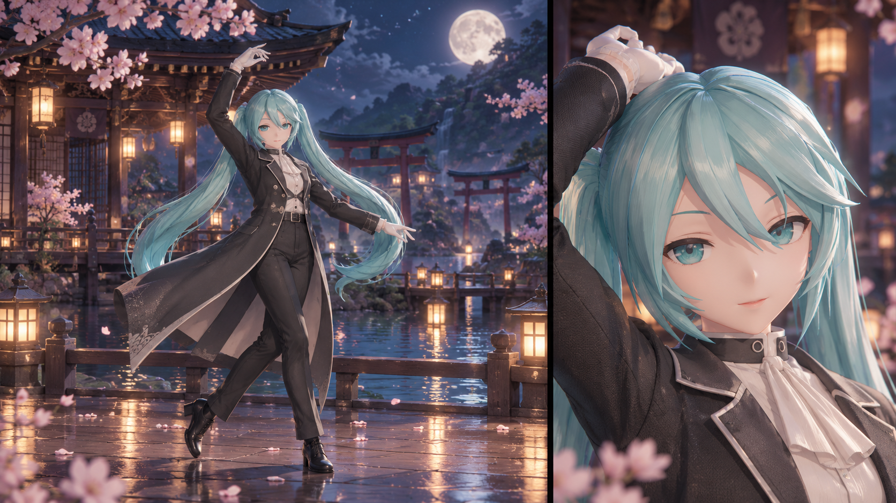
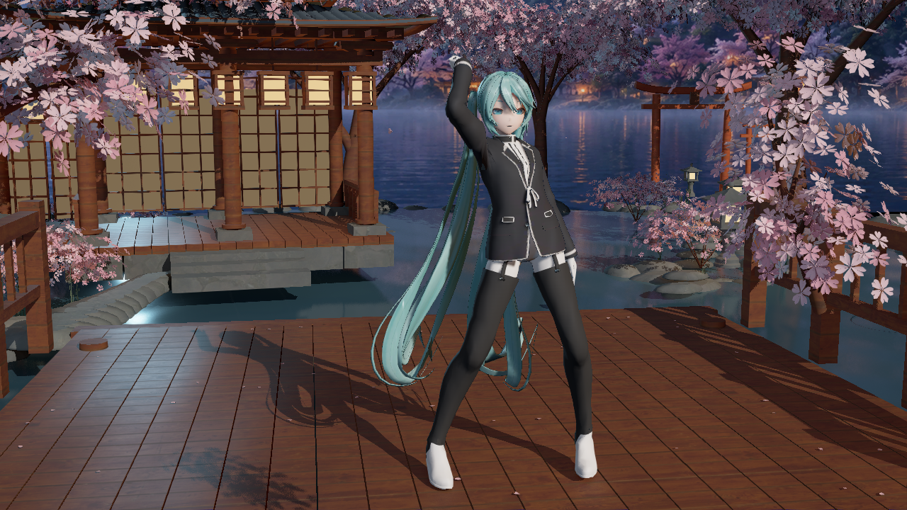
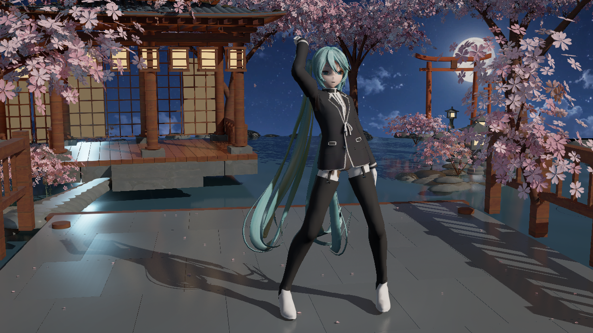
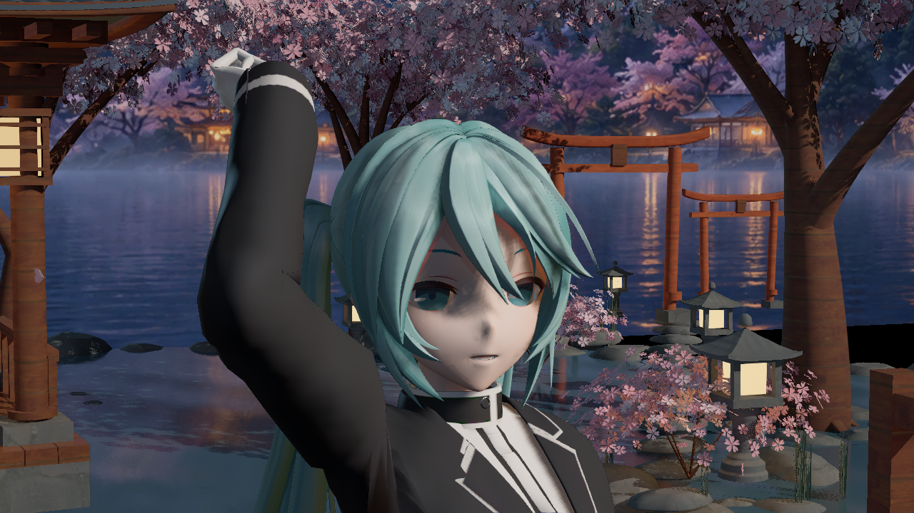
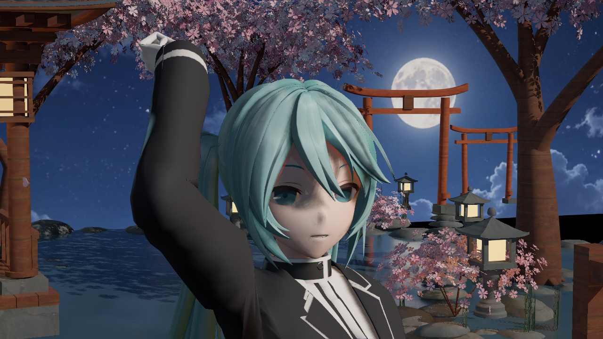
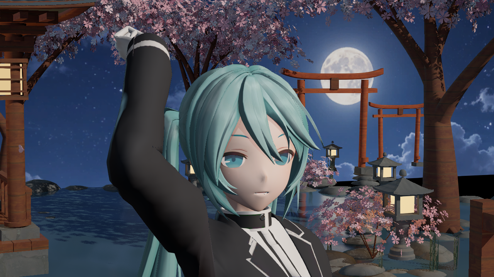

# 二期樱庭水镜：目标与视觉验收

**历史快照（2026-10-19 标记）**：本文保留原批次的研究、状态与验证，内部“当前／下一步”和历史聊天指令不作为今日架构或执行约束。现状先读[当前架构](RENDERING_ARCHITECTURE.md)和[接手状态](ENDFIELD_V2_FOR_GPT.md)，原日期与证据保持。

目标来源：用户在此前四张目标图中选定 **B 樱庭水镜**，2026-10-11 要求继续推进并符合该图。下图是 2026-10-09 的**生成式需求图**，不是插件实拍、商业游戏截图或已完成效果。

## 验收对象

以当前测试模型和真实场景灯光实现图中的材质与明暗层次：暖侧前主光、冷色细轮廓、鼻颊局部体积、跨发束的移动亮带、黑布褶脊与织纹，以及湿地和水的环境反射。当前模型的短外套、丝袜、白鞋与需求图的长燕尾服、褶裤、黑靴不同，单独记录形状差异，不以 shader 改动声称服装造型相同。

| 项目 | 需要看到的证据 | 尚不能代替验收的证据 |
| --- | --- | --- |
| 主视图遮挡 | 实际 GameViewport 中四级联有效；角色帧自阴影开关在刘海、鼻侧、领口等产生合理局部差异 | SceneCapture、只读标签、编译通过 |
| 人物明暗 | 暖主光能分出受光/背光侧，补光保留暗部而不填平鼻颊；关灯保持辐射响应 | 单纯调色或抬曝光 |
| 发丝 | 宽、窄亮带横跨发束；转头或改变灯位时移动，细节关闭仍有几何响应 | 底图上的固定白条、全头泛白 |
| 脸部 | 正面与转头都能读出鼻翼、颊面、下巴，缺头骨输入正常回退 | 配套 UV/SDF、椭球完全替代鼻部几何 |
| 黑衣 | 保留黑色主体，已有肩袖折面和通用褶皱分出层次；织纹近看有效、远看不过度闪烁 | 宽灰塑料镜面、用法线声称改变轮廓 |
| 湿地与水 | 粗糙度实际驱动反射；湿木/湿石与干梁柱可区分，暖灯反射随视角及波纹变化 | 假倒影贴图、自发光水面、只有数学参数表 |

## 当前结论：技术通过，视觉未通过

截至 2026-10-11 的 Revision4，**仍不符合需求图**。新代码和预设在隔离工程构建、生成及真实主视图捕获成功，不能据此声称美术效果完成。最新一版鼻侧黑块有所减轻，月亮进入画面，但远岸建筑和水岸被背景位移挤出；头发宽亮带、脸部层次及湿石质感仍未达到标准。

本批修改保留为工作区候选，未提交、推送或发布。新预设只在私有验证工程生成，主插件原有 496 个 Content 文件未覆盖；直接使用原有已保存资产不能视为已应用本批新参数。未实测的头发主/副瓣偏移交换候选已归档到 Saved，生产 BRDF 恢复为 Revision4 实际捕获的版本。

## 实际实施与边界

| 部分 | 实际修改 | 实拍结果与限制 |
| --- | --- | --- |
| 樱庭预设 | family 0 改为 2；主光 Pitch/Yaw −32°/48°，Key/Fill/Rim 3.8/0.28/0.9，Ambient 0.12；降低宽镜面、收窄描边；FilmSlope 0.86 | 与旧灯光、shader 同时变化，不是纯 shader A/B；人物暖侧光和冷轮廓仍弱 |
| Hair | family 2 独立双偏移正弦幂带，切向正交与退化兜底，灯循环前传播屏幕足迹；可选通用贴图 | 大块白亮减少，但没有证明形成随灯移动的宽亮带；有界系数不等于严格能量守恒 |
| Skin | family 2 从 V2 的 diffuse 0.10–0.32 / specular 0.05–0.20 平滑，提高到 Revision4 的 0.45–0.65 / 0.30–0.45；按几何与椭球法线夹角调节 | V2 鼻部尖面黑块减轻，仍有鼻侧灰块；刘海阴影另造成眼周暗色。用户维护的 `TMMDAnimeFace.usf` 未改 |
| Cloth | 保留通用褶皱/织纹，family 2 降低直接镜面比例 | 黑衣仍主要是宽灰渐变；测试模型缺少需求图的大褶裤和长衣摆，法线不能补造型 |
| 湿地 | 显式粗糙度不再被角色默认值覆盖，细节仅小幅调制；前庭换成 51 块错缝湿石，关闭其重复铺装贴图 | 反射响应增强，但偏冷白且石块大片平灰；不符合目标的暖灯、细缝和局部粗糙度层次 |
| 场景 | 前两树花簇 880→504，总数 1260→884，保留下游随机布局；两扇纸墙改为通透格栅；背景保持 3:1 比例但移动/镜像 | 花簇略稀、墙透空，月亮入画；背景水岸和建筑丢失，判为构图回退 |

所有角色修改仍遵守 BaseColor 最小输入、几何着色和可选通用贴图，不引入模型 UV/SDF 阈值图，不修改引擎。各 Reference 风格共用插件 Custom 着色框架；family 2 是终末地方向，**不是取得并移植了原作完整人物 shading model**。本机离线 shader/材质证据及尚未确认的画面对应见[公开参考](PHASE_TWO_PUBLIC_REFERENCES.md)。

## 实拍批次与可比较范围

日期均为 2026-10-11，时间为 SGT（UTC+8）。三组有效捕获均为后台、未打包 `-game` GameViewport，非 SceneCapture；1280×720、固定曝光、景深/运动模糊 0，物理 178 刚体顺序推进 156 × 1/60 秒后冻结。材质捕获前 shader/资源编译队列归零，主视图四级联阴影及 GPU 灯光数据实际读回。每组 17 张包含细节、灯光、自阴影和描边诊断，**不是 17 次美术迭代**。

| 批次完成时间 | 验证结果 | 实际变化与比较限制 |
| --- | --- | --- |
| 14:57:30，Baseline Repair3 | 17 PNG；进程自然退出；保护输入未变 | 修改前有效基线；旧 shader/灯光，临时指定 Endfield 父材质。此前 Repair2 首张灰材质不计入视觉证据 |
| 15:30:35，V2 Recover3 | 17 PNG；进程自然退出；保护输入未变 | 新 Hair/Skin/湿地实现与新灯光同时变化；发片白亮减少，鼻侧明显变黑；舞台布局保持旧版 |
| 16:05:23，Revision4 | 构建通过；生成 50/50、23 材质编译通过；17 PNG；保护输入未变 | 相对 V2 改动 StageActor、Backdrop、BRDF，镜头与物理相同；鼻部改善有限，背景构图回退 |

V2 的原生成批次虽报告 50/50、23 材质编译成功，完整守卫因 UE AndroidFileServer 自动写入私有配置而失败。原失败报告没有改写；保存自动写入版本、恢复精确冻结配置后，独立 Recover3 批次成功。Revision4 禁用该自动写配置模块后，生成和捕获均通过。

早先 UE 5.8.3 复测与正确 family 基线主要是修复引擎/验证对象；Repair1–3 和 Recover3 主要解决 DDC、SM6、动画压缩、就绪等待和配置一致性。不能把这些批次数当成连续画质提升。

## 原始截图对照

截图全部原样复制，没有重画、调色、裁切或滤镜。完整来源、批次时间、文件写入时间与 SHA256 见[归档清单](Screenshots/2026-10-11-phase-two-sakura-v2/manifest.json)。

修改前全景：远岸建筑存在，前庭为木板；月亮未入画。

Revision4 全景：月亮可见，但远岸建筑和水岸丢失，湿石偏平。

V2 人物：鼻部尖面黑块较明显，头发主要仍是纵向明暗。

Revision4 人物：鼻侧黑块减轻，刘海自阴影造成眼周暗色，宽亮带仍缺失。

同批关闭角色自阴影：眼周明显变亮，鼻侧仍留灰块。它支持区分遮挡与法线/BRDF 问题；不能据此将全部刘海阴影称为 acne，也不建议以关闭真实遮挡作为最终处理。

## 为什么画面仍差很多

1. **验证方式混入过多变量。** shader、灯光、预设和构图一起改，整图无法判断某个算法的效果；编译和参数读回只证明路径运行。需要局部、固定条件的对照。
2. **法线与遮挡问题叠加。** 鼻侧暗块在关闭自阴影后仍存在；眼周暗色随阴影开关改变。两项要分别验证，继续整体抬亮会填平体积。
3. **几何发流只是通用近似。** 当前切线由头部几何估计，底图又有固定明暗；没有实际灯位移动对照，就无法确认条带失败来自发流、偏移、带宽、足迹滤波或光向。若发片近似平面，同束法线/切线近乎恒定，正弦幂带可能沿整束保持近似常数，交换偏移也不能保证横向亮带；目前没有实际 N/T/H 分布证据，这是待验证的解释。条件性曲面峰位推断不能替代实拍。
4. **模型与场景资产不足。** 目标长外套/褶裤/黑靴和测试模型不同；低层次方块石、重复花簇及远景背景图也不能靠 shader 变成完整三维场景。远景图没有真实视差和独立受光，移动单一月亮锚点会破坏建筑、水岸对应。
5. **人物与场景的环境响应覆盖不同。** 场景原生材质可走引擎反射；角色 Custom 光照通过 LightDataRT、SH、天空镜面和主光 CSM 工作，不能因项目启用 Lumen 就声称自动获得人物局部反射、SSR、AO 或点光阴影。后处理不能代替缺失的光照路径。

## 下一次有限验证，尚未执行

先保留当前实拍结论，不继续泛化调参或扩大截图批次。Saved 中的 Aux6/Revision5 和背景补丁均为未执行草案，不计为新成果。

- **头发四帧：** 固定人物、镜头、曝光和舞台，主光 yaw −8°/+8°分别镜面开/关；三个 Hair MID 的 `SpecularStrength` 为 0.50/0，其余条件共有 `SoftSpecularStrength=0`、环境镜面/rim=0、HairDetail/Shift=0，隔离直接几何镜面。读回真实 MID、GPU 灯向；比较两组开−关差分，先确认有亮带能量和移动，再只改变一项发流/偏移参数。只关 SpecularStrength 会留下 SoftSpecular 的贡献，不算完整关镜面。若信号仍沿整束，先输出私有诊断的 T·H/N·H/足迹，再决定发流处理。PNG 差分只用于定位，不声称 HDR 能量守恒。
- **脸部独立对照：** 固定灯光和 CSM，仅改变 family 2 法线平滑，正面及侧面观察鼻颊；自阴影开关作为独立条件。先解决法线方向/过渡，再判断刘海投影的软化范围。
- **舞台独立对照：** 同机位先恢复建筑、水岸对应，再安排独立月亮；同时检查三个构图锚点，避免单点通过。湿石需要单独验证局部粗糙度和暖灯镜面贡献，不能再绑人物 shader 一起改。

只有对应局部指标可见改善后，才组合成两张美术镜头，审查与需求图的整体差距，再决定是否替换三维资产或扩展环境光照。源数据、构建产物、草案和测试角色继续留在 Git 忽略的 `Saved/Phase2Reference/`；只归档代表性原图和[修改记录](CHANGELOG.md)。
