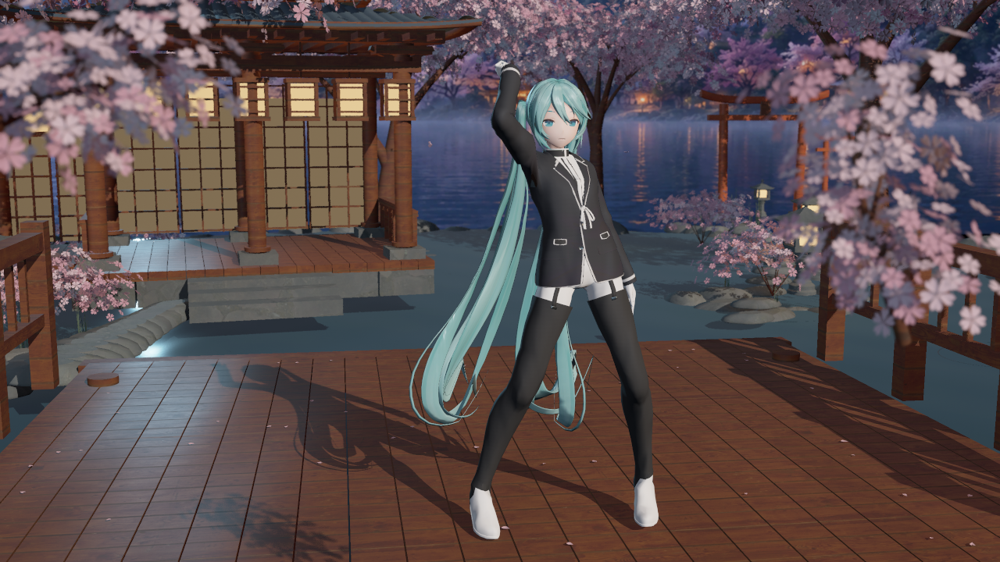
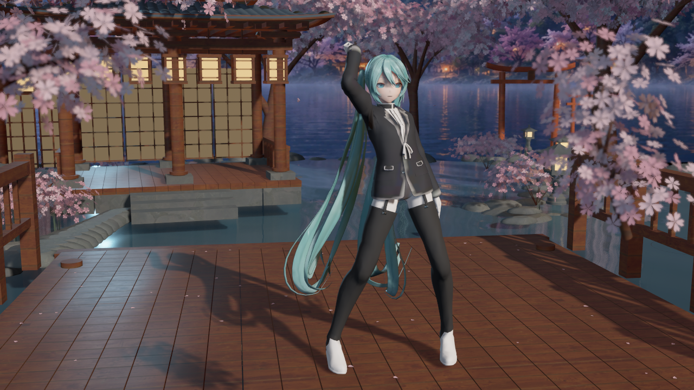
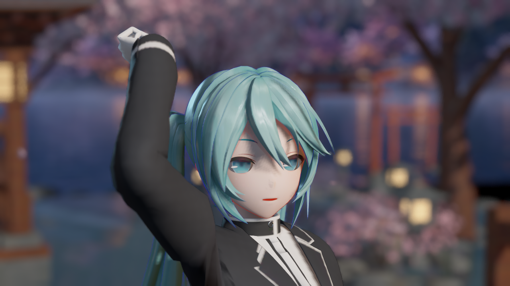
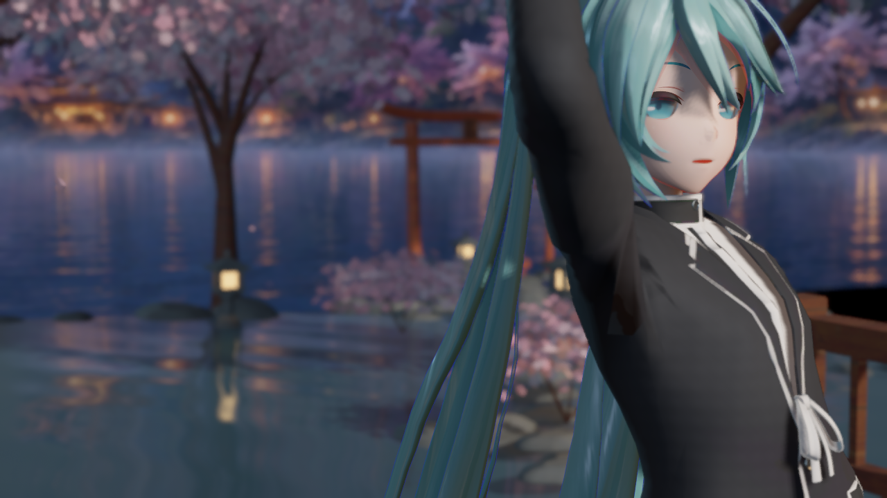
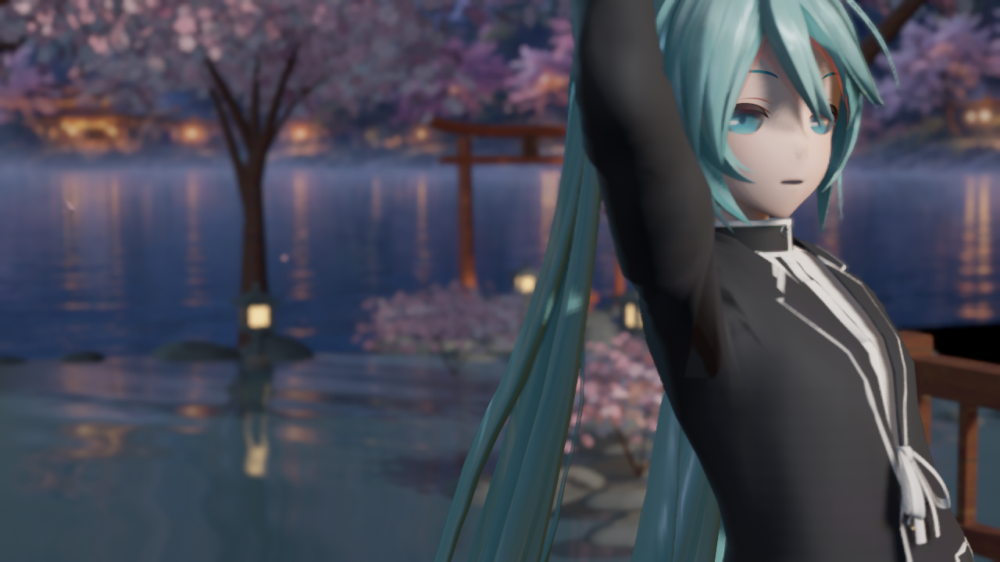
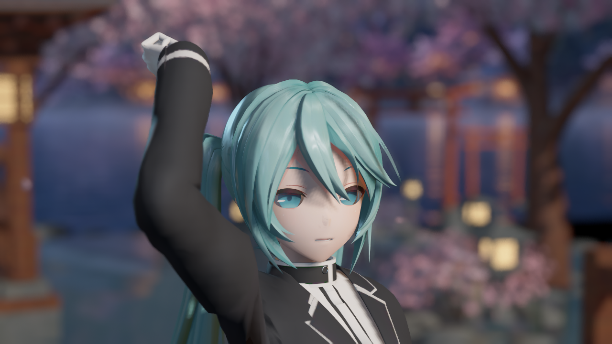

# 一期引擎截图

捕获日期：**2026-10-09**。归档日期：**2026-10-10**。这些 PNG 来自已通过验证的 UE 实际渲染，保留原文件；未重新生成画面，也未进行图片润色。

舞台全景来自后台编辑器场景捕获；其余图片来自打包版 `GameViewport / FScreenshotRequest`。编辑器场景捕获和打包主视图的阴影路径存在差异，应使用打包近景判断人物自阴影。

## 舞台与人物

樱庭水镜全景，后台编辑器场景捕获：

打包版人物全景：

## 脸部与发丝细节迭代

两张图片来自相同镜头和 2.6 秒舞蹈姿态。前图是 V2 通用细节及预设细描边迭代前的打包捕获，后图是一期最终打包捕获。

| 迭代前 | 一期最终 |
|---|---|
|  |  |

## 布料细节迭代

同机位衣物对照；通用褶皱法线只改变光照响应，不改变模型轮廓。

| 迭代前 | 一期最终 |
|---|---|
|  |  |

## 预设细描边开关

打包版相同近景下关闭与开启预设细描边的对照：

| 关闭 | 开启 |
|---|---|
|  |  |

## 来源记录

| 归档文件 | 原始本地捕获路径（相对 MMD 项目） |
|---|---|
| `sakura_stage.png` | `Saved/BackgroundValidation/SakuraDetailV5/screenshots/sakura_theater_hero.png` |
| `character_body.png` | `Saved/BackgroundValidation/RuntimePackageSakura/screenshots/runtime_reference_genshin_body.png` |
| `face_before.png` | `Saved/BackgroundValidation/SakuraDetailV5/before/face.png` |
| `face_after.png` | `Saved/BackgroundValidation/RuntimePackageSakura/screenshots/runtime_reference_genshin_face.png` |
| `cloth_before.png` | `Saved/BackgroundValidation/SakuraDetailV5/before/cloth.png` |
| `cloth_after.png` | `Saved/BackgroundValidation/RuntimePackageSakura/screenshots/runtime_reference_genshin_cloth.png` |
| `face_outline_off.png` | `Saved/BackgroundValidation/RuntimePackageSakura/screenshots/runtime_character_face_outline_off.png` |

[manifest.json](manifest.json) 记录文件大小、分辨率、来源和 SHA256，可核对归档原图。[修改记录](../../CHANGELOG.md)说明本次变化与验证结果。
