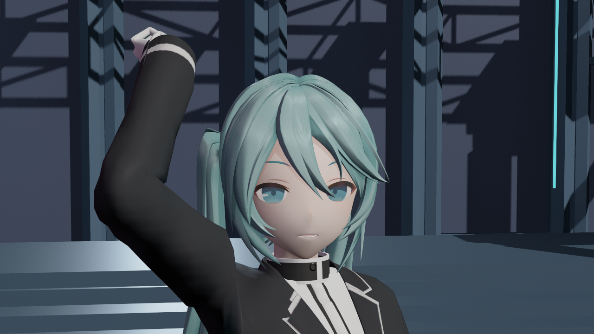
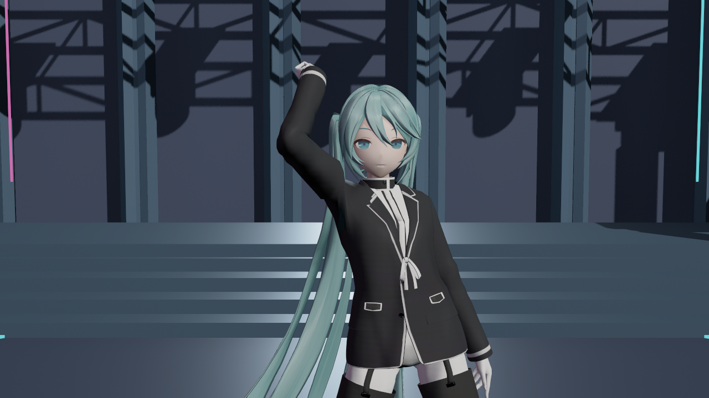

# Endfield 方向的实际问题基线

**视觉目标未达到。** 这组图用于纠正上一批验证对象，并保留当前问题；不是新的外观提升，不是终末地游戏实拍或生成式效果图。

捕获日期：**2026-10-11 10:55:49，Asia/Singapore**。引擎为 UE **5.8.3 / CL58210709**，实际离屏 SceneCapture 原始 PNG，1280×720；没有改画、调色或裁切。日期取原始文件写入时间，来源、实际父材质和 SHA256 见 [manifest.json](manifest.json)。

实际使用 **Reference_Endfield / family=2**，并核对 Opaque、Masked、Translucent 三种父材质。风格源预设为 IndustrialAnime，本组按已有统一比较配方放在 NeonConcert 舞台。此前 SakuraTheater 实拍属于 family=0 / Genshin，不能当成 Endfield 验收。

## 本轮结果与限制

- 同一后台有限批次经共享门禁完成；57 项运行检查、23 个 SM6 材质与 52 张实拍成功，不代表审美或风格通过。这里只归档两张代表图。
- 景深与运动模糊质量均以启动阶段实际 `GetString` 读回 0 确认；没有每张捕获再次查询。手动曝光和统一灯光来自既有本地源配方，实际 GPU 主光强度为 3.3；不是中性单灯实验。
- 本批没有新增 shader 或材质参数。主 Content 496、shader 88、全部源输入 184 个文件的哈希前后未变，含用户维护的 Face。
- 使用兼容的历史插件 DLL，未重编 C++、验证构建 SDK 或打包。SceneCapture 没有主视图，自定义 CSM 使用既有回退，不能用这组图验收角色自阴影。

实际看图仍存在：头发主要沿发片形成纵向亮条，衣物呈大面积平滑黑灰渐变，脸部层次不足。具体原因尚未通过分离实验确认；需要在实际主视图中补自阴影、单灯/填光和镜面开关对照，再逐项改善头发带形、皮肤明暗与衣料差异。

完整报告保留在被 Git 忽略的 Saved/Phase2Reference/EndfieldDiagnostic583，本目录只保存实拍与来源摘要。
