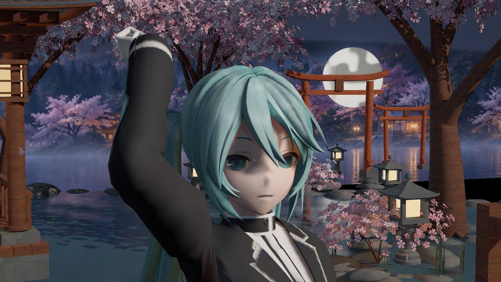
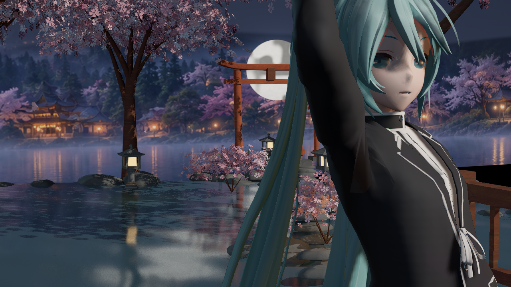

# 独立 EndfieldPhase2 首轮诊断实拍

捕获：2026-10-11 21:06:58 SGT。UE 5.8.3 CL58210709，实际 GameViewport / FScreenshotRequest，后台未打包。源码为独立的 Revision4 机械复制，原图未重绘或调色。每文件来源、大小、SHA256 和实际进程时间见 [manifest.json](manifest.json)。

Build 与只写四个新资产的 Generate 通过。Capture 实际输出三图，验证 **失败**：三父材质资源状态的合并检查每图三项失败；衣料镜头的第四阴影级联中心 patch 是清屏深度，旧检查失败。真实预设/35 槽绑定、全部 Custom 签名、156 次物理/178 刚体及最终曝光读回有效，但不能因此将整个批次记为通过。

画质 **未通过**：鼻部灰块、沿发片长轴的宽亮条、衣料大面缺层次仍可见。用户再次指出结果不合格，后续转向实际 shader 与材质数据流改进；验证链修正不能作为画质改善。

## 脸部诊断

## 衣料诊断

测试角色是插件 Miku 夹具，不是终末地人物；场景使用 native 樱庭和旧资源。本批没有保存地图验证、主 Content 发布、云上传、提交或推送。
