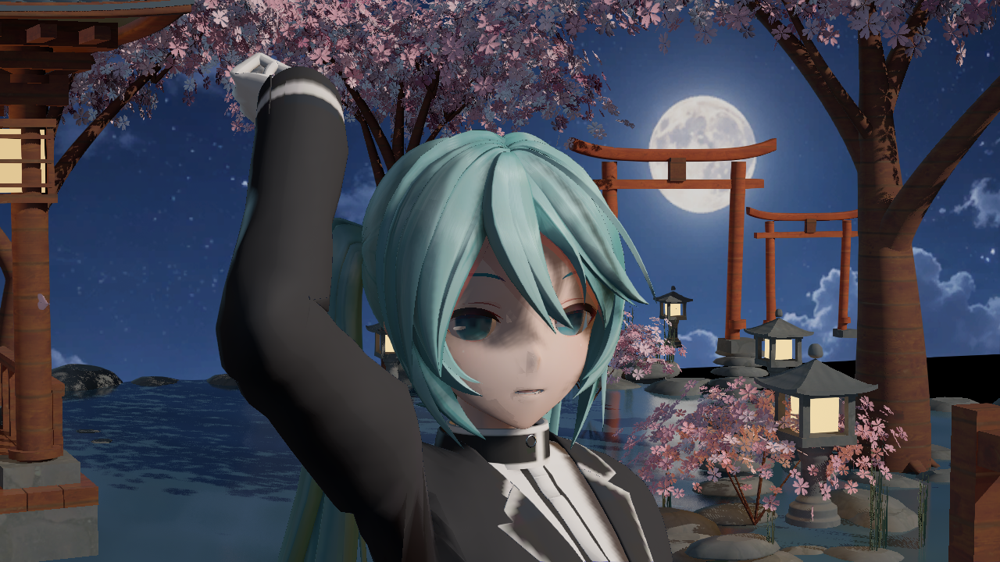
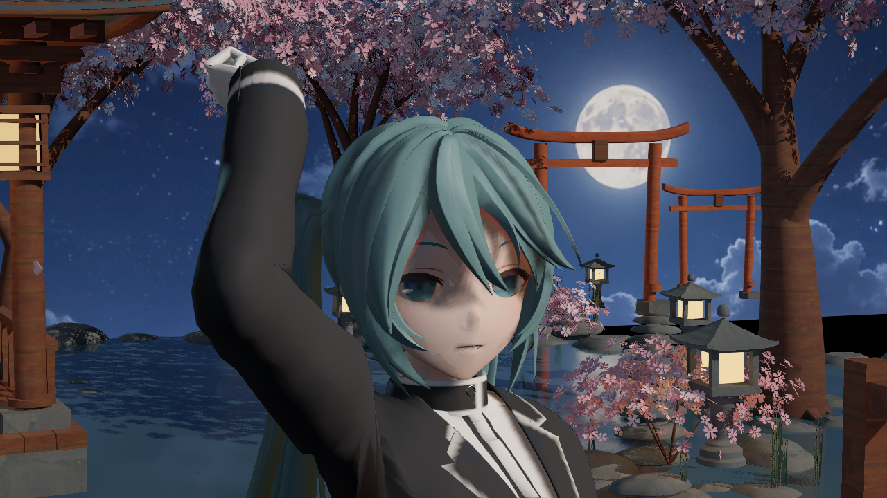

# 发带方位约束候选：效果未达

捕获日期：2026-10-11，Asia/Singapore。正常图原 PNG 写入时间 22:50:00，平色诊断图 22:50:13；完整时间、来源、字节数和 SHA256 见 [manifest.json](manifest.json)。UE 5.8.3 / CL58210709 / PCD3D_SM6，后台离屏主视图，插件 Miku 测试夹具。图像未经编辑，不是终末地角色或生成式目标图。

相对[22:33 输入归因批次](../2026-10-11-phase-two-endfield-input-attribution/README.md)，唯一 shader 差异是 `EvaluateHairBand`：构造与 shifted tangent 正交的 shifted normal，将原纵向带乘 `saturate(N'·H)^2` 方位约束。保持底图、灯光、相机、姿态、其他材质参数及 21F 宿主不变。该约束只减少能量，没有能量补偿，仍属于有界艺术近似，不是严格物理归一 BRDF。

## 正常输入实拍

## 平色 RGB 加原 Mip0 alpha 的诊断实拍

平色诊断与前批一样，只用于输入归因，只有单 mip，未复现原压缩/mip链，不能据此证明逐 LOD 透明边缘等价；未保存角色资产。

**实际结果：部分亮区略微减弱，长亮轨形状、片间明暗和灰脸基本未变。视觉目标未达，不能称作已修复发带。** 残留仍需分离漫反射法线、几何发流、直射镜面与环境镜面贡献，不能把这一有限门控当成完整材质重建。

22:49–22:50:19 SGT 有限链 Build → Generate → Normal3 → FlatHair3 全部真实 exit 0。只重写三个独立父材质，preset 与旧主 691 / 私有 Content 496 保持 SHA；新来源签名 `d52b5c39c709b5485647dfc266fb860d`。两组六张实际图、三 parent/35 MID 完整 SM6 资源、四级阴影、物理与最终 PP 检查通过。运行检查通过不等于画质通过。

仅归档两张原图及摘要，未发布主 Content/DLL，没有前台、云上传、提交、推送或 Git ref/stash 操作。
