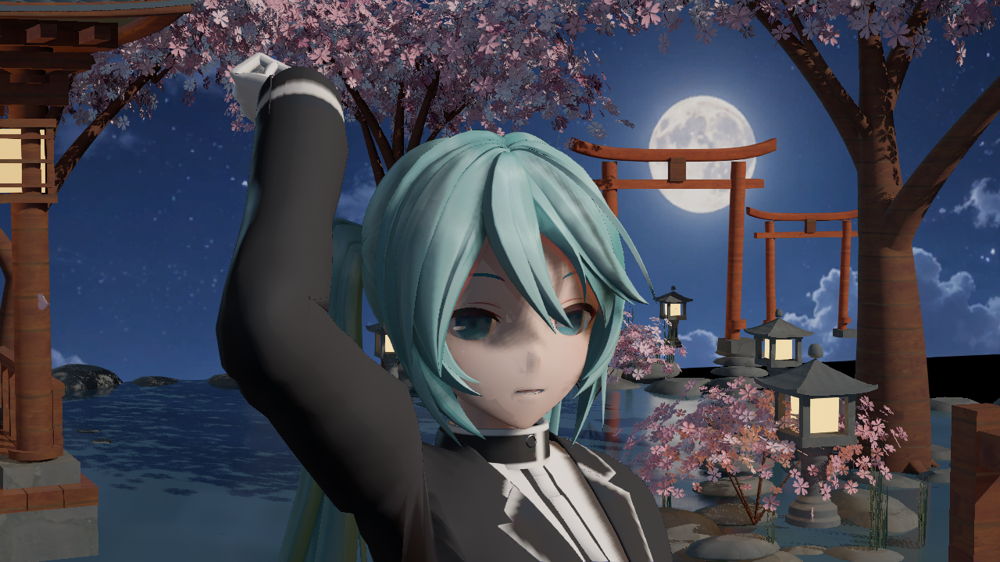
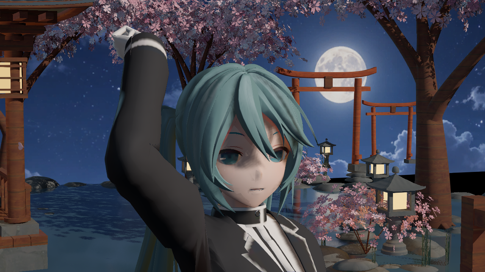
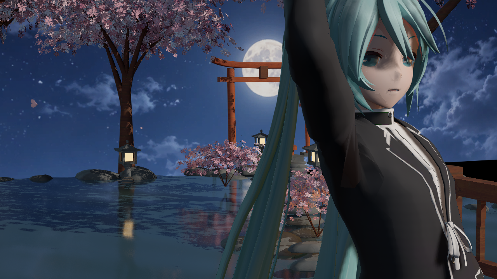

# 终末地人物方向：正常底图与平色发丝诊断

捕获日期：2026-10-11，Asia/Singapore。原 PNG 写入时间分别为 22:33:46、22:33:59、22:33:47；完整时间、来源、字节数及 SHA256 见 [manifest.json](manifest.json)。UE 5.8.3 / CL58210709 / PCD3D_SM6，后台离屏主视图，插件 Miku 测试夹具；非终末地角色、非生成式效果图。以下都是未经编辑的引擎原图。

Normal3 使用原 BaseColor；FlatHair3 只在实际三个 Hair MID 临时替换 RGB，颜色为 linear `(0.12,0.26,0.28)`，逐像素保留原源纹理 Mip0 alpha，继承采样设置。法线、BRDF、灯光、镜头、姿态与 156 次物理推进保持同一协议。临时纹理只有一个 mip，未复现原压缩和 mip 链，不能据此证明逐 LOD 透明边缘完全等价；未保存或修改角色资产。

## 正常底图：脸部近景

## 平色 RGB 加原 alpha：只用于输入归因

正常图中的部分粉白细纹在平色后消失，确认原底图画有静态亮纹；平色图仍有沿发片延伸的宽长亮轨与片间暗沟，表明程序响应和几何也有问题。该固定光向对照不能再把残留精确划分成漫反射、镜面及几何各占多少，更不能将全部问题归咎于底图。脸部灰鼻/眉眼灰带不随 Hair RGB 改变，需独立处理。

## 正常底图：衣料近景

袖部、胸前和褶皱的材质区分仍弱，尚未达到目标。

## 验证结果与边界

22:32:39–22:34:04 SGT 通过共享门完成 Build、Normal3、FlatHair3，均真实 exit 0；两组三视图各无失败项。启动时禁用 shader job DDC、启用完整 material-map DDC 后，三个父材质和 35 个实际 MID 的 SM6 资源均 complete/finalized/compiled，编译队列归零，四级阴影覆盖、灯光、物理及最终 PP 读回通过。此项修复仅在 Saved 验证宿主启动配置中，不是引擎修改或插件发布功能。源签名为 `1f630372aa72ce447e33d93d1a279e5d`，复用 21:54 的真实 Generate 回执，本批未重写资产。

**运行检查通过，画质未通过。** 旧主 691 文件、旧私有 Content 496 文件、已有独立四资产及九构建产物按阶段检查；没有主 Content/DLL 发布、前台操作、云上传、提交、推送或 Git ref/stash 操作。这里只归档三张原图和摘要，不包含测试角色、游戏资产、Saved 或构建产物。
