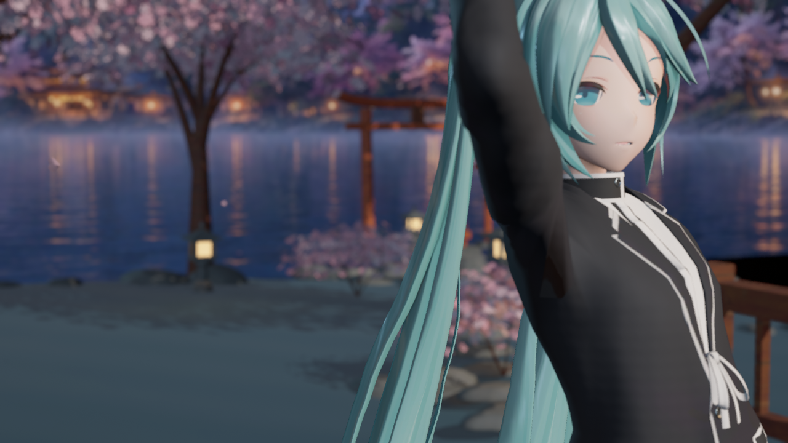

# UE 5.8.3 修复后的材质复测实拍

捕获与归档日期：**2026-10-11，Asia/Singapore**。以下两张是 UE **5.8.3 / CL58210709** 的离屏 SceneCapture 原始 PNG，非生成式目标图、非终末地实拍。逐文件时间、来源和 SHA256 见 [manifest.json](manifest.json)。捕获时间取原始 PNG 写入时间。

**2026-10-11 标签纠正：本批捕获 SakuraTheater，实际父材质为 reference_family=0（Genshin 方向）。这两张不是 Reference_Endfield 预设截图，也没有通过终末地风格视觉验收。**

本批复测二期 MaterialV1 的同一实现，没有新增外观改动。历史 5.8.2 对照保留在[上一批归档](../2026-10-11-phase-two-material-v1/README.md)，不把跨引擎版本的像素差异当成材质提升。

## 实际验证

- 同一有限批次经共享门禁运行；引擎及子进程自然结束，没有打开前台。
- 47 项通过、0 项失败；23 个 PCD3D_SM6 材质和12张实际 PNG通过。
- 主插件 Content 的496个文件和全部shader前后哈希未变，包含用户维护的 Face。
- 插件使用已验证兼容的历史 DLL，本批没有重新编译 C++、验证构建 SDK 或打包。引擎版本由本批实际运行日志确认；修复时另对官方 manifest 的16个关键文件核对哈希，不称全引擎逐文件校验。
- 离屏没有主视图，自定义 CSM 使用既有回退；运行时 CSM、全部可选贴图同时关闭、双面发片全覆盖和 SoftSpecularStrength=0 像素等价仍未覆盖。

默认画面变化仍较轻微；本批证明当前实现能在修复后的引擎编译和渲染，不据此宣称已达到终末地目标效果。完整实际报告保留在 Git 忽略的 Saved/Phase2Reference/EngineMaterialV1Recheck583，本目录仅归档两张代表性图片与来源摘要。
