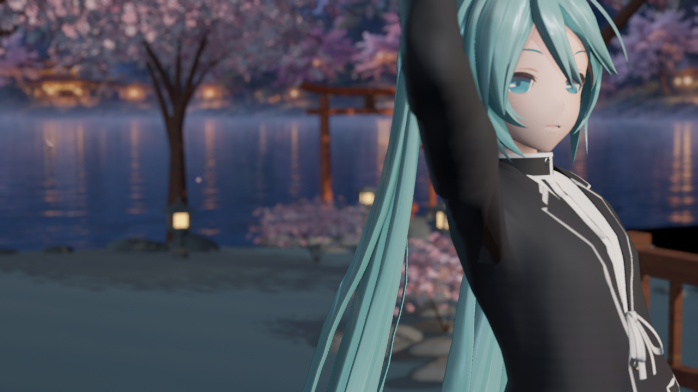
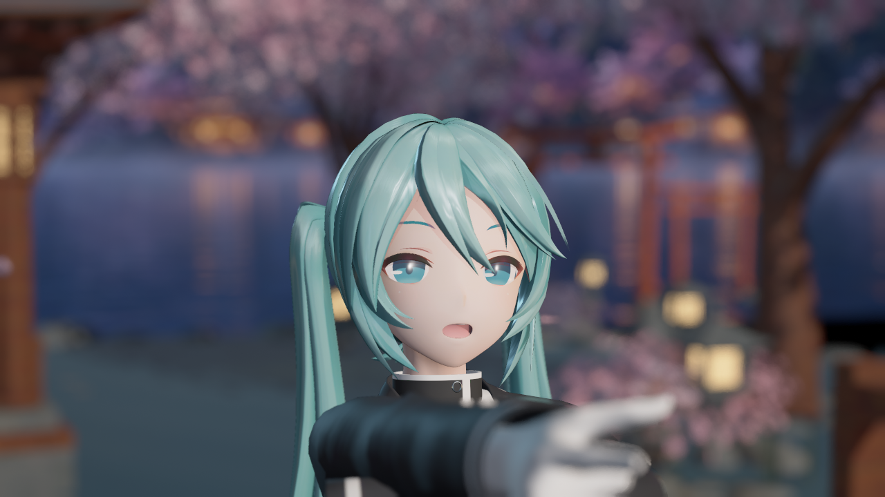

# 二期第一批材质实拍

捕获与归档日期：**2026-10-11，Asia/Singapore**。以下是本机 UE D3D12 离屏 SceneCapture 的原始 PNG，非生成式目标图、非终末地实拍。基线捕获于 09:34:01，候选于 09:37:10；逐文件来源及 SHA256 见 [manifest.json](manifest.json)。

**2026-10-11 标签纠正：这些截图捕获 SakuraTheater，实际父材质为 reference_family=0（Genshin 方向），不是 Reference_Endfield 截图。画面未达到终末地外观目标。**

## 本次变化

- Hair 角色的双瓣各向异性高光不再被可选发丝贴图强度关闭；强度为零仍使用几何法线和程序化发流。本批没有新增径向平滑镜面法线。
- Cloth 用宏观褶皱法线计算中性宽 GGX 瓣，通过已有 `SoftSpecularStrength` 与主镜面归一混合，最多 30%。此参数为零保留原 Cloth 路径；仍同时影响原有镜面强度。
- 保留原有皮肤、漫反射、粗糙度配置与阴影；环境 SH 和镜面不乘主光 CSM。没有修改 `TMMDAnimeFace.usf`。

这是自有通用材质改进，未使用商业角色资产或复制外部 shader 实现，不称为原始终末地算法复刻。

## 布料同镜头对照

修改前：

修改后：

当前预设的混合权重较低，画面差异很轻微。布料全图 MAE 为 0.1728/255，同实现重复基线约 0.0661/255；差异数值不等于画质提升。脸部 MAE 为 0.0230/255，接近重复基线的 0.0192/255，不能声称这批已经大幅改善人物塑造感。

抬头姿态候选：

## 验证与限制

隔离工程报告为 **47 项通过、0 项失败**，23 个材质 `PCD3D_SM6` 编译通过，12 张 PNG 成功；进程日志为 `Success - 0 error(s), 4 warning(s)`。环境响应、有效灯光数据下的关灯画面、两种头部姿态和头部几何基缺失兜底通过；178 个物理刚体有效。主插件 Content 的 496 个 SHA256 全部未变，截图角色资产没有加入插件。

- 关灯画面的平均亮度为 0.04537/255；仅环境的脸部画面平均亮度为 46.91288/255。
- `details_off` 只关闭 Hair/Cloth detail strength，没有关闭 `HairShiftStrength`；`geometry_fallback` 只清头部位置半径。因此未实测所有可选贴图强度同时为零、双面发片正背视全覆盖或 `SoftSpecularStrength=0` 的像素等价。
- 离屏没有主视图，自定义 CSM 使用既有回退；没有验证实际运行时 CSM 或打包运行。
- 验证结束后核对引擎更新会话的哈希证据，确认 Launcher 更新失败后存在 5.8.2/5.8.3 混合文件。上述是本轮实际历史报告，不能作为一致引擎安装上的发布验收。本轮没有修改引擎本体。后续安装修复完成，**2026-10-11 10:30 SGT** 的[UE 5.8.3 复测与新实拍](../2026-10-11-phase-two-material-v1-ue583/README.md)单独记录，未覆盖本段历史结果。

完整日志与报告保留于 Git 忽略的 `Saved/Phase2Reference/EngineBaseline/recheck` 和 `EngineMaterialV1`；本目录只归档代表性 PNG 与来源摘要。
