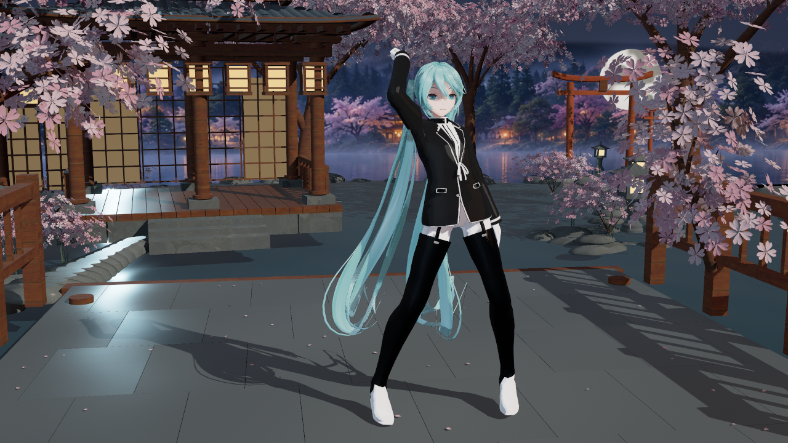
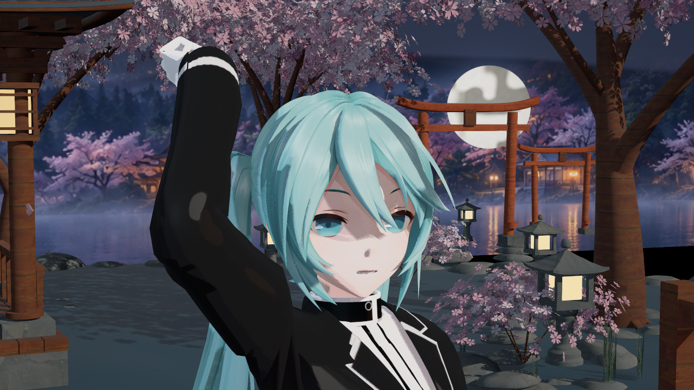
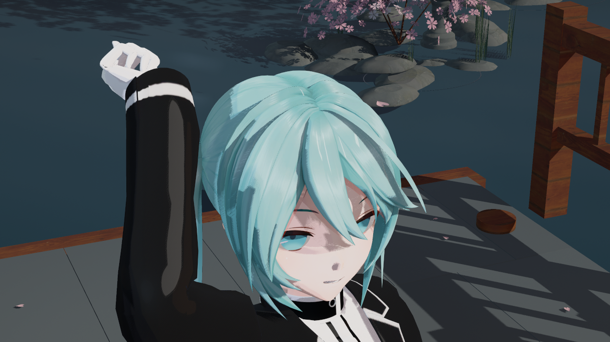
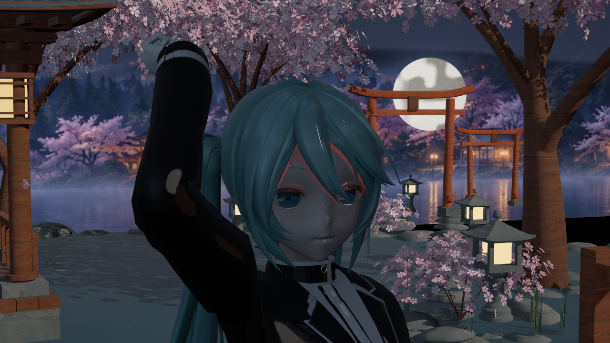

# 终末地 V2 原生 Toon：功能验证与问题归档

捕获与归档日期：2026-10-13，Asia/Singapore。来源为 UE **5.8.3 / CL58210709** 的后台 `RenderOffscreen` + `SceneCapture2D`，使用插件已有 Miku 测试夹具与八秒预览动画。以下均为实际引擎 PNG，直接复制，没有重绘、调色或生成式图片。

**原生光照基础接入通过；终末地画质尚未通过验收。** 鼻部仍有灰点，头发高光仍随发片形成亮条，布料层次与原作后处理尚未对齐。不能以编译和功能检查通过代替画质达标。

## 当前可用候选

同一份 `DA_Render_EndfieldV2` 资产，`r.Substrate=1`、`ToonUnifiedDiffuse=0`。固定镜头、灯光、动画和曝光，关闭景深与运动模糊。代表图来自 `p12` 的 `ab`，SceneCapture 默认不启用硬件光追；该批另外的 lighting 变体显式开启了光追开关，不能混为这些代表图的来源。

## 未采用的实验

同一资产、镜头、灯光、姿态与后处理，仅启动时把 `ToonUnifiedDiffuse` 改为 1；`p10` 实拍明显过暗。没有定位到可在插件内安全修复的根因，也没有修改引擎。该开关保持引擎默认 0，不作为本批推荐配置。

## 验证与限制

- `p12`：53 张实际 PNG、0 项失败；三组各 35 槽的渲染代理检查没有默认材质或代理回退。角色 Profile/粗糙度切换、源贴图保留、其他槽不变、清除分类与恢复原始材质覆盖均通过。
- `p11`：关闭 Substrate 后 9 张 PNG、0 项失败，V2 自动选择原 Unlit 父材质；不把这条回退称为新的画质成果。
- 生成与重新加载：10 个白名单资产保存成功，三种材质各有 21 / 40 / 29 个绘制 shader；最终 `verify2` 磁盘回读通过且没有保存任何包。
- 自阴影与外部遮挡开关有明显像素响应；天空环境光响应明确。AO/反射变化较小，关闭 GI 的差异接近时序噪声，**这组捕获不足以证明角色的 Lumen GI 已完整生效**；主视图、Cook、打包与移动平台尚未验证。
- 本机 UE5.8 Toon 节点不消费自定义 Tangent。当前各向异性使用引擎默认基，尚未实现可控的天使环。脸部球面法线默认关闭；所有 Profile 的 offset/hatching 贴图关闭。

逐图原始路径、捕获 UTC 时间、字节数、SHA256、环境参数和构建输入见 [sources.json](sources.json)。完整输出和失败历史留在 `Saved/Phase2Reference/Endfield2/toon-probe/gpt-v2/`，不提交 Saved、DDC、测试角色或构建产物。
