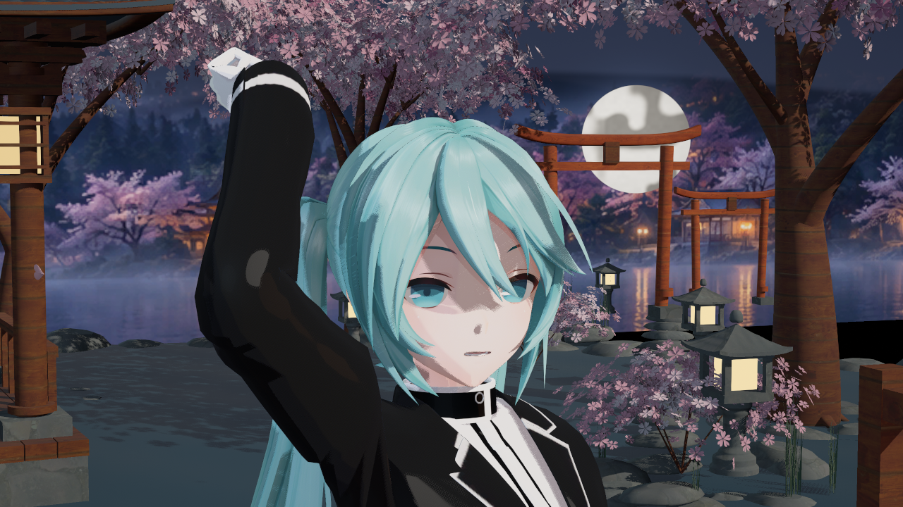
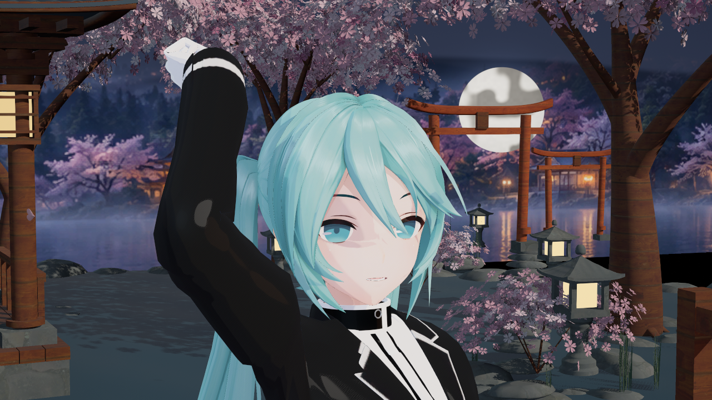
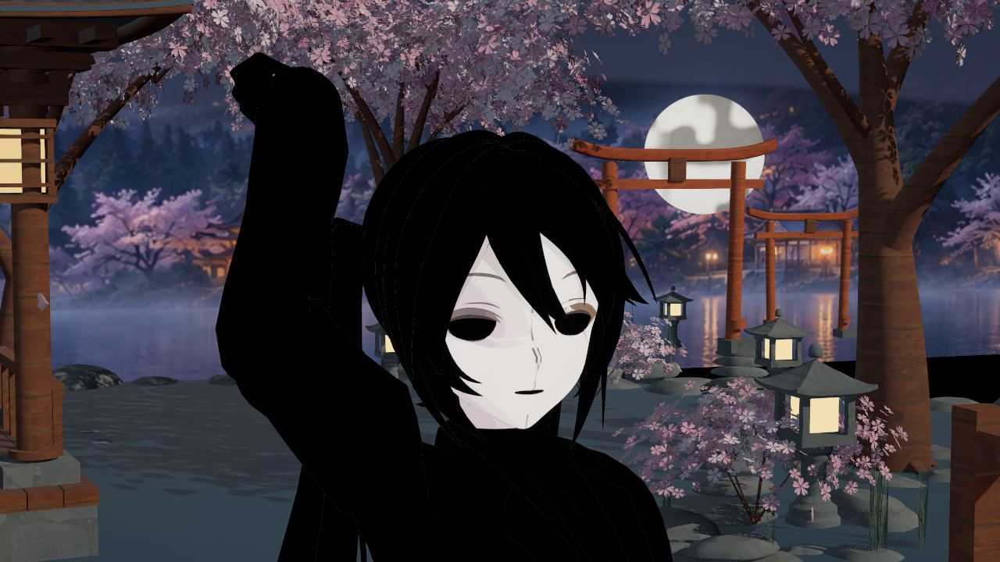
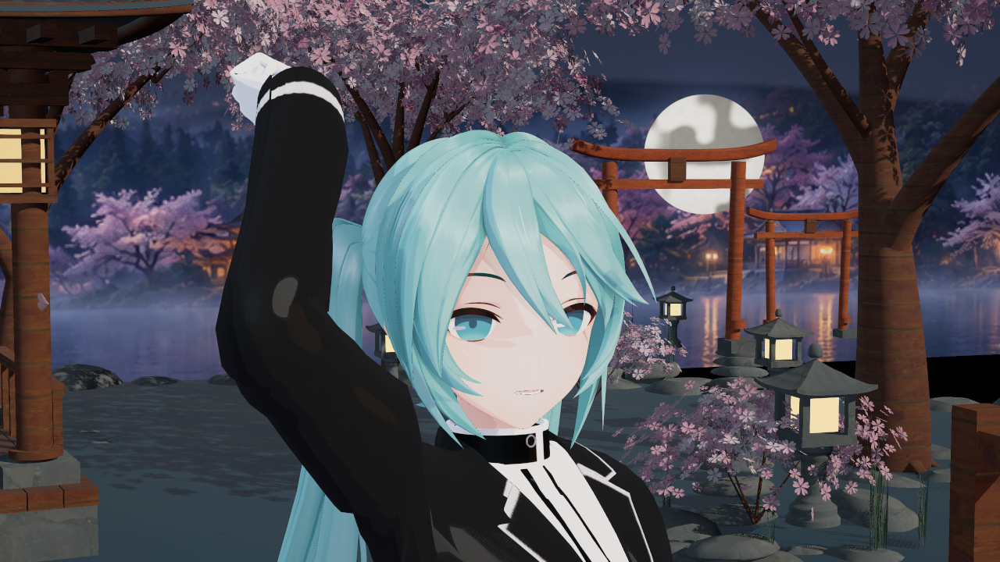

# 自动 SDF 与接触阴影修复的开发验证

捕获及归档日期：2026-10-13，Asia/Singapore。全部是 UE5.8.3 / CL58210709 后台 D3D12 引擎实拍，没有生成式目标图。逐图时间、原文件与 SHA256 见 [sources.json](sources.json)。角色为 Saved 验证夹具，固定 2.6 秒姿态；关闭景深和运动模糊，SceneCapture2D 2560×1440 输出缩至 1280×720。

本批验证了自动 SDF 的实际 GPU 消费与鼻尖接触阴影问题；**完整终末地画质仍未验收通过**。头发高光环、真实 ramp、眼部分层、深度 rim、描边和后处理还需继续实施。

## 接触阴影因果对照

以下两图均来自 p15，2026-10-13 18:58 SGT，同一 SDF 版本、父材质、灯光与姿态，仅改变角色的接触阴影开关。开启时鼻尖出现灰点，关闭后消失，普通阴影贴图仍开启。默认 V2 已采用关闭接触阴影，脸面投影抑制保持 0。

## SDF Version3

p17 捕获于 2026-10-13 19:34 SGT，重新烘焙镜像共 UV。主脸槽 15,777 个有效 texel，其中 15,510 个通过几何与阈值一致性检验的镜像 texel，56 个复杂冲突回退。黑色是非脸部区域；该图把实际 Custom 的 GPU mask 输出接到原生 Toon 底色，证明主要脸面被消费。

[75度侧光的 SDF 消费](sdf_side_light.png)是单主光开发对照，不是原作等价效果。角度阈值在固定俯角近似，复杂非连续亮区保留前向连续段，真实遮挡继续由 UE 处理；原生 Toon 的漫反射和高光仍共用一套法线。
