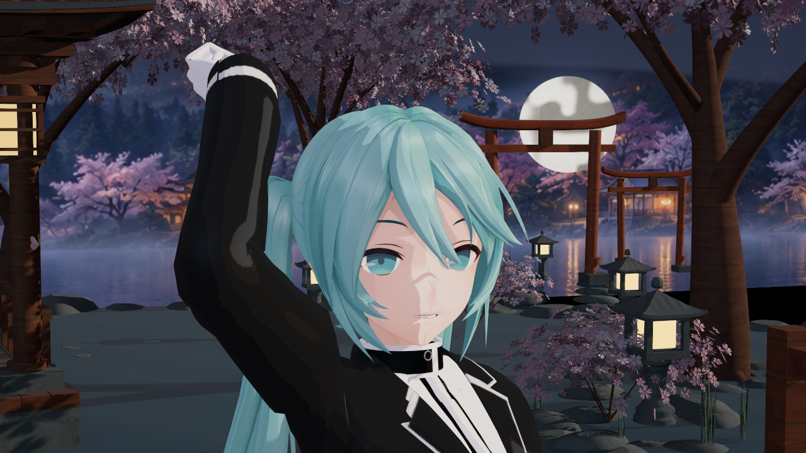
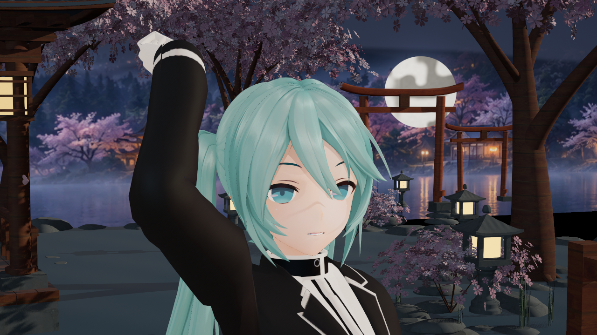
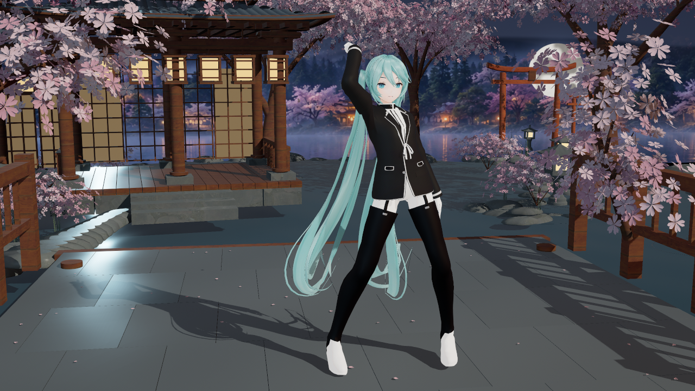
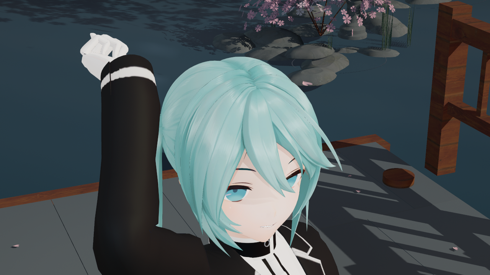
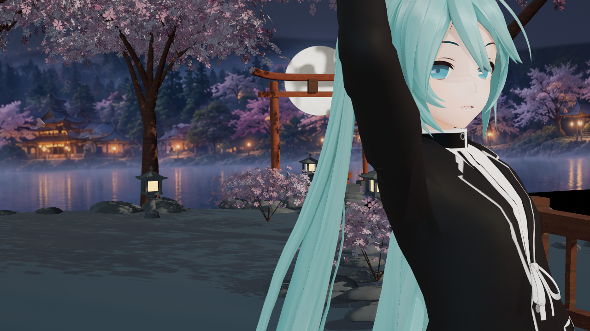
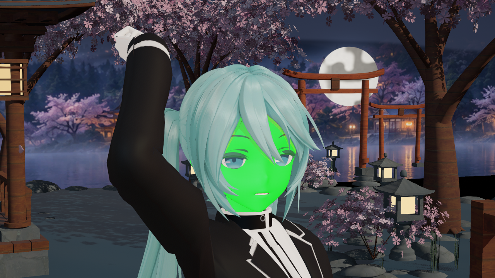
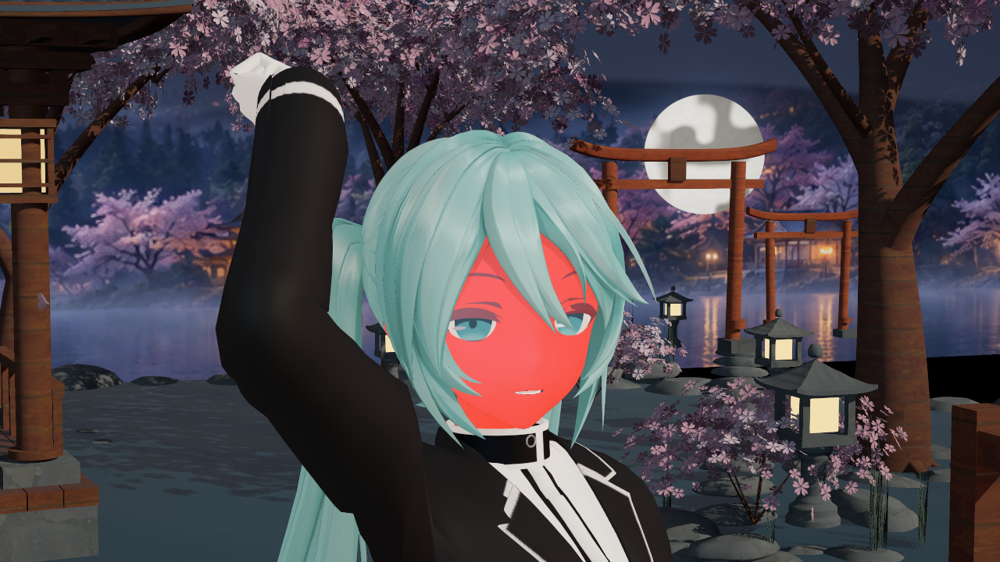
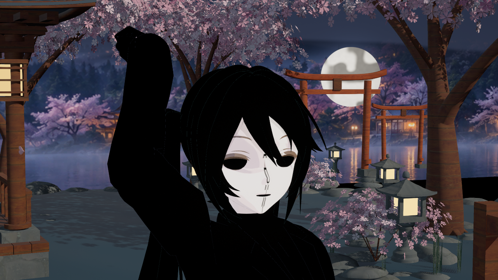

# 终末地画质迭代：脸部方向与真实 ramp

捕获日期：2026-10-14。来源：UE5.8.3 / CL58210709，`UnrealEditor-Cmd.exe`、D3D12、`RenderOffscreen`。全部为引擎原图，没有生成式目标图或修图。场景／角色为已有开发夹具，不能当作原作角色模型或最终画质验收。

原始路径和 SHA256 见 [sources.json](sources.json)。完整日志保留 `Saved/Phase2Reference/Endfield2/native-fidelity-2026-10-14/`，不随插件提交。

## 同镜头侧光对照

旧版 `baseline2`：图版本3，固定俯角阈值转共享法线，三档占位响应。

新版 `fidelity3`：图版本4／后端v6，完整方向只用于漫反射，原生法线独立供高光和GI，真实RD语义。镜头、姿态、场景和本例灯光方向保持；ramp、粗糙度、atlas分辨率等本轮有意变化，不将改善全部归因某一项。鼻部和脸颊硬条块明显减少；没有关闭整个角色普通投影。

## 材质表现

Skin／Hair／Cloth采用客户端完整256点RD。衣料保留GGX波瓣幅度；Hair／Cloth二维RS当前取固定V切片，头发切线和P图仍是几何／scalar近似。完整头发第二波瓣、体积暗部、Skin LUT、眼睛、深度rim、底色描边及后处理继续按原清单推进。

## 数据有没有真正传到后面的灯光 shader

以下绿色／红色来自**逐灯 BSDF 读取 packed valid**，不是材质节点直接输出颜色。只给专用临时Profile打开诊断平台；正式材质不显示这些颜色。

脸区固定ROI中，开启为21,779个绿色像素、8个红色像素；关闭为0个绿色、21,755个红色。另用材质覆盖图确认V4贴图在GPU实际采样：脸部白色、无覆盖区域黑色；鼻部细线包含复杂UV冲突回退和原生遮挡，不能当成最终着色图。

禁用直射漫反射后，仅比较高光／GI等剩余贡献：方向场开／关，固定脸区RGB均差 **0.113／255**，95%通道差≤1。未发现此前共享法线造成的明显漂移；保留Lumen等时序差异，不声称逐像素完全相同。

## 验证与边界

Editor build4、Game game-build2通过，generate2仅保存白名单11包，三材质实际绘制shader为21／40／29。`fidelity2` 45图／210槽、修正临时mask诊断绑定后的 `fidelity3` 26图／140槽均0失败；覆盖正侧光、−20°／45°仰角、组件旋转±35°、三灯、原生平行／点／聚／矩形灯遮挡及GI对照。

Mode0与关闭后端各8图通过。同新资产与固定场景比较，脸／头发／衣料／全景均差为0.116／0.089／0.048／0.005（0–255），保留时序噪声。fmt0普通／聚簇各11图／70槽通过，RD/RS共享响应且没有新脸部payload。方向字段只在单Toon Skin／Mode2／adaptive fmt1 opaque/masked生效；透明和简化路径回退。V4方向跟随头骨刚性旋转，嘴／脸颊Morph和独立下颌变形修正尚待补齐。

本轮未重新Cook或运行发行包，不能引用之前v4打包结果当作v6发行验证。冷编译与探针失败已保留：generate1主动停止用于补Legacy语义，fidelity1出图前因C++路径误作shader路径校验而停止；修复校验后fidelity2/3实拍成功。原先fidelity2的临时mask图不能证明V4采样，本页只归档修正后的fidelity3 mask。
