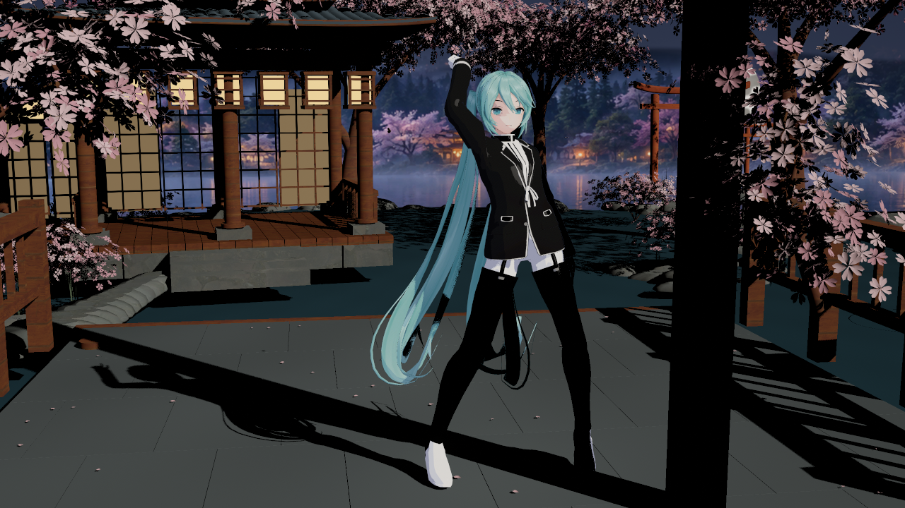
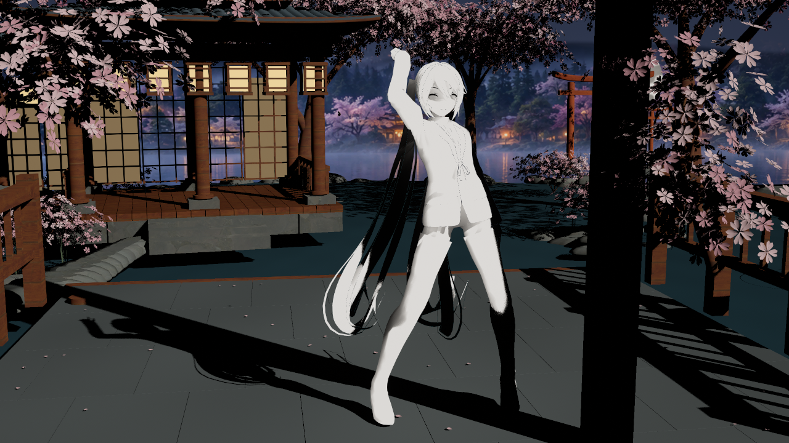
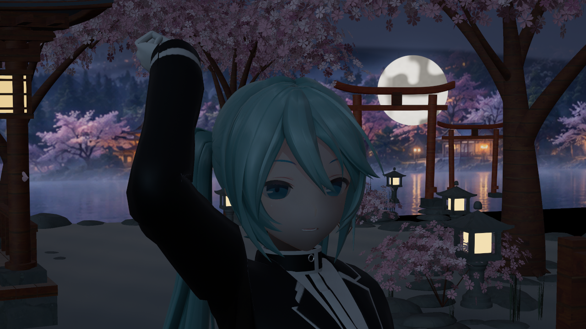
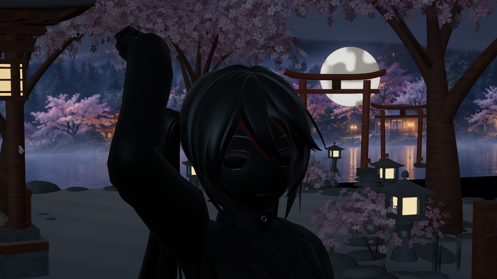
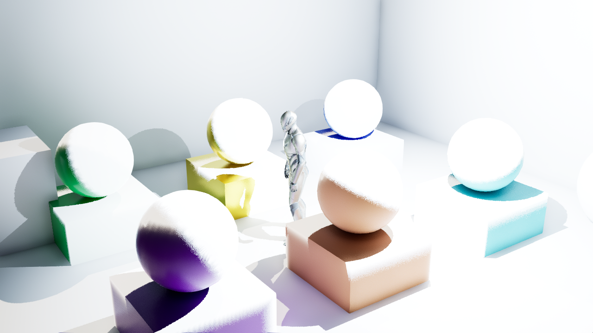
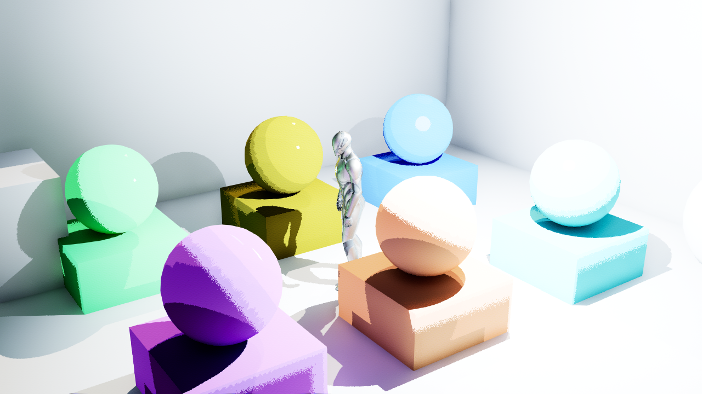

# 原生着色后端工程验证

捕获与归档日期：2026-10-14，Asia/Singapore。八张图全部为 UE5.8.3 / CL58210709 的 offscreen D3D12 SM6 引擎实拍，未使用生成式图像。前四张来自 Editor ToonProbe，后四张来自实际 Cooked Game。**用于验证着色入口、原生数据与打包后响应；终末地画质尚未验收。**

Editor 场景与角色来自既有 ToonProbe 装置，Substrate=1、adaptive GBuffer=1、VSM=1；SDF 未加载，角色接触投影沿用 V2 默认关闭。

模式 2 的真实遮挡：

相同场景的模式 1 阴影通道诊断。只有自有 Profile 角色改变，周围普通材质保持原生；RGB 分别表示表面阴影、透射阴影和 Toon 透光率，仍受灯色、能量、曝光影响：

关闭直射灯后的原生间接光视图，以及插件将间接漫反射倍率设为零的对照：

这四张 Editor 图的来源为 `Saved/Phase2Reference/Endfield2/native-backend-2026-10-14/` 中 r3、r5、r6；r3 为模式 2，r5 为模式 1，r6 为模式 2／间接漫反射倍率 0。r4 保真模式与 r8 关闭后端作为原生对照；r7 单独关闭间接高光。r3–r8 共 66 图／420 次槽检查，全部 exit 0；三类材质 shader 为 21／40／29，无默认或 fallback 回退。这批 v3 的共用适配签名为 `805E1C3704906247B59EBB1E168A31A6DD2A8B97`。

1280×720 原图 RGB 平均绝对差：r4 对 r8 的间接脸视图为 0.0429；r3 对 r6 为 6.0786；r3 对 r7 为 1.1261。全景角色区域中，相应间接漫反射／高光对照为 6.1451／1.4369，对照波动为 0.0151。像素单位 0–255，保真结果不是逐像素完全相同；小差异可能包含时序和精度差异。完整数值保留 Saved 的 `editor-comparison.json`。

v4 的 r11 额外验证传统 GBuffer=0、Clustered=1 路径，11 图／70 次槽检查，exit 0。Editor 两批合计 77 图／490 次槽检查，全部通过。v4／Cook 适配签名为 `E3E3466769C5FCEEDE7D0860A85BF3829288DA93`；相对 v3 仅额外修复传统聚簇 VS／PS 链接。四张既有 Editor 图保留原捕获来源，未冒充 v4 重拍。

以下四张新增图于 2026-10-14 在实际 Cooked Game 中捕获。来源地图为 `/Game/MMDEndfieldNativeBackendValidation/Maps/M_EndfieldNativeBackendValidation`，含六个角色球体、六个角色 cube 和原生 DefaultLit 控制几何。中央 mannequin 来自工程默认 GameMode。此场景使用诊断颜色与基础几何，不能作为终末地成品角色画质证明。

模式 2，间接漫反射／高光倍率均为 1，来源 `final2/native_backend_runtime.png`：

模式 1 阴影通道诊断，来源 `final1/native_backend_runtime.png`：

模式 2，间接漫反射倍率 0、高光倍率 1，来源 `final6/native_backend_runtime.png`：

模式 2，间接漫反射倍率 1、高光倍率 0，来源 `final7/native_backend_runtime.png`：

打包来源为同一 Saved 根目录下的 UAT `package3`：完整 Cook、Stage、Pak、Archive 均 exit 0。`game-build3` 的最新二进制随后通过 `package4` 的 skipcook 重新 Stage，exit 0。`final0`／`final1`／`final2`／`final6`／`final7` 五次实际游戏运行全部 exit 0；每次 12／12 材质槽重绑后的 CPU Profile metadata 与请求一致，第 120 帧实际捕获 1280×720 PNG，第 160 帧写报告。Cooked runtime 的 `source_mapping_active=false`，使用 Cook 时生成的 shader 库；模式和倍率通过 Profile alpha metadata 控制。

`package-comparison.json` 的整幅原图 RGB 平均绝对差（0–255）为：`final2` 对阴影诊断 `final1` 为 8.18176，对漫反射关闭 `final6` 为 7.55383，对高光关闭 `final7` 为 5.13990。相同设置重复运行 `game2`／`game2r` 的差异为 0.40268，`game2r`／`final2` 为 0.12049。这些数据支持打包后控制具有实际图像响应，不能声称逐像素完全相同或终末地画质达标。

原始 CPU 报告的 `compiled_kernel_verified_by_this_report=false` 保留不变；后端运行证据来自 Cook 来源记录与实际图像对照，CPU metadata 校验本身不能证明执行了哪个 GPU 内核。首次 `game0` 在第 1 帧以 `0xc0000374` 退出，没有 UE callstack，原因尚未定位；同模式的 `game0r` 和 `final0` 成功，不对首次失败猜测归因。

完整原始报告、对照数值和未归档图片保留在上述 Saved 根目录；工程记录见 [后端记录](../../ENDFIELD_NATIVE_BACKEND.md)。本目录只保留八张代表性实拍与本来源摘要。
