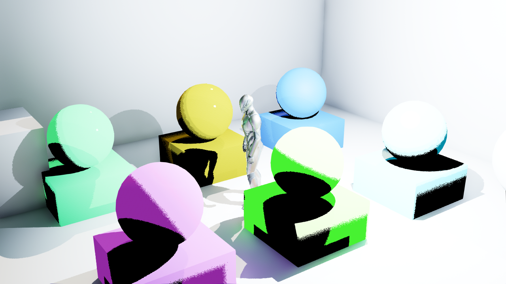
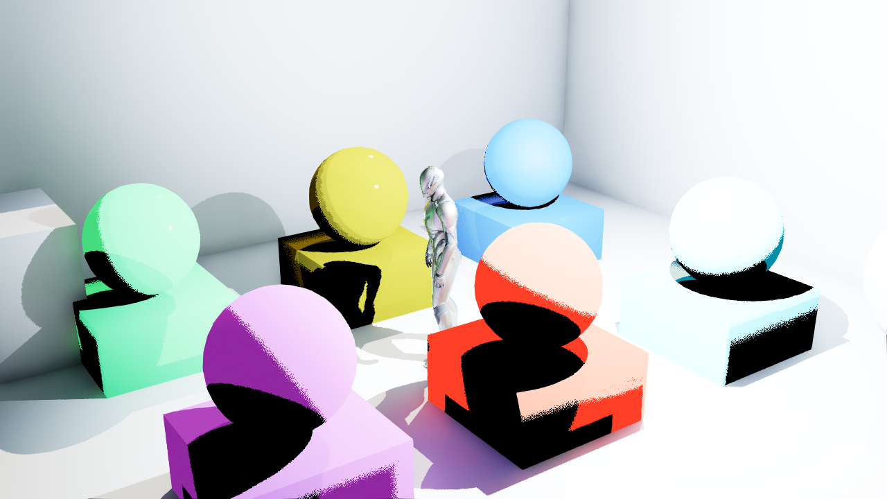

# 2026-10-15：Cooked 原生后端正／负对照

本批补齐了**实际 Cook 后的运行证据**：同一份正向 Cook 中，Skin 测试球与方块随 packed payload 开关呈绿／红；关闭后端重新 Cook 的负对照，即使启动时请求 Mode 2，也没有获准绑定后端 Profile。它验证指定路径能在 Cooked 游戏中工作，终末地画质仍未验收；独立插件结构和空白宿主检查另列在分发说明。

## 两张原图怎么读

两图来自 UE 5.8.3 CL58210709、Win64 Development、D3D12／SM6 的 `package-v8b`，均运行 160 帧，在第 120 帧捕获 1280×720 原 PNG。下图仅复制原文件，没有裁切、拼图、AI 处理或调色。

开启 fixture 专用 `-MMDEndfieldValidationPayload=1`，前方偏右的 Skin 球与方块走有效 payload 诊断，显示明绿。原文件时间：2026-10-15 16:31:18（UTC+08）。

同一 Cook 改为 `-MMDEndfieldValidationPayload=0`，同处走无效 payload 诊断，显示明红。原文件时间：2026-10-15 16:31:52（UTC+08）。

两次报告中的相机位置、注视点、分辨率、shader format 和记录的环境 CVar 逐项一致。间接漫反射／高光的后端 Profile 系数均为 0，方便观察逐灯诊断；Lumen 的全局 CVar 仍然开启。12／12 个 fixture 材质完成 Profile 重绑，2／2 个 Skin 绑定明确的头部中心、半径与正交朝向，诊断 Profile 的 `alpha(t=.75)=17`。具体 CPU 参数见来源 JSON。

额外的像素冒烟检查只读取固定区域 `[615,320,960,700)`：有效图有 17,447 个绿优势像素、0 个红优势像素；无效图为 0 个绿、16,749 个红。优势条件与坐标约定写入 JSON。**这些计数只确认诊断颜色切换，不是画质评分。**

## Cook 与负对照

`package-v8b` 和 `package-vanilla-v8` 都实际执行了 SM6-only 的 Cook、Stage、Pak／IoStore 和 Archive，退出码均为 0；使用 `-skipbuild` 复用已构建程序，没有使用 `-skipcook`。正向 Cook 的 cooker 请求后端，负向 Cook 的 cooker 关闭后端。

两包的启动器 `Windows/MMD.exe` 与实际游戏 `Windows/MMD/Binaries/Win64/MMD.exe` 分别具有完全相同的 SHA-256。差异来自 Cook 时编译／打包的 shader 内容，不能仅凭运行时开关授权 vanilla 内容。

- `game-normal-clean`：正常间接光系数 1／1，退出 0，160 帧，第 120 帧保存原图；12／12 Profile 重绑。
- `game-valid-direct-clean`／`game-invalid-direct-clean`：上述绿／红配对，均退出 0、160 帧。
- `game-vanilla-rejected`：**游戏成功退出 0，报告 `success=true`，正常回退原生渲染**；协议为 0，`profile_marker_allowed=false`，Profile 重绑数为 0。启动仍带后端 Mode 2 请求，因此拒绝的是不匹配的 Cook 标记，并非游戏运行失败。

三次正向运行的 manifest 分别为 `backend-92492.json`、`backend-29604.json`、`backend-8440.json`；负向为 `backend-59188.json`。正向均反射出协议 8、verified=true，运行时 source mapping=false。这里的 `active=false` 指源码映射未启用，不能据此判断 Cooked Profile 路由失败。

## 证明范围与保留问题

协议 8 的凭据只覆盖一个已加载 GlobalShader 的序列化编译反射。运行报告中的 `compiled_kernel_verified_by_this_report`、`payload_gpu_verified_by_this_report` 及逐材质 `gpu_payload_verified` **仍为 false**：CPU 报告没有做 GPU 回读。外部绿／红配对实拍补充证明本 fixture 的 Skin packed 写入、读取和逐灯诊断分支；不据此保证所有材质内核、GI／阴影排列、角色动画／Morph 或最终画质。

此前 `game-valid-direct` 在首帧以 `0xc0000374` 退出；`game-normal` 首帧 RHIThread 发生访问异常，栈首为 `renderdoc.dll`。两次日志均记录原配置 `AutoAttach=1`、`CaptureAllActivity=1`。失败日志保留在 Saved。后续仅通过 CLI `-DisablePlugins=RenderDocPlugin,AndroidFileServer` 禁用捕获插件，上述四次运行均成功；未改用户 Config，不能称 RenderDoc 已彻底修复或一般稳定性已获保证。

独立BuildPlugin与空白宿主四父材质编译结果见[分发说明](../../ENDFIELD_PLUGIN_DISTRIBUTION.md)，本夹具不能替代该检查。两张PNG、报告、manifest、Cook脚本／日志、退出文件和正负包EXE的来源路径、时间与哈希保存在[cooked-sources.json](cooked-sources.json)；完整日志与包体不提交。
