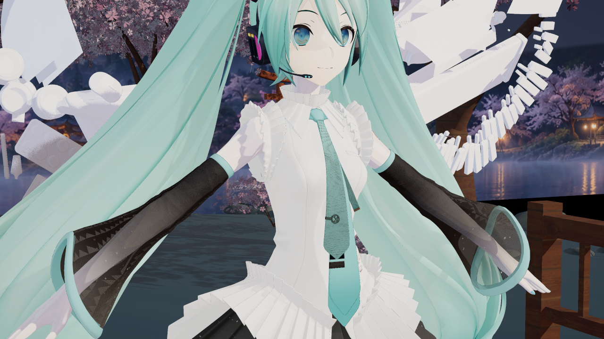
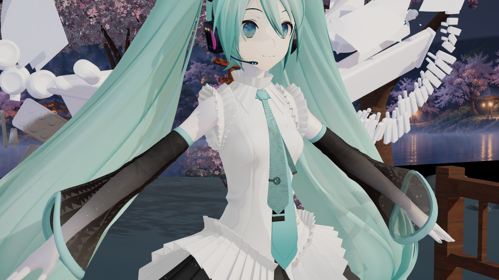
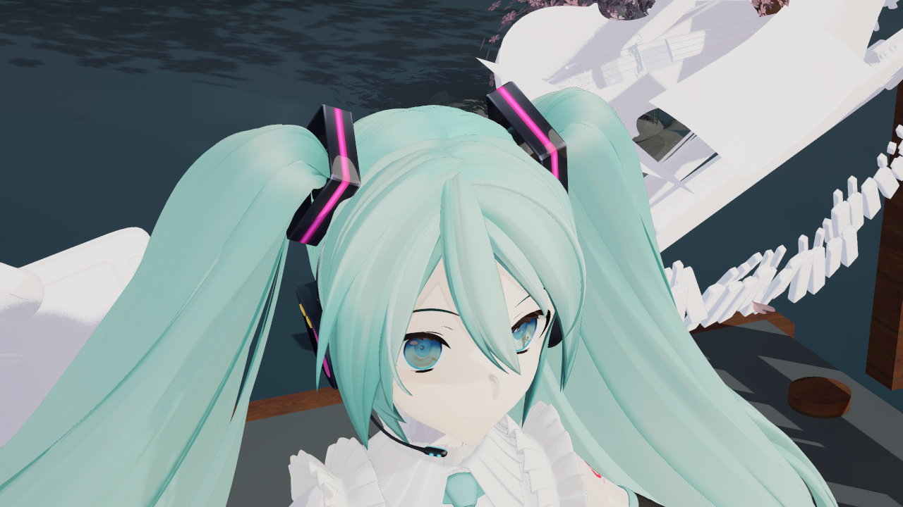
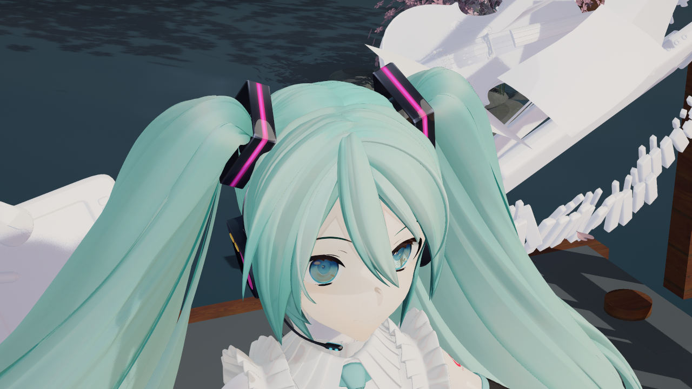
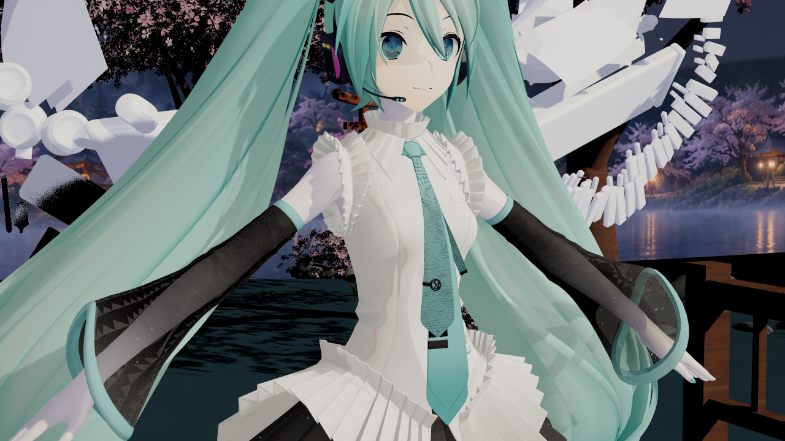
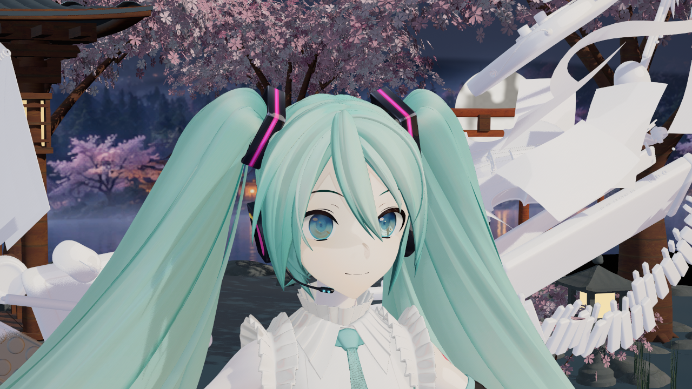

# 2026-10-15：修复暗部洗平与大面转折

全部是 UE 5.8.3 / CL58210709 的后台 D3D12 SM6 原始截图，1280×720，没有调色或生成式修图。前图为同日较早的 v8 `yyb16-final2`；后图为本批 v9 `volume9b`。模型仍是 YYB Hatsune Miku 16th 带翼款，39个材质槽、参考姿势。没有换模型、机位或曝光。

## 衣料与翅膀

修改前：大块白衣和翅膀连接处层次弱。

修改后：衣褶和圆柱连接处的转折更清楚。主光保留完整 NPR 暗部，补光只补受光面；未分类的翅膀使用连续通用 ramp。

## 头发

修改前：

修改后：发束明暗变化增加；二维 RS 和柱面高光法线已接通，完整的球面高光法线、P/flow 分区和第二波瓣仍未完成。

## 单灯检查与皮肤现状

只有主灯、关闭 GI／天空／环境反射后的诊断。黑色环境属于开关测试，不是最终展示配置；衣褶仍有转折。

正常灯组下的脸部。加入了参考视角染色，但皮肤 LUT、眼睛分层等尚缺，不能称终末地画质达标。

## 实际验证与维护

- Editor `editor-build3`、Game `game-build2` 通过；`generate9b` 生成白名单12包，四父材质成功编译。
- `volume9b`：34图／156槽／0失败，包含上面的常规图、主灯／三灯／GI／高光开关，以及平行／点／聚光／矩形灯的 clear/blocked 对照。当前加载的全局编译协议记录为9；这仍不代表所有内核、所有路径或完整画质验收。
- `low64mode2` 和 `low64mode0` 各8图／78槽／0失败。atlas64请求Mode2会打印提示并恢复原曲线、Mode0；四机位对原生模式平均RGB差分别为 `.00063/.05470/.03531/.05610`（0–255），不称逐像素相同。正常Mode2需先设置 `r.Substrate.ToonProfile.Resolution=256`。
- 新旧四机位的 **Unlit 对照逐像素一致**，相机位置与FOV也逐项相同。衣褶固定矩形中的亮度P95−P05由13增至32.50，发束矩形由10.71增至25.91；这是局部数值描述，不是画质评分或全角色分割。见[数值摘要](analysis.json)和[捕获来源](source.json)。
- 引擎shader、既有资产、Config及用户Face保护范围2,378项：2,375保持，3项自有V2资产有意更新，没有意外变化。没有提交角色资产或构建缓存。

代码入口是 `TMMDEndfieldNativeBSDF.ush`（方程）、`TMMDEndfieldNativeLightCapture.ush`（当前View主灯）、`TMMDEndfieldNativeProfile.cpp` / `MMDEndfieldNativeRampData.inl`（二维表）和生成器的Generic ramp。[方程与来源对照](../../ENDFIELD_REPRODUCTION_REFERENCE_AUDIT.md)解释哪些来自公开复刻、哪些是UE多灯扩展。

**范围限制**：本批没有重新做 v9 完整 Cook/BuildPlugin；v8的发行证据不能算v9的新验证。传统聚簇入口已同步并通过共享shader编译，本批未重跑fmt0聚簇GPU实拍。没有动画/Morph、性能基准、原作配套法线或完整皮肤LUT验证；同向平行光的主灯识别仍有歧义。头发窄高光对几何法线仰角敏感，后续应补独立球面高光法线，而非只加亮度。

首次 `generate9` 在静态核对发现旧Legacy函数签名后主动中止；`volume9` 因新实验漏入白名单而拒绝执行，修正后 `volume9b` 成功。失败记录保留在本机Saved，没有复用旧报告冒充通过。
