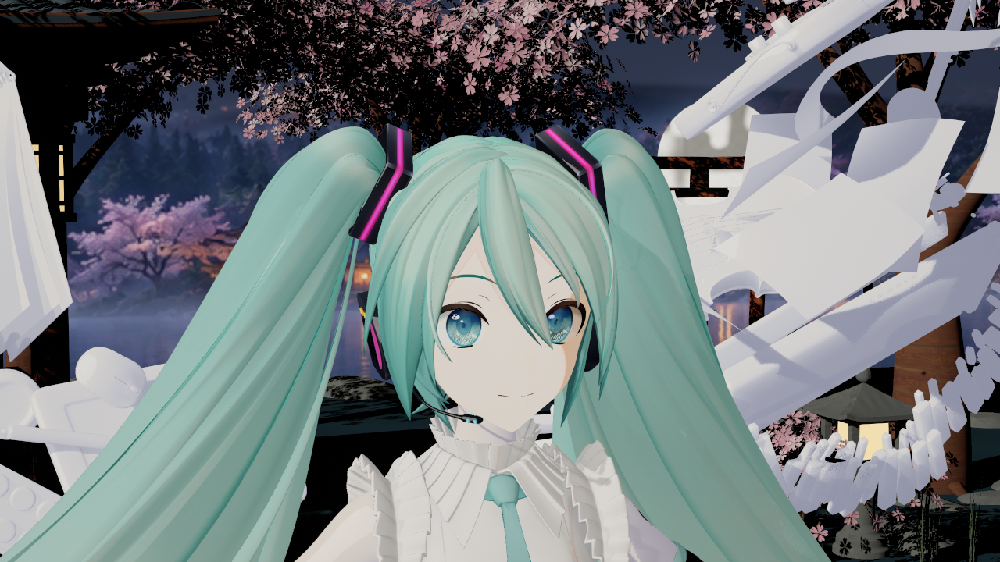
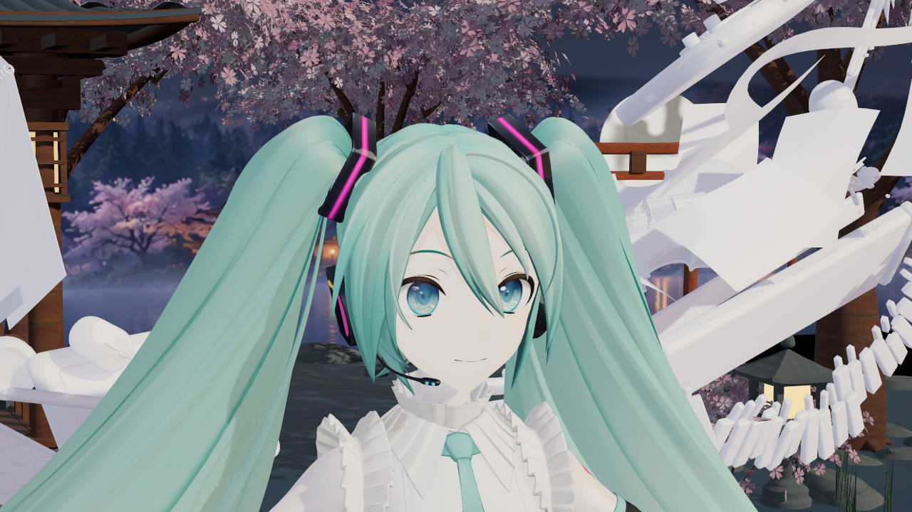
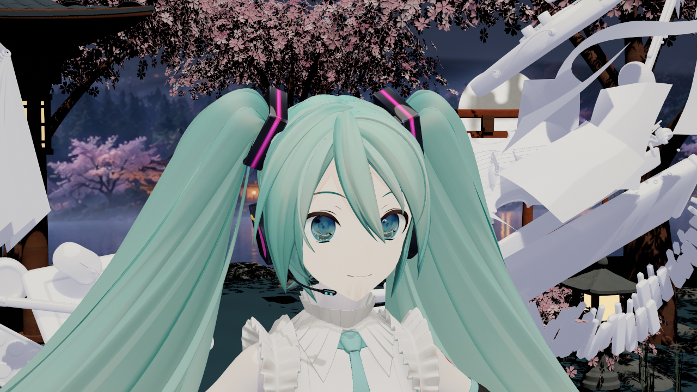
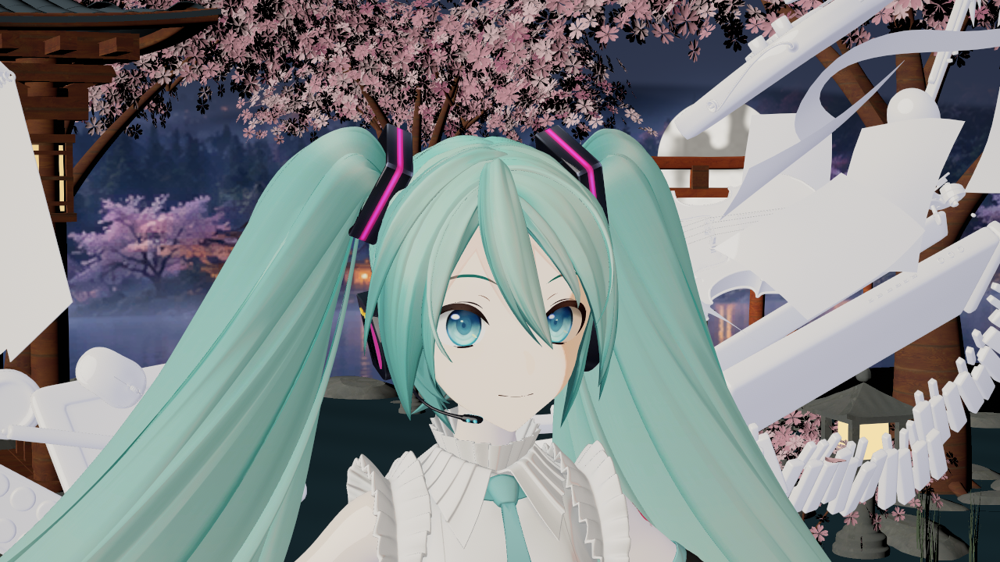
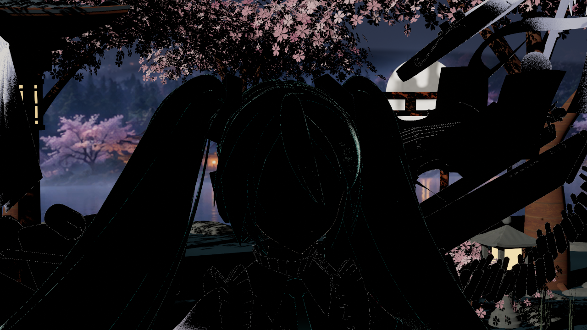
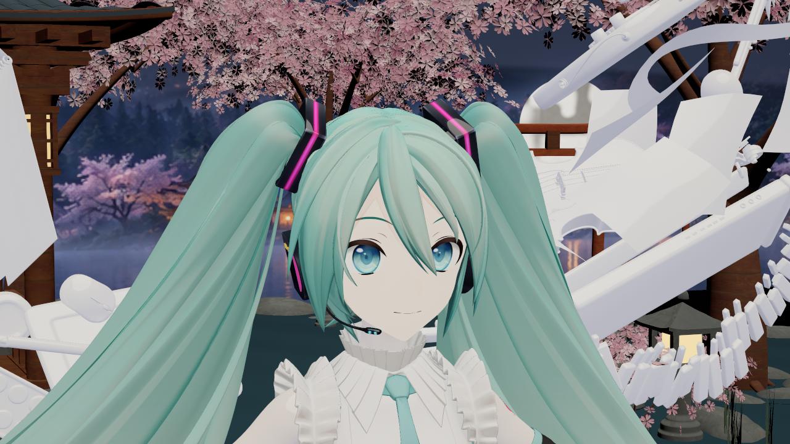

# 2026-10-16：头发／脸部投影整理

本目录均为 UE 5.8.3 CL58210709、D3D12 SM6 实拍原图，归档日期同捕获日期，无生成式效果图。样本为仓库已有 YYB 16th 带翼款，参考姿势；模型、临时 SDF、构建产物留在 Saved，不随插件提交。

## 最直接的前后对照

历史 `cast3`（20:53，本批修复透明投影前）：已关闭 Hair 投影、开启 Face 抑制，但仍强制共享透明层按硬遮罩投影，鼻子留下椭圆。

最终 `cast4`（21:18 起）：相同相机和侧光，取消全部自有 Toon 透明父材质的强制硬遮罩投影；Hair=0、FaceSuppress=1。鼻核心与同角度 ShadowOff 图逐像素一致。投射覆盖和接收深度分离单独使用时没有解决该椭圆，不能把成果归因于这一单项。

## 其他实际检查

默认环境中的脸部，保留正常灯光、环境和材质响应：

顶光检查头发没有因 Opaque 转 Masked 留下黑色碎块：

同侧光关闭阴影，用于定位投影而非明暗阈值问题：

外部挡板仍能投影到脸部。此图为隔离直射检查，关闭了 GI／天空等填充，因此遮挡区非常暗：

原 Opaque 材质仅为控制投影转成 Masked 后，把源 Opacity 设为 0 仍保留主视图；它与 ShadowOff 正常／修改前／重复四图逐像素一致。原 Masked 和透明槽仍使用自身 alpha：

## 本次验证范围

- 最终 Editor8 编译通过；generate17 保存 15 个自有包，七个父材质实际 shader 编译通过。Backend14／Graph7／Skin layout42／payload5／FaceData5。
- `cast4`：19 个投影对照加 8 个 A/B 视图，共 27 图／156 次槽检查／0 失败；额外 52 项像素与控制检查通过。四张 Unlit 与 cast3 逐像素相同。
- `mode0_final2` 与 `atlas64_final`：各 8 图／78 次槽检查／0 失败，实际 Editor GlobalShader 协议 14。首次 `mode0_final` 因显式样本与旧 fixture 组合错误被探针拒绝；改为本模型临时 bake 后通过，未复用失败报告。
- 2,381 项保护基线仅 8 个自有 V2 包有意变化；安装引擎、用户 Face shader、Config 和既有未提交资产保持。
- 最终 `EFCastClean16c` 独立 BuildPlugin 的 Editor Development／Game Development／Shipping 三配置通过，必需文件与过滤检查通过；15 份冻结 Source／HLSL 和 15 个自有 V2 资产与工作区逐字节匹配，见[发行验证摘要](distribution-summary.json)。构建后只补录文档结果，代码和资产未再改变。早期 cast1 黑块、generate15 调用签名失败均保留在 Saved，修复并重新执行；旧结果不代替最终验证。

Hair 投射关闭影响所有接收面，包括身体和地面；Face 投射抑制也不是按接收者筛选。当前没有额外柔化刘海代理层。单模型参考姿势不代表动态 LOD、Morph、Forward MSAA／A2C、光追阴影或完整游戏画质已验收；本批没有重跑完整 Cook 或干净宿主渲染。

文件 SHA256、原始路径、报告摘要和源文件冻结记录见 [sources.json](sources.json)。处理原理及修改入口见[脸部阴影说明](../../ENDFIELD_FACE_SHADOW_GUIDE.md)。
