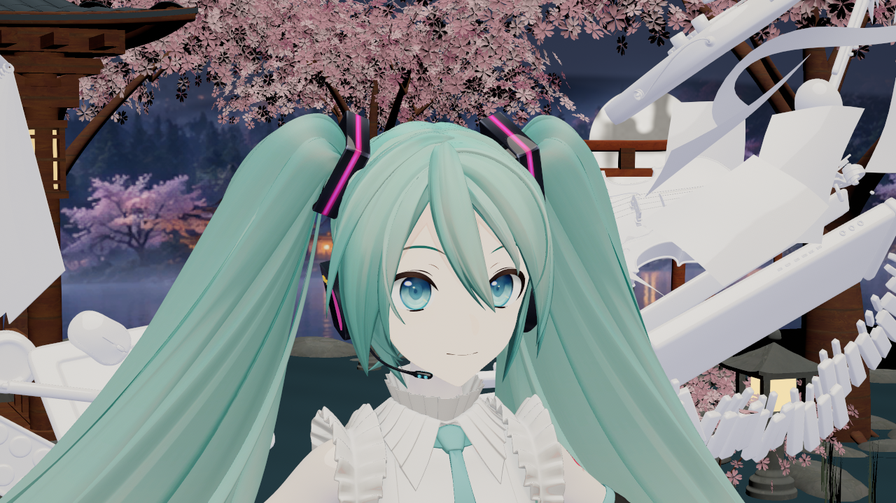
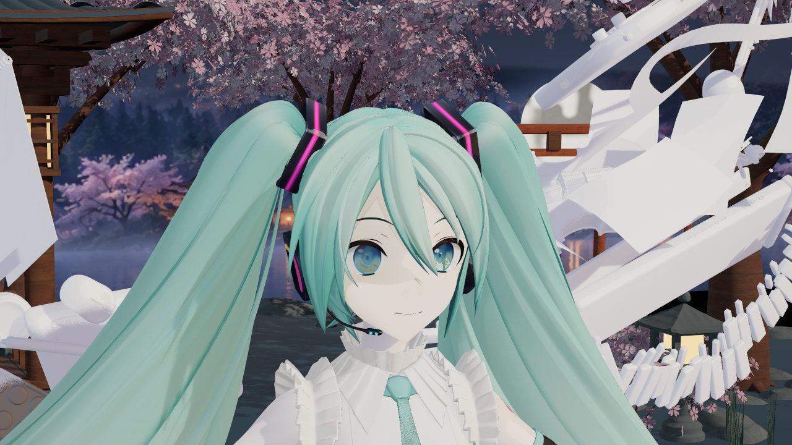
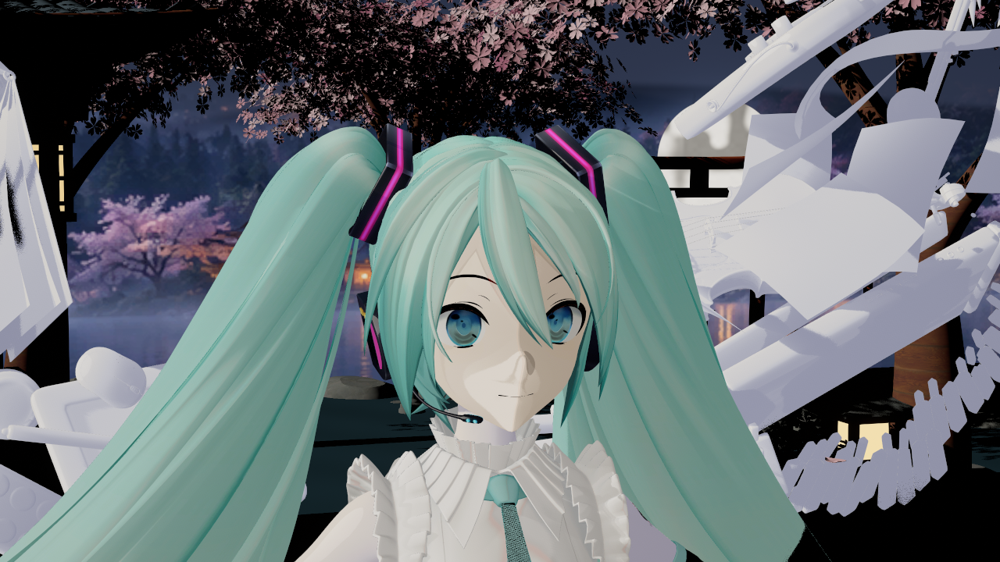
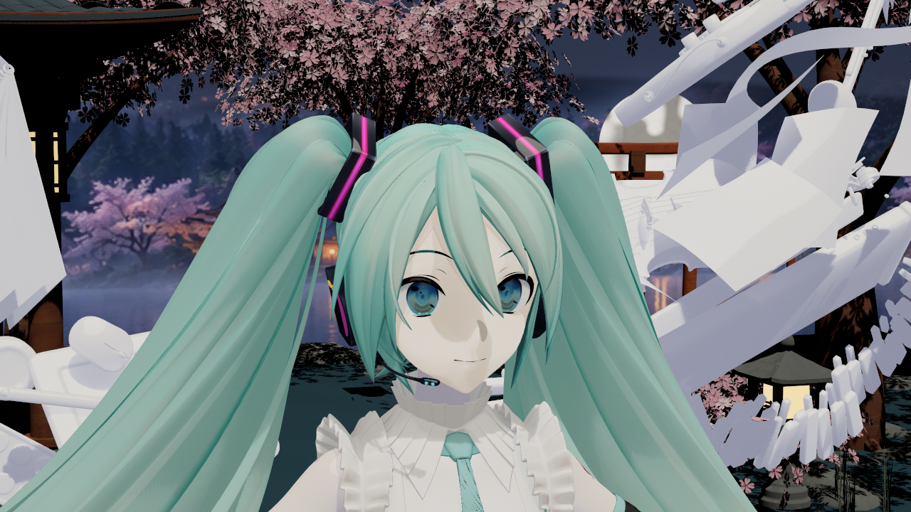
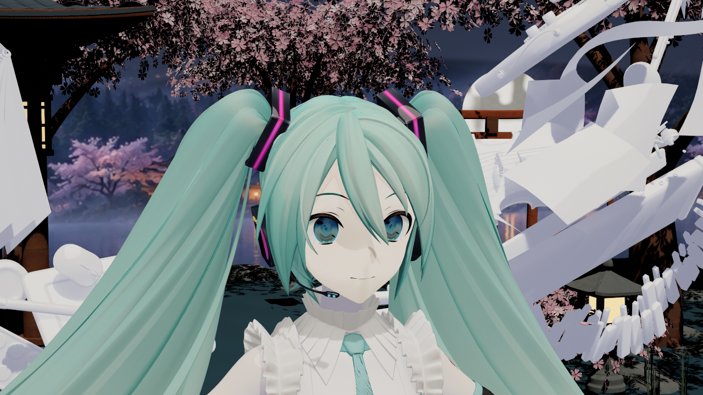
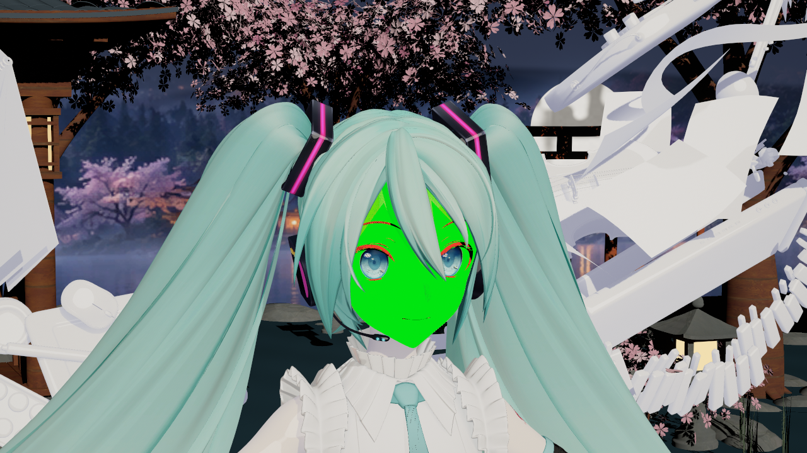
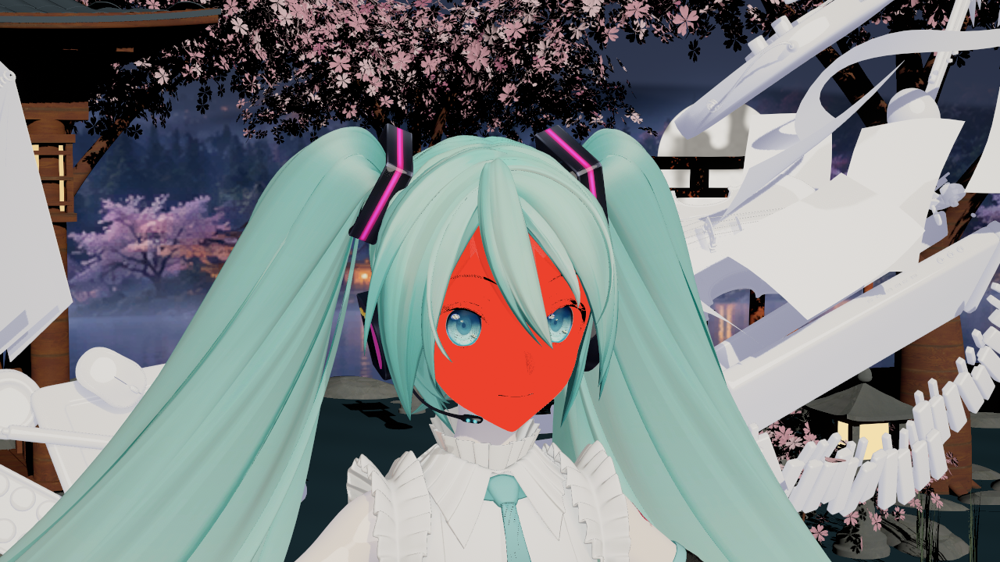
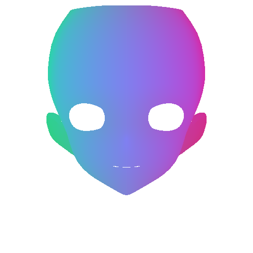

# 2026-10-16：脸部角阈值与透明鼻影修复

捕获日期：2026-10-16；UE 5.8.3 CL58210709，Win64 D3D12 SM6，后台 `RenderOffscreen`。本页均为实际引擎 PNG 原字节，或明确标注的纹理源数据导出，没有生成式效果图、重绘或调色。测试角色继续使用 YYB16th 带翼款，参考姿势，角色资产仅放本机 Saved。

原理和维护入口见[脸部 V5 说明](../../ENDFIELD_FACE_V5_GUIDE.md)。文件哈希、报告来源、机位、配置及验证范围记在 [sources.json](sources.json)。

## 鼻斑来自另叠的半透明层

以下两图使用同一脸部机位、主光方向和曝光，均关闭动态阴影、接触阴影、GI、天空与反射。左侧原因对照的旧实现已使用 V5 主脸，但透明鼻壳仍单独受光；因此这块斑不能归因于刘海投影。

修正前：

修正后：

自动识别两层贴脸几何并复用宿主图，保留源 RGB 与 opacity。没有在生产代码中写死模型名、材质名或槽号。测试专用的“只把鼻壳 opacity 置零”对照仍保留在探针中，用来判断斑点是否由那层几何造成，不作为最终修法。

## 日常灯光与侧光

下面为原场景多灯、GI 和原生阴影下的效果；它与前两张隔离图的灯光设置不同，不能拿来作单因素比较。

90° 侧光用于检查明暗边界；真实投影仍保留：

## 脸部明暗与刘海投影分开

同一主光与机位，第一张保留全部原生投影；第二张仅在临时代理上关闭已分类 Hair 槽的投射，可见头发、身体投影和其他槽均保留。不是把整张脸的阴影接收关掉。

原生合并阴影没有“是哪根头发遮挡”的身份信息。生产默认仍保留投影，本轮修鼻斑没有靠整体关阴影。

## 数据是否真的到达着色入口

diagnostic18 的绿表示 `valid && has_face_sdf`，红表示不成立。不透明主脸经 packed 写入／读回；透明附脸层走 forward inline，不能混称为 GBuffer 读回。透明混合与抗锯齿使边缘、鼻壳不一定为纯绿或红。

下面是主脸 512² 线性 RGBA 的**源数据导出**，不是一张渲染效果图。R/G 是左右截止角，B 是前层深度，A 是覆盖；它用过程化头部坐标采样，没有新增物理 UV2／3／4，也不读取底图 UV 来决定阈值位置。

自动图是几何角阈值底图，不是原作手绘 SDF，也不是追踪真实遮挡得到的距离场。手绘继续调整 R/G，保留 B/A；重烘会重新生成派生图，人工版本应先另存。

## 验证和限制

最终 `final11` 为42图／156次槽检查，`final0` 为8图／78次，`final-lights11` 为11图／78次，合计61图／312次／0失败，实际GlobalShader协议均为11。`final11` 外部像素检查通过：主脸与鼻部参考区域由绿变红，阈值始终亮／暗有响应；after5的四张旧Unlit与当前解码像素完全一致。绑定为3份主脸图、2份透明引用；两鼻壳各182/182顶点、投影面积100%通过，原opacity .45／.001保持。

本轮还包含方向开关、左右高俯角、组件旋转、GI／高光隔离、绑定失效与恢复，以及四类灯的遮挡检查。四类灯clear／blocked全图差异分别为3.629／5.993／5.542／7.943（RGB均差，0–255），但遮挡条本体可见，差异同时含几何遮挡，不能当作纯阴影或全部kernel验证。具体结果以 sources.json 的实际报告摘要为准；CPU 检查、退出码或截图数量不能单独证明画质。四类灯测试出现 `VSM Non-Nanite Marking Job Queue overflow` 警告，未作性能／VSM容量验收。

首轮 `overlay11` 虽 CPU 全过，但诊断图发现新 guard 误关了不透明载荷；此轮是失败证据，不当作最终画面验收。随后改用 `SUBSTRATE_OPAQUE_DEFERRED` 判定路径，并修正自有透明 Skin 局部灯的方向归一化，再重新编译和出图。

无动态投影时，修复后的鼻壳与完全隐藏鼻壳相比仍有轻微色差；全部原生投影下鼻暗形保留。85°／90°侧光仍可见明显鼻梁弧线、亮鼻区域和较直的半脸分界，美术收敛尚未完成。

透明层仍按 UE 原生 Forward 提供选定方向光和局部灯，GI 不等同于不透明 Lumen；同色并不保证所有灯光配置下逐像素相同。验证使用参考姿势与当前 LOD，未证明独立 Morph／下颌、非均匀缩放、任意动态 LOD 或跨引擎版本正确。新后端为 protocol11，本批没有重跑完整 Cook／BuildPlugin，不能沿用 v8 的发行验证。安装引擎和用户 Face shader 保持原样，完整终末地画质仍继续迭代。

2,378项保护基线中2,373项字节不变，仅5个自有EndfieldV2包有意更新。既有未提交场景、旧材质、旧Outline、旧截图和Mobile文档未纳入本批提交。
