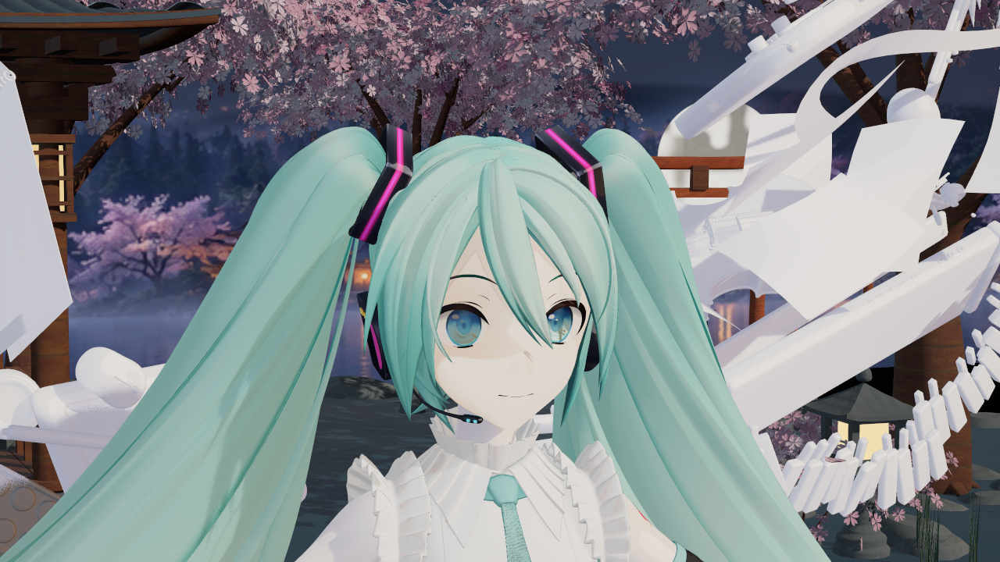
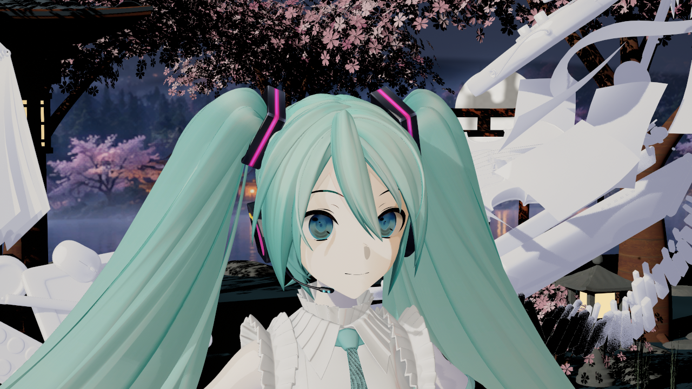
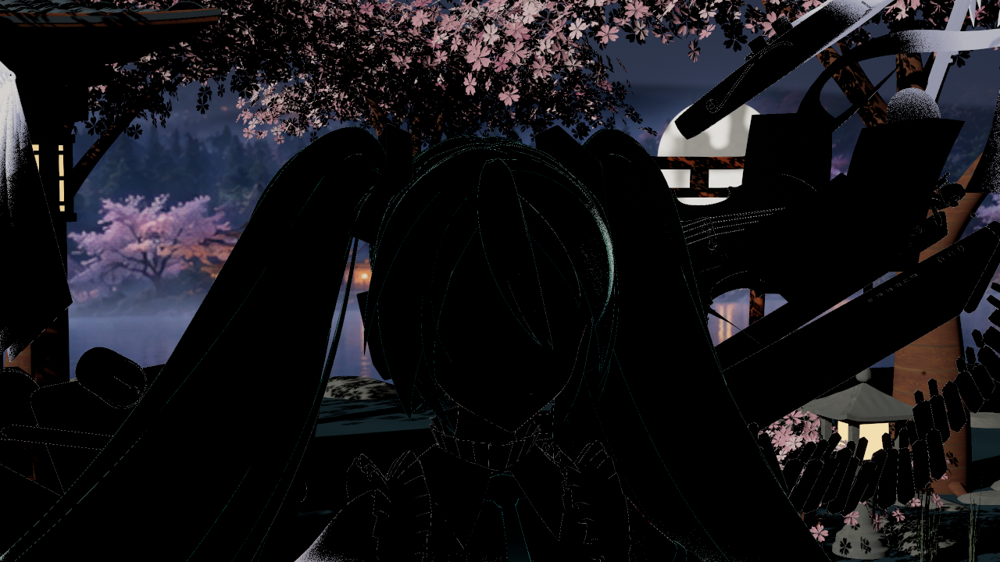

# 2026-10-16：皮肤明暗交界的微弱暖红

捕获与归档日期：2026-10-16（UTC+8）。来源为本机 UE 5.8.3 CL58210709、Win64 D3D12 SM6 的 `RenderOffscreen` 实拍，使用 YYB 初音16周年羽翼模型参考姿势。这里只分发截图，不分发测试角色。七张PNG均直接复制引擎输出，未调色、重绘或使用生成图；逐图源路径、时间、SHA256及实验参数见 [sources.json](sources.json)。

这轮补的是**随当前灯光出现的局部暖红过渡**。默认强度很弱，只在明暗交界的小范围内出现；没有把整张脸统一染红，也没有增加固定发光。它是风格化漫反射近似，尚未实现邻域扩散或薄处厚度透射。

## 默认环境下的脸

这张保留预设的正常环境光；下面诊断组关闭GI、天空、反射与AO，方便只看直射光变化，不能把两组的总亮度直接相比。

## 只切换泛红强度

侧光为头部相对偏航−65°、仰角25°。左图对应强度0，下一张为`.18`；Master、原有LUT、视角响应、曝光、原生高光、SDF及透明度保持。观察屏幕右脸颊明暗交界的细窄弧带，变化刻意很轻。

关闭：

开启：

预先固定的右颊矩形`(710,458)–(728,483)`，开关MAE为1.303，同条件[关闭复拍](side-off-repeat.png)的MAE为0.202，约6.44倍；平均RGB变化为`(+1.091,−1.091,−1.536)`，对应微弱暖红。数值来自编码后的LDR PNG，不是线性光能。满逆光差异没有超过自身复拍噪声，本批不把它算作有效泛红证据；侧光全脸变化也很小，不能宣称整脸明显改善。

## 原生阴影能把它遮住

同一侧光，放入不绘制主画面和深度、只投影的遮挡块。原生阴影开启时：

保持遮挡块，只关闭原生动态阴影：

右颊亮度从无遮挡的200.026降为0.069，关闭阴影后为202.612；泛红开关的右颊MAE从1.303降为0，关闭阴影后恢复为1.270。关闭阴影时，放块与不放块的整图RGB在两档强度下分别完全一致，确认块本身没有挡住相机画面。这里证明的是已审核矩形里的实际受影与抑制，没有读取逐像素ShadowTerms缓冲，也没有完整受影分割图。

主灯归零时，泛红开关的整图RGB完全一致；[零灯开启图](zero-direct-on.png)留作记录。

## 验证与维护

- 最终`redness3`通过：34图、156槽检查、0失败；外部像素与控制检查72项通过。本批重新目检ROI，并记录当前报告和图片哈希。
- Mode0与启动atlas64回退各8图、78槽、0失败；三组实际Editor全局shader反射协议均为13，这不等于验证所有材质内核。
- `generate13`保存15包，七父材质真实编译通过；最终Editor3、Game1及17项静态边界检查通过。
- `EFSkinRedness16`独立BuildOnly通过Editor Development、Game Development、Game Shipping；12份冻结Source／Shader与发行包逐字节一致。本轮未重新做空白宿主角色渲染、完整Cook游戏运行或性能测量。
- 2381项保护检查中2379项保持，仅自有V2预设和OffsetLinear包更新。用户已有资产、安装引擎、项目配置及用户Face shader未改。

调参在`DA_Render_EndfieldV2 → CharacterSkinLighting`的`RednessStrength/Width/AngularWidth/Tint`，重新应用预设生效。强度0保留原有皮肤响应。公式在`Shaders/Core/TMMDEndfieldSkinResponse.ush`，主光／补光入口在`TMMDEndfieldNativeBSDF.ush`，旧聚簇入口在`TMMDEndfieldNativeLegacy.ush`。身体皮肤及补光／Legacy的新增项没有分别完成独立GPU画面对照，不能把编译或静态检查写成全部GPU验证。

参数、数据布局及后续限制见 [皮肤材质指南](../../ENDFIELD_SKIN_MATERIAL_GUIDE.md)。
