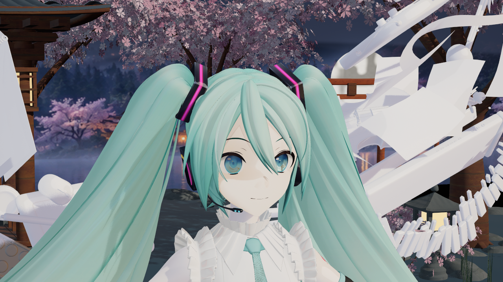
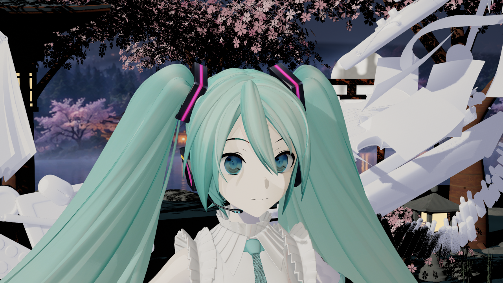
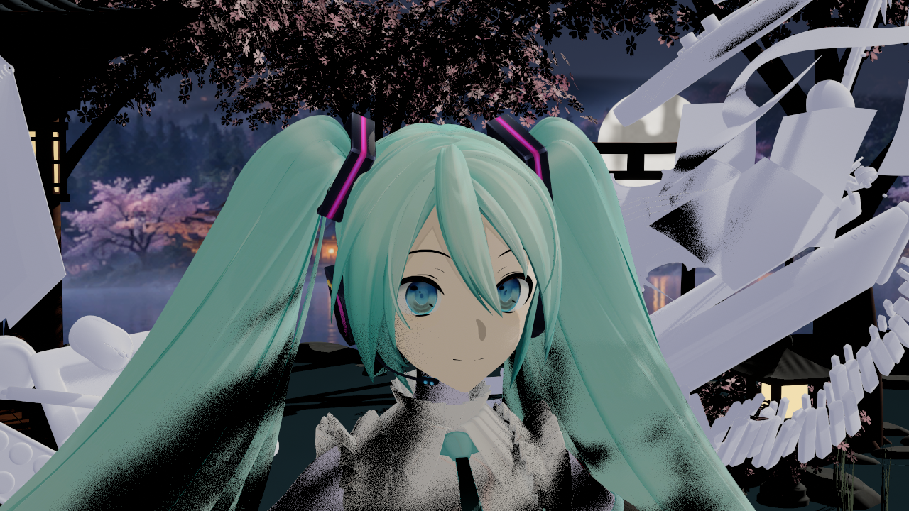
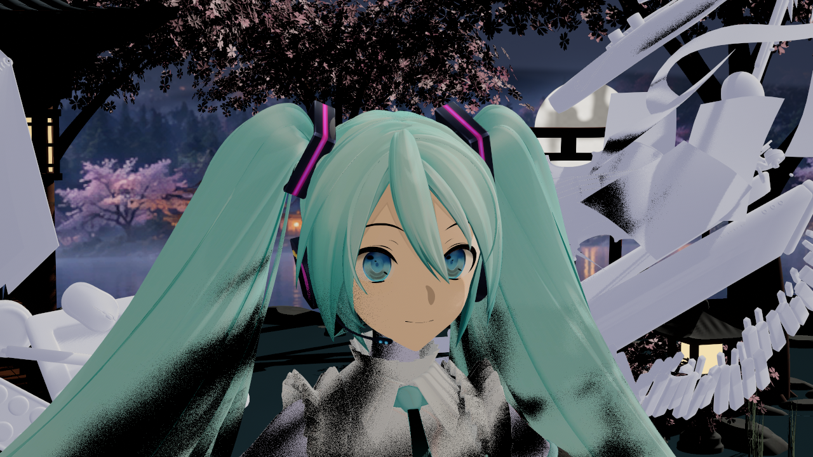
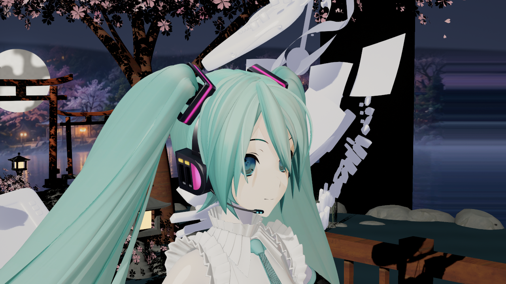
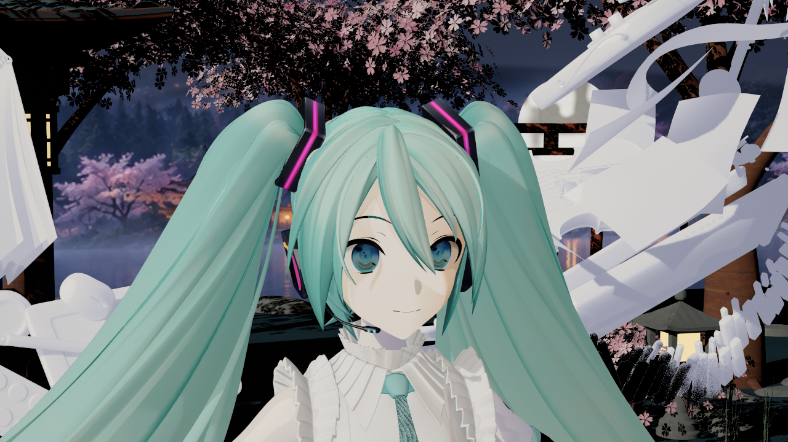

# 2026-10-16：皮肤暗部颜色与视角响应

捕获、归档日期均为2026-10-16，Asia/Singapore。UE 5.8.3 CL58210709／Win64 D3D12 SM6／RenderOffscreen，YYB16th带翼款参考姿势。以下7张均为引擎输出的 **1280×720 PNG原字节**，没有重绘、调色或生成式加工；[来源、参数和SHA256](sources.json)。测试角色、贴图、Saved和构建产物不提交。

使用与维护见[皮肤材质说明](../../ENDFIELD_SKIN_MATERIAL_GUIDE.md)。这是本插件原创LUT与视角响应的实际对照，未实现邻域扩散、厚度透射或原作RefineMask，不能称为真实空间SSS或完整终末地画质验收。

## 正常场景

新预设默认状态：逐灯皮肤响应开启，两组静态肤色修正关闭，使用原底色。环境、原生投影和独立高光保持现有路径。

## 同条件开关

以下对照只切换皮肤响应Master。固定模型、灯色、曝光、SDF和原生阴影；关闭GI、天空与反射等环境贡献，只留主灯，便于观察直射响应。背景树木和水面因此有较黑区域，这些隔离图不作为正常场景的美术展示。

侧光，头部相对主灯角度−65°／仰角25°。关闭：

开启，局部变化较轻：

逆光，主灯角度120°／仰角25°。关闭时暗部偏灰：

开启后暗部转为暖肤色，保留同一光照和原生遮挡：

逆光白衣和头发阴影存在明显颗粒。新增同条件OFF复拍后，白衣开关差异MAE为5.0864，自身复拍MAE为5.3136；观察到的差异处于本次噪声范围内，不能声称整图逐像素不变。右颊肤色响应MAE为11.1052，自身复拍为1.3548；鼻部混合像素为9.9101／0.09788，变化高于对应噪声。这些都是编码PNG的0–255指标，不是画质评分或物理能量测量。

## 视角与柔化宽度

只让相机绕头转25°，模型与世界灯方向保持；以下为开启状态，完整运行另有同机位关闭图：

独立测试把角度柔化半宽从默认`2/255`改为`.025`，其他皮肤响应保持开启：

`.025`仅为实验，未改成预设默认值。它不模糊原生头发／鼻部投影；鼻梁、明暗分区硬边和原模型附鼻影层仍需继续改善。

## 验证范围与失败修复

- `generate12b`：15包、七父材质真实编译，shader数21／40／29／21／40／29／40。
- `response3`：47图、195次槽检查、0失败；其中18图为本次皮肤实验，21图为脸部回归，8图为原有AB。7个Skin槽、5个有效脸部绑定（3 packed＋2 inline）、原alpha和39槽参数／Profile／父材质恢复检查通过。
- 外部像素分析55项严格检查通过；主灯归零时，Master开关两张全图RGB完全一致，没有额外自亮。其他灯光组存在时序漂移，分别使用侧光／逆光复拍估计，左右相机ROI单独检查。
- `mode0`和启动atlas64回退各8图／78槽／0失败；实际Editor GlobalShader协议12。运行中直接降低已分配cube的atlas分辨率仍不支持。
- 最终`EFSkinResponse16c`独立BuildOnly：Editor Development／Game Development／Shipping及文件检查通过，14份冻结Source／Shader与工作区逐字节一致。没有重跑v12空白宿主角色绘制或Cooked游戏；这几项保持未验证。
- 首轮`generate12`因遗漏Legacy高光调用第五参数而在出图前失败；只修该调用点后重试通过。`response1`虽然产出46图，但距离场阴影属性setter会裁掉快照值，导致恢复检查失败；修复探针原始属性恢复后，`response2`46图0失败。最终`response3`再加逆光复拍，历史失败证据保留Saved，没有改写成成功。

本模型`body01`仍归Generic，脸部实拍不能代替身体Skin验收。CPU参数、少量ROI、GlobalShader协议和构建成功均不等于全部GPU内核或原作画质已验证。保护范围2381项中2379项不变，仅更新自有V2预设和OffsetLinear包；安装引擎、用户Face及原有未提交工作保持。
