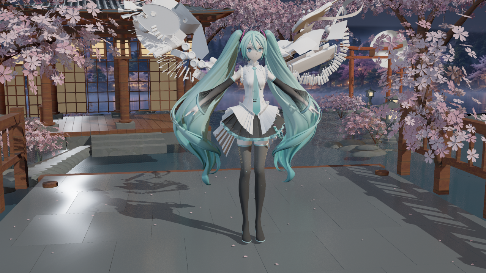
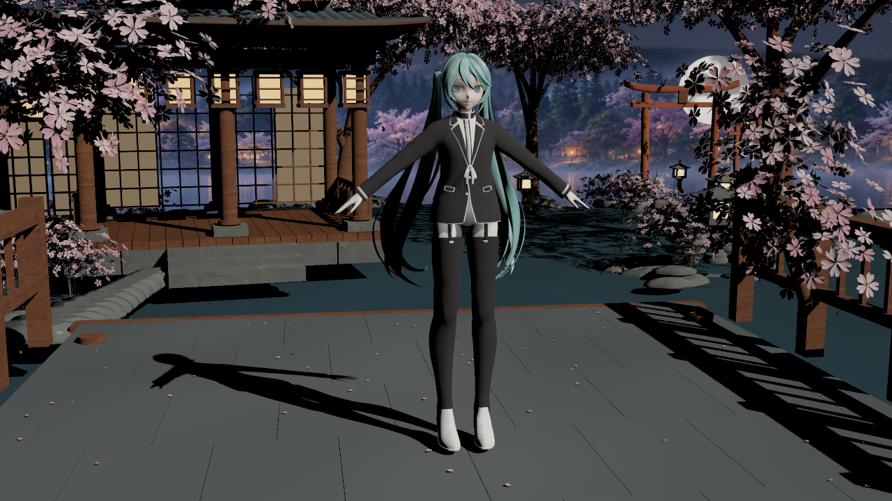
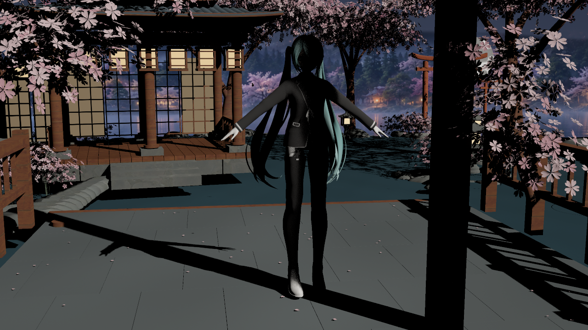
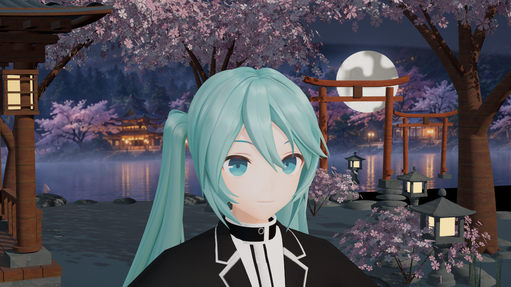

# 暖暖原生迁移：实际引擎验证

**后续状态：此批视觉已被用户否决，不能作为画质达标依据。** 这是17时的首轮原生迁移记录，只保留其功能验证与原始画面；镜面色带及脸部法线的后续修正另批记录。

捕获与归档日期：2026-10-19，Asia/Singapore。UE 5.8.3 / CL58210709，D3D12 SM6。下方均为实际离屏引擎截图，原 PNG 逐字节复制，没有生成式修图。使用参考姿势的两个既有 MMD 导入样本（35／39槽），不分发角色资产。[来源与原图哈希](sources.json)、[验证摘要与像素 ROI](validation-summary.json)。

## 当前结果

暖暖预设已改用独立的六份原生父材质、六类 Profile 与逐灯响应；复用 Substrate packed 材质缓冲、原生阴影及 GI／反射入口。旧三份 Unlit 材质只作兼容回退。[使用说明与实现边界](../../INFINITY_NIKKI_NATIVE_RENDERING.md)。

最终 Editor 构建通过，六父材质 SM6 shader 数为21／40／29／21／40／29；生成十三个自有包，重复生成写入0包。七轮有效实拍共171图／506次槽检查／0失败，均记录当前 Editor 全局 shader 协议15。实际绘制、协议反射、CPU绑定和像素对照分开记录；这些数量不是美术验收。

有效批次为：原生暖暖55图、同预设Mode0基线8图、终末地回归8图、第二模型8图；显式Lumen的第一模型44图、第二模型8图，以及含同条件复拍的GI／反射隔离40图。完整报告和其哈希保留在摘要指向的Saved路径；发行只保留五张代表图和来源摘要。

## 角色实拍

裙装角色，显式开启SceneCapture Lumen，48次捕获累积；原有背景与模型设计不代表原作资产。头发与布料使用暖暖独立响应。

另一模型的脸部近景。鼻梁暗边与源附层色差仍可见，眼睛层次尚不足；真实空间SSS、原作预积分皮肤LUT、OIT和透明衣装质感未实现，**视觉未验收，不宣称已复刻原作画质**。

## 阴影与间接光

四类灯的有／无遮挡对照均在角色ROI产生变化。方向光脸部ROI的sRGB8亮度为124.82→12.52；点／聚光为192.64／192.63→2.26，矩形灯227.49→.03。ROI为1280×720输出中的`[645,125,665,142]`，不含挡板本体。下方为方向光测试；测试时隔离环境照明，不能当作常规美术灯光。

SceneCapture在此UE版本默认关闭Lumen，仅开启项目CVar或预览图元追踪不足。修正显式`-LumenTracking`选项后，同时覆盖捕获组件的GI和反射方法，再以48次捕获累积并添加同条件复拍。

直射开启时，脸颊GI开关MAE约1.50，复拍噪声.31；头发GI约.73、反射约.74，复拍噪声.15。关闭三盏舞台直射灯时，脸颊GI约5.40／噪声.74，头发GI约3.23、反射约2.55／噪声.38，均超过三倍噪声。皮肤反射与本次AO差异未超过此门槛，记为未确认。Unlit负对照的脸颊GI开关MAE为0。

脸颊ROI为`[585,467,612,490]`，头发为`[535,270,590,340]`，均位于脸部镜头角色内部。这些是tonemap后的像素响应，不能解释为线性辐照度或所有角色／角度的结论。原生Mode2对同一暖暖预设Mode0的脸／发／布ROI也产生可测差异，不以旧终末地Unlit对照冒充同风格基线。

## 终末地隔离

516项既有资产与用户Face shader哈希保持；终末地八个既有着色函数及RD／RS、肤色配方数据与改动前一致。终末地原生预设没有生成或重存，实际8图／70次槽检查通过，35个受检原生槽均识别为终末地风格；暖暖槽识别为独立风格，未串用。

没有同条件的改动前v14 GPU截图，本轮不宣称逐像素相同；证据范围是源码／数据／资产不变、路由隔离及v15实际绘制回归。共享改动包括风格路由、缓存隔离、完整性清单及协议15，不修改终末地配方或预设参数。

## 失败记录与范围

首轮55图的绘制与105次槽检查通过，但协议反射仍绑定旧14标记，总验收失败；CPU与USF标记同步至15后重新完成上述有效批次。第一次只开启预览图元追踪的36图没有真实开启捕获Lumen，不计GI验证。失败与未覆盖结果均未混入最终通过计数。

当前未验证完整BuildPlugin、Cooked／Shipping、干净宿主角色绘制、动态Morph／LOD或GPU性能。协议15的发行库需要重新Cook，不能沿用v14库；Editor协议反射不是每个材质kernel的GPU回读证明。
