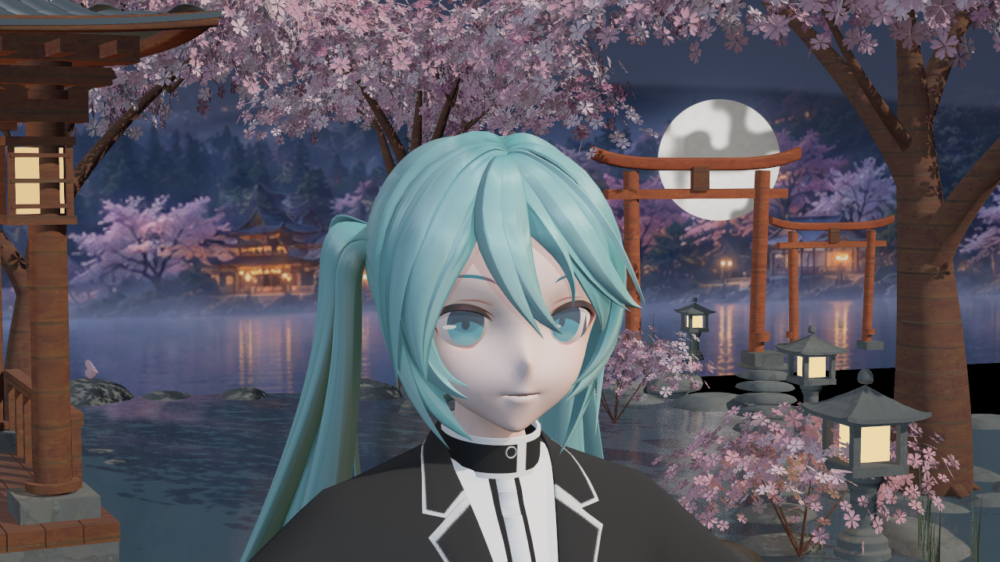
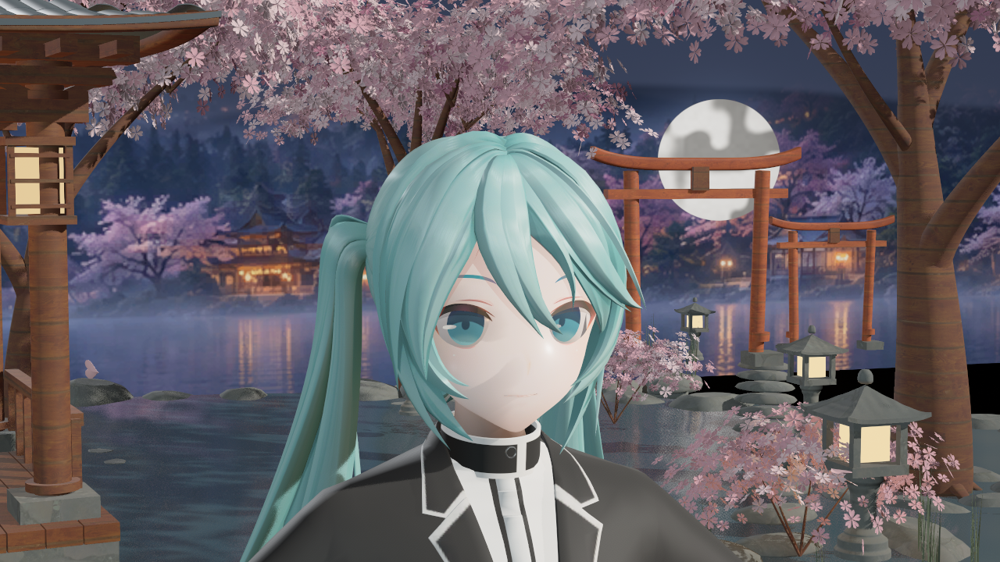
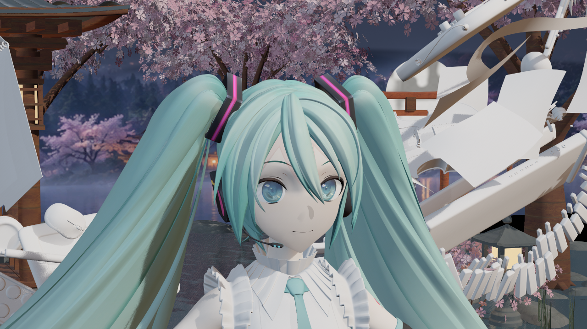
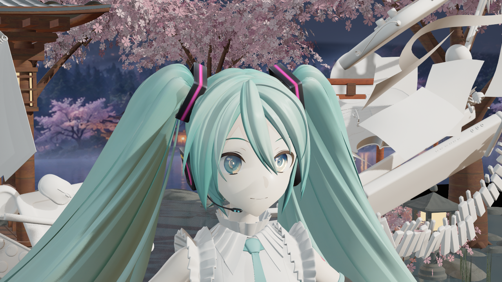
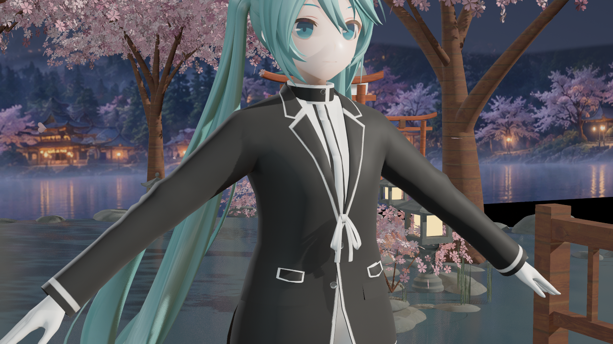
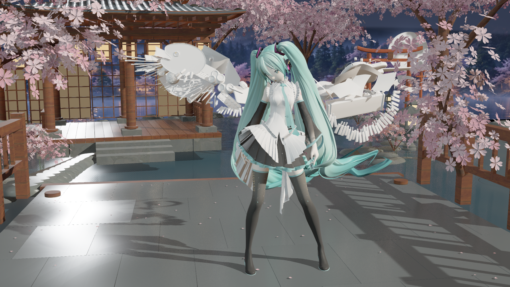

# 暖暖第二批：镜面、柔化法线与灯光校正

日期：2026-10-19，Asia/Singapore。新图捕获于19时，UE5.8.3 / CL58210709，D3D12 SM6。[原图时间、来源与哈希](sources.json)，[验证摘要、ROI与限制](validation-summary.json)。所有图片均为实际引擎输出，逐字节复制，没有生成式修图。前后对照中材质和预设灯光均有变化，不能归因于单一参数。

## 修正内容

首轮原生版错误地把常量Toon高光色带当作保留真实GGX。固定版本引擎的`SubstrateToonEvaluateCommon`会将分布结果重新映射到该色带，因此常量曲线抹掉了高光层次。暖暖现直接计算GGX分布、Smith可见度和Fresnel，补齐面积光能量归一化，矩形灯的LTC积分不再重复乘NoL／距离衰减。皮肤使用宽、窄两个高光波瓣，布料保留较粗糙的表面与Charlie纤维柔光，眼睛恢复随灯光变化的反射。

独立暖暖几何入口复用共享头框架与投射覆盖，向packed／inline载荷传入连续几何法线。默认Skin柔化强度为1，主脸与附层使用一致的头部代理；不使用终末地角阈值分区，不改网格UV或原始透明度。缺少头框架时仍回退几何法线。这是法线代理与局部柔肤近似，不是真实空间SSS。

暖暖预设新增显式灯光覆盖：主光源角1.5°、镜面倍率1／.35／.75；樱庭天空改为接近中性的颜色及.32强度，减少整体蓝灰。新增开关默认关闭；主光源角在退出覆盖后恢复进入前的实际值，其余灯光恢复原主题配方。终末地不启用这些新开关。

## 同模型与同机位对照

第一模型为35槽的既有MMD样本，参考姿势，启用捕获Lumen，48次捕获累积。旧图来自本日17时，不是本轮重拍。

打磨前：

打磨后：

鼻梁硬暗块减轻；低面数法线与附层仍可能留下局部色差。没有把源底色涂白或增加固定自发光。

第二模型为39槽的既有样本，同样的参考姿势与脸部机位。虹膜中的反射使用实际灯光，不是贴上的白色亮点。右虹膜ROI中约3%的像素三通道达到250以上，集中在高光位置；不是整片虹膜变白。两眼结构和反射仍不等于原作的分层角膜、折射或焦散。

打磨前：

打磨后：

布料近景：

动作第2秒实拍，96次捕获累积；这是一个姿势的检查，不代表全部动画、Morph或LOD已验收：

## 验证结果

最终Editor构建与六父材质SM6编译通过，十三个自有包更新。五轮最终实拍91图／401次槽检查／0失败，Editor全局shader协议15：第一模型59图、第二模型8图、动作姿势8图、终末地回归8图、同一舞台切换恢复8图。最终重复生成0写入，结果另附于验证摘要。中间过强高光的一轮与.92柔化强度的一轮均保留在Saved，未计为最终画质结果。

暖暖脸颊GI开关MAE为2.12／复拍噪声.41，关闭三盏舞台直射灯时为6.67／.78；头发GI与反射也超过三倍复拍噪声。皮肤反射差仍未过此门槛，不宣称已验证其间接镜面贡献。所用ROI、源报告哈希及tonemap后像素范围均见摘要；不将像素差解释为线性辐照度。

516项既有资产与用户Face shader哈希保持，终末地BSDF文件与打磨前逐字节一致。终末地角色区域对同条件17时基线的脸颊／头发MAE约.002／.002，脸核心约.006，衣服ROI为0；整图有背景阴影时域差异，不能宣称逐像素相同。主光先设自定义1.7°，暖暖→终末地切换后角度、镜面强度、天空色与强度恢复检查通过。

当前仍缺空间SSS、原作预积分皮肤LUT、OIT、ShellFur、宝石体折射和衣料微细节。鼻影附层的局部色差尚未完全消除，模型几何、原贴图分辨率和舞台资源也影响最终表现。此批修正实际着色错误，用户视觉验收仍为false。完整BuildPlugin／Cooked／Shipping、发行宿主及GPU性能未重测；没有修改安装引擎。
