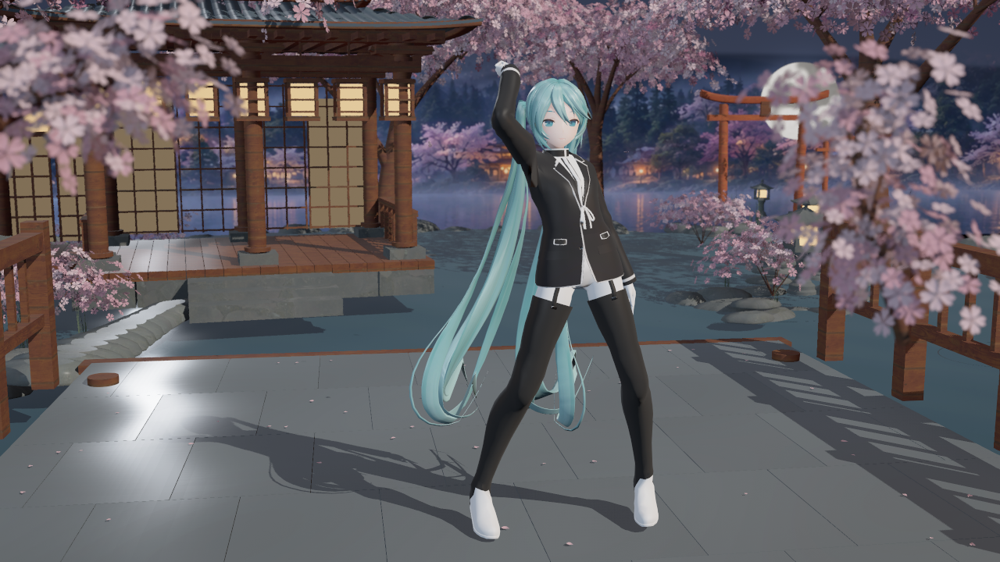
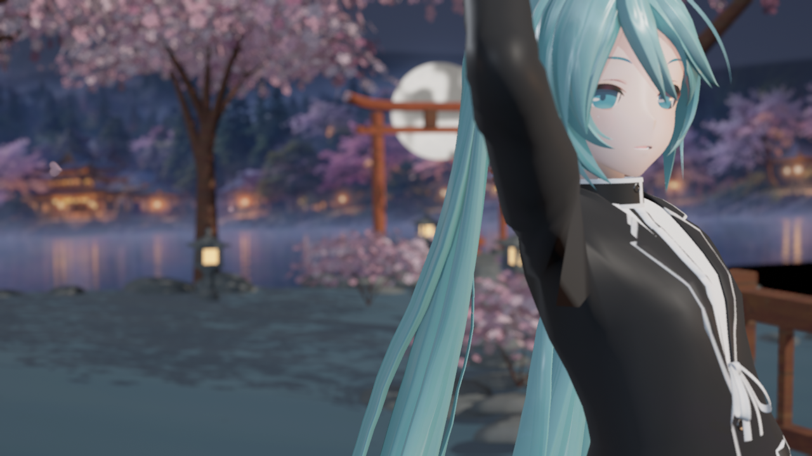

# 无限暖暖风格预设：柔光衣装

**状态更正（2026-10-19）：此实验误用了旧 Unlit Reference 模板，视觉未获用户验收。** 终末地 V2 已有 Substrate packed／延迟逐灯后端，本实验尚未接入。下方编译、参数和实拍测试只证明旧路径的对应功能，不代表画面接近原作或已完成渲染交付。后续开发以[当前架构](../../RENDERING_ARCHITECTURE.md)为基础；这些图片和解包数据保留为过程证据。

下文资产和脚本说明只对应15:31的旧批次；同名预设之后已迁移，当前使用与验证见[原生暖暖说明](../../INFINITY_NIKKI_NATIVE_RENDERING.md)。

本批日期为 2026-10-19（Asia/Singapore）。这是本插件的原创风格近似，目标是连续明暗、柔和肤质、几何发丝高光、缎布纤维柔光和克制后期。

在内容浏览器启用插件内容，使用 `/Ue5MMDTools/Stages/Presets/DA_Render_InfinityNikki`。将它赋给舞台 Actor 的 `RenderPreset`，应用角色渲染预设；也可通过 `UMMDStageLibrary::ApplyCharacterRenderPreset` 应用。角色原底图、底色、透明度和材质部位沿用既有系统；部位识别不合适时使用材质角色覆盖。预设不自动替换当前舞台主题。

三个父材质位于 `Stages/Materials/M_MMD_InfinityNikki_{Opaque,Masked,Translucent}`。默认关闭描边及 HairShift、HairDetail、ClothDetail 的贴图强度，仅底色即可完成基础着色。灯光 RT、场景阴影和天空反射由父材质提供；没有有效灯光数据时走通用预览回退，存在有效零灯元数据时不凭空补光。可选细节使用插件自有通用纹理和几何坐标，不使用模型脸部 UV 或配套阈值图。

独立入口 `MMDInfinityNikkiPresets -Generate` 只写这四个新包，并检查归属、44 输入、混合模式和共享节点；重复生成在签名一致时不重存。`MMDStagePresets -PresetAsset=...` 只读实拍指定预设，在旧资产生成流程前返回。可通过 `Scripts/Invoke-InfinityNikkiPresets.ps1 -EngineRoot <UE根目录>` 构建、生成并截图；`-SkipBuild` 用于已编译代码，`-NoGenerate` 只校验现有预设，`-SkipCapture` 跳过需本机导入角色夹具的实拍。`-CharacterSample <导入目录名>` 可选择 `Saved/BackgroundValidation/ImportedAssets/` 内已有样本；默认选最新有效样本，只读复用合格的八秒动作缓存，缺少缓存时保留已有动作。

## 参考依据与逆向边界

[Epic 对原作开发团队的访谈](https://www.unrealengine.com/developer-interviews/behind-the-scenes-of-infinity-nikki-tracing-a-glamorous-turn-to-an-unreal-open-world/)发布于 2024-08-23，本次访问日期为 2026-10-19。开发团队介绍了 PBR 光照、专门的角色阴影、透明服饰处理和克制后期；这些描述用于确定美术方向，不提供本预设的具体公式或数值。

本机 REA 6.7.0 完成了客户端 PE 资源身份检查，通用 UnrealPak 首次读取失败。随后改用 CUE4Parse 的 `GAME_InfinityNikki` 专用适配，通过 [Whimstar 作者维护的公开服务接入方式](https://github.com/NikkiTools/Whimstar/blob/e64ba491420d7c0a8846e8e550910536f4fc5e2a/Whimstar/ApiUtilities.cs)成功挂载 197 个容器中的 196 个，解出六份真实 UE 配置。`global.utoc` 未挂载；1,418,066 是去重前索引项数，不是独立文件总数。没有启动或注入游戏进程，游戏安装目录未写入。

最新补丁 `Default_Ini_m4_2816_2865_P.pak` 的 `DefaultEngine.ini` 明确包含 `r.SubsurfaceScattering=True`、`r.Subsurface.UsePreintegratedSkinDiffuse=True`；`Windows DeviceProfile` 包含 `r.OIT.SortedPixels=1`；`WindowsEngine.ini` 包含 Lumen 硬件光追相关配置。这些是静态配置证据，需要与平台、画质档、用户设置和运行时覆盖合并，不能据此宣称某帧启用了全部效果。逐项行号、节名、文件来源和 SHA-256 见 [package-evidence.json](package-evidence.json)。

已定位皮肤、头发和衣物材质路径，但三个代表材质的属性反序列化均因缺少匹配 `.usmap` 失败。已挂载索引内未发现 HLSL 源码；编译后的 ShaderArchive 路径不等于恢复了着色逻辑。原作 shader 字节码、BRDF 和精确材质参数仍未恢复。初始 REA 记录及后续结果关系见 [reference-evidence.json](reference-evidence.json)。发行内容不含游戏 shader、贴图、模型、密钥或完整配置。

## 实现范围

`TMMDInfinityNikkiCharacter.usf` 独立维护本预设，复用现有几何 BRDF、LightDataRT、插件主光阴影、SH 与天空反射。新响应包含 Burley 漫反射、归一化包裹柔肤和 Charlie 纤维柔光。柔肤是局部 BRDF 近似，不是空间 SSS；头发沿用几何各向异性双瓣，饰品沿用金属 GGX。角色没有接入完整 Lumen 间接漫反射，也未实现原作 OIT、ShellFur 或宝石体折射。透明排序和混合仍遵循现有 UE 路径，主光以外的逐灯遮挡沿用现有插件限制。新风格不修改安装引擎、既有预设或用户维护的 Face shader。

提取到的配置用于校正实现方向，并未直接复制为工程全局 CVar。皮肤使用几何头部框架缓和主脸与附着层的受光差异；框架缺失时保留通用几何法线。当前没有实现原作预积分皮肤 LUT 或真正扩散，作者制作的假鼻影透明层仍可能留下局部色差。角色部位识别沿用现有规则，未识别的身体槽可通过角色覆盖设为 Skin。

## 本批验证与原始实拍

2026-10-19 使用本机 UE 5.8.3、D3D12 / PCD3D_SM6。Editor 构建通过；三个父材质分别编译出 21 / 40 / 37 个 shader，主节点均为 44 输入。第一次生成写入四个新包，源码更新后刷新四包，最终重复生成写入 0 包。35 槽位 Assistant Gen. Works Librarian Miku 和 39 槽位 YYB16thWing 两套已有导入样本各 12 张实拍全部通过；源材质角色、底色和透明度、Masked 发丝切换及恢复、GPU 灯光读回、环境光和全灯关闭、动画与物理响应、原材质恢复均通过。既有 516 项资产与 Face shader 的 SHA-256 全部保持。

35 槽位样本采用已有 `MMDStagePreview8s`，角色动作 2.6 / 6.4 秒；39 槽位样本采用原 CH4NGE 前两秒，动作 0.6 / 1.6 秒。环境光单独开启时，面部区域 sRGB 亮度均值分别为 101.025 / 66.300；全部灯光与天空关闭为 0.04481 / 0.04473（0–255）。这些数字只用于检查无灯不自发光，不是肤色美术验收。未测试独立 Cook、Shipping、空白宿主发行包或 GPU 性能。

离屏捕获没有主视图，报告明确记录自定义场景阴影相机基无效，舞台原生阴影及角色回退路径继续使用；本批自阴影开关验证不能代替正常主视图下的遮挡效果验收。部位角色依靠现有识别及用户覆盖，不保证每个模型的作者命名都能正确识别。

早期一次实拍因旧测试要求固定槽名及 Metal 部位而失败，现已为独立预设入口增加按实际源槽检查，旧固定夹具检查保持。第二次在动作第 0 秒测试物理，因时间未推进而失败；已去除强制第 0 秒，改用样本自身有效动作时间。失败记录保留于本机 Saved，未计入最终通过结果。

下列四张是 2026-10-19 15:31（Asia/Singapore）UE 离屏实际渲染，1280×720 PNG，来自 `Saved/InfinityNikkiValidation/20261019-153118-173/screenshots/`；原始文件直接复制，未经生成式编辑。角色来源为本地已有的 YYB Assistant Gen. Works Librarian Miku 导入样本，舞台为插件 SakuraTheater。模型和动作资产未放入本批发行内容。报告摘要、源文件及图片 SHA-256 见 [validation-summary.json](validation-summary.json)。

全身与头发：

皮肤近景：

衣物近景：

关闭全部灯光和天空的对照：

