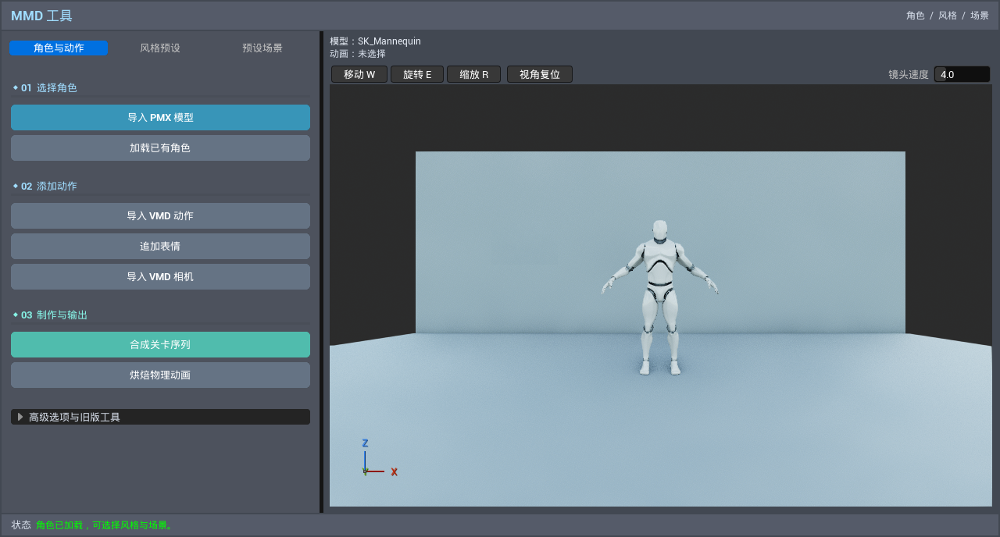
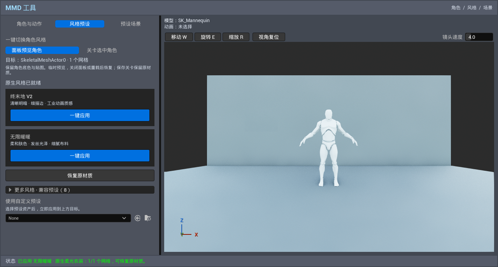
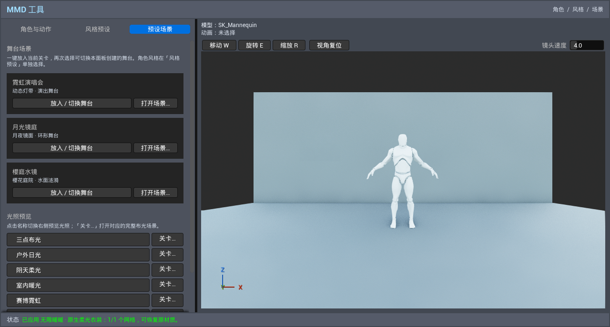

# 工具面板实际引擎截图

捕获日期：2026-10-22 17:20–17:21（Asia/Singapore）。来源：本地 UE 5.8.3 / CL58210709，D3D12 SM6，`Ue5MMDTools.UI.PresetWorkflow` 的实际 Slate 窗口，经 `FSlateApplication::TakeScreenshot` 捕获。图片原样归档，非生成式效果图。

使用项目已有 UE4 Mannequin 验证通用骨骼网格，不包含新增测试角色资产。截图启用 Substrate 与插件原生后端 Mode 2；风格页截图实际对预览网格应用无限暖暖。截图只证明面板布局、目标范围及入口可用，不作为 MMD 角色画质或原作风格验收。

## 本轮验证

- `MMDEditor Win64 Development` 构建成功。
- 最终源码分别在工程默认兼容配置、Substrate + 原生 Mode 2 配置运行集成测试，均为 1 项成功、0 失败。既有灯光子系统将预览覆盖设置／清除及收集状态记为 Warning，报告为 Success with warnings；无测试断言失败。
- 覆盖十套渲染 DataAsset 实际应用、连续切换后恢复首次材质覆盖、源网格材质保护、预览与关卡实例互不串改、关卡多选、保存准备／恢复方法、关闭面板清理、三套舞台复用及原有舞台保持。
- 目检三个工作页签，主要按钮、目标提示、原生就绪状态与恢复入口可读。发现天空捕获未更新导致预览黑色，修正为每帧更新后重新构建、重跑测试并捕获以上最终三图。
- 完整日志和自动化报告位于本地 `Saved/UIValidation/compat-final*`、`Saved/UIValidation/native-final*`；不提交 Saved 或构建产物。

未自动执行交互式 PMX/VMD 文件选择、物理烘焙、打开地图后的保存／取消对话框、Aurora 旧资产保存、打包或性能测试。角色预设仍为本次会话的临时实例效果，舞台可保存到关卡。
