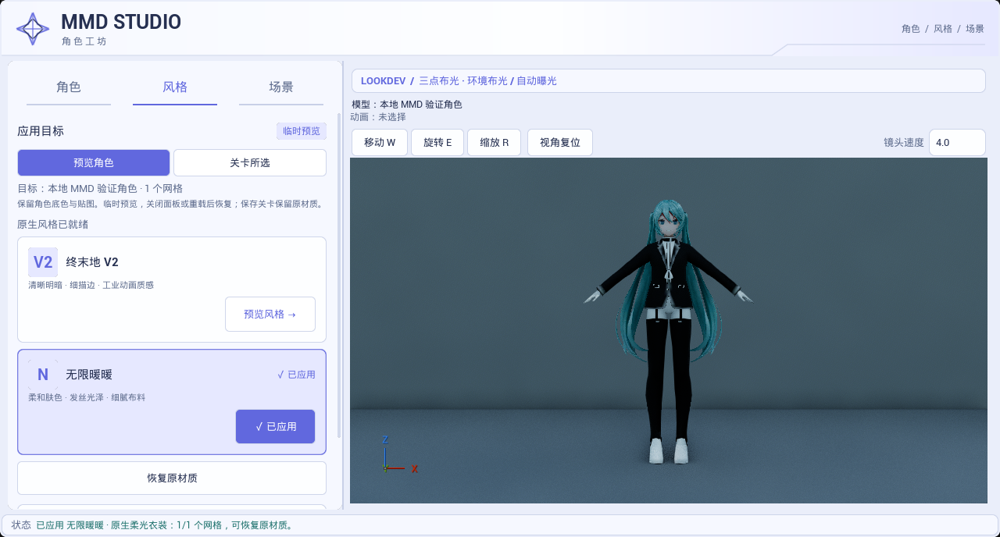
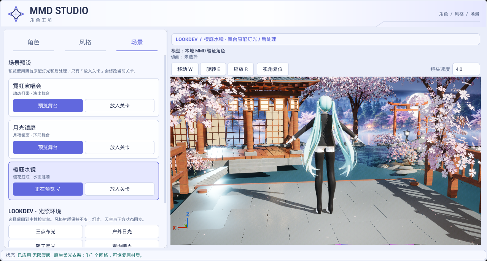
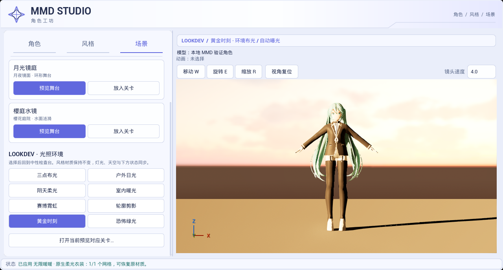
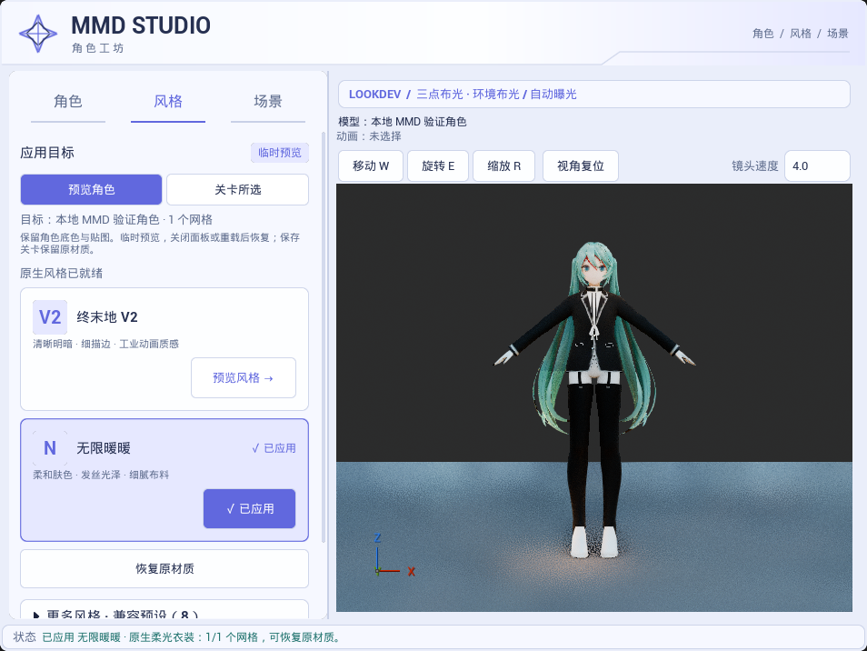

# 二次元浅色菜单实际引擎截图

本目录是默认光照校准前的历史实拍；新的默认检查环境见[光照校准与最新截图](../2026-10-23-studio-light/README.md)。

捕获日期：2026-10-23 12:40（Asia/Singapore）。本地 UE 5.8.3 / CL58210709，D3D12 SM6、Substrate + 插件原生 Mode 2，通过自动化测试中打开的真实 Slate 面板捕获。四张图均从 `Saved/UIValidation/panel_1.png` 至 `panel_4.png` 原样复制，归档前后 SHA-256 一致，未后期修图。

用户选择的[生成式 UI 概念及完整提示词](../../Design/2026-10-23-anime-ui/README.md)另存于 Design；本目录只放实际引擎画面。当前界面已替换前轮森林主题，采用白蓝紫、菱形星标、细线卡片和明确的目标／方案／环境选中态。概念图中的角色、肖像缩略图及额外控件没有作为已实现效果展示，右侧保持实际角色与 LookDev。

角色只读挂载已有 `Saved/BackgroundValidation/ImportedAssets/MMDBackgroundValidation_3CA65F00441D783AE8064BB741F53F1D` 缓存，原始来源为本地 YYB Assistant Gen. Works Librarian Miku NoSword PMX，35 个材质槽。未复制或提交角色、贴图、测试关卡或 Saved 内容。

## 本轮验证

- 最终 Editor 构建：`Saved/UIValidation/anime-ui-build-final2*` 成功。中间 Slate 参数重载／SpinBox 参数以及测试枚举名的构建错误均已修正，早期失败日志保留于本地，不作为通过结果。
- 最终 `Ue5MMDTools.UI.PresetWorkflow`：`Saved/UIValidation/anime-ui-final-report/index.json`，Success，22.905 秒，0 失败、0 Error；23 条 Warning 来自既有灯光覆盖／收集日志。前一轮浅色实拍测试另存 `anime-ui-native-report`，不混用为最终截图。
- 覆盖十套角色预设实际应用与恢复、连续切换、预览／关卡隔离、多选、保存准备与恢复、关闭清理、源网格材质保护、三套舞台放置与复用，以及八套灯光、注册可见的 SkyLight／HDRI 参数匹配、舞台后处理互斥、主光前向优先级和换角色后保持环境。
- 实际捕获角色、风格、舞台、黄金时刻和窄窗口五种状态；本目录保留四张代表图。目检确认 960 宽窗口中导航、两张风格卡片、恢复入口与视口工具栏可见，控制区可滚动，模型没有被边界裁掉。桌面高度限制导致主截图为 1280×688；窄窗口面板为 954×716，来自请求 960×720 客户区后的实际 Slate 几何。

本轮主要修改 UI 样式与状态表现，灯光配方、shader 和角色资产保持。截图中的真实角色和材质响应与生成式概念不同，不代表终末地／暖暖完整画质已验收；舞台继续采用原配机位，模型朝向由用户调整。自动曝光与历史帧可能改变截图亮度，本轮没有做跨尺寸像素一致性、GPU 性能、Cook／Shipping、交互式导入／烘焙或完整 GI／反射验收。角色风格仍为临时预览，保存保护语义见[工具面板说明](../../TOOL_PANEL_GUIDE.md)。
