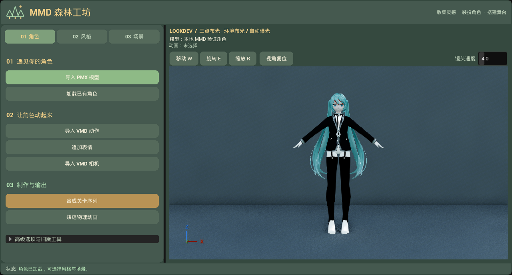
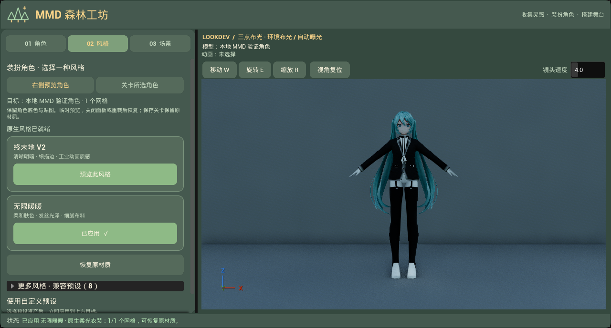
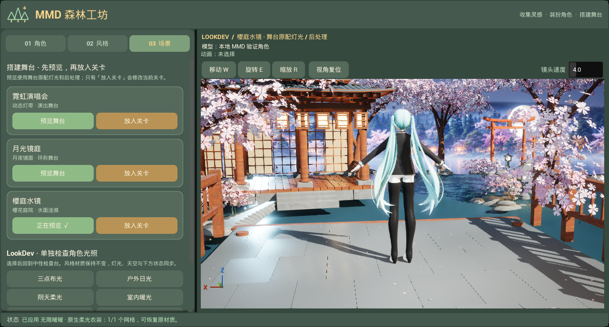
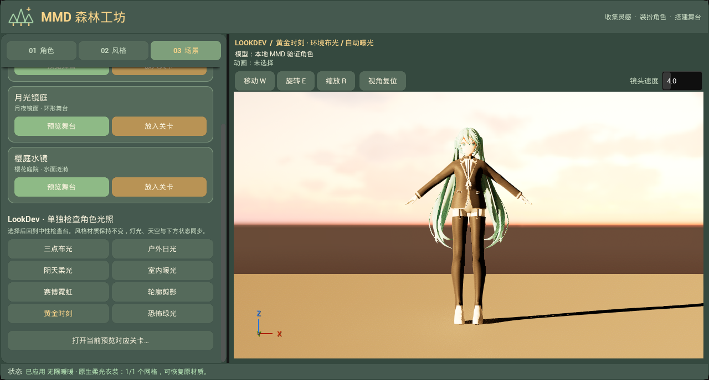

# 森林工坊与 LookDev 实拍

此页归档早期森林主题。当前界面与制作入口见[工具面板指南](../../TOOL_PANEL_GUIDE.md)。

捕获日期：2026-10-23 11:58（Asia/Singapore）。本地 UE 5.8.3 / CL58210709、D3D12 SM6、Substrate + 插件原生 Mode 2。截图通过集成测试打开的实际 Slate 面板捕获，未做后期修图，非生成式目标图。

角色只读挂载已有 `Saved/BackgroundValidation/ImportedAssets/MMDBackgroundValidation_3CA65F00441D783AE8064BB741F53F1D` 缓存，来源为本地 YYB Assistant Gen. Works Librarian Miku NoSword PMX，35 个材质槽。本轮不复制或提交角色、贴图和测试关卡；截图中的「本地 MMD 验证角色」仅为临时预览 Actor 标签。

## 验证

- 最终 Editor 构建成功；`Ue5MMDTools.UI.PresetWorkflow` 在原生配置（上述 35 槽 MMD 样本）和默认兼容配置（项目 Mannequin）各通过 1 项，0 失败。报告中的 Warning 来自既有灯光覆盖／收集日志，不代表断言失败。
- 验证十套风格应用、连续切换与恢复、关卡多选／预览隔离、保存准备与恢复、关闭清理、源网格材质保护及三套舞台复用。
- 新增检查八套环境生成灯数、注册且可见的实际 SkyLight Cubemap／角度／强度、可见 HDRI 的对应参数、舞台与检查台后处理互斥、真实舞台主光与预设一致、前向主光优先级、换角色后的舞台保持和 Lumen 跟踪开启。
- 首轮环境断言误计了已注销但尚未 GC 的旧舞台天空组件；改为只检查注册的组件后重跑。实际目检发现的编辑选区／灯光图标干扰、方向光优先级争用及通用镜头被立柱遮挡，均修正并复拍以上最终图。
- 完整本地记录：`Saved/UIValidation/forest-build*`、`forest-native-final*`、`forest-compat-final*`。失败尝试保留于本地 `forest-native*`；本目录只归档最终图。

舞台预览使用固定初始时刻、舞台 DataAsset 和场景生成器的默认机位；不自动调整模型自身朝向。检查台使用自动曝光，舞台使用其自身后处理。截图验证 UI、机位和环境对应关系，不代表终末地／暖暖原作画质已验收；角色方案仍为临时预览。未测试 GPU 性能、Cook／Shipping、交互式导入／烘焙、地图保存取消对话或完整 Lumen／反射图像差异。
