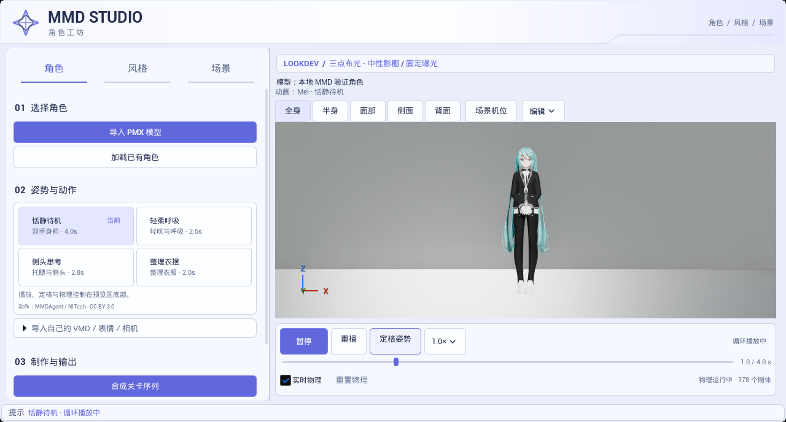
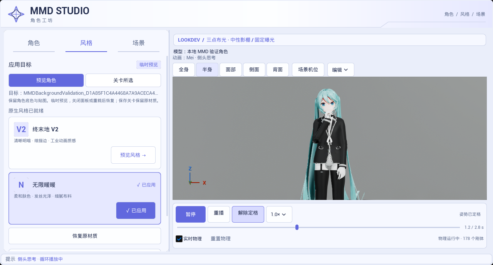
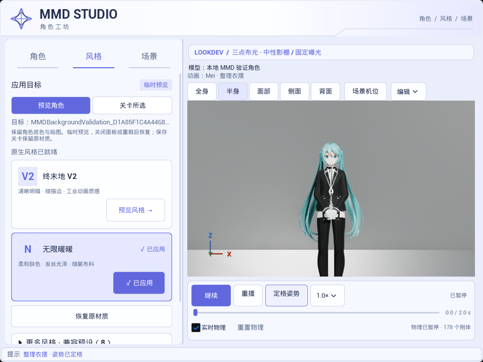

# 预览交互优化

捕获时间：2026-10-23 17:12，新加坡时间。UE 5.8.3 / CL58210709、D3D12 SM6、原生 Mode 2、Substrate 开启，以下为实际 Slate 面板与实时视口，非生成式示意图。只读加载本地35材质槽、178刚体 MMD 样本，不分发角色资产。

左侧动作卡片增加说明、时长和「当前」反馈，播放、重播、定格、倍速、进度及实时物理移到右侧底部固定栏；低频变换工具收进「编辑」，窄窗口不再因三个变换按钮占第二行。截图前通过实际 Slate 指针事件依次点击暂停／继续／定格／解除定格，断言真实状态变化；事件不发送给系统鼠标。

切换风格／场景页不隐藏公共播放栏。定格只停止动作时间，头发、衣物仍执行 Bullet；真实验证在0.8秒保持动作时间90步，物理骨骼最大旋转差135.14708°，178刚体保持初始化。它是跨骨骼最大差值，证明物理仍在改变输出，不是每根骨骼旋转该角度，也不是物理精度评分。[指标](interaction_metrics.json)。截图中的思考姿势另停在1.2秒，不能把截图时间当作上述0.8秒测试时间。

请求960×720，实际截图954×716。固定栏按钮、进度和物理状态完整可读，暂停与定格分开显示；暂停时动作和物理均停止。全身／半身等机位高亮显示，手动导航会清除选中态。

## 验证范围

- 最终 `interaction-build-final2` Editor Development 构建通过。
- `Ue5MMDTools.UI.MotionPreview` 通过，6.316秒，0 Error／失败，221条既有导入／IK及环境 Warning。新增重复点当前动作不回零、暂停／倍速／定格跨动作保持、半速实际推进、定格继续物理、拖动结束恢复此前状态、重播退出定格、快捷键与机位选中态检查；原有四套 VMD、物理循环和源资产保护继续通过。
- `Ue5MMDTools.UI.PresetWorkflow` 同进程回归通过，0.756秒，0 Error／失败，74条既有诊断 Warning。风格应用／恢复、作用范围隔离、保存保护、舞台复用和八套 LookDev 环境继续通过。
- 显式 `-MMDPanelInteractionCapture` 验证三个页签与窄窗口可找到公共控制栏，并执行实际 Slate 点击。角色／风格／场景／窄窗口四状态均在本地 Saved 捕获，选取三张归档。[完整来源与文件哈希](validation_sources.json)。
- 未改变 Mei 动作文件、shader、光照、模型／Skeleton 资产或安装引擎文件。未重新跑 Cook／Shipping、兼容配置启动、性能、人工文件对话框或实体键盘／手柄；快捷键仅在预览视口内分发，测试覆盖其行为和状态，不声称完成实体输入设备验收。首轮测试构建中的格式串错误保留本地，最终构建与报告为准。
