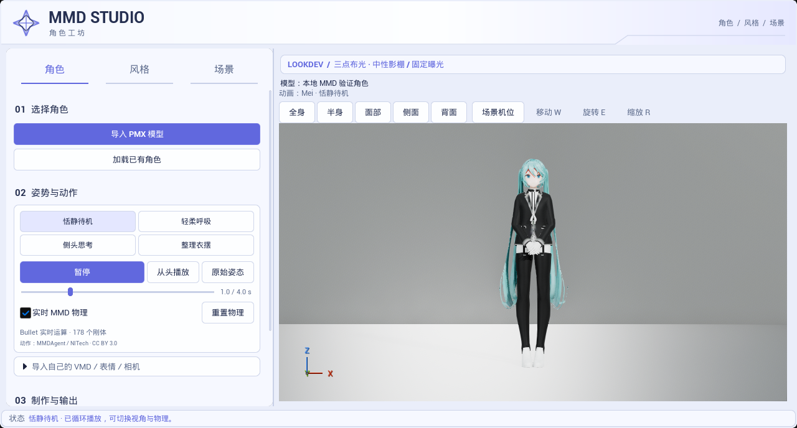
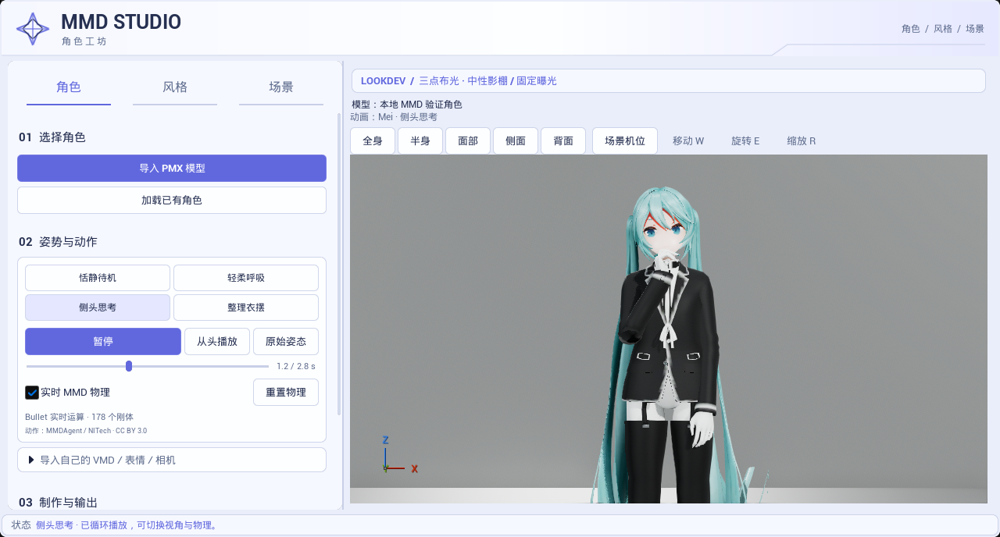
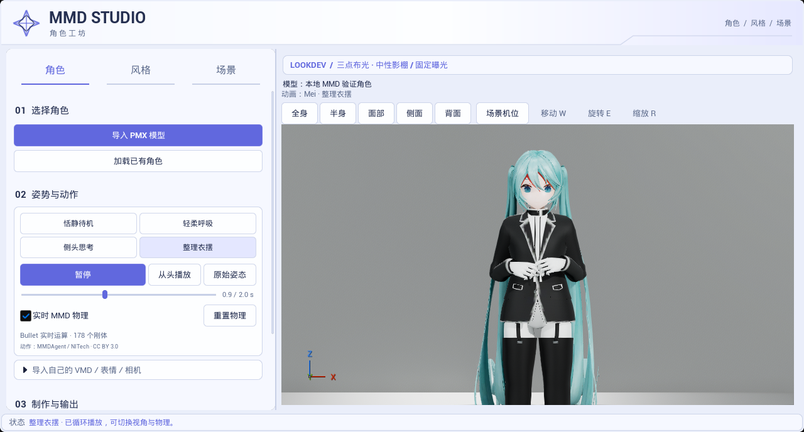

# 换用 Mei 女性角色正式配布动作

捕获时间：2026-10-23 15:45，新加坡时间。以下均为 UE 5.8.3 / CL58210709、D3D12 SM6、原生 Mode 2、Substrate 开启时的实际 Slate 面板与预览视口，非生成式目标图。只读加载既有35材质槽、178刚体 MMD 缓存，未分发测试模型。

用户否决了前轮简易生成动作的手臂观感。本批撤下四组生成 VMD 和脚本，换用 [MMDAgent Sample Script 1.8](https://sourceforge.net/projects/mmdagent/files/MMDAgent_Example/MMDAgent_Example-1.8/) 中的 Mei 女性角色动作。原始 VMD 字节未改动，完整保留肩、肘、腕和手指配合；[原始配布许可、作者署名与文件哈希](../../../Resources/PreviewMotions/README.md)。没有改 shader、布光、骨骼绑定或模型资产。

默认待机改为双手收在身前的恬静站姿，腿部靠拢，保留作者4秒循环。

思考动作用手指靠近下颌、头部轻侧的完整配布姿势，避免前轮仅拼上臂、前臂角度造成的生硬腕部。

整理衣摆动作包含双手与手指配合。动作源骨架与当前角色的臂长、手指和衣服形状不同，接触仍可能有小幅偏移；不把某张截帧当作全循环没有穿插的保证。轻柔呼吸、窄窗口面部镜头也在本地 Saved 捕获，不重复归档。

## 验证

- 最终 `mei-build` Editor Development 构建通过。
- `Ue5MMDTools.UI.MotionPreview` 通过，7.940秒，0 Error／失败，221条既有导入／IK与环境诊断 Warning。验证四组正式 VMD 可解析、按当前骨架映射、保留4／2.5／85÷30／2秒原时长、内存缓存和换角色隔离、源网格／Skeleton／材质脏状态保护、暂停／跳转／重置／循环及五机位平滑切换。
- 178刚体实际初始化，所有骨骼变换有限；暂停在同一动画时间后开／关物理，最大骨骼旋转差131.42955°，证明 Bullet 实际改变输出。它是跨全部骨骼的最大差值，不是每根骨骼都旋转这个角度，也不是物理精度评分。[指标](motion_metrics.json)。本批对照固定了动画时间，避免将动作本身的变化算成物理差。
- `Ue5MMDTools.UI.PresetWorkflow` 同进程回归通过，0.988秒，0 Error／失败，74条既有诊断 Warning。原有风格／场景预设与默认光照参数继续通过。
- [完整来源与捕获时间、SHA-256、报告摘要](validation_sources.json)。前轮15:19的生成动作实拍已经被用户否决，不作为本批观感证明。本轮未重跑 Cook／Shipping、兼容启动、性能或人工文件对话框。
