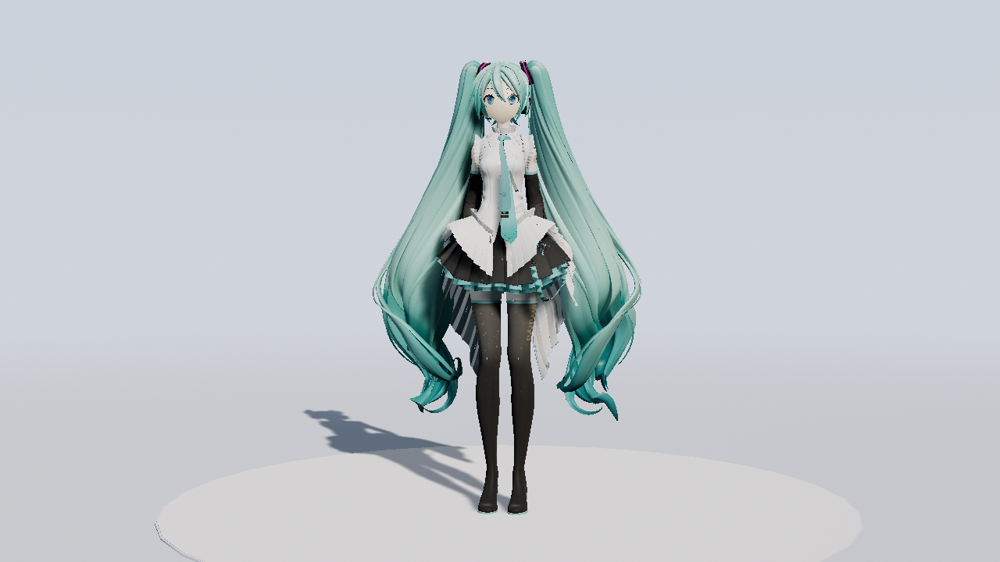
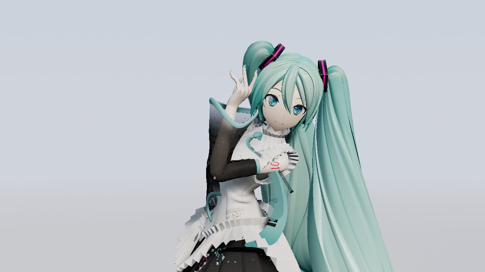
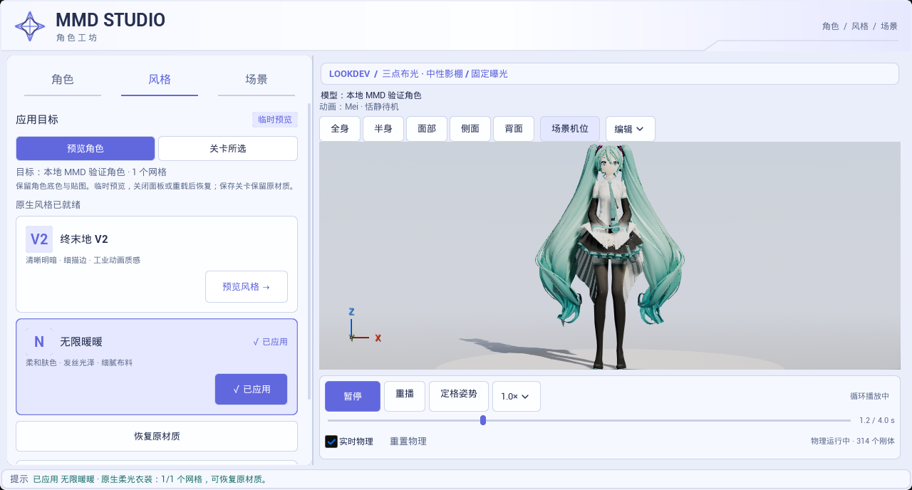

# 2026-10-23 MMD 制作与默认展示场景实拍

截图捕获及归档均为2026-10-23，时区 Asia/Singapore。下列画面来自 UE 5.8.3／CL58210709、D3D12 SM6、共享原生后端协议15与暖暖风格；不是生成式目标图。精确文件时间、SHA-256和验证路径见 [validation_sources.json](validation_sources.json)。

默认展示采用浅蓝／奶白渐层、哑光地面及低圆盘。Studio 暖主光3.2、冷补光0.55、轮廓光1.25、天光0.45，固定 EV0；Skin／Face 保留源底图，单独使用较暖、较低提白和镜面的表面参数。该角色在 VSM 下出现三角自阴影；本次宿主改用 CSM，保留投影，未修改安装引擎或 shader 源码。

本机最终样片在 `Saved/MMDProduction/2026-10-23-red-horse-showcase/mmd_movie.mp4`：95.5秒，2865帧，1280×720／30 fps，H.264＋44.1 kHz双声道 AAC，56,547,860字节。Showcase 镜头跟随实际骨骼构图；原始 VMD 镜头版另留 `2026-10-23-red-horse-final`，其中部分近景被长发遮挡，不作为最终展示镜头。视频、源模型及动作不纳入插件。

314个刚体、379个关节在渲染时持续以60 Hz计算，共推进5788个物理步；动画按30 fps保存实际输出，含498条完整骨骼轨道与源表情。保存的 Sequence 是物理烘焙结果，可通过 `MMD.OpenProduction "作品目录"` 继续编辑动作和镜头；使用原模型材质，不含完整舞台、暖暖临时 MID 或音乐轨道。

最终 `ProductionReload` 在新进程实际加载、生成角色／相机并评估首／中／末帧，0 Error／Warning；时间基、无源 PMX 的保存物理数据、面板动作、最终预设与持久化 Studio 地图检查通过。最终面板预设检查有77条导入／IK等 Warning；动作控制测试有213条 Warning，均0 Error。真实灯光审计以受光照参考背景排除常亮展示背景影响，线性亮度为0.292627→0.000100→0.292415，详见 [lighting_metrics.json](lighting_metrics.json)。

暖暖生成器更新十三个自有包，六个父材质实际 SM6 编译通过。源模型／Skeleton dirty 状态保持，未保存原资产；没有重测 Cook／Shipping、所有角色、完整发行宿主或 GPU 性能。早期 PowerShell／命令let初始化／诊断开关与天光保存失败的日志留在本机，不作最终通过证据。

本地角色：YYB Hatsune Miku 16th NoWing，署名 SANMUYYB／霁行Ralker／Delta幻黑。动作与面捕：-不灵-；编舞：白小白。原相机：秋燚QY；最终 Showcase 为本工具自动构图。随动作包附带的《红马》音频仅作本地预览，不据此声称商业或再分发授权。截图仅作本工具的非商业制作演示，不分发 PMX、贴图、VMD 或音频源文件。
