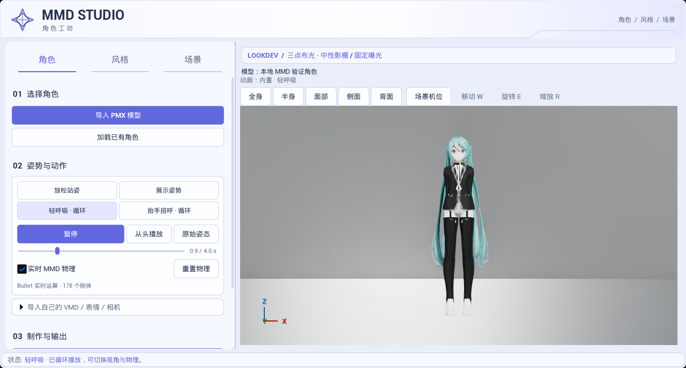
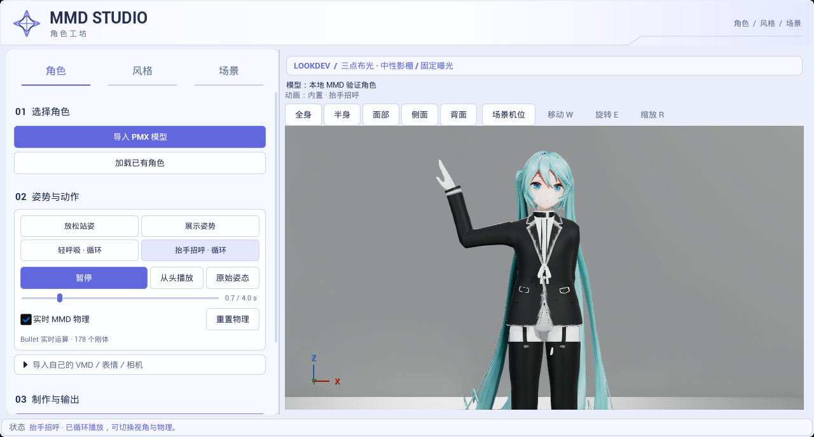
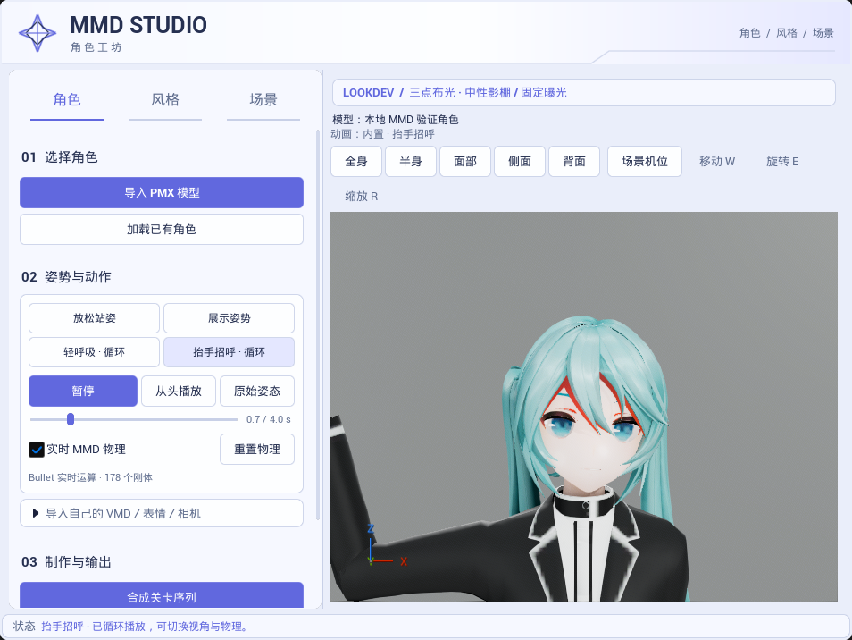

# VMD 展示动作、角色镜头与实时 MMD 物理

此页归档早期程序姿势。当前内置动作来自 MMDAgent，使用方式见[工具面板指南](../../TOOL_PANEL_GUIDE.md)。

捕获日期：2026-10-23，15:19，新加坡时间。以下均为 UE 5.8.3 / CL58210709、D3D12 SM6、原生 Mode 2、Substrate 开启时的实际 Slate 面板与视口，非生成式概念图。模型只读挂载本地既有的35材质槽缓存，178个 MMD 刚体；不随插件分发测试角色。

加载标准 MMD 后默认轻呼吸，头发由 Bullet 计算并自然垂落。左侧可一键切换四组原创 VMD，底部显示实际178个刚体状态；右侧保留校准后的默认检查台。

两张是同一4秒循环在不同时间的真实渲染，手腕和头发姿态会变化，没有烘焙物理或贴图动画。截图在自动化测试实际绘制60帧后读回，离屏测试帧率不代表交互运行帧率。

面部机位按头骨和模型尺寸取景；实际窗口截图954×716，工具栏换行、预设／时间／物理控件和提示仍可读。面部镜头允许裁掉手部和身体，不代表全身机位裁切。

## 本批验证

- `motion-build-final` Editor Development 构建通过。
- 最终 `Ue5MMDTools.UI.MotionPreview` 通过，5.954秒、0 Error／失败，163条既有导入／IK诊断和环境 Warning；四组正式 VMD 解析及按骨架转换、临时资产／缓存／换角色隔离、静态姿态真实 Bullet 运算、暂停／跳转／重置／片尾循环、五种视角与0.3秒过渡、源网格／Skeleton／材质保护均通过。
- 静态放松姿势开启物理120步后，相对关闭物理的最大骨骼旋转差为136.77034°，178个刚体初始化，所有骨骼变换有限；暂停后姿态保持。该指标证明物理确实参与输出，不是所有骨骼都旋转这个角度，也不是原作物理精度评分。详见 [实际指标](motion_metrics.json)。
- `Ue5MMDTools.UI.PresetWorkflow` 同进程回归通过，0.705秒、0 Error／失败，74条既有诊断和环境 Warning；原有风格应用／恢复、保存隔离、舞台复用和八套布光继续正常。修正关闭预览时的选区清理，避免临时 Actor 残留到下一测试关卡。
- 首轮所用旧材质缓存没有 MMD 刚体，测试正确失败；后续换为已持久化物理数据的缓存。镜头过渡测试发现旧 Focus 动画干扰，已显式终止旧过渡；招呼动作按实拍调整前臂旋转轴。中间失败报告仅保留在本地 Saved，不充当最终通过证据。

[完整来源、捕获时间、文件哈希和最终报告摘要](validation_sources.json)。本轮未重新执行 Cook／Shipping、兼容模式启动、性能或交互文件对话框；未改变灯光／shader 配方，也不保证任意非标准骨架或任意 PMX 刚体配置都符合原作效果。
