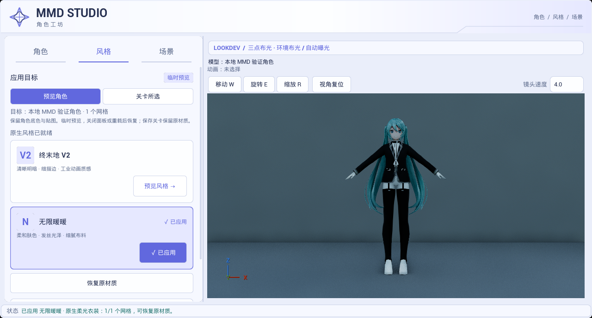
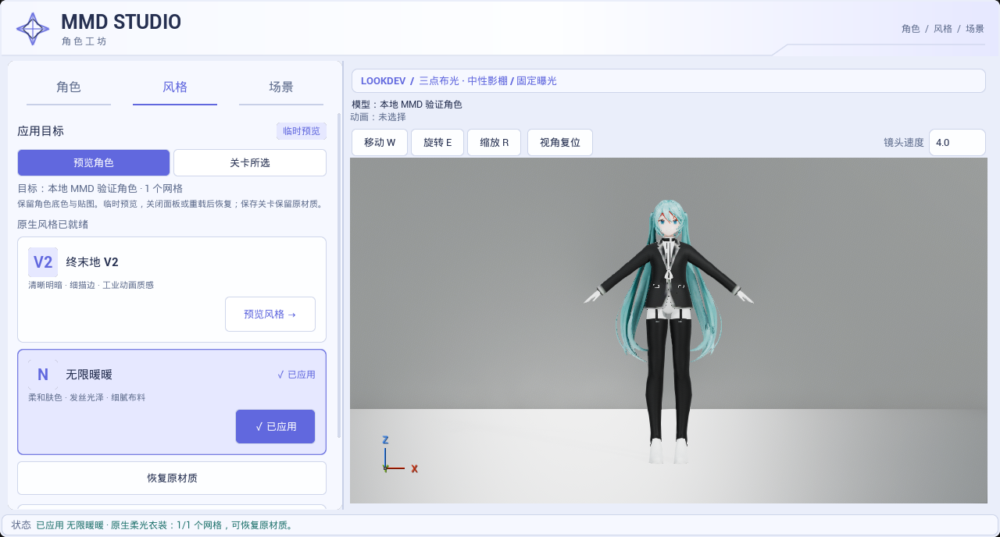
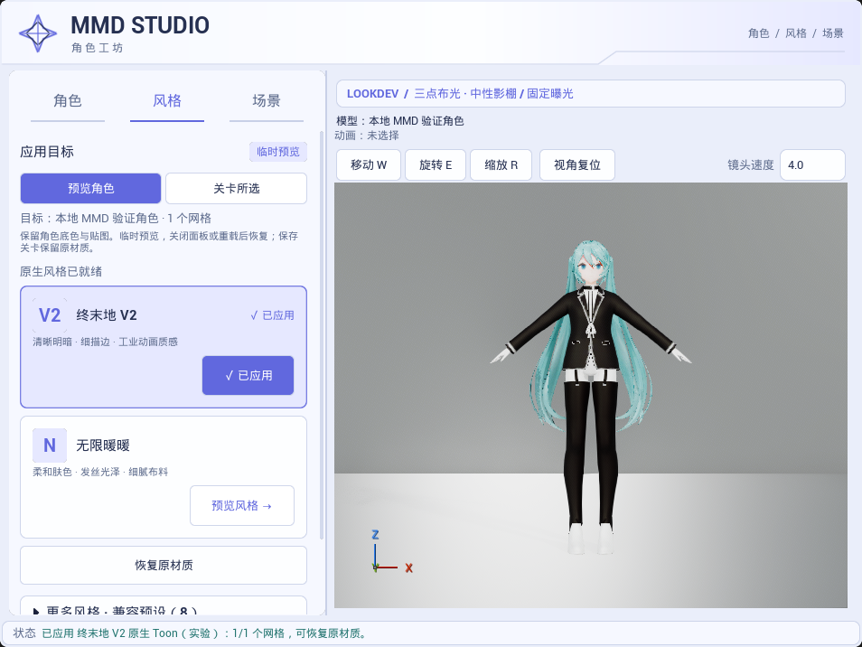
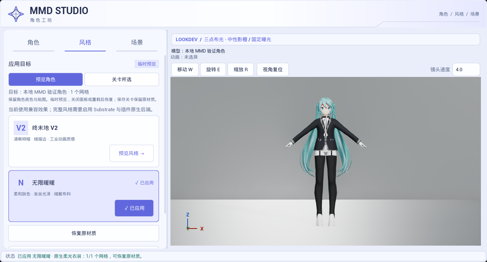
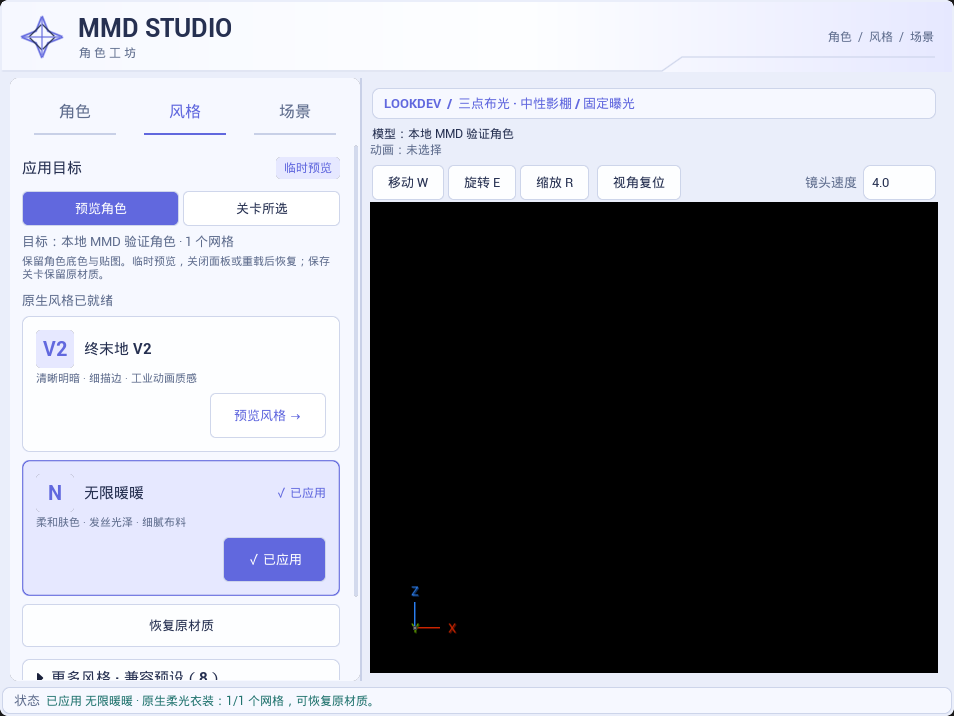

# 默认影棚光照校准

捕获日期：2026-10-23，Asia/Singapore。原生截图捕获于 13:13，兼容截图捕获于 13:15。UE 5.8.3 / CL58210709，D3D12 SM6，真实 Slate 工具面板；图片从自动化测试输出原样复制，无后期调亮，非生成式目标图。

角色只读复用已有 35 槽缓存 `Saved/BackgroundValidation/ImportedAssets/MMDBackgroundValidation_3CA65F00441D783AE8064BB741F53F1D`，来源为本地 YYB Assistant Gen. Works Librarian Miku NoSword。没有修改或提交角色、贴图、材质源资产、测试角色包或用户 Face shader。

## 修改前后

下图是 2026-10-23 12:40 的历史实拍，即用户指出偏暗的版本；不是本轮复拍。

默认影棚改用主光／补光／轮廓三盏方向光及中性天光，强度 3.2／1.8／2.4／1.0。方向光不受模型大小与灯距的平方衰减影响，兼容 LightDataRT 继续使用同一配方。只有主光投影，避免多道地面影子；主光前向优先级为 1，其他为 0。影棚固定手动曝光 EV0、关闭物理相机曝光和曝光偏移曲线，其他检查环境与舞台继续使用各自的曝光语义。

## 实际受光验证

最终原生测试在相同 960 宽窗口中完成「默认灯光 → 移除全部灯光 → 恢复默认灯光」，每个状态实际绘制 48 帧后读回视口，再捕获面板。全视口线性平均亮度依次为 `0.40578187 → 0.00007404 → 0.40577215`，恢复相对差约 `0.0024%`。[原始读回指标](lighting_metrics.json)。这证明本次画面随真实灯光改变，不依赖改底色、增加材质自发光或截图后处理补亮；不表示每个像素或所有材质都已验收。

对上述 12:40 历史图和本轮同尺寸原生暖暖图，固定 ROI 的 sRGB 平均亮度：脸部 `113.248 → 199.651`、黑衣局部 `29.211 → 74.758`、白靴局部 `111.694 → 229.897`。三个 ROI 中 RGB 同时达到 250 的像素比例均为 0。[ROI 坐标与原始指标](image_metrics.json)。ROI 包含各自区域内的所有像素，只说明这些小区域，不能推断整张图完全无高光裁剪。

## 默认关卡与验证来源

- 最终 Editor 构建为 `Saved/UIValidation/studio-light-build-final4*`，通过。
- 最终原生报告 `studio-light-final2-report`：Success、37.813 秒、0 Error／失败、26 条既有灯光日志 Warning。使用 Substrate + 原生 Mode 2、上述 35 槽 MMD 角色，验证新曝光／光源结构、保存后的默认地图重载、关灯／恢复 GPU 读回，以及既有十套材质切换、隔离／恢复／保存保护、三套舞台和八套检查环境。
- 最终兼容报告 `studio-light-compat-report`：Success、24.060 秒、0 Error／失败、23 条既有灯光日志 Warning；同一 MMD 角色、默认工程配置，重载默认地图并检查原有工作流与五种面板实拍。兼容模式没有重复做关灯 GPU 对照。
- 插件自有 `LE_Studio3Point` 及其 External Actor／Object 包已同步。修改前确认这三个资源路径没有未提交工作，并将原来的 28 个文件及哈希备份到本地 `Saved/UIValidation/StudioMapBeforeCalibration`。最终再次独立加载，确认只有三盏方向光、一盏强度 1.0 的天光、一个固定曝光 PP；没有旧局部灯或叠加天光。[地图哈希、资源范围与本地日志入口](validation_sources.json)。其他 Content 资源无本批变化。
- 首轮关灯对照读到了没有刷新的缓存帧；下一轮仅按时间等待，切换后读回尚未稳定。现改为实际渲染帧预热，最终指标以上述报告为准。默认地图重载还暴露了旧灯外部包未保存及 SkyLight 没有被旧 `ALight` 清理逻辑覆盖的问题；现加载外部 Actor、收集脏内容包并限定保存该地图的外部路径，同时清理旧天光。中间失败报告、检查与重建日志保留 Saved，未当作通过结果。

本批不修改 shader、后端协议、项目全局曝光设置或其他七套检查灯配方。固定 EV0 只用于默认中性检查环境；不是户外物理曝光标准，也不是终末地／暖暖完整画质验收。未重测 Cook／Shipping、GPU 性能、所有模型／朝向或完整 GI／反射画质。用法见[面板说明](../../TOOL_PANEL_GUIDE.md)。
