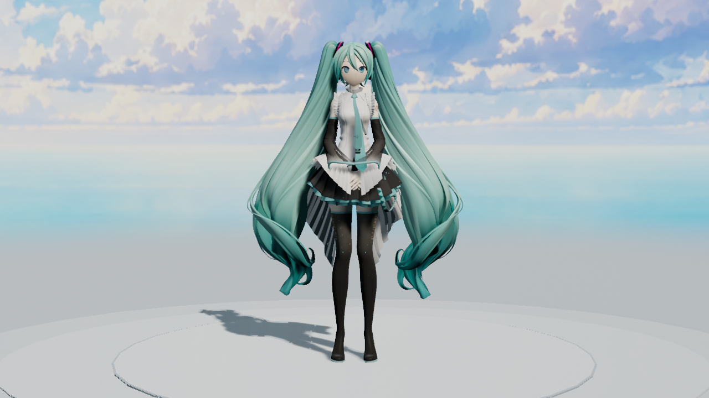
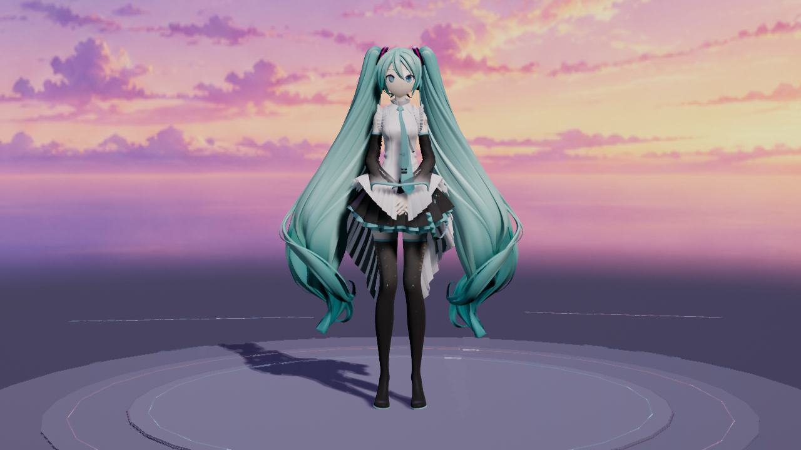
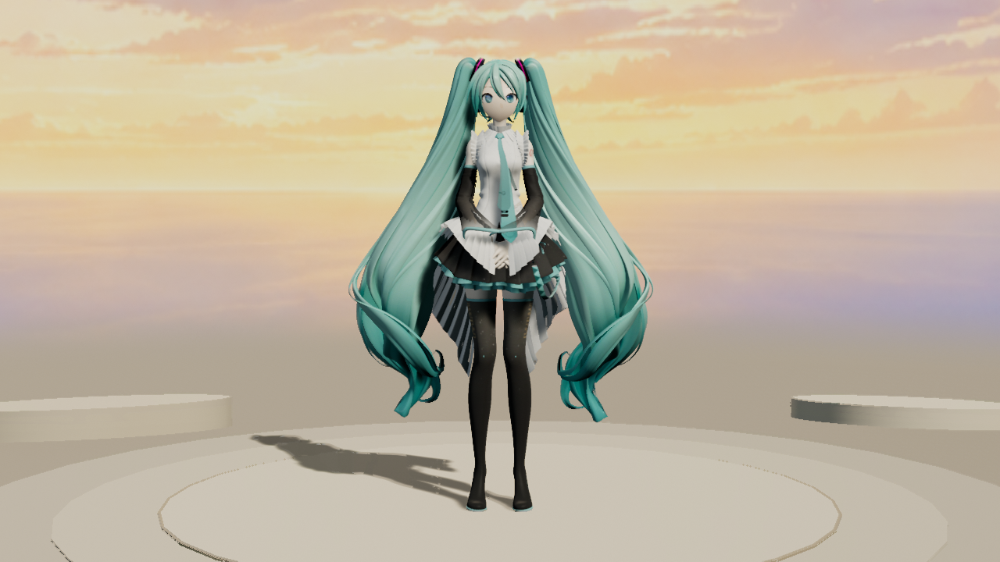
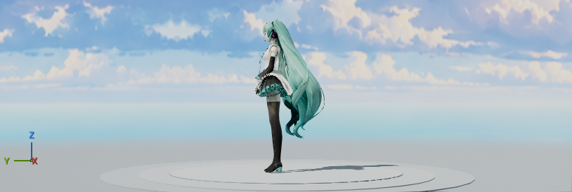

# 2026-10-25 云空场景历史实拍（用户已否决）

日期：2026-10-25，Asia/Singapore。完整面板与侧面视口来自约 14:23 的 run8；三套后台短片分别于 14:24:22、14:25:22、14:25:43 完成。宿主为 UE 5.8.3／CL58210709、D3D12 SM6。这里展示实际引擎输出，imagegen 只制作了场景内的天空贴图，未生成角色或冒充引擎画面。

**此批云空版也已被用户明确否决，保留为历史，不再作为当前效果或默认场景。** 第一轮含竖向装饰的布局被否决后，当时改为开阔天空、宽台阶与低矮布景，并曾将晴空露台设为默认；用户随后要求恢复原版纯白影棚并新增其他影棚。后续工作见[纯白影棚集合](../2026-10-25-studio-collection/README.md)。以下保留原捕获时间、图像、视频与实际测试结果，不将技术检查通过等同于审美认可。第一轮图片仍在 `Saved/UIExperience/2026-10-25/run4/rejected-display-panels/`，没有覆盖历史 2026-10-23 档案。

## 三套后台画面

以下三张均直接复制相应电影的 `frames/frame_000015.png`，时间位置为 0.5 秒，分辨率 1280×720，未调色或修图。

晴空露台（`SkyGlass`）：

暮色星台（`VioletStage`）：

暖光画廊（`WarmAtelier`）：

[三套场景原速短片，3 秒](display-scenes.mp4)

短片按晴空露台 → 暮色星台 → 暖光画廊顺序，将各 1 秒的原 MP4 直接拼接。输出为 1280×720／30 fps、90 帧、3 秒、无音轨；使用视频流复制，没有缩放、补帧、变速或二次编码，完整解码通过。源文件均在 `Saved/UIExperience/2026-10-25/movie-<ID>-final/`，该目录中的 `report.json` 与 `production.json` 均报告成功。

电影捕获单独使用 **TAA**，保留持续 ViewState，预热 12 个捕获帧并复用首帧历史；这不是全局抗锯齿变更。每套记录 30 个输出帧、118 次物理步进（含 1 秒预热），固定 EV0，实际灯光分别为 `DisplaySkyGlass`／`DisplayVioletStage`／`DisplayWarmAtelier`。`source_asset_dirty_flags_unchanged` 与 `saved_editable_assets` 均为 true；本归档不复制烘焙资产，也不据此声称本轮做了独立进程重开验证。

三套均有 73 条导入映射提示：55 条未匹配骨骼轨道、18 条未匹配表情轨道。它们保留在源报告中，不能宣称全部 VMD 轨道已映射或零警告。实际模型使用了 87 条匹配骨骼轨道与 11 条匹配表情轨道，跨模型的接触姿势仍需检查。

## 面板与侧面视口

面板预览仍使用项目 **SMAA**，与上面的电影 TAA 分开记录。三张完整面板可查看场景卡片、当前光照提示和固定播放控制：

| 场景 | 实际完整面板 |
|---|---|
| 晴空露台 | [display_SkyGlass.png](display_SkyGlass.png) |
| 暮色星台 | [display_VioletStage.png](display_VioletStage.png) |
| 暖光画廊 | [display_WarmAtelier.png](display_WarmAtelier.png) |

晴空露台侧面机位用于检查天空与地面的衔接：

已目检三套电影的第 15 帧、晴空露台第 29 帧及 run8 的前／侧视口：这些画面未见此前的天空硬接缝、按钮白色填充遮字或明显 TAA 双影。该范围不等同于所有镜头方向、整段快速舞蹈或抗拖影压力测试。

run8 六项 UI 测试全部为 Success、0 Error；Warning 依次为 DisplayScenes 97、Experience 29、FrameStepping 0、MotionPreview 161、PresetWorkflow 70、PreviewFraming 0，共 357。详情及界面动效视频见[交互实拍记录](../2026-10-25-ui-experience/README.md)。报告、原 MP4、图片的精确路径、时间、SHA-256 与关键结果收录在 [validation_sources.json](validation_sources.json)，未将整个 Saved 或完整报告打包。

## 资源来源与范围

天空图片来源见[DisplayScenes 资源说明](../../../Resources/DisplayScenes/README.md)及其完整生成记录；可见天空是艺术背景，不是 HDRI 光照数据。实际地台、宽阶与低矮布景由插件在引擎中构造，角色光照来自各自的方向光与天光配方。本轮没有下载、导入或分发 Fab 环境资产。

测试角色为 YYB Hatsune Miku 16th NoWing，署名 SANMUYYB／霁行Ralker／Delta幻黑；待机使用 MMDAgent Mei 配布 VMD，CC BY 3.0 来源及署名见[预设动作说明](../../../Resources/PreviewMotions/README.md)。截图与无声短片用于非商业工具演示，不包含角色、贴图、动作或音乐源资产。本批未验证 Cook／Shipping、所有模型、所有显卡或游戏运行性能。
