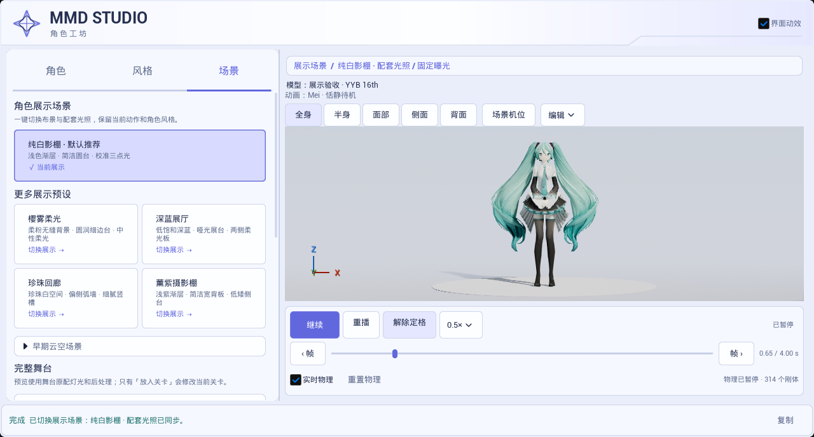
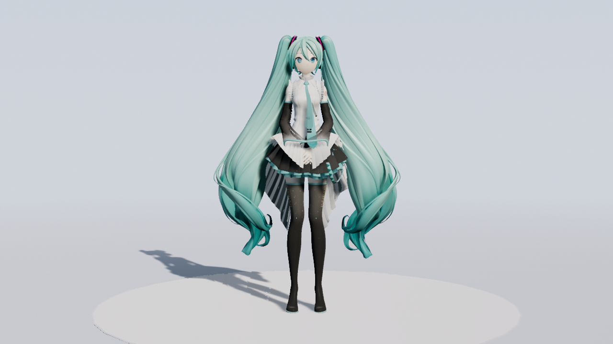
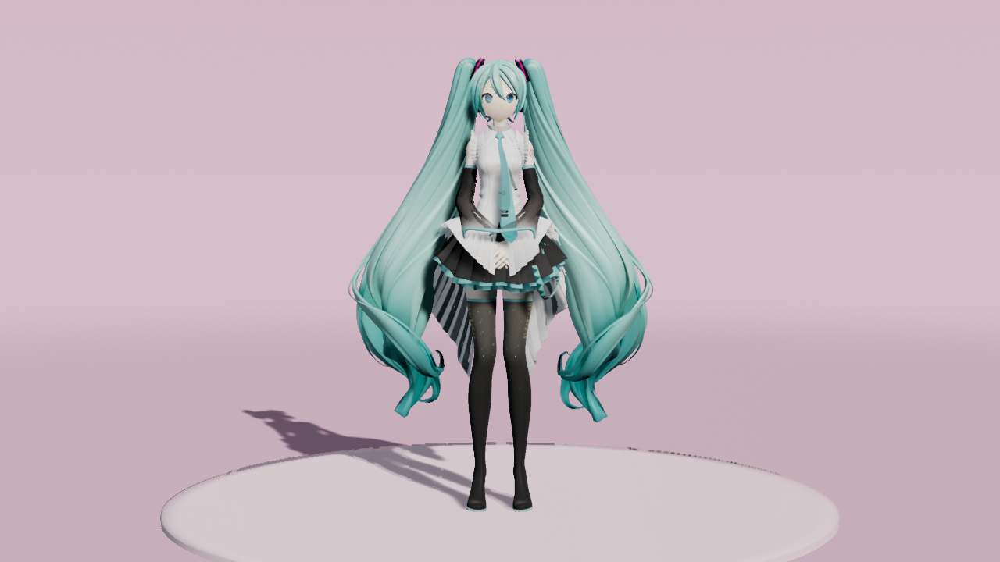
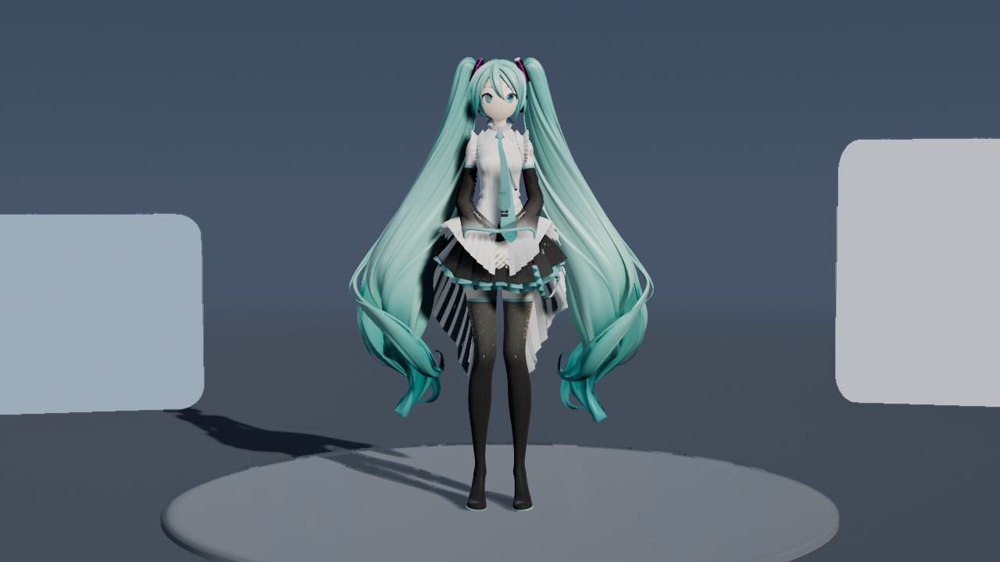
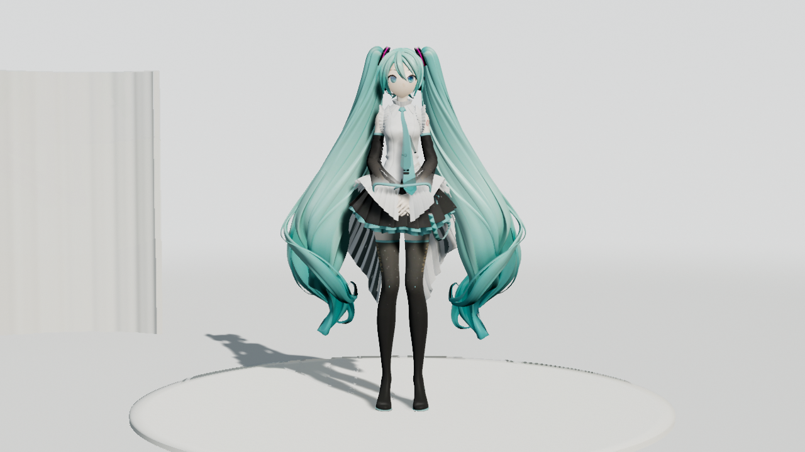
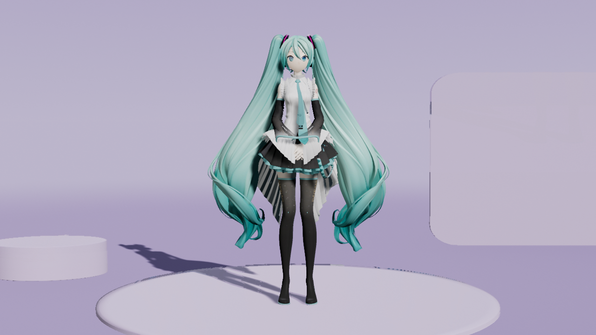

# 2026-10-25 纯白影棚与预设集合

捕获日期：2026-10-25，面板约 15:24，后台短片约 15:27–15:28，Asia/Singapore；UE 5.8.3／CL58210709、D3D12 SM6。

本日第二批工作记录。用户否决前一批云空版后，默认恢复原版纯白影棚（`Studio`），并新增四套可选影棚。这里不使用前一批图像冒充本轮效果；旧图及来源继续保留在[云空历史归档](../2026-10-25-display-scenes/README.md)。

## 实现范围

| 场景 | ID | 当前实现方向 |
|---|---|---|
| 纯白影棚（默认） | `Studio` | 保留原有浅色渐层、哑光地面与简洁圆台 |
| 樱雾柔光 | `RoseStudio` | 柔粉无缝背景、圆润细边台、中性柔光 |
| 深蓝展厅 | `SlateGallery` | 低饱和深蓝、哑光展台、两侧柔光板 |
| 珍珠回廊 | `PearlAtrium` | 珍珠白空间、偏侧弧墙、细腻竖槽 |
| 薰紫摄影棚 | `LilacStudio` | 浅紫渐层、简洁宽背板、低矮侧台 |

早期三套云空保留在默认收起的「早期云空场景」，不作为默认。四套新增影棚使用实际引擎几何与材质，本批未生成新图片，也未寻找或导入 Fab 资产。原有天空图片和生成来源记录保持。

## 实际面板截图

以下是本轮 `Saved/UIValidation/display_<ID>.png` 的原样副本，由 `Saved/StudioCollection/2026-10-25/run2/` 中的实际 Slate 自动化捕获。旧云空图没有混入本目录。图中动作定格并暂停在 0.65 秒，保留 0.5× 倍速与实时物理选择，展示切换后的状态保持；不能把静态截图写成正在播放的录像。

| 场景 | 实际完整面板 |
|---|---|
| 纯白影棚 | [display_Studio.png](display_Studio.png) |
| 樱雾柔光 | [display_RoseStudio.png](display_RoseStudio.png) |
| 深蓝展厅 | [display_SlateGallery.png](display_SlateGallery.png) |
| 珍珠回廊 | [display_PearlAtrium.png](display_PearlAtrium.png) |
| 薰紫摄影棚 | [display_LilacStudio.png](display_LilacStudio.png) |

已目检五张完整面板与四套新增视口：默认 Studio 原有外观保留，新增布景黑面问题在这些画面中已消失，场景卡片与光照提示对应。这里只记录本机这些角色／机位的检查，不表示用户已认可其审美效果。

## 五套后台短片

[五秒原速预览](studio-collection.mp4)依次展示纯白影棚、樱雾柔光、深蓝展厅、珍珠回廊、薰紫摄影棚，各一秒。源目录为 `Saved/StudioCollection/2026-10-25/movie-<ID>/`，全部由实际 UE 渲染并推进 Bullet 物理。合成使用原视频流直接拼接，保持 1280×720／30 fps，共 150 帧、5 秒，不插帧、不缩放、不重新编码，无音轨；完整解码检查通过。

以下五张图片为各自 `frames/frame_000015.png`（0.5 秒）的原样副本，不是生成式目标图。新增影棚未使用生成图片；早期云空中的 imagegen 天空资产不参与这五套画面。

| 纯白影棚 | 樱雾柔光 |
|---|---|
|  |  |

| 深蓝展厅 | 珍珠回廊 |
|---|---|
|  |  |

五套 `report.json` 和 `production.json` 均记录成功，每套 30 帧、1 秒，118 次物理步进包含 1 秒预热。实际灯光分别为 `Studio3Point`、`DisplayRoseStudio`、`DisplaySlateGallery`、`DisplayPearlAtrium`、`DisplayLilacStudio`，全部固定 EV0。Studio 的宿主调用特意省略 `-Stage`，报告确认默认结果为 `Studio`／`Studio3Point`。

面板预览使用项目 SMAA；短片使用捕获组件局部 TAA，原生输出分辨率，预热 12 个捕获帧并复用首帧历史，没有更改项目预览的抗锯齿设置。每套源资产 dirty 标记保持，动画与 Sequence 保存成功，但本批没有另做新进程重开检查。每套仍有 73 条导入警告：55 条未匹配骨骼轨道、18 条未匹配表情轨道。

已检查五套代表帧，未见拓扑裂缝或缺面；台面和背板薄边仍有约 1–2 像素的断续暗采样。没有做隔离对照定位原因，不能将其归因为已证实的 TAA 或 Lumen 问题。代表帧与一秒待机短片也不证明全方向画质、快速舞蹈抗拖影或用户审美验收通过。

## 实际验证

`Saved/StudioCollection/2026-10-25/build2.log` 记录构建成功，执行 7.32 秒。`run2/report/index.json` 的六项测试均为 Success、0 Error，共 380 条 Warning：

| 测试 | 耗时（秒） | Warning | Error |
|---|---:|---:|---:|
| `Ue5MMDTools.UI.DisplayScenes` | 11.27 | 120 | 0 |
| `Ue5MMDTools.UI.Experience` | 2.63 | 29 | 0 |
| `Ue5MMDTools.UI.FrameStepping` | 0.008 | 0 | 0 |
| `Ue5MMDTools.UI.MotionPreview` | 1.83 | 161 | 0 |
| `Ue5MMDTools.UI.PresetWorkflow` | 0.87 | 70 | 0 |
| `Ue5MMDTools.UI.PreviewFraming` | 0.005 | 0 | 0 |

新增回归检查生成网格的三角面绕序与外向顶点法线一致，避免仅修顶点法线却保留反向三角面的黑面问题；同时检查默认 Studio、八套展示注册、旧云空默认折叠、光照／曝光、组件复用与角色播放状态保持。Warning 仍包括导入映射／VMD 数据模型、IK 调试、灯光覆盖和测试角色选中提示，不能记成零警告。精确耗时、报告与截图 SHA-256 见 [validation_sources.json](validation_sources.json)。

本批未改动效逻辑，未重复录制 UI 动效视频。旧 run8 与云空短片结果不代替本轮验证；本批未验证 Cook／Shipping、全部模型／显卡或游戏帧率。归档只包含五张面板、五张电影代表帧、五秒拼接与来源摘要，不包含整份报告、构建产物或可编辑角色资产。

测试角色为 YYB Hatsune Miku 16th NoWing，署名 SANMUYYB／霁行Ralker／Delta幻黑；动作来自 MMDAgent Mei 配布 VMD，CC BY 3.0 来源及署名见[预设动作说明](../../../Resources/PreviewMotions/README.md)。画面用于非商业工具演示；归档不包含角色、贴图、动作或音乐源文件。
