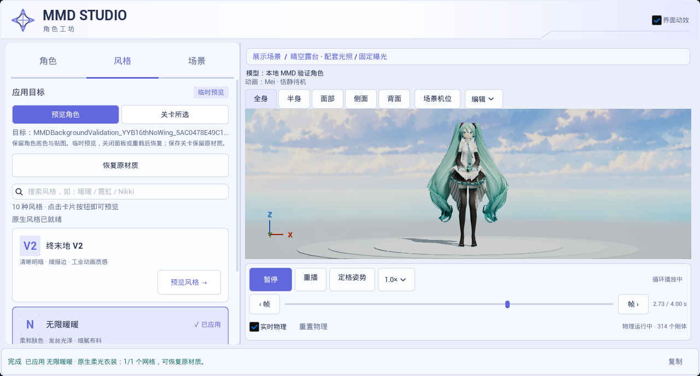
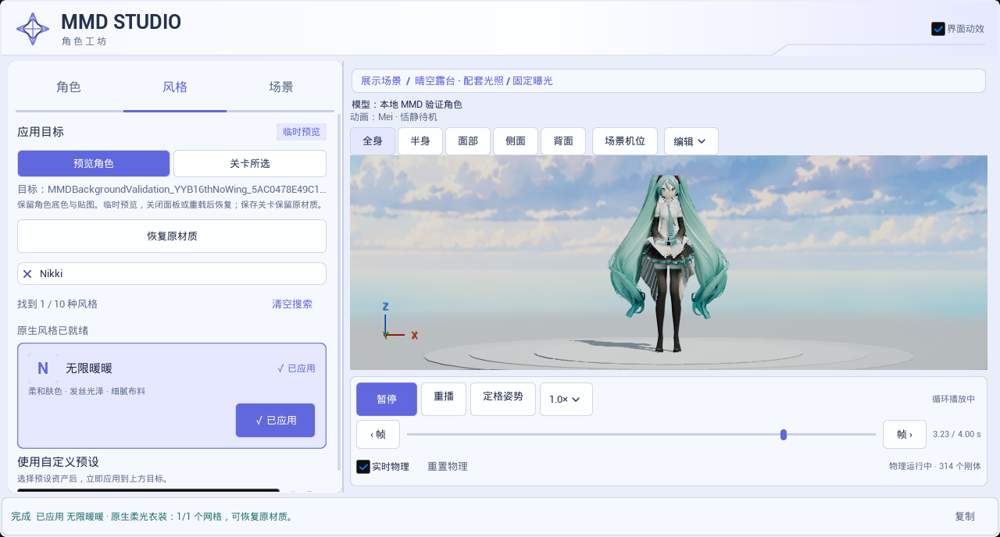

# 2026-10-25 面板交互与动效实拍

本页保留 run8 的历史交互证据。画面中的云空默认场景随后被用户否决；当前默认已恢复纯白影棚，新预设与后续验证见[影棚集合](../2026-10-25-studio-collection/README.md)。这里的原始测试结果与捕获文件未重写。

捕获日期：2026-10-25，约 14:23–14:24，Asia/Singapore。来源为 UE 5.8.3／CL58210709、D3D12 SM6 的实际 Slate 自动化窗口，原始记录位于工程 `Saved/UIExperience/2026-10-25/run8/`。这批证据替换本轮早先的 run2／run4 归档，默认场景已改为晴空露台，按钮文字遮挡已修复。

[查看实际界面动效片段](ui-experience.mp4)

片段展示角色／风格／场景切页、指示条过渡、搜索过滤及状态反馈，角色与物理预览继续运行。画面由自动化驱动交互并逐帧调用 Slate 截图接口采集；并非手动桌面操作录像。源画面 1280×688，共 90 帧，首末帧间隔 4.363257 秒。视频按 [capture_times.csv](capture_times.csv) 相邻时间戳写入变帧率时长；最后一帧沿用末次观测间隔停留 0.048777 秒，并重复一帧结束该停留，总长 4.412035 秒、91 个编码帧。没有按固定 30 fps 加速或补帧，不能据此推断编辑器／GPU 帧率。

编码后逐帧比对前 90 帧时间戳，最大偏差 0；完整解码通过。已目检代表截图与解码片段帧，文字可读。面板预览沿用项目 SMAA；后台电影单独启用的 TAA 不影响面板设置。文件时间、SHA-256、测试来源与视频参数见 [validation_sources.json](validation_sources.json)。

## 实际测试结果

源报告为 `Saved/UIExperience/2026-10-25/run8/report/index.json`。六项均为 Success，0 Error，合计 357 条 Warning。

| 测试 | 结果 | Warning | Error |
|---|---|---:|---:|
| `Ue5MMDTools.UI.DisplayScenes` | 通过 | 97 | 0 |
| `Ue5MMDTools.UI.Experience` | 通过 | 29 | 0 |
| `Ue5MMDTools.UI.FrameStepping` | 通过 | 0 | 0 |
| `Ue5MMDTools.UI.MotionPreview` | 通过 | 161 | 0 |
| `Ue5MMDTools.UI.PresetWorkflow` | 通过 | 70 | 0 |
| `Ue5MMDTools.UI.PreviewFraming` | 通过 | 0 | 0 |

Warning 包括 IK 调试、VMD 数据模型、灯光覆盖日志，以及测试角色的编辑器选中操作因 Actor flags 无效被拒绝的提示；未将它们记为零警告。此批检查覆盖对应交互断言和本机角色，未证明所有模型、Cook／Shipping、其他宿主或 GPU 性能通过。

run4 的 9 项 `DisplayScenes` 失败属于历史结果：当时在控件尚未挂入窗口、缓存属性未更新时读取 `IsEnabled`。修正测试取值时机后，run8 已实际重跑六项测试，以上为新报告结果，未修改原始 run4 报告。

第一轮几何展示布局被用户否决后，已重做为云空、宽阶与低矮布景。当前归档是重做后的实际实现，不表示用户已认可其审美效果。旧布局面板仅保留在 `Saved/UIExperience/2026-10-25/run4/rejected-display-panels/`；新场景与后台电影见[展示场景实拍](../2026-10-25-display-scenes/README.md)。

本地测试角色为 YYB Hatsune Miku 16th NoWing，署名 SANMUYYB／霁行Ralker／Delta幻黑；待机来自 MMDAgent Mei，动作来源及 CC BY 3.0 署名见[预设动作说明](../../../Resources/PreviewMotions/README.md)。画面用于非商业工具演示；此目录不含角色、贴图、VMD 或音频源文件。
