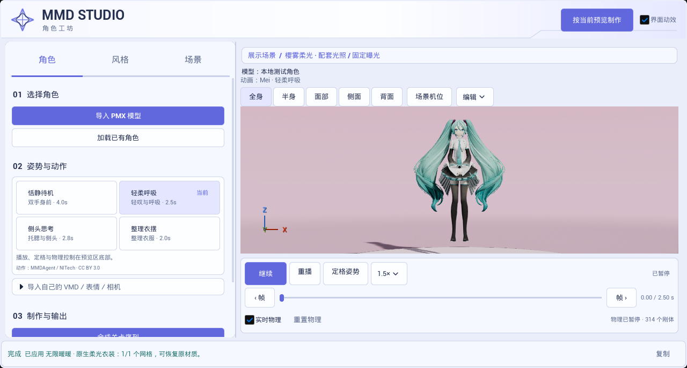

# 2026-11-04 按当前预览制作

捕获与归档均为 2026-11-04（Asia/Singapore）。截图来自 UE 5.8.3／CL58210709、D3D12 SM6 下的 `Ue5MMDTools.UI.PreviewMovie` 离屏测试。截图时预览暂停在第 0 秒，选用了轻柔呼吸、无限暖暖、樱雾柔光、全身透视机位与 1.5 倍速。

原图位于 `Saved/UIExperience/2026-11-04-preview-movie/preview_movie_cta.png`，归档文件与原图 SHA-256 一致。

同一轮通过实际 Slate 点击启动后台制作。FFprobe 核对成片为 2136×720、30 fps、50 帧 H.264。测试报告位于 `Saved/PreviewProduction/2026-11-04/preview-e2e/report/index.json`。

测试角色为 YYB Hatsune Miku 16th NoWing，署名 SANMUYYB／霁行Ralker／Delta幻黑。轻柔呼吸来自 MMDAgent Mei 配布 VMD，按 CC BY 3.0 署名。[预设动作来源](../../../Resources/PreviewMotions/README.md)
