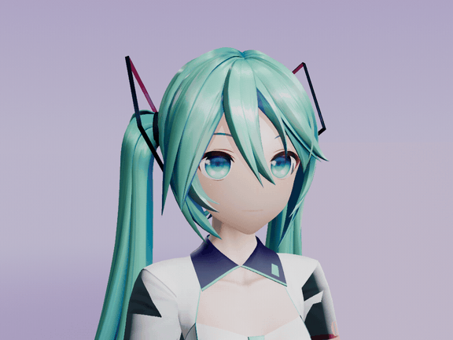

# 10 周年初音侧脸待机

2026-11-05（Asia/Singapore）使用 UE 5.8.3／CL58210709、D3D12 SM6 和原生 Mode 2 离屏捕获并归档。

动图取自最终成片，576×432、15 fps、48 帧，循环播放。[脸部补光实拍对照](comparison.png)为两次渲染的第 14 帧（从 0 开始），使用相同裁切与缩放。

两版沿用同一薰紫摄影棚、固定曝光、侧脸机位与眨眼。保持原试拍的投影关闭设置。两个成片均为 1024×768、30 fps、96 帧，匹配 3 条表情轨道，记录 250 次 Bullet 步进（含预热）。

在第 0、14、28、44、64、95 帧抽样，最终版的下颊与下巴样区平均亮度分别约增加 10–11 和 11–13 个 8 位码值。头发、衣服、背景样区像素一致。这次实拍覆盖上述模型、预设和离屏配置，启用投影时的画面及 Cook、Shipping、性能仍待单独验证。

## 借物表

- **角色**　初音未来，Crypton Future Media, INC. [Piapro 角色许可](https://piapro.jp/license/pcl)
- **模型**　三目YYB（SANMUYYB），YYB 初音ミク 10th v1.02，用于非商业演示。[作者配布](https://bowlroll.net/file/146083)
- **动作**　Wait of Mei，名古屋工业大学计算机科学系 MMDAgent Project Team，CC BY 3.0。取身体动作前 3.2 秒，另配眨眼和轻微嘴角变化。[动作来源与许可](../../../Resources/PreviewMotions/README.md)
- **布景**　Ue5MMDTools 薰紫摄影棚。
