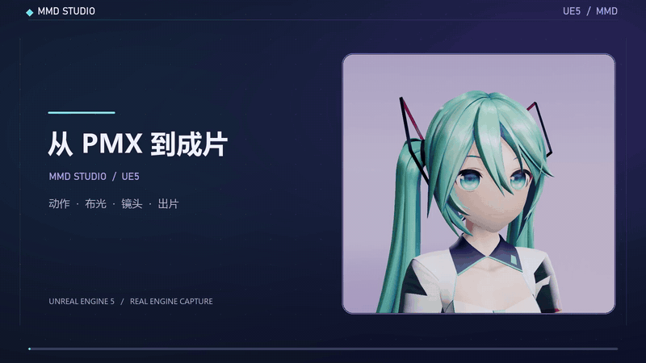

# MMD STUDIO 操作演示

[下载完整操作视频（MP4）](mmd_studio_workflow.mp4?raw=true)

2026-11-05（Asia/Singapore）使用 UE 5.8.3／CL58210709、D3D12 SM6 离屏录制。角色在开录前载入。自动化向实际 Slate 控件送入五次鼠标点击，依次选择轻柔呼吸、打开场景页、换薰紫摄影棚、切到面部机位并提交后台制作。

界面素材来自 157 帧实际采集画面。片头和片尾的侧脸素材取自[同日待机实拍](../2026-11-05-nikki-face-fill/README.md)。剪辑按点击坐标加指针、高亮和字幕，配原创合成音轨，缩短了后台等待。视频末段的制作结果来自本次点击实际输出的 2.5 秒 MP4，2136×720、30 fps、75 帧，Bullet 推进 208 步（含预热）。

完整版为 1600×900、30 fps、18.63 秒，H.264 视频和 AAC 双声道音频。动图为 800×450、6.78 秒的节选。自动化测试通过，0 个错误，成片通过完整解码。测试报告、原始面板帧和点击时间戳留在本地 `Saved/UIWorkflowVideo/2026-11-05/`。

## 借物表

- **角色**　初音未来，Crypton Future Media, INC.。[角色许可](https://piapro.jp/license/pcl)
- **模型**　三目YYB（SANMUYYB）的初音未来 10 周年版 v1.02，用于非商业演示。[作者配布](https://bowlroll.net/file/146083)
- **动作**　Wait of Mei、Breath of Mei，名古屋工业大学计算机科学系 MMDAgent Project Team。片头、片尾所用的 Wait of Mei 近景另配眨眼和轻微嘴角变化。[动作来源与 CC BY 3.0 许可](../../../Resources/PreviewMotions/README.md)
- **布景、界面和配乐**　Ue5MMDTools 展示场景与角色工坊，演示配乐为本片合成。
