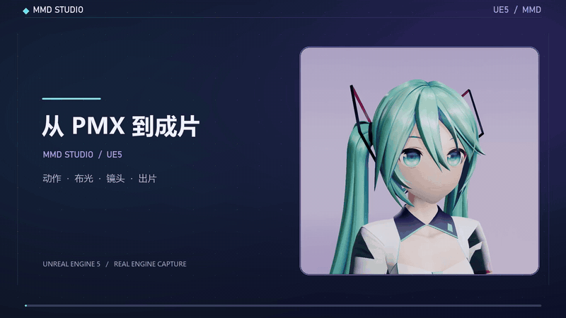

# Ue5MMDTools

**Import MMD characters into Unreal Engine 5 and turn PMX + VMD data into a finished short video.**

Ue5MMDTools imports PMX models and VMD animation, previews MMD physics, toon lighting, camera and stage presets, then renders the current preview to MP4. Imported animation, morph curves and cameras can also continue into Sequencer.

[Download Win64 plugin](https://github.com/treasureGrove/MMDUETools/releases/latest) · [Get a demo model](MODEL_SOURCES.md) · [中文首页](README.md) · [Chinese guide](github.md) · [Watch the demo](https://www.bilibili.com/video/BV1M2RXBPExk/)

<p align="center">
  <a href="https://github.com/treasureGrove/MMDUETools/raw/main/docs/Screenshots/2026-11-05-workflow-video/mmd_studio_workflow.mp4"></a>
</p>

**19 seconds from loaded character to finished MP4:** choose a motion, switch the studio, frame the camera, and start background production.

## What it does

- Import PMX geometry, materials, skeletons, morph targets and MMD physics data.
- Import VMD bone animation, morph curves and camera animation.
- Preview characters in MMD Studio with Bullet hair and cloth physics.
- Switch toon styles, lighting stages and camera presets.
- Continue editing animation and cameras in Sequencer.
- Render the current preview to a 30 fps MP4 with FFmpeg and FFprobe.
- Expose editor and commandlet workflows that can be automated from scripts.

## Install in five minutes

1. Download the **Win64 plugin** from the latest release and extract `Ue5MMDTools/` into your project's `Plugins/` folder.
2. Use a PMX model you are allowed to use. To reproduce the images on this page, open [MODEL_SOURCES.md](MODEL_SOURCES.md) and download the model from its original author page.
3. Keep the PMX file and its textures in their original relative layout.
4. Enable the plugin, restart Unreal Editor, then open **Window → Ue5MMDTools**.
5. Click **Import PMX Model**. After the first import, use **Load Existing Character** for later sessions.

The prebuilt package targets **UE 5.8.3 / Win64**. Native toon profiles require D3D12 SM6 and the matching documented project configuration. MP4 production requires `ffmpeg` and `ffprobe` available on Windows PATH.

## Build from source

The complete Unreal host project is on the [`dev` branch](https://github.com/treasureGrove/MMDUETools/tree/dev). The `main` branch is the lightweight plugin distribution tree. The development host uses UE 5.8.3 and the Win64 C++ toolchain.

```text
YourProject/
  Plugins/
    Ue5MMDTools/
      Ue5MMDTools.uplugin
```

## Current support matrix

| Capability | Status |
| --- | --- |
| PMX model import | Available |
| VMD bone animation | Available |
| VMD morph curves | Available |
| Bullet physics preview | Available |
| Sequencer camera and animation workflow | Available |
| MP4 production | Available |
| UE 5.8.3 Win64 | Verified target |
| UE 5.6 / 5.7 | Not verified |

## Contributing and support

Bug reports and feature requests are welcome. Please include your UE version, plugin version, GPU, model type, a short reproduction, and any relevant log or screenshot. See [CONTRIBUTING.md](CONTRIBUTING.md) before opening a pull request.

- [Report a bug](https://github.com/treasureGrove/MMDUETools/issues/new?template=bug_report.yml)
- [Request a feature](https://github.com/treasureGrove/MMDUETools/issues/new?template=feature_request.yml)
- [Start a discussion](https://github.com/treasureGrove/MMDUETools/discussions)

## License and third-party assets

The plugin code is MIT licensed. Third-party models, textures, motions and audio keep their original licenses and are not relicensed by this project. See [MODEL_SOURCES.md](MODEL_SOURCES.md) and the included source notices before using any asset.
