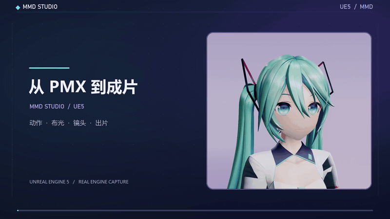

# Ue5MMDTools

[](https://github.com/treasureGrove/MMDUETools/releases/latest)
[](docs/BUILD_ENVIRONMENT.md)
[](LICENSE)
[](https://github.com/treasureGrove/MMDUETools/stargazers)

[简体中文](README.md) · **English** · [日本語](README.ja.md)

**Import MMD characters into Unreal Engine 5 and turn PMX + VMD data into a finished short video.**

Ue5MMDTools imports PMX models and VMD animation, previews MMD physics, toon lighting, camera and stage presets, then renders the current preview to MP4. Imported animation, morph curves and cameras can also continue into Sequencer.

> **It removes the middle of the pipeline.** Physics, lighting, framing and encoding happen inside the plugin: MMD data goes in, a finished frame goes out, and you only drop into Sequencer when you want to refine. No round trips through Blender, MMD and UE for a single shot.

[Download Win64 plugin](https://github.com/treasureGrove/MMDUETools/releases/latest) · [Project site](https://treasuregrove.github.io/MMDUETools/en/) · [中文首页](README.md) · [Illustrated guide](github.en.md) · [Get a demo model](MODEL_SOURCES.md) · [Watch the demo](https://www.bilibili.com/video/BV1M2RXBPExk/)

<p align="center">
  <a href="https://github.com/treasureGrove/MMDUETools/raw/main/docs/Screenshots/2026-11-05-workflow-video/mmd_studio_workflow.mp4"></a>
</p>

**19 seconds from loaded character to finished MP4:** choose a motion, switch the studio, frame the camera, and start background production.

## What it does

- Import PMX geometry, materials, skeletons, morph targets and MMD physics data.
- Import VMD bone animation, morph curves and camera animation.
- Preview characters in MMD Studio with Bullet hair and cloth physics.
- Switch toon styles, lighting stages and camera presets.
- Continue editing animation and cameras in Sequencer.
- Render the current preview to a 30 fps MP4 with FFmpeg and FFprobe.
- Expose editor and commandlet workflows that can be automated from scripts.

## Install in five minutes

1. Download the **Win64 plugin** from the latest release and extract `Ue5MMDTools/` into your project's `Plugins/` folder.
2. Use a PMX model you are allowed to use. To reproduce the images on this page, open [MODEL_SOURCES.md](MODEL_SOURCES.md) and download the model from its original author page.
3. Keep the PMX file and its textures in their original relative layout.
4. Enable the plugin, restart Unreal Editor, then open **Window → Ue5MMDTools**.
5. Click **Import PMX Model**. After the first import, use **Load Existing Character** for later sessions.

The panel defaults to Chinese. English panel text ships with the plugin under `Content/Localization/` and is used when the editor language is English; a visual pass is still in progress, and the Japanese translation is planned.

The prebuilt package targets **UE 5.8.3 / Win64**. Native toon profiles require D3D12 SM6 and the matching documented project configuration. MP4 production requires `ffmpeg` and `ffprobe` available on Windows PATH.

## Build from source

The complete Unreal host project is on the [`dev` branch](https://github.com/treasureGrove/MMDUETools/tree/dev). The `main` branch is the lightweight plugin distribution tree. The development host uses UE 5.8.3 and the Win64 C++ toolchain.

```text
YourProject/
  Plugins/
    Ue5MMDTools/
      Ue5MMDTools.uplugin
```

## Who this is for

- **MMD creators** who want UE-quality lighting on an existing PMX/VMD pipeline and a finished MP4, not another importer to babysit.
- **Technical artists** who need hair and cloth physics, stage presets and camera blocking inside the engine, without rebuilding a lighting rig per shot.
- **Pipeline engineers** who want the same thing from a script: `import-pmx`, `import-vmd`, `render`, each returning JSON.

If what you actually need is maximum import fidelity (SDEF, live IK evaluation, VMD write-back), [MMD2Unreal](https://github.com/JDui/MMD2Unreal) and [IM4U](https://github.com/tekifuta/IM4U) go deeper on that. They solve "does the character look right in UE"; this project solves "can I ship this short today". They can be installed side by side.

## Current support matrix

| Capability | Status |
| --- | --- |
| PMX model import | Available |
| VMD bone animation | Available |
| VMD morph curves | Available |
| Bullet physics preview | Available |
| Studio, lighting and style presets | Available |
| Sequencer camera and animation workflow | Available |
| MP4 production | Available |
| Command-line import and render | Available |
| UE 5.8.3 Win64 | Verified target |
| UE 5.6 / 5.7 | Not verified |

## How it compares

| | Ue5MMDTools | Blender MMD Tools → FBX → UE | MMD2Unreal / IM4U |
| --- | --- | --- | --- |
| PMX / VMD into UE | Directly in the plugin | Round trip, materials and morphs often rebuilt | Directly in the plugin |
| Hair and cloth physics | Built-in Bullet, freezes to keep simulating | Pre-baked in Blender | KawaiiPhysics / custom solver |
| Lighting and stage | Eight studios and style presets, one click | Build it yourself | No built-in stage |
| Delivery | Preview is the shot, background MP4 and frames | Configure Movie Render Queue | Configure it yourself |
| Batch work | CLI with JSON reports | None | None |
| License | MIT, commercial use allowed | Per project | Check each repository |

## If it saved you time

Building a stage, lighting it, getting physics to behave and encoding the MP4 by hand is half a day to two days of work. This plugin collapses that into one button. If it saved you that time, a star helps other MMD creators find it — that is the single most useful thing you can do for the project right now.

## Contributing and support

Bug reports and feature requests are welcome. Please include your UE version, plugin version, GPU, model type, a short reproduction, and any relevant log or screenshot. See [CONTRIBUTING.md](CONTRIBUTING.md) before opening a pull request.

- [Report a bug](https://github.com/treasureGrove/MMDUETools/issues/new?template=bug_report.yml)
- [Request a feature](https://github.com/treasureGrove/MMDUETools/issues/new?template=feature_request.yml)
- [Start a discussion](https://github.com/treasureGrove/MMDUETools/discussions)

## License and third-party assets

The plugin code is MIT licensed. Third-party models, textures, motions and audio keep their original licenses and are not relicensed by this project. See [MODEL_SOURCES.md](MODEL_SOURCES.md) and the included source notices before using any asset.
